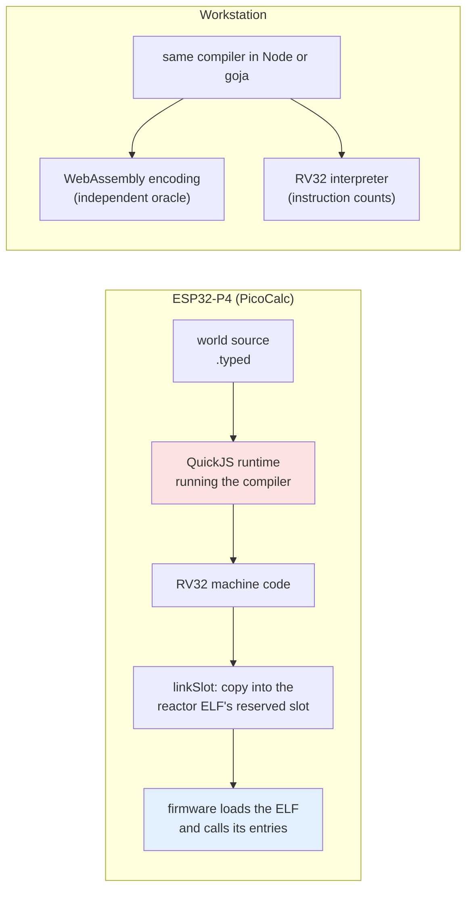
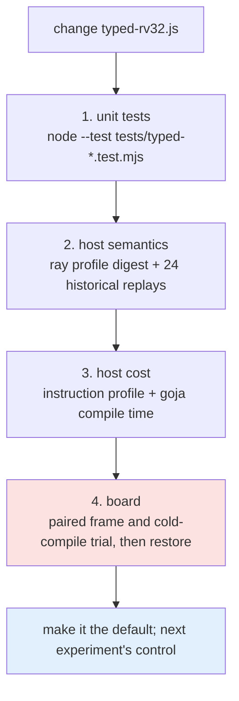

# How the Typed compiler reaches C on the ray tracer

> This guide was written in PICOCALC-RAY-PARITY and is kept current here; the ticket copy (`ttmp/2026/11/21/PICOCALC-RAY-PARITY--make-typed-compiler-optimizations-cumulative-and-close-the-ray-tracer-s-gap-to-c/design-doc/01-how-the-typed-compiler-reaches-c-on-the-ray-tracer-an-intern-guide.md`) is the historical record. Paths are those of the repository today; measurements, commits and ticket script names are as recorded when it was written. The ticket scripts it names have promoted, parameterized versions in `bench/` (see `docs/measuring.md`).


This guide is for an engineer joining the work of making Typed programs on the PicoCalc run as fast as C. By the end you should be able to explain how a Typed function becomes RISC-V machine code on the handheld, read the code generator in `compiler/typed/typed-rv32.js`, measure a change on the host and on the board, and pick up the next phase of the plan. The guide assumes you know a compiled language and can read a RISC-V instruction listing. It explains everything specific to this project when it first matters.

## 1. What the system is

The PicoCalc is a handheld computer built around an Espressif ESP32-P4, a dual-core 32-bit RISC-V processor running at 360 MHz. The firmware is a small operating system written in C. It hosts applications called **worlds**, for example Files, Agenda, Editor, Chess and the Ray Tracer. A world can be written in JavaScript, which the firmware runs in QuickJS, or in **Typed**, a statically typed JavaScript subset that this project defines.

A Typed world is compiled **on the device**. The compiler is itself JavaScript. When the user opens a Typed world, the firmware starts a fresh QuickJS runtime, loads the compiler, compiles the world's source to RISC-V machine code, links that code into a prebuilt executable, and calls it. Two numbers therefore matter for every compiler change:

- **Cold compile time** is how long the user waits for the compiler. It runs inside QuickJS, a bytecode interpreter, on the P4.
- **Execution time** is how fast the generated code runs, for example one ray-traced frame.

An optimization that saves 2 ms per frame and costs 100 ms of compile time pays for itself only after 50 frames. Each step of this project reports both numbers.



The same compiler files run on a workstation under Node or under goja, the JavaScript engine inside the trace REPL. On the host the compiler can also emit WebAssembly. Running the WebAssembly in V8 gives an execution of the same source that does not depend on the RISC-V backend. Tests compare the two.

There is no production compiler in the commercial sense. Everything here is experimental. What matters is which compile path is the **default**, meaning what `typedRv32.compile(source, imports, maxLength)` does when given no options. Every world on the device uses the default, and every experiment's control arm measures it. Section 6 explains how the default was made cumulative in this ticket.

## 2. Typed, as the code generator sees it

Typed looks like JavaScript with type annotations. The parts that matter for code generation are small:

- `i32` is a 32-bit signed integer with wrapping arithmetic. `bool` is stored as 0 or 1. Division and remainder trap on a zero divisor and on `-2147483648 / -1`.
- `buffer` is a reference to a block of unsigned 16-bit **cells** preceded by a 4-byte header holding the capacity in cells. `b.length` reads the header. `b.charCodeAt(i)` reads cell `i`. `b.setCharCodeAt(i, v)` writes it. Both check `0 <= i < capacity` and **trap** otherwise. Writes performed before a trap stay visible. A compiler may therefore never move a check above a store that the source executes first.
- Functions take at most eight parameters, which arrive in registers `a0`–`a7`. There are no closures in the native target and no garbage collector.
- Records, enums, imports of firmware services (`typedSdk*`) and `async` functions exist, but the ray tracer uses none of them.

Here is a small checked loop that this guide follows through the compiler:

```js
function sumCells(work: buffer, n: i32): i32 {
    let total = 0;
    for (let i = 0; i < n; i = i + 1) {
        total = total + work.charCodeAt(16 + i);
    }
    return total;
}
```

## 3. From source to a numeric operation tape

The frontend lives in `compiler/typed/typed-wasm.js`. Its entry `typedWasm.compileFunctions(source, functionBase, imports, maxLength, numericOperands, onFunction, onSignatures, options)` parses and type-checks the source. For each function it emits a **tape**: an array of integer cells encoding WebAssembly-like stack operations. With `numericOperands = true`, every operand occupies exactly one cell. The RV32 backend consumes this form.

The tape for `sumCells` has 52 cells and 29 operations. `typedWasm.decodeNumericOperations(fn.code)` prints it as follows. The offset is the cell index.

```text
  0 i32.const              0          8 block 64              29 text.checked_address 0 4
  2 local.set              2         10 loop 64               32 i32.load16_u 1 4
  4 i32.const              0         12 local.get 3           35 i32.add
  6 local.set              3         14 local.get 1           36 local.set 2
                                     16 i32.lt_s              38 local.get 3   (i = i + 1 …)
                                     17 i32.eqz               45 br 0
                                     18 br_if 1               47 end
                                     20 local.get 2           48 end
                                     22 i32.const 16          49 local.get 2
                                     24 local.get 3           51 end
                                     26 i32.add
                                     27 local.set 4
```

Three details matter later:

- Locals are numbered. Parameters come first: `work` is 0 and `n` is 1. Then come declared locals, `total` = 2 and `i` = 3, then frontend temporaries. Local 4 holds the computed index `16 + i`.
- A buffer read is `text.checked_address receiver index` (opcode `0xf1`) followed immediately by `i32.load16_u` with offset 4. The check and the address computation are one operation, and the load skips the 4-byte header. A write is `0xf1`, then the value expression, then `i32.store16` (`0x3b`).
- The frontend streams by default. It hands each finished function to the backend through `onFunction` and then drops its tape, so peak memory stays bounded on the P4. `streamFunctions: false` buffers all functions first. Both modes must produce identical images, and tests check this.

The full opcode table is `inspectOperations` in `typed-wasm.js`. The backend's operand-count table `OPERAND_CELLS` in `typed-rv32.js` must agree with it.

## 4. The RV32 backend

`compiler/typed/typed-rv32.js` is about 700 lines. `typedRv32.compile(source, imports, maxSourceLength, options)` drives the frontend, lowers each function to 32-bit RISC-V words, resolves calls and returns `{image, entries, relocations, signatures, ...}`. Here `image` is a `Uint8Array` of machine code and `entries` maps each function name to its byte offset. `typedRv32.linkSlot(program, reactor, entryNames)` copies the image into a reserved region of a prebuilt reactor ELF and patches its entry stubs.

### 4.1 Where values live

The class `FunctionCode` walks the tape once and emits instructions as it goes. It never builds an intermediate representation. Its decisions about value locations are fixed:

| Value | Default location | Code |
|---|---|---|
| Operand-stack depth 0–4 | `t0, t1, t2, t3, t4` | `STACK_REGISTERS`, `push`, `pop` |
| Deeper operands | frame slot after the locals | `spill`, `slot(depth)` |
| Every parameter and local | a 4-byte frame slot at `4*local(sp)` | `readLocal`, `writeLocal` |
| Scratch | `t5`, `t6`; `a0` for capacity, division checks and results | `checkedAddress`, `binary` |
| Return address | the frame's top slot | `lower()` |

Operand registers keep expression temporaries out of memory. Every **named** value, however, lives in memory: each `local.get` is a load from `sp` and each `local.set` a store. `lower()` emits the prologue (`addi sp,sp,-frame; sw ra,frame-4(sp)`), stores each incoming argument register into its local's slot, walks the tape, and emits one epilogue that every `return` jumps to.

A checked read is lowered by `checkedAddress(receiver, index)`:

```text
readLocal(t6, receiver)        lw   t6, 4*receiver(sp)    # buffer pointer
load capacity                  lw   a0, 0(t6)
bounds test                    bltu index, a0, +8
                               ebreak                     # the trap
address                        slli out, index, 1 ; add out, t6, out
then i32.load16_u              lhu  out, 4(out)
```

The default backend, with the stock policy, compiles the loop body of `sumCells` to this:

```asm
38: lw    t0,8(sp)        # total
3c: addi  t1,zero,16
40: lw    t2,12(sp)       # i
44: add   t1,t1,t2
48: sw    t1,16(sp)       # index temporary, local 4
4c: lw    t5,16(sp)       # …read straight back
50: lw    t6,0(sp)        # work
54: lw    a0,0(t6)        # capacity, again
58: bltu  t5,a0,0x60
5c: ebreak
60: slli  t1,t5,0x1
64: add   t1,t6,t1
68: lhu   t1,4(t1)
6c: add   t0,t0,t1
70: sw    t0,8(sp)        # total
74: lw    t0,12(sp)       # i
   … i = i + 1, stored to 12(sp), then jump back to the test that reloads i and n
```

Each iteration touches the stack ten times: eight times in the body shown, and twice more in the loop test, which reloads `i` and `n`. GCC and LLVM compile the equivalent checked C with no stack access in the loop at all (Section 7).

### 4.2 Three optional lowerings that are now default

Three mechanisms were added by earlier labs as opt-in options. Since this ticket they are the default, and Phase 1 (Section 9) extended the third one with callee-saved homes and direct reads.

**Guarded-return inlining** (`inlineGuardedReturns`, class `GuardedReturnCode`). `guardedReturnSummary` recognizes a one-argument helper of the exact form `if (x <rel> K) return -x or C; return x;`, for example `typedRayAbs`. Its call sites are replaced by a compare and a branch. The ray tracer's shadow test calls `typedRayAbs` 74,226 times per frame. After inlining, the shadow function makes no calls, which also makes it a **leaf** for the next mechanism.

**Operand locations** (`operandLocations: {forward, capacity, homes}`, function `planLocations`). This is a pre-pass over a function's tape that produces a plan the emitter consults. It has three policies:

- *forward*: when a `local.set` of a temporary is immediately consumed by a checked address and the temporary is read nowhere else, the index stays in a register. In `sumCells` this removes the `sw t1,16(sp)` / `lw t5,16(sp)` pair.
- *capacity*: in a **pure leaf**, a function with no stores and no real calls, the capacity of the first buffer read on the straight-line entry path is loaded once into `a7` and reused by later checks.
- *homes*: in a leaf, the highest-scoring locals get fixed registers from the spare argument registers. Score is one per read, or four inside a loop. The register is the local's location for the whole function, so branch joins need no reconciliation.
- *select* (Phase 1b, default since Step 6) is a separate option group for instruction selection: literal right operands use I-type instructions and a literal 0 is read from `x0` (`immediates`); division by a positive constant uses shifts or `mulh` with a magic number (`divisions`); a comparison that feeds `if` or `br_if` becomes one conditional branch, and an in-range backward branch is emitted directly (`branches`); a result stored at once into a homed local is computed in the home (`results`); frameless leaves read parameters in place (`leafParams`).
- *saved* and *direct* (Phase 1, default since this ticket's Step 5): every framed function may also home locals in `s1`–`s11`, and a read of a homed local is consumed straight from its home instead of being copied to an operand register. Section 9 describes both.

With these policies the same loop body becomes the following. `work` is in `a5`, `n` in `a4`, `total` in `a3` and `i` in `a2`:

```asm
38: addi  t0,a3,0         # total
3c: addi  t1,zero,16
40: addi  t2,a2,0         # i
44: add   t1,t1,t2        # index stays in t1 (forwarded)
48: lw    a0,0(a5)        # capacity
4c: bltu  t1,a0,0x54
50: ebreak
54: slli  t1,t1,0x1
58: add   t1,a5,t1
5c: lhu   t1,4(t1)
60: add   t0,t0,t1
64: addi  a3,t0,0         # total
```

No stack accesses remain in the loop. The register moves (`addi t0,a3,0`) remain, because operands still pass through the fixed operand registers. The capacity is still loaded every iteration, because the first read of `work` lies inside the loop rather than on the straight-line entry path.

**Frameless leaves** (`LeafCode`) were already default. A function with no locals, at most 128 tape cells and only allowlisted operations runs without a stack frame.

**PIE loops** (`pieLoops`, in `typed-pie-loops.js`) stay opt-in. The P4's PIE extension has 128-bit registers holding eight 16-bit lanes. The recognizer finds one loop shape, a subtraction from a loop invariant guarding a scalar continuation, and packs eight subtractions. It saved under 1% of a ray frame and cost about 70 ms of cold compile. Section 8 explains why.

### 4.3 The compile API

```js
typedRv32.compile(source, imports = [], maxSourceLength, options)
// options (all optional):
//   policy: "default" | "stock"        code-generation policy (Section 6); default "default"
//   inlineGuardedReturns: true | false | (callerName) => bool
//   operandLocations: {forward?, capacity?, homes?} | false
//   pieLoops: "scalar" | "pie" | "pie-empty" | (facts) => {plan}   (needs typed-pie-loops.js)
//   streamFunctions: true (default) | false
//   inspect: {function?, emit(event)}  observe emitted ranges and decisions
typedRv32.policies                    // {default, stock}, frozen
typedRv32.linkSlot(program, reactorBytes, entryNames)
```

Explicit fields override the policy. `{operandLocations: false}` turns that mechanism off. An explicit `undefined` leaves the policy's value in place.

## 5. The benchmark: one ray-traced frame

`apps/typed/raytrace/raytrace.typed` renders a 160 × 160 image of three spheres over a checkered floor, with shadows and diffuse lighting, into RGB565 cells. The camera is orthographic, so every primary ray is parallel to the depth axis. The C reference is `firmware/nucleus/raytrace_demo.c`. Both renderers produce identical pixels, depths and object identities for twelve tested poses.

The entry `typedRayFrame(pixels, work, sphereX, sphereY, lightX, lightY)` calls `typedRayPrepare`, which fills lookup tables in `work`. Then for each of the 160 rows it calls `typedRayComputeRow` (primary intersections) and `typedRayLitRow`. `typedRayLitRow` calls `typedRayPixel` for each pixel. `typedRayPixel` calls `typedRaySphereScale` for sphere pixels, or `typedRayInShadow` for floor pixels, and then `typedRayPack` for the RGB565 conversion.

`node bench/host/ray-profile.mjs` runs the opening frame in the host interpreter and attributes executed instructions to functions. These are the arms on the current source. "Leaf homes" is the default as of commit eaf0872; "current default" adds Phase 1's saved homes and direct reads.

| Function | Stock | Leaf homes | Leaf homes: stack ld+st | Current default | Current: stack ld+st | Calls made |
|---|---:|---:|---:|---:|---:|---:|
| `typedRayInShadow` | 5,528,397 | 4,232,582 | 626,243 | 3,787,258 | 459,059 | 0 (helper inlined) |
| `typedRayComputeRow` | 3,608,697 | 3,140,941 | 354,598 | 2,539,646 | 38,175 | 0 |
| `typedRayPack` | 1,740,800 | 1,740,800 | 460,800 | 1,561,600 | 204,800 | 0 |
| `typedRayPixel` | 1,564,356 | 1,564,356 | 413,496 | 1,564,356 | 413,496 | 51,200 |
| `typedRayLitRow` | 1,539,680 | 1,386,080 | 539,360 | 1,029,280 | 79,520 | 25,600 |
| `typedRaySphereScale` | 810,424 | 608,365 | 138,323 | 583,873 | 138,323 | 0 |
| **Frame** | **15,532,634** | **12,717,463** | **2,535,422** | **11,098,863** | **1,333,516** | 77,131 |

Before Phase 1 the table showed three register-allocation problems:

- `typedRayPack` was unchanged by the earlier default. It makes no checked access, so `planLocations` returned no plan at all, and its seven named values all lived on the stack.
- `typedRayPixel` and `typedRayLitRow` make calls. Leaf homes apply only to leaves, because the argument registers are overwritten by a call.
- `typedRayInShadow` is a leaf with homes, but it has 3 parameters and 15 locals and only four spare argument registers.

Phase 1 (Section 9) addressed them together. What remains: `typedRayPixel` claims no `s` register because its per-call estimate is below the save/restore margin, and it is called 25,600 times. `typedRayInShadow` and `typedRayPack` still execute about 0.66 M stack accesses between them. The profiler does not yet separate prologue/epilogue saves from body accesses; adding that split is the first step of the next register-allocation change.

The interpreter's counts are guest instructions, not cycles. A load, a branch and a divide each count as one. Physical time comes from the board (Section 6.5).

## 6. Measuring and validating a change

A compiler change in this project must pass four gates in this order. The first three run on the workstation in minutes. The fourth needs the board.



### 6.1 Unit tests

`make -C picocalc-os test-apps` runs the app logic tests and the compiler tests: `tests/typed-rv32.test.mjs`, `typed-pie-loops.test.mjs`, `typed-inspect.test.mjs` and `typed-wasm-inspect.test.mjs`. Three tests pin exact image digests that were timed on the P4. `9a4a2356…` is `pie-empty` over the stock policy (PICOCALC-SIMD-LAB). `2e33bb64…` is `pie-empty` over forward, capacity and leaf homes (PICOCALC-OPERAND-HOMES, 46.05 ms per frame). `3ea6af69…` is `pie-empty` over saved homes and direct reads without `select` (this ticket's Step 5, 42.56 ms). `6b854512…` is the current default without PIE (Step 6, 31.51 ms), pinned in `tests/typed-rv32.test.mjs`. When a change alters the default code generation on purpose, the default's digest changes. Record the new one only after it has been timed on the board.

### 6.2 The reference interpreter and the ray profile

`bench/host/rv32-interp.js` interprets exactly the RV32IM subset the backend emits. It is a classic script with no imports, so the same file runs in Node, in a trace-REPL session and in QuickJS. `typedRv32Interp.run(program, entry, args, memory, options)` returns the result, the step count and a `Uint32Array` of per-word execution counts. At every internal call it checks that `sp` is 16-byte aligned. At every return it checks that the return address matches the call and that `sp`, `gp`, `tp` and `s0`–`s11` are unchanged. A backend that keeps locals in callee-saved registers and forgets a restore fails here with `callee-saved x9 changed across a call`.

`bench/host/typed-ray-bench.js` sets up the opening frame's memory exactly as earlier profilers did. `typed-ray-profile.mjs` runs it and requires the SHA-256 of guest memory after the frame to equal `430f0d50…`, the digest every earlier lab recorded for the C-verified frame. A miscompilation that changes one pixel, depth, identity or padding byte fails this check.

```sh
cd picocalc-os
node tools/typed-ray-profile.mjs                       # stock and default
node tools/typed-ray-profile.mjs --options '{"operandLocations":{"homes":true}}' --json /tmp/p.json
```

### 6.3 The 24 historical replays

Files, Agenda and Editor have end-to-end host checks written by earlier labs. Each compiles a world, links it into a reactor built with the Espressif GCC, runs it in the CJI RISC-V emulator (`compiler/cji/build/rv32/rv32emu`) and compares screens and state with the WebAssembly build. `scripts/04-replays.sh` in this ticket runs all 24:

```sh
gcc=/home/manuel/.espressif/tools/riscv32-esp-elf/esp-14.2.0_20260121/riscv32-esp-elf/bin/riscv32-esp-elf-gcc
bash ttmp/2026/11/21/PICOCALC-RAY-PARITY--*/scripts/04-replays.sh "$gcc" "$PWD/cji/build/rv32/rv32emu"
```

The Editor replays had been failing since November 20 for a reason unrelated to the compiler. `sdk/typed/world.c` now encodes Chess PSIX frames, so the reactor needs `chess-psix.c` plus `__floatsidf`, `__divdi3` and `strcmp`, and the emulator's firmware modules provide none of them. The ticket's copy of the Editor replay links `chess-psix.c` and `scripts/04-libgcc-helpers.c`, whose integer-only implementations were checked against native results on 4,000,000 inputs. With that fix, all 24 replays pass.

### 6.4 The trace REPL as a compiler sandbox

The trace REPL (`cmd/trace-repl`) is a Go service that keeps JavaScript sessions alive between requests. Its query language answers questions about captured LLVM pass dumps. Its session VM can also hold the Typed compiler. `scripts/01-open-compiler-session.py PORT --baseline REV` loads the frontend, the async rewriter, the world linker and two backends into one session: the working tree's as `typedRv32` and the one at `REV` as `typedRv32Base`. It also loads every Typed source, including the assembled worlds. Two drivers use such a session:

- `02-planner-equivalence.py` compiles every input with both backends under seven option sets and compares the bytes. Use it for any change that should not alter output.
- `03-compile-cost.py` interleaves base and candidate compiles and reports medians.

goja, like QuickJS, is a bytecode interpreter. Allocation-heavy compiler code that V8 runs quickly shows up there as it does on the P4. The planner's original cost was found this way. The ticket's analysis document records the REPL's limits: 64 KiB per cell, a 15 s deadline, and no file loading.

### 6.5 The board

Physical trials use the procedure of the earlier labs. Build a diagnostic firmware that compiles each arm on the device and times the compiled entry in rotated, paired blocks. Check every output against its host fixture after timing. Then flash the playable firmware again. Leaving the playable build installed is a standing rule (`AGENTS.md`). The build and install recipe is `ttmp/2026/11/20/PICOCALC-TYPED-CHESS--…/reference/03-reproduce-chess.md`. The closest existing ray harness is PICOCALC-OPERAND-HOMES `scripts/01-board.py`, which timed five policies, the shadow predicate, complete frames and cold compiles in one image. Report paired medians: the median of the per-block percentage changes, not the ratio of two medians.

## 7. What C does that Typed does not yet do

The earlier labs compared the shadow predicate against GCC 14.2 and LLVM 18 on the same data layout, with the same checks, on the same P4. Listed in cycles per call, fastest first:

| Implementation | Cycles/call | What separates it from the row above |
|---|---:|---|
| Firmware C, native data layout | 73.76 | — |
| GCC, Typed's 16-bit cell layout, unchecked | 88.40 | data representation (+20%) |
| GCC, same layout, checked | 135.74 | bounds checks (+54%) |
| LLVM, same layout, checked | 144.31 | a different optimizing compiler |
| LLVM with its block-local register allocator | 276.70 | register allocation across blocks (+92%) |
| Typed default (this ticket) | 276.98 | — |
| Typed before operand locations | 382.25 | forwarding, capacity reuse, leaf homes |

The remaining factor of 3.75 to the C predicate splits into three parts:

```text
277 / 74  ≈  (277 / 136)  ×  (136 / 88)  ×  (88 / 74)
 3.75     ≈     2.04      ×     1.54     ×    1.20
            code generation   bounds checks  representation
```

The code-generation factor is mostly register allocation. LLVM's middle end turns every local into an SSA value (SROA and `PromoteMemToReg`). Its greedy allocator then keeps loop-carried values in registers across blocks and calls, saving callee-saved registers once per call. Its block-local allocator, which spills at block boundaries, needs 92% more cycles on the same IR, and Typed now sits at exactly that level. LLVM also removes redundant capacity loads with EarlyCSE: 12 sites become 1 in the read-only predicate. The checks factor is the cost of the bounds contract itself. C omits the checks. Typed must keep them, but it can test a whole region once and keep a checked fallback. The representation factor comes from Typed buffers having only 16-bit cells.

For the whole frame, Typed under the earlier default plus `pie-empty` took 46.05 ms against 7.72 ms for scalar C in the same firmware. After Phase 1 the default without PIE took 39.49 ms (5.11× C) and the shadow predicate 247 cycles (1.82× the checked C predicate's 136). After Phase 1b it took 31.51 ms (4.08× C) and 212.8 cycles (1.57×); after Phases 1c and 1d it took 22.43 ms (2.90× C) and 194.1 cycles (1.43×); after Phase 1e it took 20.20 ms (2.61× C) and 181.7 cycles (1.34×); with Phase 3's pointer homes it took 19.31 ms (2.50× C) and 171.9 cycles (1.27×); with versioned loops and split locals it takes 16.26 ms (2.11× C) and 161.4 cycles (1.19×). With division facts (the `kernel` policy) it takes 15.27 ms (1.97× C), with value sets, hoisting, fused conjunctions and loads into homes 11.43 ms (1.48× C), with induction variables 11.17 ms (1.44× C), and with reused argument registers 10.99 ms (1.42× C). The traced half of the frame now executes fewer instructions than GCC's (925,448 against 1,132,651); all of the remaining gap is in shading (2,337,939 against 1,317,388), and most of that is register pressure in `LitRow`. The C renderer visits all 160 pixels of every row for every sphere. A Typed source that computes exact sphere spans and traverses shadows row by row took 29.98 ms on the old compiler. "Competitive with C" therefore has two meanings, and both should be reported. One compares the same algorithm in both languages; that is the compiler benchmark. The other compares the best correct Typed program against the existing C renderer; that is the product benchmark.

## 8. Why vectorization is not the next step

PIE vectorization of the primary row saved 0.43% of a frame over an equally scheduled scalar row, and the best packet variant saved 0.90%. Only the subtraction `d = R - squares[x]` is packed. Every hit still goes through a scalar square-root lookup at a data-dependent address, a compare and conditional stores, which the ordinary backend emits with its stack-resident locals. Hand-written PIE in the C renderer saves only about 1.1 ms of a 7.9 ms frame. GCC's vectorizer declined the loop on cost, and LLVM's RV32 target left it scalar. Vectorization pays on this processor when the whole loop body stays in lanes. A planar particle update used 89% fewer cycles packed than scalar. Return to SIMD once scalar code is close to LLVM.

Phase 1 made the case stronger. With the new default, `pie-empty` is a net loss: 42.56 ms per frame against 39.49 ms without it. A PIE-lowered function is emitted by `typed-pie-loops.js`, which receives no operand-location plan, so `typedRayComputeRow` loses its register homes when it is packed. Any future SIMD lowering must start from the scalar backend's register plan, not from the stack-resident form.

## 9. The plan

Each phase changes the default only after passing the four gates in Section 6. Each phase's result becomes the next phase's control.

### Phase 0: make improvements cumulative (this ticket, done)

- `planLocations` walks raw tape cells instead of decoding the tape into objects. Its output is byte-identical on every compiling input (98 compiles across the ray tracer, four assembled worlds and the standalone sources, under seven option sets). Its overhead in goja fell from +34% to +5% of a ray compile.
- `compile` resolves a named **policy**. `default` enables guarded-return inlining and all three operand-location policies. `stock` reproduces the earlier default for control arms.
- The interpreter, the frame bench and the profiler live in `firmware/tools/`. The replays are repaired.

### Phase 1: register homes for every framed function

**Status: done, default since Step 5 of the diary.** The opening frame fell from 12,717,463 to 11,098,863 host instructions. On the P4 the frame without PIE fell from 45.14 to 39.49 ms (−12.5%), the shadow predicate from 277.5 to 247.2 cycles (−10.9%) and Chess evaluation by 11.1%, all with 6/6 block wins. Ray cold compile on the device rose from 307 to 332 ms (+8.2%), so the change pays for itself after five frames. What was built differs from the plan below in two ways, and both matter:

- Callee-saved homes alone made the frame **slower** (13,175,107 instructions). A homed read was still copied into an operand register, so a home only turned `lw` into `mv`. The *direct* option, which lets the consumer read the home register itself, is what made homes pay: alone it saved 0.76 M instructions, and together with saved homes 1.62 M.
- The cost model is stricter than `score > cost + 1`. A local's estimate halves under each enclosing `if`, a write counts half, and an `s` register needs a score above twice its save/restore cost (`SAVED_MARGIN = 2`, chosen by a sweep over 1–4 on the ray frame, with the Chess engine as holdout).

The original plan follows for reference.

This was the next compiler change, and it addresses the three rows of Section 5's table that are register-allocation problems. It has four parts.

1. **Plan every framed function.** Today `planLocations` returns `null` unless the tape contains a checked address (`0xf1`). Homes do not depend on buffers. Forwarding and capacity caching keep their own conditions.
2. **Keep parameters in their incoming registers in a leaf.** Today homes start at `a{max(1, params)}`, so a homed parameter is copied to another register. Parameter `i >= 1` can stay in `a_i`. `a0` cannot be a home, because the framed emitter uses it as scratch for capacity loads, division checks and return values.
3. **Use the callee-saved registers `s1`–`s11`** for leaves that run out of argument registers and for functions that make calls. A callee must preserve these registers across a call. Each one the function claims costs a save in the prologue and a restore in the epilogue, two instructions per invocation, plus a frame slot. A function that calls others can keep values in `s` registers across those calls, which argument registers cannot do.
4. **Charge the cost.** Assign an `s` register only to a local whose loop-weighted score exceeds the save/restore cost, with reads and writes both counted. A local read once outside any loop is better left in its slot.

Pseudocode for the planner part (a sketch; names follow the current code):

```js
function planHomes(fn, scores, {leaf, receiverCached}) {
    const homes = new Map();
    const free = [];
    if (leaf) {
        // incoming argument registers a1..a{params-1} stay homes for their parameters
        for (let p = 1; p < fn.params.length; p++) if (scores.get(p) >= 2) homes.set(p, A0 + p);
        for (let r = A0 + Math.max(1, fn.params.length); r < A0 + (receiverCached ? 7 : 8); r++) free.push({reg: r, cost: 0});
    }
    for (const s of [9, 18, 19, 20, 21, 22, 23, 24, 25, 26, 27]) free.push({reg: s, cost: 2});  // s1, s2..s11
    for (const [local, score] of [...scores].sort((x, y) => y[1] - x[1])) {
        if (homes.has(local)) continue;
        const next = free[0];
        if (!next || score <= next.cost + 1) break;
        homes.set(local, free.shift().reg);
    }
    return homes;   // the emitter saves/restores every s register that appears here
}
```

The emitter changes are small, because `readLocal` and `writeLocal` already consult `this.locations.homes`:

```text
lower():
    addi sp, sp, -frame              # frame now includes one slot per claimed s register
    sw   ra, frame-4(sp)
    sw   s_k, saveSlot(k)(sp)        # NEW, for each claimed s register
    move each argument register to its home or slot
    … body …
exit:
    lw   s_k, saveSlot(k)(sp)        # NEW
    lw   ra, frame-4(sp)
    addi sp, sp, frame
    ret
```

`call()` needs no change. It spills only the operand registers `t0`–`t4` that survive the call, and the callee preserves `s` registers by contract. The PIE emitter path returns before planning and is unaffected. Frameless leaves have no locals and are unaffected.

Validation: the interpreter's callee-saved check, the ray profile digest, the 24 replays, and byte-identity of the `stock` policy. The profile should show `typedRayPack` and `typedRayInShadow` stack traffic falling sharply, and `typedRayPixel` and `typedRayLitRow` stack traffic falling for the values that live across their calls. The target on the board is the shadow predicate moving from 277 cycles toward LLVM's 144.

The unmerged patch from November 19 (`ttmp/2026/11/19/PICOCALC-REGISTER-LOCALS--…/scripts/02-register-locals.patch`) implemented the same idea on a different research copy of the backend. It cut Editor's search loop by 41% and cost 6.7% compile time. Read it for the corner cases it handled, such as an older pending read of a local that a direct write would overwrite, and the division check's scratch register. It cannot be applied as a patch.

### Phase 1b: instruction selection (done, default since Step 6)

The profile after Phase 1 showed where the remaining instructions were: 1.79 M `li` (16% of the frame) loading literals into registers for the next operation, 1.10 M `mv`, 735 k `jal` from conditional branches emitted as an inverted branch over a jump, and 222 k divides, 217 k of them by constants. The `select` option group addresses each one (Section 4.2). On the host the frame fell from 11.10 M to 9.00 M instructions and the Chess engine oracle from 248.6 M to 188.6 M. On the P4 the frame fell from 39.48 to 31.51 ms (−20.2%), the shadow predicate from 247.7 to 212.8 cycles and Chess evaluation by 31.2%, with cold compile unchanged within 0.3%. Constant division alone removed 1.3% of the instructions but 8.3% of the frame time: the P4's divide is far slower than one instruction. `scripts/09-division-sweep.mjs` checks the division sequences against JavaScript on 300 divisors and 130,200 results.

### Phase 1c: inlining and capacity homes (done, default since Step 7)

`inline` replaces calls inside loops with the callee's expanded tape, substituting plain-local and literal arguments; `operandLocations.capacities` gives each unwritten buffer parameter a capacity register loaded once per call; `operandLocations.nested` weighs homes by loop depth; `select.commute` moves left-hand literals of commutative operations to the right. Together they make `typedRayLitRow` one leaf loop containing `Pixel`, `SphereScale`, `Pack` and `InShadow`. P4 frame: 31.53 → 24.18 ms (3.13× C). Ray cold compile: 343 → 605 ms, which pays for itself after about 36 frames; Agenda and Editor images grow by 85% and 30%. Reducing that compile cost is open work.

### Phase 1d: loop rotation and constant homes (done, default since Step 8)

`select.rotate` emits every `for`/`while` loop bottom-tested, so an iteration ends in one backward branch instead of a skip and a jump. `operandLocations.constants` keeps literals that need a register (fused compares, constant checked indices, large immediates) in homes, planned by the same `constantForm` decision the emitter uses. P4 frame: 24.19 → 22.43 ms (2.90× C), ray cold compile +10.6%.

### Phase 1e: shared homes and short forward branches (Step 10)

`operandLocations.share` lets locals whose live intervals do not overlap share a register, so the inlined bodies in `LitRow` share homes and one callee-saved save serves several locals (stack loads 275 k → 105 k). `select.shortBranches` emits a forward conditional branch as one instruction, patched once the function is complete, and lowers the function again with long branches if any target lies beyond 4 KiB. Host frame: 6,454,048 → 6,102,270 → 5,884,011 instructions. P4 frame: 22.44 → 20.20 ms (2.61× C), ray cold compile +15% (from `share`, whose interval test is quadratic).

### Phase 2: capacity reuse beyond pure leaves

(Largely covered by `capacities` in Phase 1c for buffer parameters; locals that hold buffers remain.)

`typedRayComputeRow` still loads `work`'s capacity 155,812 times per frame. It writes only into `work` itself, through checked stores. A checked store to cell `i` writes bytes `4+2i` and `5+2i`, which can never overlap the buffer's own 4-byte header. A store into a *different* buffer might, if the caller passed overlapping buffers, and earlier labs tested such aliases. The rule to implement: the cache survives checked stores into the cached receiver and is invalidated by any other store or real call. Separately, the load must not be hoisted to entry unless the function reads that buffer on every path. Otherwise, loading at the first access inside a loop and keeping the register afterwards needs a "loaded" flag, or a guard at the loop header.

### Phase 3: one check for a whole region

Generalize the SCALAR-BREAKDOWN shadow-region guard. When every access in a function or loop has a provable maximum index, test the maximum once at entry and run an unchecked copy. Otherwise run the original checked copy, so traps still occur at the same operation with the same prior writes. The earlier lab's instruction prediction for this transformation matched the measurement exactly. Target: the unchecked GCC row of Section 7.

**Policies now depend on the compile budget (Steps 14 and 15; ticket PICOCALC-COMPILE-BUDGET).** The device compiles its boot worlds against deadlines (1.7 s Files and Agenda, 6 s Editor and Chess). Step 13's default missed two of them. There are four named policies, plus `stock`:

- `interactive` (the Step 6 set) for Agenda and Editor.
- `balanced` (`default` without versioned loops and split locals, the Step 11 set) for Chess with the 3D painter.
- `default` (everything through Step 13) for Files.
- `kernel` (`default` plus division facts, value sets, hoisting, fused conjunctions, loads into homes, induction variables, pointer-only sources and reused argument registers) for compute kernels such as the ray tracer.

Each policy's ray image is pinned in `tests/typed-rv32.test.mjs` to an image a board run timed.

An option becomes part of `default` only if the arms firmware shows every boot world still inside 75% of its deadline.

**The kernel passes after division facts (Steps 16–21).** Step 16's profile showed that most remaining waste needs registers that are all taken; scoring changes made the frame worse. The next three passes therefore remove work instead of moving it:

- **Value sets (`select.sets`, Step 17).** A flow-sensitive analysis gives each local a set of at most four constants. A pure block over such locals becomes a balanced tree of comparisons that selects a precomputed result. The floor colour, one of four brightness levels, is the case that pays. Host frame 4,532,990 → 4,080,475; P4 frame 15.27 → 13.84 ms; compile +6%.
- **Hoisting (`select.hoist`, Step 18).** Inside a versioned loop, statements and subexpressions that do not change across iterations move into the guard block. A load moves only when the guard also proves the loop's stores cannot reach its buffer (`s == r` sends the run to the slow copy). Host frame → 3,646,781; P4 frame → 12.45 ms; compile +11%.
- **Fused conjunctions and loads into homes (`select.conjunctions`, `select.loadHomes`, Step 19).** `if (a && b)` branches on `a` and `b` directly instead of building a 0 or 1, and a checked load writes a homed destination directly. Host frame → 3,399,939; P4 frame → 11.43 ms (1.48× C); compile +1%.
- **Induction variables and pointer-only sources (`select.induction`, `operandLocations.pointerOnly`, Step 20).** In a versioned loop's fast copy, `i = a·k + b` with a multiply becomes a variable stepped by `a·s` beside the counter. A local read only through its pointer home then stops being stepped at all, and the pointer advances by one `addi`. The shadow test's sphere loop costs one address instruction per sphere. Host frame → 3,278,213; P4 frame → 11.17 ms (1.44× C); compile +1.5%.
- **Argument registers for locals (`operandLocations.reuseArgs`, Step 21).** In a leaf, the argument register of a parameter without a home there is free once the prologue has stored the parameter; plain locals may take it. `LitRow`'s `a3` (the once-read `stride`) holds the sphere count. Host frame → 3,239,635; P4 frame → 10.99 ms (1.42× C); compile unchanged.

**Division facts are done (`kernel` policy, Step 15).** Facts take a division or remainder by a constant whose dividend is provably non-negative and drop its rounding bias and sign fix-up. The intervals are computed per local before versioning and read through the split map. Host frame 4,888,369 → 4,532,990 instructions; P4 frame 16.25 → 15.27 ms.

**Versioned loops are done (default since Step 13).** `select.version` emits a counted loop twice behind one guard that proves its affine, invariant-based and constant accesses in range for every iteration; the fast copy uses the unchecked address `0xf3`. `operandLocations.split` gives each region-confined web of a local its own id, without which the two copies share live intervals and register allocation collapses. Bounds checks per frame: 541,956 → 32,683; host frame 5,578,770 → 4,888,369; P4 frame 19.34 → 16.26 ms; ray cold compile on the device 0.86 → 1.45 s.

**Pointer homes are done (default since Step 11).** For `r[L + k]`, `r[k + L]` and `r[L + M]` on unwritten parameters the access after the check is one `lhu` with a displacement; host frame 5,884,011 → 5,578,770 instructions, P4 frame 20.17 → 19.31 ms. In instructions Typed is now 2.28× the board's C frame, which is built at -O3 and executes 2,450,039 instructions for the same pixels (`scripts/14-c-frame-instructions.mjs`). In time it is 2.50×, so about 90% of the gap is instruction count and the rest is cycles per instruction (about 1.25 for Typed and 1.13 for C). Moving the harness's `work` buffer from PSRAM to internal RAM changes the Typed frame by 0.2% (Step 12).

**Status after Phases 1–1e.** This is now the largest remaining cost. In the default frame (5.9–6.1 M host instructions), each checked `work.charCodeAt(K + x)` costs `addi`, `bltu`, `slli`, `add` and `lhu`. That is about 1.6 M instructions across 541,956 accesses, where GCC emits one `lhu` off a strength-reduced pointer. Two pieces are needed, and both work on the tape after inlining:

1. **Pointer homes.** For accesses `r[L + k]` with the same buffer r and local L and constants k within ±1021 of an anchor K0, keep `p = r + 4 + 2*(L + K0)` in a register. Each access becomes `lhu v, 2*(k-K0)(p)`. The planner scores p like a local. The emitter updates p at every write of L: `addi p, p, 2c` for `L = L + c`, otherwise three instructions. Example: `typedRayInShadow`'s `work[shadow]` … `work[shadow + 3]` (52,917 iterations per frame), and `ComputeRow`'s `work[1545 + x]` and `work[1705 + x]` with anchor 1545.
2. **Versioned loops.** For a rotated loop whose counter has a constant start, a constant or invariant bound and a constant step, every `r[L + k]` index lies in a computable range. Before the loop, test the range's maximum against a capacity home and its minimum against 0. If both pass, run a copy of the loop whose accesses in that set carry no check; otherwise run the original. Writes in the loop cannot change a capacity (Phase 1c), so the test is valid for the whole loop. The cost is code size: the loop exists twice. In `typedRayLitRow` the loop holds the inlined pixel pipeline.

Loop-invariant loads (`InShadow`'s `work[16..19]` inside `LitRow`'s pixel loop, about 0.5 M instructions) need the same versioning with an additional test: the hoisted cells must not lie inside the address range of any buffer the loop writes. This is done as `select.hoist` (Step 18), with the test as buffer-identity terms in the loop guard.

### Phase 4: division by constants

`typedRayPack` divides by 255, 8 and 4 six times per pixel. GCC replaces `x / 255` with a high-half multiplication by a fixed reciprocal, shifts and a sign correction. For a divisor proved positive, Typed already omits the trap checks. The remaining step is the reciprocal sequence. It must keep truncation toward zero for negative dividends.

### Phase 5: the algorithm, in both languages

Port the exact-span and row-oriented-shadow traversal from PICOCALC-TYPED-RAY into `raytrace.typed`. Port the same traversal to C for the fair reference. `scripts/director/row-domain.c` in that ticket is a start. Measure both against the then-current default.

### Phase 6: element widths

Signed 16-bit and 32-bit indexed arrays would let source state what it stores. This is a language change in the frontend and both backends, and it is scheduled last.

## 10. Decision records

**D1. The qualified options become the default; `stock` remains for controls.** Context: improvements lived behind options, so every lab's control was the unimproved compiler. Alternatives: keep options and require every caller to pass them; or flip the default with no way back. Decision: a named policy object, defaulting to `default`, with `stock` reproducing the previous output byte for byte. Consequence: the next experiment starts from the improved compiler automatically. The P4-pinned digest in `typed-pie-loops.test.mjs` now names the OPERAND-HOMES image.

**D2. PIE loop lowering stays opt-in.** It needs another module, saves under 1% of a ray frame and costs about 70 ms of cold compile. Revisit after Phase 3.

**D3. The interpreter lives in `firmware/tools/` as a dependency-free classic script.** Earlier labs ran interpreters copied between ticket directories and patched with string replacement. One maintained file that runs in Node, goja and QuickJS lets tests, the REPL and future on-device checks share it. It does not execute PIE instructions; programs compiled with `pieLoops` are profiled elsewhere.

**D4. Copy, do not edit, historical replay scripts.** The ticket keeps a repaired copy of the Editor replay and of `replay.sh`. The original evidence in older tickets stays as it was recorded.

## 11. Review rules for a backend change

- A new location for a value must be honored by every reader and writer of that value: `readLocal`, `writeLocal`, `checkedAddress`, argument setup in `lower()`, and the PIE emitter if it can see the function.
- Never home a value in `a0`, `t5` or `t6` in a framed function. They are scratch.
- A function that claims an `s` register must restore it on every exit. All exits jump to `this.exit`; keep it that way.
- Run the `stock` policy through `02-planner-equivalence.py` after any refactor. Its output must not move.
- Report guest instructions and P4 cycles separately. Report cold compile time next to execution time.

## 12. File and API reference

| Path | Contents |
|---|---|
| `compiler/typed/typed-wasm.js` | Lexer, parser, type checker, tape emitter, `compileFunctions`, `decodeNumericOperations`, Wasm encoder |
| `compiler/typed/typed-async.js` | Rewrites `async` functions before emission (needed for Editor) |
| `compiler/typed/rv32/` | The RV32 backend's sources, 13 files joined in name order: encoders, `FunctionCode` (the emitter), leaf code, inlining, loop versioning with hoisting and induction, live-range splitting, ranges, value sets, conjunctions and rotation, `planLocations`, `POLICIES`, `compile`. See its README |
| `compiler/typed/typed-rv32.js` | The generated bundle every loader reads (`node compiler/rv32/build.mjs`); never edit it directly |
| `compiler/typed/typed-pie-loops.js` | Optional PIE loop recognizer and emitter |
| `compiler/typed/typed-world.js` | World import table (`typedWorld.imports`) and linker contract |
| `apps/typed/raytrace/link.js` | `linkTypedRay`: the ray tracer's four entries |
| `apps/typed/raytrace/raytrace.typed` | Benchmark source |
| `firmware/nucleus/raytrace_demo.c` | C reference renderer (`trace_row`) |
| `firmware/port/esp32p4/main/typed_ray_p4.c` | Firmware side of the Typed ray mode; program table at `install()` |
| `bench/host/rv32-interp.js` | `typedRv32Interp.run/profile/classify` |
| `bench/host/typed-ray-bench.js` | `typedRayBench.openingFrame/frameProfile` |
| `bench/host/ray-profile.mjs` | Opening-frame profiler with digest check |
| `tests/compiler/typed-rv32.test.mjs` | Backend unit tests, including the policy test |
| `cmd/trace-repl/README.md` | REPL service protocol |
| this ticket `scripts/` | REPL session setup, planner equivalence, compile cost, repaired replays |
