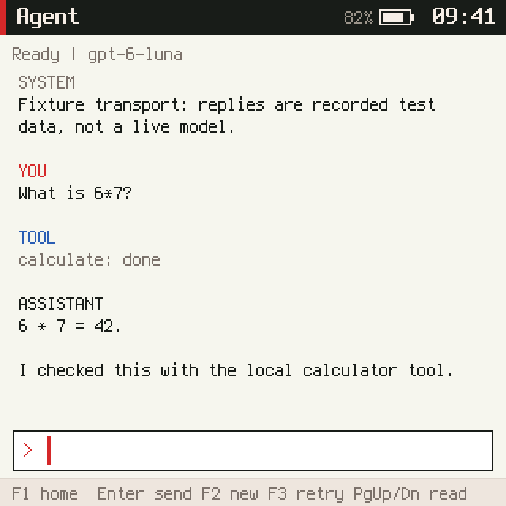
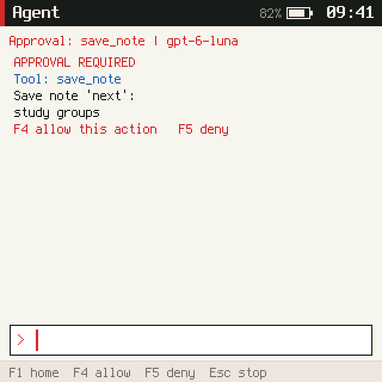
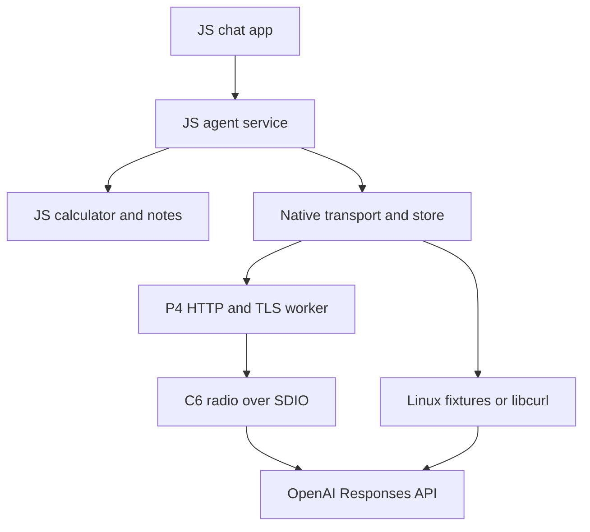

# A real agent on the PicoCalc

## Implementation guide and engineering report

**Project:** wesen/2026-10-20--ds-js-os

**Scope:** ESP32-P4 PicoCalc, full QuickJS runtime, Linux simulator

**Baseline:** `3e0bcfa60f370f62aae9ee1ce8402d6bba1ff05d` on `main`

**Implementation branch:** `feat/picocalc-agent`

**Prepared:** October 30, 2026, America/New_York

## 1. Executive summary

The PicoCalc can be a useful, focused agent terminal without running a browser. This implementation puts the conversation, context policy, tool loop, arithmetic, notes, approval decisions, and screen interface in JavaScript. A narrow native boundary handles the operations that need operating-system services or must not block the JS execution lane: Wi-Fi, DNS, TCP, TLS, HTTP, persistent records, and credential access.

The result is a working application and agent loop integrated into the existing OS, with an optional direct HTTPS transport for the ESP32-P4's onboard ESP32-C6 radio. A Linux backend supports both deterministic response fixtures and real HTTPS through libcurl. The same JavaScript runs on the host and the PicoCalc. No companion phone is part of the design.

This is an API client with an on-device agent, rather than a port of the chatgpt.com website. It uses credentials and model access for an OpenAI API project. It does not import website chats, account memory, connectors, subscriptions, or the website's other product features. The model runs remotely; the device runs the orchestration and local tools.

The implemented experience includes persistent conversation text, local notes, a prompt editor, scrolling, cancellation, explicit retry, and physical-key approval for note changes. Five local functions are available to the model: `calculate`, `device_status`, `list_notes`, `read_note`, and `save_note`. It can make several model requests and tool calls to complete one user task. HTTP is asynchronous at the native boundary; this first version presents complete model responses, without token streaming.

### Delivery status

| Area | Status and evidence |
| --- | --- |
| JS agent and UI | Implemented; behavioral tests and the actual QuickJS simulator exercise the complete flow |
| Local tools | Implemented; argument validation, explicit write approval, and persistence acknowledgement |
| Host transport | Deterministic fixtures and optional real HTTPS; verified against a local TLS server |
| PicoCalc transport | ESP-IDF worker, ESP-Hosted C6 integration, certificate-verifying HTTPS, SNTP, and provisioning implemented |
| Firmware build | See the final validation section for exact build results and image size |
| Real model request | Not performed in this environment; no user API credential was supplied |
| Physical hardware | Not exercised here; C6 firmware compatibility, Wi-Fi, power, and latency require device acceptance |

The implementation deliberately bounds memory, network sizes, context, output, tool count, and runtime. A successful simulator or firmware build is not presented as proof of a successful radio connection or model call. The remaining acceptance procedure is concrete and appears below.

## 2. What the codebase already provides

The repository is more substantial than a firmware sketch. It has a small C nucleus, several isolated JavaScript worlds, a retained UI vocabulary, a compositor, hardware capabilities, a deterministic simulator, supervision, and a real ESP32-P4 port. These existing boundaries are the right place to integrate an agent. [R1-R4]

Each world has its own QuickJS runtime, heap quota, turn budget, mailbox, timers, and manifest claims. Apps publish declarative screen trees. The compositor owns the framebuffer and gives the display driver a restricted handle. The keyboard and display drivers are JavaScript; C implements bus execution and graphics primitives.

The most consequential semantic detail is that a turn lasts until its handler completes. Returning a pending Promise from a handler keeps that world's mailbox occupied. It is therefore unsafe to implement the chat UI as one long `async` handler that awaits an entire model request: the same world could not process its cancel key while waiting. The new design uses short handlers and polling instead.

The host clock models work and wire time; it is not automatically wall-clock paced. That is useful for repeatable tests but unsuitable for waiting for a real server: forty-five simulated seconds could elapse before a real HTTPS worker has made progress. The new `-r` host option paces execution for live requests while leaving the default deterministic mode unchanged.

### Baseline map

| Source | Existing responsibility | Consequence for the agent |
| --- | --- | --- |
| `nucleus/kernel.c` | Scheduling, mailboxes, deferred effects, restart supervision | Keep each JS handler short; preserve epoch and ownership checks |
| `nucleus/vm.c` | Full QuickJS host-call binding | Add a small network API and the missing persistent-store binding |
| `nucleus/nucleus.h` | Shared kernel and port contracts | Define one bounded POST transport, independent of the board |
| `js/prelude.js` | World DSL, messages, handles, UI objects | Expose `agentNet` and `store` as small JS interfaces |
| `js/system/compositor.js` | Layout, focus, input forwarding, rendering | Authenticate input/frame senders for a trustworthy approval screen |
| `js/system.json` | Worlds, claims, heap and turn budgets | Add separate `agent` and `chat` worlds |
| `host/port_host.c` | Host memory, files, persistent records | Make file replacement atomic and keep host tests reproducible |
| `port/esp32p4/main` | Real bus workers, kernel task, console, PSRAM | Add a separate network worker and NVS-backed store |
| `js-papers3` / `vm_mqjs.c` | Separate PaperS3/MicroQuickJS product path | Reference its store design; do not assume its APIs exist on PicoCalc |

The baseline PicoCalc README explicitly listed Wi-Fi and storage as unfinished. Later shared storage infrastructure was present in the host and PaperS3 path, but the full-QuickJS prelude/binding and the P4 store implementation were missing. The implementation closes that gap instead of inventing a second persistence model. [R1, R3]

## 3. Hardware target and connectivity

This repository targets a PicoCalc whose RP2040 has been replaced by a Waveshare ESP32-P4-WIFI6 on the existing adapter. It does not target the stock RP2040 board. The P4 board has an integrated ESP32-C6 and external PSRAM. The P4 itself has no native Wi-Fi radio; Espressif's supported expansion path uses a Wi-Fi coprocessor and `esp_wifi_remote`. [R1, R5, R6]

The P4 runs the OS, QuickJS, lwIP/TCP, TLS, and the HTTP client. ESP-Hosted carries the radio interface over SDIO to the C6. The radio firmware and host component must be compatible. The current implementation pins the host components instead of following an unspecified latest release.

### Verified SDIO mapping for the base Waveshare board

| Signal | ESP32-P4 GPIO |
| --- | --- |
| SDIO clock | 18 |
| SDIO command | 19 |
| SDIO data 0 | 14 |
| SDIO data 1 | 15 |
| SDIO data 2 | 16 |
| SDIO data 3 | 17 |
| C6 reset / enable | 54 |

These values were checked against the base board schematic, not copied from another Waveshare display kit. They do not overlap the repository's keyboard pins 50/49 or LCD pins 3/2/7/24/25. The committed `sdkconfig.agent-wifi` records the exact component configuration names. [R1, R7]

### What belongs in JS and what belongs in C

| Work | Implementation | Reason |
| --- | --- | --- |
| Conversation, prompts, model settings | JS service | Policy changes should be easy to inspect and modify |
| Tool schema and dispatch | JS service | This is agent behavior, not a hardware primitive |
| Arithmetic and note policy | JS | Small bounded computations and ordinary structured data |
| UI, editing, scroll, approval | JS app and compositor | Reuse the existing UI model and keyboard path |
| Context limits and retry semantics | JS | Application-specific choices with direct behavioral tests |
| DNS, TCP/IP, TLS, HTTP | Native worker | SDK integration, certificate validation, blocking I/O, and cancellation |
| C6 radio and SDIO | ESP-IDF / ESP-Hosted | Hardware transport, interrupts, buffers, and driver ownership |
| Credential lookup | Native port | Credentials should not become model-visible or world-visible values |
| Durable write primitive | Native port | NVS/atomic file operations and observable completion |

Writing TCP/IP or cryptography in JS would add little to the product and would create a large correctness and maintenance burden. Conversely, moving the agent loop into C would make policy harder to evolve without solving a measured performance problem. The 53 KiB stress test found one JS implementation choice that was too expensive: a per-character byte-count loop. Native-backed string operations inside QuickJS fixed that issue without adding a new C helper.

## 4. User experience

The launcher has an **Agent** tile and a `c` shortcut. It remains a small, keyboard-driven application: no browser, feed, tabs, or notifications are required.

| Input | Action |
| --- | --- |
| `c` on the launcher | Open Agent |
| Enter | Send the current prompt |
| Left / Right / Home / End | Move within the draft |
| Backspace / Delete | Edit the draft |
| Up / Down | Scroll one transcript line |
| Page Up / Page Down | Scroll a page |
| Escape | Cancel active work; otherwise clear the draft |
| F1 | Return to the launcher |
| F2 | Start a new conversation; keep saved notes |
| F3 | Retry the exact failed network request, if one remains |
| F4 / F5 | Allow / deny the displayed note write |

Typing can continue while the model is working. Sending a second prompt is blocked until the current run finishes or is cancelled. A draft remains local to the chat world, so a service restart does not destroy it. Approval uses dedicated function keys; typing an ordinary `y` in a draft cannot accidentally authorize a write.

Supported local commands are `/help`, `/notes`, `/model MODEL_ID`, and `/effort low|medium|high|none|omit`. Model selection clears conversation context to avoid carrying incompatible provider items between models. Use `omit` for a model that does not accept a reasoning parameter. Access to a named model still depends on the configured API project.

The default is `gpt-6-luna` with low reasoning effort and a 2,048-token output limit, based on the current official model documentation. Model identifiers are configuration, not built into the native transport. A 320-pixel screen benefits from concise answers, but the app remains scrollable. [R8]

The fonts support ASCII and a small symbol subset. Ordinary transcript display normalizes common punctuation and shows a visible question mark for unsupported glyphs. This display conversion does not alter retained source text, but response/history retention is bounded and clips long text. Approval proposals instead escape unsupported characters so that normalization cannot conceal the exact note content being authorized. This is not a Unicode terminal or a mathematical typesetting engine; the first version is intended for plain text and ASCII mathematics.



*Figure 1. The actual compositor and simulated panel, using recorded API responses. This is a validation capture, not a live model result.*



*Figure 2. The complete proposed note change is available for review before F4/F5. Long proposals can be scrolled.*

## 5. Architecture and execution model



There is still one JS execution lane. The implementation adds two worlds, taking the default manifest from 13 to 15. `chat` owns the draft and viewport. `agent` owns model requests, tool policy, notes, history, and approvals. The agent has `net.agent` and `sys.read`; chat has neither. Model output is data. It is never evaluated as JS.

The app sends commands to the service with `send`, and the service returns an `agent.state` snapshot. Neither side awaits a complete HTTP request in a message handler. The agent polls once per 100 ms while a request is active, and each tool is executed in a separate short turn.

### Message contract

| Direction | Message | Payload |
| --- | --- | --- |
| Chat to agent | `agent.submit` | `{text}` |
| Chat to agent | `agent.cancel` | `{}` |
| Chat to agent | `agent.new` | `{}` |
| Chat to agent | `agent.retry` | `{}` |
| Chat to agent | `agent.approve` | `{id, allow}` |
| Chat to agent | `agent.snapshot` | `{}` |
| Agent to chat | `agent.state` | `{run, phase, model, entries, approval, error}` |

The service accepts these commands only from the `chat` world. The app accepts state only from `agent` and key events only from `compositor`. Approval IDs include the run, native request ticket, and provider call ID. Native tickets are not reused across world restarts or in-process cold boots, so an old queued approval cannot authorize a new request.

### Phases

| Phase | Meaning | Next action |
| --- | --- | --- |
| `idle` | Ready without an active run | Accept a prompt or command |
| `requesting` | Native POST is outstanding | Poll, cancel, or time out |
| `tools` | Validated calls remain, or their outputs are ready | Execute one tool or start the next model request |
| `approval` | A note replacement awaits physical confirmation | Approve, deny, cancel, or expire |
| `done` | A final assistant answer was received | Save bounded history and accept the next prompt |
| `cancelled` | User stopped the run or a previous boot was interrupted | Start a fresh prompt; do not resume automatically |
| `error` | A request or validation step failed | Explicit retry if a safe request body remains |

### One task, step by step

1. Validate the prompt and start a new run with a deadline.
2. Construct a Responses request from bounded completed conversation text plus the current prompt.
3. Stage a native request; the C port copies the body and returns a ticket immediately.
4. Poll on later turns while the chat world keeps accepting input.
5. Require a completed, valid response and validate the entire output batch before executing any tools.
6. Preserve all output items needed for the active tool loop, including opaque reasoning items.
7. Execute allowed calls, gathering `function_call_output` values with their matching `call_id`.
8. Pause for a note-write approval where required, and wait for storage acknowledgement before reporting success.
9. Send the complete continuation to the model. Repeat within the round/tool limits.
10. When no calls remain and an assistant answer exists, save a bounded plain-text exchange and return to ready.

This is the Responses function-calling protocol: function descriptions are top-level function tools, and tool outputs reference the original call ID. Reasoning items are kept during the active loop; the request asks for encrypted reasoning content for stateless compatibility. [R9, R10]

## 6. Provider request and context policy

The native transport is provider-neutral within a narrow shape: it posts bounded JSON to one locally configured HTTPS endpoint. The JavaScript service currently implements OpenAI Responses. It does not implement the Chat Completions wire format.

```json
{
  "model": "gpt-6-luna",
  "instructions": "Concise PicoCalc assistant instructions...",
  "input": [{"role": "user", "content": "What is 6*7?"}],
  "tools": [
    {
      "type": "function",
      "name": "calculate",
      "description": "Evaluate bounded arithmetic",
      "strict": true,
      "parameters": {
        "type": "object",
        "properties": {"expression": {"type": "string", "maxLength": 256}},
        "required": ["expression"],
        "additionalProperties": false
      }
    }
  ],
  "parallel_tool_calls": false,
  "store": false,
  "stream": false,
  "max_output_tokens": 2048,
  "reasoning": {"effort": "low"},
  "include": ["reasoning.encrypted_content"]
}
```

The example abbreviates the instructions and tool list; `requestBody()` constructs the actual request. The bearer credential is added by the port, never inserted into this JSON. The service contains no API key, URL, or arbitrary header supplied by a model.

`store:false` means the implementation does not rely on provider-side response storage to continue a conversation. It is not a blanket promise about all provider data-retention policies. Each request is sent with the context needed to execute it.

There are two distinct context lifetimes. During an active task, the service preserves the provider's output items and every function result so that a tool sequence remains valid. After a task finishes, it retains only the user prompt and visible assistant text. Earlier reasoning and tool details are deliberately compacted away at that boundary. After a reboot, the same bounded text history and notes are restored, but an interrupted tool run is never replayed.

This policy is predictable on a constrained device and avoids unbounded context growth. It also has a practical limitation: a later question cannot assume the assistant still has the exact output of an earlier tool unless that information was included in the visible answer or read again. The guide and system instructions make that tradeoff explicit. Whole completed exchanges are removed when retention limits are reached; a pending function-call sequence is never truncated midway.

The model may return an incomplete response because the output limit includes reasoning as well as visible output. The implementation treats `incomplete`, failed responses, invalid JSON, unsupported output types, duplicate call IDs, and malformed batches as errors. It does not execute calls from an incomplete or partially validated response. [R10]

## 7. Local tools and write approval

| Tool | Behavior | Controls |
| --- | --- | --- |
| `calculate` | Parses arithmetic, constants, and a small math-function set | 256-character expression, 128 tokens, depth 20, finite final result; no `eval` |
| `device_status` | Reads uptime, worlds, memory, and kernel counters | Read-only `sys.read`; no credentials or claimed wall-clock date |
| `list_notes` | Returns note names | Agent's own private record only |
| `read_note` | Returns one named note | Validated name; missing note is an explicit tool error |
| `save_note` | Creates or replaces a named note | Exact proposal, physical approval, quotas, durable-write acknowledgement |

The calculator supports `+ - * / % ^`, parentheses, `pi`, `e`, and `sqrt`, `abs`, `sin`, `cos`, `tan`, `log`, `exp`, `floor`, `ceil`, `round`, `min`, `max`, and `pow`. Trigonometric inputs are radians. Numeric behavior is ordinary IEEE-754 JavaScript arithmetic; this is not a symbolic algebra engine or arbitrary-precision mathematics. Expressions such as `constructor(...)`, assignments, property access, or code snippets are rejected.

Tool schemas are strict, but local validation remains authoritative. A model can still produce an unexpected name, argument, or value. The dispatcher checks the permitted name, exact required keys, argument types, name syntax, and quotas before executing anything. Unknown tools and invalid arithmetic are returned as tool errors, allowing the model to explain the failure without gaining extra capabilities.

A note name is 1-32 ASCII characters drawn from letters, digits, space, underscore, period, and hyphen, beginning with a letter or digit. Notes are stored as an array of records, not object properties indexed by model-supplied strings. Up to eight notes fit within a combined 3,072-byte JSON quota; each note text is at most 1,536 characters.

The approval screen shows whether the operation creates or replaces a note, its name, and its complete proposed text. Non-ASCII/control characters are shown as explicit Unicode escapes, and literal backslashes are doubled when needed, so the limited font cannot silently turn a different character into a question mark. F4 approves the matching request; F5 rejects it. Approval also expires. Deadline checks happen inside the approval handler, in addition to the polling timer, so a delayed key cannot authorize an expired action in the gap before the next tick.

The service stages the note in the native store, then waits until `store.status()` says the deferred write completed. Only then does it return `{ok:true,saved:true}` to the model. A failed write restores the service's old note set and returns an error. The tool never reports success for a failed save, and the model is instructed to honor that result. As with any language model, its prose can still be mistaken; the tool status is the authoritative action result.

### Approval path hardening

The existing system did not enforce channel subscription capabilities. Merely checking `agent.approve`'s sender would be insufficient if another world could forge keyboard events through the compositor. The compositor now accepts keys only from `keyboard`, frames only when the declared app matches the actual sender, power state only from `power`, and world-status events only from the native kernel. The chat app checks its own state/input senders as well.

This closes the concrete spoofing paths needed for this feature. It does not turn the existing OS into a complete hostile-app sandbox: arbitrary key-channel subscription and other system-wide trust boundaries remain separate work. Trusted shipped worlds are still part of the device's security boundary.

## 8. Native transport contract

The QuickJS prelude exposes four synchronous operations that return promptly:

```js
const status = agentNet.status(); // {configured, mode}
const ticket = agentNet.start(JSON.stringify(request));
const result = agentNet.poll(ticket); // null, or {status, body, error}
agentNet.cancel(ticket);
```

All operations require the `net.agent` claim. There is one outstanding request. Ownership includes the world ID and its epoch, and disposal cancels a world's active request. Tickets are monotonic. Native worker threads/tasks never enter QuickJS and never mutate kernel state directly.

Start and cancel participate in the nucleus's deferred-effect mechanism. A segment that throws or overruns cannot leave behind an HTTP request that should never have been committed. Results are consumed through polling on the kernel thread. A cancelled or crashed world's old result cannot be delivered into a restarted world.

The port API is `port_agent_configured`, `port_agent_mode`, `port_agent_start`, `port_agent_poll`, and `port_agent_cancel`, with an `agent_net_result_t`. A start copies the request; a completed poll transfers ownership of the response buffer. The maximum body sizes are enforced at the native boundary as well as in application code.

### Host backend

The default build has no external networking dependency. If `PICOCALC_AGENT_FIXTURES` is set, the backend consumes numbered files such as `001.json`, `002.json`, and optional `.status` and `.delay_ms` companions. Responses use virtual time, so test screens and state transitions replay deterministically. Fixture mode is explicitly identified in the conversation.

With `AGENT_LIVE=1`, libcurl runs a POST on a pthread. URL and bearer token come from the process environment. HTTPS is mandatory; peer and hostname verification stay enabled; redirects are not followed; embedded NUL bytes, invalid UTF-8, and oversized bodies are rejected. An optional CA file supports testing a trusted private endpoint without weakening verification.

### P4 backend

The P4 port creates a FreeRTOS network task on core 0. It owns Wi-Fi initialization, connection, native SNTP setup, and blocking HTTP operations. The kernel and JavaScript lane continue on their existing task/core arrangement. Requests and large response buffers use PSRAM.

The port uses ESP-IDF's `esp_http_client`, the certificate bundle, a fixed provisioned HTTPS endpoint, and explicit bounded reads. In ESP-IDF 5.4.2, the HTTP data event callback is not a reliable way to abort an oversized transfer because its return value is ignored by that path; explicit reads give this implementation enforceable limits and cancellation checkpoints. [R11]

The native wall clock is synchronized before TLS requests. The JavaScript `Date` implementation in this repository is based on a synthetic boot date plus uptime, so it must not be used for certificate validity. A missing network clock is a clear error, not a reason to disable certificate validation.

Cancellation is immediately logical: the UI stops waiting and the request ticket becomes unusable. The native worker owns its client handle until its blocking operation returns or times out, so the implementation does not close/free that object from a competing task. A new request can report that the previous worker is still closing. Retry after cleanup is explicit. Cancellation cannot promise to undo a request the server already received or avoid all billed work.

## 9. Persistence and credential boundaries

The full-QuickJS prelude now has `store.get`, `store.set`, `store.remove`, `store.all`, and `store.status`. Each world has one quota-bound JSON record, keyed by its own world name. `store_kb` is now read by the QuickJS manifest parser. The agent's record is capped at 16 KiB.

Writes are staged until the end of the current segment and coalesced within that segment. A thrown segment does not write. The host backend uses a temporary file, synchronization, and atomic rename when `-s DIR` is supplied. Without `-s`, its store survives simulated power cycling within a process but is not durable across process exit. Use `-s` for actual host sessions.

Persistent writes are deferred, not backgrounded: the current P4 backend performs the bounded NVS commit on the kernel thread after a segment. Flash erase/garbage-collection latency can temporarily delay input. Measure it during device acceptance; queueing durable writes is a future improvement if actual latency warrants it. Network I/O is the operation moved to a separate worker in this implementation.

On the P4, a new `agentstore` NVS partition is placed at `0x410000`, after the existing 4 MiB factory application. Its size is 128 KiB. The original NVS and application offsets remain unchanged. World records live there; Wi-Fi/API configuration lives in a separate native namespace in the original NVS partition. The new store initialization does not automatically erase an existing partition when initialization fails.

The persisted session contains version, model, effort, bounded completed text history, notes, and a marker/prompt for an interrupted run. Draft editing belongs to the chat world's volatile state. The implementation does not persist every keystroke, poll, or model output chunk.

API tokens never enter the JS request body, tool data, chat state, or prompt. They are added to the native HTTP header. Provisioning and status messages do not print them. The firmware does not enable flash/NVS encryption or secure boot as part of this change; physical extraction resistance remains a deployment choice. The USB console is a trusted administrative interface, as it already is for debugging and key injection.

## 10. Resource limits and failure behavior

| Resource | Limit / behavior |
| --- | --- |
| Chat world heap | 768 KiB manifest quota |
| Agent world heap | 1,536 KiB manifest quota |
| Agent turn budget | 100 ms, not one budget for the whole network round |
| Chat turn budget | 80 ms |
| Prompt | 2,048 UTF-16 code units and 4,096 UTF-8 bytes |
| Display transcript | 12,288 JSON bytes, at most 40 service entries |
| One display entry / retained answer | 6,000 UTF-8 bytes each; long output is visibly clipped |
| UI row cache / rendered rows | 1,024 transcript rows or 2,048 approval rows; 15 visible rows per frame |
| Completed history | At most six exchanges and 10,240 JSON bytes |
| Application session record | 15,360 bytes before the outer store wrapper; native quota 16 KiB |
| Notes | Eight records, 1,536 characters each, 3,072 JSON bytes combined |
| Native request / response | 49,152 / 65,536 bytes |
| Model output | 2,048 tokens, including reasoning where applicable |
| One agent run | Six model rounds, eight tool calls, three-minute deadline |
| Native HTTP deadline | 45 seconds logical deadline; agent-service watchdog is 50 seconds; worker cleanup can take longer |
| Approval | Two minutes, also bounded by the remaining run deadline |
| Retry | User initiated; exact failed request body, no automatic paid retry loop |

The UI sends only visible prewrapped rows to the compositor. Rewrapping a full transcript on every keystroke would make work scale with conversation length, so wrapping happens when state changes and the frame contains a small viewport.

The service counts UTF-8 bytes instead of assuming JS string length equals network size. ASCII takes a fast path; non-ASCII counting uses native regular-expression scans, and clipping uses a bounded binary search that preserves surrogate pairs. This matters: the initial implementation's JS byte loop failed the real QuickJS turn-budget stress test on a 53 KiB response. The revised version passes the same test without increasing the budget.

Network errors, HTTP error statuses, incomplete responses, malformed JSON, tool errors, and storage failures remain visible. Provider error display uses status and a sanitized code rather than dumping raw response bodies into logs. A 401 points to credential configuration, 429 to quota/rate limits, and 400 to model/effort or API compatibility. There is no silent fallback to simulated answers in live mode.

Retry is intentionally narrower than "run the whole prompt again." If a note was saved and the next model request failed, F3 resends that continuation with the existing tool result. It does not rerun the note write. A reboot or cancellation does not preserve an executable retry plan; the user starts a new task instead.

## 11. Run it on Linux first

All commands in this section run from `picocalc-os/`. The existing default build needs a C compiler, zlib, and pthreads. Behavioral tests additionally use Node.js and Python 3. The live build needs libcurl development headers/libraries. The TLS test runner uses OpenSSL to create test certificates.

### A. Deterministic demonstration

```bash
make -j4
PICOCALC_AGENT_FIXTURES=tests/fixtures/agent \
  ./build/picocalc-host -s out/agent-store scripts-agent/tour.txt
```

This types three prompts, executes a local calculation, displays and approves a note write, reads the note, and produces five screenshots. The numbered fixtures are recorded API-shaped replies. They are useful evidence that the whole app/kernel/transport/store path works; they are not a substitute for live-model validation.

For an automatically checked run that uses a fresh store:

```bash
python3 tests/agent-integration.py
# Or keep the screenshots and store in a fresh directory:
python3 tests/agent-integration.py --output /tmp/picocalc-agent-check
```

The integration test verifies the actual stored record and absence of kernel fault frames, rather than relying only on screenshot appearance. Its cases cover the full tool flow, a new process restoring history, cancellation during a 40-second simulated request, and a large response near the native byte cap.

### B. Run all feature checks

```bash
make test-agent
make test-agent-live
```

The live test target talks to a local HTTPS test server with a dummy token. It does not call OpenAI or consume model credits. It needs permission to bind a localhost port. Native tests can select a different simulator binary with `PICOCALC_TEST_BINARY`; the integration runner also accepts `--binary`.

### C. Try the real API from the host

```bash
make AGENT_LIVE=1 -j4
export PICOCALC_AGENT_URL=https://api.openai.com/v1/responses
read -rsp "OpenAI API key: " PICOCALC_AGENT_TOKEN
echo
export PICOCALC_AGENT_TOKEN
./build-agent/picocalc-host -r -s out/live-agent-store -
```

Then enter simulator commands on standard input:

```text
wait 1600
key c
wait 300
type Explain why the integers under addition form a group.
key enter
wait 30000
capture live-agent.png
stats
```

If the answer is still pending, issue another bounded `wait` and capture. Use `key esc` to cancel. The host is a script-driven board simulator, so `type TEXT` injects keyboard input rather than sending that text directly to a model. `-r` is needed for sensible wall-clock pacing when talking to a real server.

When finished, exit the simulator and remove the credential from that shell:

```bash
unset PICOCALC_AGENT_TOKEN
```

Do not reuse the fixed fixture demonstration script as an unattended live acceptance test: it presses F4 at a predetermined time and assumes specific responses. For a real model, inspect the approval screen before authorizing the action.

`PICOCALC_AGENT_CA_FILE` can name a trusted private CA file for a private HTTPS endpoint. It is not an insecure mode. The endpoint must implement the Responses request/response contract used by the JS service, even though the C transport itself only sees JSON.

## 12. Build and provision the PicoCalc

### Prerequisites

Use the repository's ESP-IDF 5.4.2 target and the supported base Waveshare ESP32-P4-WIFI6 revision. The existing port was developed for the older P4 target documented in the repository; newer silicon revisions can need different SDK support. Check the board and image compatibility instead of forcing a mismatched image to flash. [R1, R13]

The build adds exact managed-component pins for `espressif/esp_wifi_remote` 0.14.0 and `espressif/esp_hosted` 1.4.2. The Wi-Fi build selects `dependencies.agent.lock`. Ordinary offline builds do not need to resolve these external radio components. The bundled JavaScript is compiled into the firmware, as in the existing port; changing an app still requires a firmware rebuild. [R14, R15]

### A. Build the offline firmware

```bash
cd port/esp32p4
source ~/esp/esp-idf-5.4.2/export.sh
idf.py build
```

The offline build includes the app and storage API, but reports networking as unconfigured/disabled. This is useful for confirming that the new worlds and normal LCD/keyboard paths boot before introducing radio setup.

### B. Build the Wi-Fi firmware

Use a separate build directory and SDK configuration so that turning on networking does not contaminate the existing offline configuration:

```bash
idf.py -B build-agent \
  -D PICOCALC_AGENT_WIFI=ON \
  -D SDKCONFIG=sdkconfig.agent \
  -D 'SDKCONFIG_DEFAULTS=sdkconfig.defaults;sdkconfig.agent-wifi' \
  build
```

The overlay enables the certificate bundle and specifies the C6 SDIO wiring. Do not place your SSID, passphrase, or token in this file. The endpoint's default is the OpenAI Responses URL; the secret is provisioned later into native NVS.

### C. Flash the P4

Choose the existing CH343 console device for your P4. Close any serial monitor or capture tool that owns it. Then run the same build configuration with `flash`, adding the correct local port:

```bash
idf.py -B build-agent \
  -D PICOCALC_AGENT_WIFI=ON \
  -D SDKCONFIG=sdkconfig.agent \
  -D 'SDKCONFIG_DEFAULTS=sdkconfig.defaults;sdkconfig.agent-wifi' \
  -p /dev/serial/by-id/YOUR_P4_CH343_PORT flash
```

The partition table adds `agentstore` without moving the original application or default NVS. A normal flash updates the relevant image/table; there is no reason to run `erase-flash` as a routine setup step. Existing saved data should not be erased to hide an initialization problem.

### D. Check or update C6 firmware

The base Waveshare board normally ships with radio firmware, but its exact ESP-Hosted version and transport mode must be verified. The new host pins version 1.4.2 and uses a conservative 20 MHz SDIO packet configuration. The matching slave must use the same transport mode. The provided `sdkconfig.c6-agent` overlay disables streaming mode and records the compatible slave settings.

The pinned host component includes the C6 slave source under `managed_components/espressif__esp_hosted/slave`. Copy that project to a separate working directory before configuring it; do not edit the component manager's copy in place. Copy `sdkconfig.c6-agent` into that project. With ESP-IDF exported, the checked command from the copied slave project is:

```bash
idf.py -B ../build-c6 \
  -D IDF_TARGET=esp32c6 \
  -D 'SDKCONFIG_DEFAULTS=sdkconfig.defaults;sdkconfig.defaults.esp32c6;sdkconfig.c6-agent' \
  build
```

Use the same build/config arguments with `-p YOUR_C6_ADAPTER_PORT flash monitor` once the board has been placed in the correct programming mode.

Programming the C6 is a separate operation from flashing the P4. Follow the manufacturer's base-board procedure: the C6 programming pads, a 3.3 V TTL adapter, common ground, IO9 boot strap, and the P4 BOOT state matter. The P4 CH343 port is not automatically the C6 programming port. Use the identified C6 adapter only and follow the board documentation for entering and leaving programming mode. [R13]

This is a hardware acceptance dependency, not something the P4 app can infer from a successful C build. If ESP-Hosted startup does not show a compatible slave and transport, fix that mismatch before debugging TLS or model requests.

### E. Provision without embedding secrets

From `picocalc-os/`, use the helper:

```bash
python3 -m pip install pyserial
python3 tools/provision_agent.py \
  --port /dev/serial/by-id/YOUR_P4_CH343_PORT
```

It prompts for SSID, passphrase, API key, and optional HTTPS endpoint. Password/key prompts are hidden; credentials are not passed in command-line arguments, written to a configuration file, or printed in the helper's output. The helper sends the native console commands and checks acknowledgements.

The equivalent console grammar is shown with placeholders below. Do not paste a real token into an issue, repository document, screenshot, or chat transcript.

```text
net ssid YOUR_SSID
net password YOUR_WIFI_PASSPHRASE
net token YOUR_API_KEY
net endpoint https://api.openai.com/v1/responses
net connect
net status
```

The parser accepts one separator after a setting name; additional spaces are part of the value, preserving SSIDs/passphrases with leading spaces. SSID is limited to 32 bytes. The key is limited to 512 printable non-whitespace ASCII bytes in the P4 port. A passphrase is empty for an open network, 8-63 bytes, or a 64-digit hexadecimal PSK. Keep serial-terminal local echo disabled, and keep sensitive HTTP/Wi-Fi debug logging disabled. The application itself redacts values, but third-party DEBUG logs can expose protocol/configuration details.

`net status` reports configuration, Wi-Fi state, and whether the native clock is set. Wait for Wi-Fi and network time before starting a real prompt. `net forget` removes the native connection/API configuration and requests disconnect; it leaves conversation notes in their separate partition.

### F. First real task

Open Agent with `c`. Ask a simple text question first, then `What is 6*7?`, then ask it to save a short named note. Review the proposed text before pressing F4. Read the note back and power-cycle the device to verify persistence. Use F3 only when the screen explicitly offers a failed request to retry.

## 13. Implementation map

The main changes are deliberately easy to find:

| Path | What to change here in the future |
| --- | --- |
| `js/system/agent.js` | Model defaults, instructions, tools, context, quotas, approvals, retries |
| `js/apps/chat.js` | Editing, scrolling, formatting, status, keyboard controls |
| `js/apps/launcher.js` | Agent entry point |
| `js/system/compositor.js` | Trusted display and keyboard forwarding |
| `js/system.json` | Claims, world budgets, memory/store quotas |
| `js/prelude.js` | Public JS transport and store wrappers |
| `nucleus/vm.c` | Capability/epoch/ticket checks, deferred effects, limits, store status |
| `nucleus/nucleus.h` | Platform-neutral C transport API |
| `host/agent_host.c` | Fixtures and optional verified libcurl worker |
| `host/main_host.c` | Wall-clock pacing for live simulator runs |
| `host/port_host.c` | Atomic host records |
| `port/esp32p4/main/agent_p4.c` | Wi-Fi, SNTP, HTTPS, credential console |
| `port/esp32p4/main/store_p4.c` | Native NVS world records and configuration availability |
| `port/esp32p4/main/main_p4.c` | Boot initialization and bounded console input |
| `port/esp32p4/sdkconfig.agent-wifi` | Host radio/TLS configuration |
| `port/esp32p4/sdkconfig.c6-agent` | Matching C6 slave transport settings |
| `port/esp32p4/optional/agent_wifi` | Optional managed dependencies |
| `port/esp32p4/dependencies.agent.lock` | Resolved, pinned Wi-Fi dependency graph |
| `tools/provision_agent.py` | Secret-safe interactive provisioning |
| `tests` and `tests/fixtures/agent` | Behavioral, native, TLS, and simulator acceptance checks |
| `scripts-agent/tour.txt` | Reproducible screenshot demonstration |

### Extending with another local tool

Add a strict schema to `AGENT_TOOLS`, local validation to `toolArgs`, and a bounded implementation to `nextTool`. Return structured results through `toolResult`. Keep effects behind an approval when they modify data or reach beyond the calculator. Do not pass model-generated code to the sandbox REPL as a shortcut for a general-purpose tool.

If a new operation can block, implement a port primitive with the same ownership, cancellation, deferred-start, and generation rules. Poll it in later short turns. Long-running computation should similarly be chunked or delegated; changing an entire turn budget to several seconds would make the UI experience worse for every world sharing the lane.

For a new provider, keep the transport API and replace the JS request construction/response adapter. Test the real provider's function-call and continuation semantics; a superficially similar JSON shape is not enough. Preserve an active call sequence as a unit whenever context is compacted.

## 14. Validation results

The tests separate three kinds of evidence: pure behavior tests, the actual OS/simulator, and native/platform builds. A mocked API response proves orchestration and UI behavior, not model quality. A local TLS test proves transport checks, not internet reachability. Firmware compilation proves SDK integration, not wiring or radio firmware.

### Automated behavior and transport

| Check | Result |
| --- | --- |
| Agent service tests | 21 passing: request shape, tools, context, cancellation, safe retry, quotas, persistence, expiry and replay protection |
| Chat UI tests | 13 passing: editing during work, viewport bounds, sender checks, approval IDs/content, draft survival |
| Compositor authentication tests | Four passing: forged keys/frames/status/power cannot impersonate the trusted path |
| Actual QuickJS integration | Four scenarios passing: complete tool/approval/store flow; process restart; slow-request cancellation; 53 KiB reply |
| Native boundary cases | 15 passing: claims, ownership, tickets, byte limits, Unicode, deferred effects, lifecycle, storage failures |
| Real local HTTPS cases | Seven passing: verified POST/header, untrusted CA, hostname mismatch, redirect rejection, body cap, NUL rejection, cancellation |

The final native/TLS run contained 22 cases and completed successfully. It used an explicitly trusted generated test certificate and a dummy bearer. No actual API credential was used. Pure JS tests run the unmodified service/app source under a small test harness; the simulator integration then checks those same files under the repository's QuickJS and scheduler.

### Measured simulator run

The three-prompt tour completed at 15.22 simulated seconds with zero crashes. In the recorded sample, the agent reported about 281 KiB and chat about 234 KiB of device-scaled memory, below their 1,536/768 KiB quotas. The lane was 2.9% busy for that scripted workload. These are simulator results, not physical-device benchmarks or estimates of model latency.

The report's captures come from the simulated panel memory after the normal compositor/display path. A separate integration run typed a second draft while the agent calculated, requested approval, saved, and answered; that draft survived each transition. A pathological response containing 5,800 newline characters also completed without a crash and stayed inside the chat quota.

Near-quota approval cases were also run in the actual QuickJS simulator: 1,490 non-ASCII characters produced about 10.5 KiB of escaped review text, and a separate note contained 1,490 newlines. Both completed without crashes, the entire proposal remained reviewable, and the stored original text matched exactly. Chat memory was about 274/479 KiB respectively, inside its unchanged 768 KiB quota.

### Firmware and sanitizers

The Wi-Fi-enabled ESP32-P4 application has been built using actual ESP-IDF 5.4.2, RISC-V GCC 14.2.0_20241119, ESP-Hosted 1.4.2, and `esp_wifi_remote` 0.14.0. A clean offline P4 build and the exact pinned C6 slave project also compile successfully. The final P4 Wi-Fi application is 2,207,776 bytes and fits the existing 4 MiB factory partition with about 47% free. The final offline image is 1,465,312 bytes; the matching C6 image is 851,424 bytes. Both P4 builds include the same frozen JS/native source snapshot. No firmware was flashed to a device in this workspace.

The generated validation binaries have these SHA-256 identifiers. They identify build evidence, not signed releases; full version and command metadata is recorded in `assets/build-validation.json`.

- **P4 Wi-Fi:** `1ac5dc0e66d55b3d514809ab7dc42d34242f4a5e896cef7ada93ff70617d431f`
- **P4 offline:** `37b25faf4d8e3d1f0186c3807233f344e55b70b2bac3d3656ff0b663f46844b6`
- **C6 companion:** `118bf135795f8401bc3a8cae20367c9c5c0f513a48988016a7e247bf9472e7f6`

All four actual QuickJS integration scenarios also pass with AddressSanitizer and UndefinedBehaviorSanitizer instrumentation, with zero world crashes and no detected address/undefined-behavior errors. Leak detection was disabled; this is not a leak-freedom result. The shared-code regression check builds PaperS3 and boots its existing 15-world manifest for 1,000 simulated milliseconds without faults.

### Problems the checks found and corrected

1. **Large-response work in JS.** A character-by-character UTF-8 counter exceeded the 100 ms virtual turn budget. Native-backed scans and bounded clipping fixed it; the unchanged stress case passes.
2. **Complete answers versus tool continuations.** A long final answer does not need to fit the next-request context budget. The cap is applied to pending tool continuations while final visible text is clipped to the display/history limit.
3. **Approval replay.** A JS run counter restarts with a world. Including the monotonic native request ticket makes stale approval IDs distinguishable even if a provider reuses a call ID.
4. **Timer gaps.** Approval deadlines are checked on the incoming approval itself, so a queued key cannot exploit a gap before the next periodic tick.
5. **Transport-dependent time.** Live host deadlines use wall time and live scripts can be paced; fixture delays keep virtual time.
6. **Untrusted message routing.** Sender checks protect the keyboard/frame path used to review and authorize a local write.
7. **Native result integrity.** Oversized, NUL-containing, or malformed UTF-8 responses are rejected before they become a JS string.
8. **Storage success.** Staging a write is not the same as committing it; note tools wait for explicit native status.

## 15. Hardware acceptance procedure

These checks remain to be performed on the user's device. They are completion criteria for the device port, not work that can be inferred from simulator screenshots.

| Stage | Check | Pass condition |
| --- | --- | --- |
| Board identity | Confirm base board, silicon revision, adapter, SDIO pins | Matches the SDK/board assumptions; no forced revision override |
| Baseline boot | LCD, keyboard, original apps, Agent tile | Normal inputs and display; no fault/restart loop |
| Radio | ESP-Hosted logs and C6 transport/version | Compatible firmware, packet mode, expected SDIO pins/clock |
| Network | Connect, disconnect, reconnect, cold boot | IP acquired; native clock becomes set; failures remain visible |
| Real model | Ask text and arithmetic questions | Real API response; local calculation output used correctly |
| Notes | Approve, deny, replace, read, power-cycle | Only approved writes persist; history and notes restore |
| Cancellation | Stop during connection and response receipt | UI remains usable; old result ignored; next request works after cleanup |
| Restart | Restart agent while a request/approval exists | No automatic replay; old approval cannot authorize new work |
| TLS failures | Untrusted/wrong-name/expired certificate and unset clock | Request fails; validation is never bypassed |
| HTTP failures | 401, 429, 5xx, 3xx, truncation, oversized body | Clear error; no redirect credential forwarding or partial tool execution |
| Resource pressure | Long answers, maximum notes, repeated runs/cancels | No heap drift or unexpected world crash; key latency remains acceptable |
| Power loss | Interrupt saves at controlled times | Previous or new valid record survives; no automatic external action after boot |
| Power and flash latency | Active Wi-Fi, request bursts, NVS saves | Measured input latency, temperature and battery behavior are acceptable |

Record firmware commit, component versions, device revision, network conditions, memory high-water marks, largest available internal/PSRAM blocks, and end-to-end latency. Do not replace these measurements with the virtual-clock figures. A series of 50-100 requests/cancellations and several controlled power-loss saves is an appropriate first device soak test.

## 16. Troubleshooting

| Symptom | Likely cause / next step |
| --- | --- |
| Agent reports transport not configured | Offline build, missing token/SSID, or host environment not exported |
| `net status` says Wi-Fi down | Check SSID/passphrase, C6 version, SDIO wiring/mode, then `net connect` |
| Clock remains unset | Network time unavailable; check DNS/NTP access. Do not disable TLS verification |
| HTTPS succeeds on laptop but P4 fails | Compare native clock, CA bundle, free internal memory, C6 link, and endpoint |
| HTTP 401 | Reprovision the API key; confirm it belongs to the intended API project |
| HTTP 400 | Check model access, Responses compatibility, reasoning effort; try `/effort omit` for a non-reasoning model |
| HTTP 429 | Check API quota/rate limit; retry only when appropriate |
| Incomplete response | Task or reasoning consumed the output cap; shorten the task or deliberately adjust the JS limit |
| New request says worker still closing | Previous cancellation is still cleaning up a native socket; retry after it exits |
| Text shows question marks | Character is outside the shipped bitmap fonts; use ASCII/plain text |
| History disappears after host process exit | Run with `-s DIR`; the default host record store is in memory |
| Note storage fails | Inspect `agentstore` initialization/space and record quotas; do not erase unrelated NVS automatically |
| Offline build resolves Wi-Fi dependencies | Check separate build/config and the selected dependency lock; use the supplied CMake option |
| Agent repeatedly crashes | Inspect UART fault frames, restore a known build, and reproduce with the fixture/sanitizer tests |

## 17. Decisions and alternatives

**Direct HTTPS is the primary path.** The board already has a capable P4 and C6. A gateway would simplify credentials and provider adapters, but would add another service that must be running and reachable. This implementation supports a locally configured compatible endpoint, so a gateway can be introduced later without moving the JS agent off the device.

**The phone is not a required relay.** A serial-only first prototype would have been easier, but would not meet the goal of using the handheld independently. USB remains a one-time provisioning/debugging interface. Normal operation is Wi-Fi from the device.

**Whole JSON responses come first.** This makes response validation, tool batch atomicity, quota enforcement, and deterministic testing straightforward. Keyboard responsiveness is already preserved. Streaming is a useful next increment, especially for perceived latency, but should not arrive by holding a JS turn open or executing partial function arguments.

**The local tool set is deliberately finite.** A calculator, device state, and notes make it a real multi-step agent while keeping the capability boundary reviewable. General shell execution, unrestricted JavaScript evaluation, and arbitrary URL fetching would require a different permission and resource model.

**Persistent text is bounded.** A full searchable chat archive, multiple conversations, and provider-side conversation IDs were considered beyond the first implementation. The chosen text history works offline for viewing and restores after reboot, without requiring an ever-growing local database.

**No new JS package runtime is introduced.** The agent uses the repository's existing QuickJS world API. There is no Node.js, npm dependency tree, SDK, or browser on the device. Node is used only for host-side tests. The Responses JSON adapter is small enough to understand directly.

## 18. Next implementation phases

The next work should be driven by device measurements and daily use.

1. **Complete hardware acceptance.** Verify radio firmware, native clock, true model requests, resource headroom, cancellation, and power-cycle behavior. This is the first gate.
2. **Stream text safely.** Add a bounded native chunk queue and a JS SSE parser. Limit bytes/events per turn, retain UTF-8 split boundaries, handle terminal response states, and execute tools only after complete validated arguments. Keep stop/input responsive.
3. **Improve history.** Add named conversations and selective deletion, then SD-backed archival if needed. Maintain a short active context and explicit compaction policy. Avoid writing flash on every edit or token.
4. **Add provider-hosted search if wanted.** Show sources and account for larger responses/tool output. Test the provider's actual search item and citation shapes before enabling them. The current agent explicitly has no browsing tool.
5. **Improve mathematical text.** Expand fonts or add a modest monospace math renderer; keep source text intact and avoid turning the screen into an expensive general HTML renderer.
6. **Measure power.** The current 100 ms service timer and active Wi-Fi are functional defaults, not a completed battery-optimization project. Stop unnecessary polling, reconnect deliberately, and reuse TLS connections only after measurements justify the complexity.
7. **Harden broader OS permissions.** Add channel subscription/publish capabilities, bounded mailboxes, and durable settings ownership if third-party worlds become part of the product. The new sender checks address this feature's concrete approval path; they are not a substitute for those OS-wide controls.

Token streaming, browsing, multimodal input, voice, rich Markdown/LaTeX, background notifications, cloud chat synchronization, and a full conversation archive are not implemented by this change.

## 19. References and reproducibility

Repository findings are grounded in the baseline commit above and the implemented files listed in section 13. Official API/hardware references were checked during this work. Model availability, component support, and board revisions can change; use the pinned project versions for reproduction and verify migrations separately.

- **R1.** [Baseline PicoCalc README](https://github.com/wesen/2026-10-20--ds-js-os/blob/3e0bcfa60f370f62aae9ee1ce8402d6bba1ff05d/picocalc-os/README.md): hardware target, world architecture, original limitations, existing build flow.
- **R2.** [Baseline kernel](https://github.com/wesen/2026-10-20--ds-js-os/blob/3e0bcfa60f370f62aae9ee1ce8402d6bba1ff05d/picocalc-os/nucleus/kernel.c): turns, scheduling, deferred effects, supervision.
- **R3.** [Baseline QuickJS binding](https://github.com/wesen/2026-10-20--ds-js-os/blob/3e0bcfa60f370f62aae9ee1ce8402d6bba1ff05d/picocalc-os/nucleus/vm.c) and [MicroQuickJS binding](https://github.com/wesen/2026-10-20--ds-js-os/blob/3e0bcfa60f370f62aae9ee1ce8402d6bba1ff05d/picocalc-os/nucleus/vm_mqjs.c): API differences and existing store precedent.
- **R4.** [Baseline JS prelude](https://github.com/wesen/2026-10-20--ds-js-os/blob/3e0bcfa60f370f62aae9ee1ce8402d6bba1ff05d/picocalc-os/js/prelude.js): Promise/turn dispatch and UI/message contract.
- **R5.** [Waveshare ESP32-P4-WIFI6 documentation](https://docs.waveshare.com/ESP32-P4-WIFI6): base board and integrated C6.
- **R6.** [ESP-IDF 5.4.2 Wi-Fi expansion](https://docs.espressif.com/projects/esp-idf/en/v5.4.2/esp32p4/api-guides/wifi-expansion.html): P4 requires a Wi-Fi coprocessor and remote Wi-Fi integration.
- **R7.** [Waveshare base-board schematic](https://files.waveshare.com/wiki/ESP32-P4-WIFI6/ESP32-P4-WIFI6-datasheet.pdf): C6 SDIO and reset wiring.
- **R8.** [GPT-6 Luna model documentation](https://developers.openai.com/api/docs/models/gpt-6-luna): model identifier, Responses/tool support, effort settings.
- **R9.** [OpenAI function calling](https://developers.openai.com/api/docs/guides/function-calling): function schemas, call IDs, and continuation outputs.
- **R10.** [OpenAI reasoning guide](https://developers.openai.com/api/docs/guides/reasoning) and [conversation state](https://developers.openai.com/api/docs/guides/conversation-state): stateless context, reasoning items, and output limits.
- **R11.** [ESP-IDF 5.4.2 HTTP client](https://docs.espressif.com/projects/esp-idf/en/v5.4.2/esp32p4/api-reference/protocols/esp_http_client.html): blocking task behavior, certificate bundle, HTTP streaming operations.
- **R12.** [ESP-IDF 5.4.2 HTTP client source](https://github.com/espressif/esp-idf/blob/v5.4.2/components/esp_http_client/esp_http_client.c): exact callback and read behavior inspected for this version.
- **R13.** [Waveshare base-board FAQ](https://docs.waveshare.com/ESP32-P4-WIFI6/FAQ): C6 programming procedure and board-version cautions.
- **R14.** [ESP-Hosted 1.4.2 component](https://components.espressif.com/components/espressif/esp_hosted/versions/1.4.2): pinned host/slave source and configuration.
- **R15.** [esp_wifi_remote 0.14.0 component](https://components.espressif.com/components/espressif/esp_wifi_remote/versions/0.14.0): pinned remote Wi-Fi API integration.

The Markdown report is the source document. The companion PDF contains the same implementation guide, tables, findings, and reference links, with the architecture and simulator captures laid out for reading. The repository retains the tests and response fixtures so the implementation can be checked independently.
