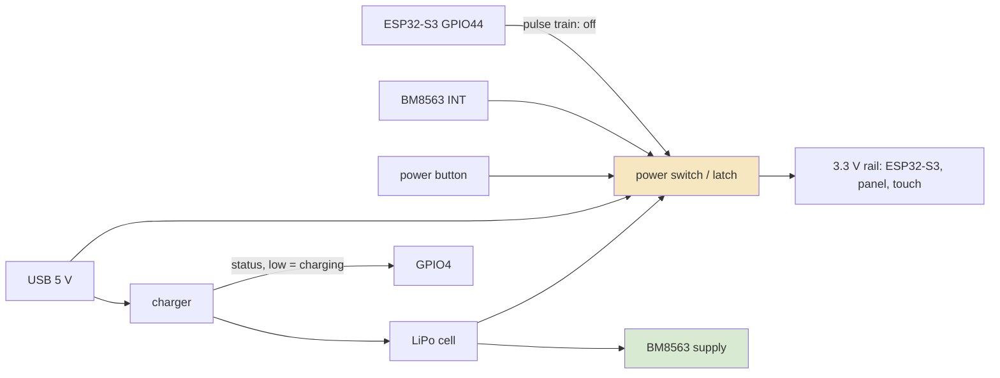
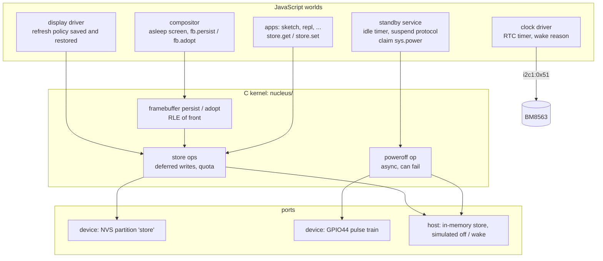
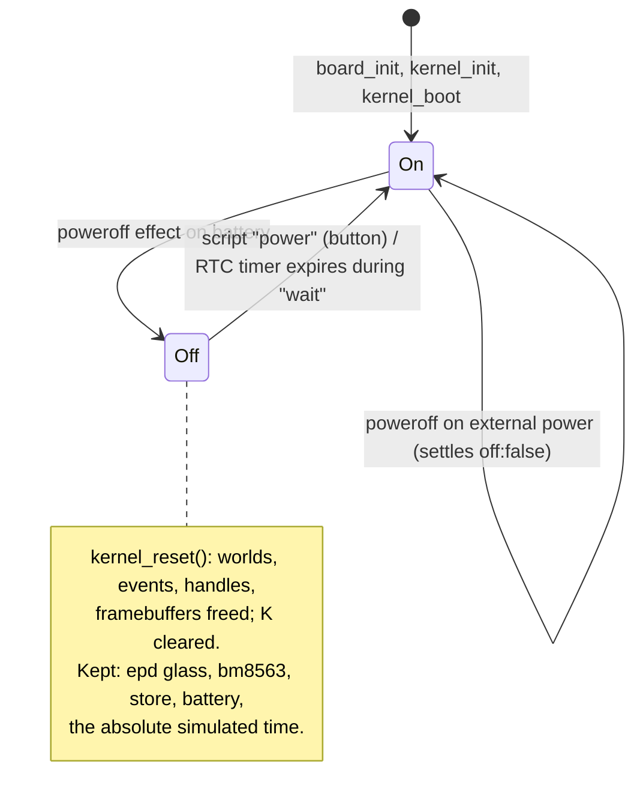

# Power off when idle: analysis, design and implementation guide

## 1. What this ticket is about

The M5Stack PaperS3 is a 4.7-inch e-paper tablet built around an ESP32-S3. The previous ticket, PAPERS3-IDLE, made picocalc-os spend its idle time in the chip's light sleep: the kernel waits on a queue, FreeRTOS stops its tick, and the chip draws a few milliamperes until a touch interrupt or a timer wakes it. Light sleep keeps RAM, so nothing has to be saved. It still draws current, and a 1800 mAh cell drains in days, not weeks.

The board can do better. An e-paper panel holds its picture with no power at all, and the PaperS3 has a power latch that the firmware can release, which disconnects the battery from everything except the real-time clock. A tablet that is switched off still shows its last screen. This ticket makes picocalc-os use that: after a period without use on battery, the system saves what each program needs, draws a final "asleep" screen, and switches the board off. Pressing the power button, or an alarm from the real-time clock, starts the board again, and the system comes back to the screen it left, changing only the pixels that differ.

The work touches every layer of the system, which is why this guide starts from the beginning. By the end of it you should be able to explain:

- how the PaperS3's power path works, what the firmware controls and what it cannot;
- what a world, a turn, a segment and a deferred effect are in picocalc-os, and why persistent writes must be deferred effects;
- how the new persistent store, power-off operation, RTC wake and standby service fit together;
- why a resume can avoid the full-screen flash that a normal boot does, and what must hold for that to be correct;
- which files change in each phase and how each phase is tested on the host simulator and on the device.

## 2. The board's power path

### 2.1 What is on the board

The parts that matter for this ticket are listed below. The pin numbers are the ones the firmware uses (`picocalc-os/port/esp32s3-papers3/main/s3.h`, `bus_s3.cpp`).

| Part | Connection | Role in this ticket |
|---|---|---|
| Power latch | GPIO44 (`PIN_PWROFF`) | Held low, the board stays on. A pulse train on it releases the latch and cuts the supply. |
| Power button | to the power circuit, not to a GPIO | Pressing it while the board is off starts it: a cold boot from the ROM bootloader. |
| Charger status | GPIO4 (`PIN_CHARGE`) | Low while the charger is charging, that is, while USB power is present and the cell is not full. |
| USB detect | GPIO5 in M5's demo | Reads 0 with USB in on this unit, so the firmware does not use it (see PAPERS3-IDLE diary). |
| BM8563 real-time clock | I2C bus `i2c1` at 0x51 (SDA 41, SCL 42) | Keeps time on its own supply. Its interrupt output can switch the board on. |
| GT911 touch controller | `i2c1` at 0x5D, INT on GPIO48 | Wakes the chip from light sleep. It cannot wake a board that is off. |
| ED047TC1 e-paper panel | 8-bit parallel bus driven by M5GFX | Keeps its picture without power. |
| Flash | 16 MB | Room for a persistent store partition. |



### 2.2 How M5's own firmware switches the board off

M5Stack's libraries are the reference for the power path, because the schematic only says that the parts are connected, not how the sequence goes. Two sources were read for this ticket:

- `M5Unified/src/utility/Power_Class.cpp`, `Power_Class::powerOff()`. For the PaperS3 it drives GPIO44 low and high five times, about 50 ms each way, and then calls `esp_deep_sleep_start()`. The deep sleep is a fallback: if the latch did not open, which is what happens when USB powers the board, the chip at least stops running.
- `M5PaperS3-UserDemo`, `hal.cpp` and `app_power.cpp`. The "sleep and wake up" test calls `M5.Rtc.setAlarmIRQ(16)` and then `powerOff()`. Sixteen seconds later the board starts again by itself. This is the evidence that the RTC's interrupt output is wired into the power circuit.

The firmware today holds GPIO44 low from `bus_s3_init()` on and keeps it low through light sleep (`gpio_sleep_sel_dis`, see PAPERS3-IDLE). If that pin floats, the board switches itself off; that was a real bug during PAPERS3-IDLE and it is the same mechanism this ticket uses on purpose.

### 2.3 What the firmware can and cannot do

These facts set the limits of the design.

- The board can only be switched off on battery. With USB power present the latch is bypassed, and the pulse train does nothing. The design must therefore treat "power off" as a request that can fail, and the standby logic must not try it while external power is present.
- The firmware learns about external power from GPIO4, which is low only while the cell charges. Once the cell is full the pin goes high although USB is still present. So GPIO4 high does not prove that the board is on battery. The only reliable test is to try: pulse the latch, wait, and see whether the chip is still running.
- After power-off, a press of the power button cold-boots the chip. There is no RAM to resume from. Everything that must survive has to be in flash or on the glass.
- The RTC keeps running while the board is off. Its timer or alarm can switch the board on, and the clock driver can read, after boot, which of its flags caused the start.
- Touch cannot wake a board that is off: the GT911 is not powered.
- `esp_reset_reason()` reports a power-on reset for every cold boot, whether the button or the RTC started it. The RTC's flags are the only way to tell the two apart.

### 2.4 The BM8563's timer and alarm

The BM8563 is register-compatible with the NXP PCF8563. The clock driver (`js-papers3/drivers/clock.js`) reads registers 0x02 to 0x08 today, which hold the time in BCD. This ticket also uses the control and timer registers.

| Register | Name | Bits used here |
|---|---|---|
| 0x00 | Control/status 1 | 0 for normal operation |
| 0x01 | Control/status 2 | bit 3 AF (alarm flag), bit 2 TF (timer flag), bit 1 AIE (alarm interrupt enable), bit 0 TIE (timer interrupt enable) |
| 0x09 to 0x0C | Minute, hour, day, weekday alarm | bit 7 set disables that field of the alarm |
| 0x0E | Timer control | bit 7 TE (timer enable), bits 1–0 source: 0b10 = 1 Hz, 0b11 = 1/60 Hz |
| 0x0F | Timer count | counts down from this value at the selected rate |

M5Unified's `RTC8563_Class` programs a wake in seconds as follows. For up to 255 seconds it sets `0x0E = 0x82` (enabled, 1 Hz) and `0x0F = seconds`. For longer it sets `0x0E = 0x83` (enabled, 1/60 Hz) and `0x0F = minutes`, up to 255 minutes. In both cases it sets TIE in 0x01 and clears TF. When the counter reaches zero the chip sets TF and drives INT low, which switches the board on. `disableIRQ()` writes 0x80 into all four alarm registers, 0 into 0x0E and 0 into 0x01.

The INT output stays low until software clears the flag. That has a consequence the design must respect: if the firmware boots because of the timer and never clears TF, INT keeps holding the power circuit on, and the next power-off will not work. The clock driver must clear the flags at boot.

```text
wake in N seconds (N <= 255 * 60):
  if N <= 255:  write 0x0E = 0x82; write 0x0F = N
  else:         write 0x0E = 0x83; write 0x0F = ceil(N / 60)
  r = read 0x01
  write 0x01 = (r | TIE) & ~(TF | AF)

at boot:
  r = read 0x01
  wake = r & TF ? "rtc-timer" : r & AF ? "rtc-alarm" : "button"
  write 0x01 = 0                 # clear the flags, disable both interrupts: INT is released
  write 0x0E = 0                 # stop the timer
```

## 3. The parts of picocalc-os this ticket builds on

This section is a short account of the system, enough to follow the design. The longer one is the vault report "picocalc-os on the M5Stack PaperS3 - E-Paper, MicroQuickJS and an Idle Tablet".

### 3.1 Worlds, the lane, turns and segments

picocalc-os is a small C kernel (`picocalc-os/nucleus/`) that runs JavaScript programs called **worlds**. Each world is a separate MicroQuickJS context with its own fixed-size arena (`mem_kb` in the manifest), its own mailbox and its own state. Drivers, the compositor, system services and applications are all worlds. The manifest `js-papers3/system.json` lists them, with the **claims** each one holds: names of hardware or privileged operations it may use, such as `i2c1:0x51` or `sys.clock`.

There is one **lane**: one world runs at a time, on the kernel's task. A world runs when a message arrives for it. Handling one message is a **turn**; a turn that waits on a promise (an I2C read, an `ask` to another world) is split into several **segments**, one per resumption. A segment has a time budget (`budget_ms`); a world that runs past it, runs out of memory or throws is faulted and restarted.

### 3.2 Deferred effects

Everything a segment does to the outside world is recorded, not done: sending a message, starting an I2C transfer, presenting a rectangle on the panel. The records are **deferred effects** (`deferred_t` in `nucleus/nucleus.h`). When the segment ends normally, the kernel applies them in the order they were made (`apply_deferred` in `nucleus/kernel.c`). When the segment faults, the kernel throws them away (`discard_deferred`, called from `crash_at`).

This is the property the persistent store relies on. A world that writes its state and then throws in the same segment must not leave half of that state in flash. If writes to the store are deferred effects, they reach flash only when the segment that made them finished cleanly.

```c
// nucleus/kernel.c (existing)
static void crash_at(world_t *W, const char *why) {
  if (K.cur == W) discard_deferred();   // a faulted segment's effects never happen
  ...
}
...
  K.lane_free = K.vnow + cost;
  K.cur = NULL;
  apply_deferred(K.lane_free);          // a clean segment's effects happen, in order
```

### 3.3 Host operations and claims

JavaScript reaches the kernel through host operations. The prelude (`js-papers3/prelude.js`) wraps them: `k("clock.set", ms)` is a synchronous operation, `ka("i2c", ...)` an asynchronous one that returns a promise id the kernel settles later. The C side lives in `nucleus/vm_mqjs.c` in two tables, `SYNC_OPS` and `ASYNC_OPS`. An operation that needs privilege checks a claim first:

```c
static JSValue op_clock_set(JSContext *ctx, world_t *W, int argc, JSValue *argv) {
  if (!world_claims(W, "sys.clock")) return fail(ctx, "%s has no claim on sys.clock", W->name);
  ...
}
```

This ticket adds operations in the same style: `store.load`, `store.save`, `fb.persist`, `fb.adopt` and `poweroff`.

### 3.4 The builder API

A world declares itself with a builder in the prelude: `app(name)`, `driver(name)` or `service(name)`, then `.state(initial)`, `.on(type, handler)`, `.every(ms, fn)`, `.onStart(fn)`, `.screen(fn)`, `.needs(channel...)`, `.provides(channel...)`. A handler receives the world's state object `s` and the message payload; if it returns a promise-like value, the turn continues in later segments until it settles. `send(to, type, payload)` delivers a message, `ask(to, type, payload, {timeout})` delivers one and returns a promise for the reply, `publish(channel, payload)` delivers to every world that `needs` the channel.

### 3.5 The compositor, the framebuffer and the display driver

The compositor (`js-papers3/system/compositor.js`) owns the screen. Applications describe their screens as trees (`ui.col`, `ui.text`, `ui.button`, ...); the kernel renders the focused application's tree after each of its segments and publishes it on the `frames` channel. The compositor lays the tree out under a title bar and above a footer and draws it into a framebuffer.

The framebuffer is a `dmabuf_t` (`nucleus/nucleus.h`) with two pixel arrays of 540 × 960 bytes (8-bit gray):

- `back` is where the compositor draws;
- `front` is what was last sent to the panel.

`gfx_commit` (`nucleus/gfx.c`) compares the dirty bands of `back` with `front`, copies what changed into `front`, and returns the rectangles that changed. The compositor then asks the display driver (`js-papers3/drivers/display.js`) to present them. At allocation `front` is filled with `NEVER_DRAWN`, a value no drawing produces, so the first commit reports the whole screen (`dmabuf_alloc` in `nucleus/hw.c`).

The display driver chooses an e-paper waveform for each present:

- `quality`: 16 grays, a full refresh that drives every pixel through black and white first and clears every ghost. It is what the user sees as a flash.
- `text`: 16 grays, no flash, a little ghosting.
- `fast` and `fastest`: black and white, quicker, more ghosting.

Partial presents leave ghosts, so the driver counts them and forces a clean `quality` refresh after 32 partials, 16 screens of partial area, or 15 minutes. It also forces one for the first frame after boot (`lastClean` starts at `-1e12`, so the "age" rule fires with the reason "first frame").

### 3.6 What a boot looks like on the glass today

Two full refreshes happen at every boot. The first is M5GFX's: `bus_s3_init()` calls `panel->init()`, which is `LGFX_Device::init_impl(true, true)`; with `use_clear` it calls `clear()`, and because `Panel_EPD` starts with auto-display on, the `endWrite()` that follows calls `display(0, 0, 0, 0)` and paints the panel white with the quality waveform (`managed_components/m5stack__m5gfx/src/lgfx/v1/LGFXBase.cpp` line 3621, `Panel.hpp` line 88, `platforms/esp32/Panel_EPD.cpp` line 553). The second is the display driver's "first frame" clean refresh of the compositor's first screen.

A resume that keeps the old picture has to remove both.

### 3.7 Power management after PAPERS3-IDLE

`s3_pm_init()` in `port/esp32s3-papers3/main/port_s3.c` configures dynamic frequency scaling and automatic light sleep. Workers hold PM locks while they need the CPU at full speed or awake (`PM_KERNEL`, `PM_EPD`, `PM_I2C`). A `power_in` lock keeps the chip out of light sleep while GPIO4 is low, because light sleep turns the USB pads off and a host could not enumerate the chip. The power-off operation reuses the GPIO4 reading to refuse early when external power is certain.

## 4. The problem, stated precisely

The goal is a tablet that, on battery, switches itself off after a configurable time without use and resumes at the same screen when started again. "Resumes at the same screen" has three parts, and each is a separate mechanism:

1. **State.** Each world that has state worth keeping writes it to persistent storage before the power goes, and reads it back when it starts. Today nothing survives a boot.
2. **Power.** Some world decides that the system is idle, runs a suspend protocol, and asks the kernel to switch the board off. Today nothing can.
3. **Picture.** On resume, the panel already shows the last screen. The system should repaint only the pixels that differ, with a non-flashing waveform. Today every boot flashes twice.

The constraints:

- A crash must not corrupt the stored state. Writes reach flash only from segments that finished cleanly.
- Power-off can fail (USB). A failed power-off must leave the system running and usable, not half-suspended.
- A boot that does not follow a clean suspend (a crash, a dead battery, a long press of the button) must not trust a stale saved picture. The worst acceptable outcome is the normal flashing boot.
- The host simulator must model all of it, so the whole cycle can be tested in scripts with captures, as every other feature of the system is.
- Flash wear and write time must stay modest: the store is written at suspend, not continuously.

## 5. Design overview



The design has five pieces.

- **A persistent store**, one record per world, holding a JSON object. Worlds read their record synchronously and write it as a deferred effect. On the device it is an NVS partition; on the host it is memory, optionally backed by files.
- **A power-off operation**, `sys.powerOff()`, available to worlds with the claim `sys.power`. It is asynchronous: if the board is still running a second after the latch was pulsed, the promise settles with `{ off: false }`.
- **RTC wake in the clock driver.** The driver reports why the board started (button or RTC) and accepts a request to program the timer before power-off.
- **A standby service**, a new world, which watches activity and power, decides when to suspend, runs the suspend protocol, and handles RTC wakes.
- **Resume without a flash.** The compositor saves the panel's picture (the framebuffer's `front`) at suspend and adopts it at boot, so the first commit after resume reports only the pixels that changed. M5GFX no longer clears the panel at init, and the display driver keeps its ghosting counters across the power cycle.

The whole cycle, from idle to resumed, as a sequence:

```mermaid
sequenceDiagram
  participant SB as standby
  participant W as each world
  participant CO as compositor
  participant DI as display
  participant CL as clock
  participant K as kernel / port
  SB->>SB: idle for idleMin on battery
  SB->>W: ask "suspend" (timeout 1 s each)
  W->>K: store.set(...)  (deferred write)
  W-->>SB: reply
  SB->>CO: ask "suspend" {since}
  CO->>CO: draw the asleep screen
  CO->>DI: ask "present" (text)
  DI-->>CO: done
  CO->>K: fb.persist()  (deferred: RLE of front -> store)
  CO-->>SB: reply
  SB->>CL: ask "wake" {inMin} (optional)
  CL->>K: i2c writes 0x0E, 0x0F, 0x01
  CL-->>SB: reply
  SB->>K: sys.powerOff()
  K->>K: GPIO44 pulses; board off
  Note over K: ... power button or RTC INT ...
  K->>K: cold boot, kernel_boot, worlds start
  CL->>CL: read 0x01: wake reason; clear flags
  CO->>K: fb.adopt()  (front := saved picture)
  W->>K: store.get(...) in onStart
  CO->>DI: present only changed rects (text)
  SB->>CL: ask "wake reason"
  SB->>SB: rtc wake and no touch? power off again soon
```

The remaining sections describe each piece, then the order of implementation.

## 6. The persistent store

### 6.1 Requirements

- Each world has its own record. A world cannot read or write another world's record. This follows the system's isolation model: worlds share nothing except messages.
- A record is a JSON object of keys chosen by the world. The world reads it with `store.get(key)` and writes it with `store.set(key, value)`.
- Writes are deferred effects. A segment that faults loses its writes.
- Each world has a quota (default 16 KB of JSON, `store_kb` in the manifest), so a runaway world cannot fill flash. A write over the quota throws in the calling segment.
- The kernel itself has a few records of its own (the saved picture). They live in a separate namespace that worlds cannot name.

### 6.2 JavaScript API

```js
// prelude.js (new)
g.store = {
  get: function (key) { ... },            // the value stored under key, or undefined
  set: function (key, value) { ... },     // stored when this segment ends; value must survive JSON
  remove: function (key) { ... },
  all: function () { ... },               // a copy of the whole record
};
```

The prelude loads the world's record once, on the first call, through a synchronous operation, and keeps it as a parsed object. `set` and `remove` change the object and call `k("store.save", json)` with the whole record. The C side keeps at most one pending write per world per segment: a second `store.save` in the same segment replaces the text of the first deferred effect instead of adding another, so a loop that calls `set` a hundred times writes flash once.

Why one record per world rather than one flash entry per key? NVS keys are limited to 15 characters, and a JSON object needs no key rules at all. The record of a typical world is a few hundred bytes, and rewriting it whole costs the same as rewriting one entry. The quota is also simpler to enforce on one string.

Usage in an application:

```js
app("repl")
  .state({ line: "", hist: [], ... })
  .onStart(function (s) { s.hist = store.get("hist") || []; })
  .on("suspend", function (s) { store.set("hist", s.hist.slice(-20)); })
  ...
```

### 6.3 C operations

| Operation | Kind | Effect |
|---|---|---|
| `store.load` | sync | Returns the world's record as JSON text, or `null`. It reads the port each time; the prelude calls it once per world instance, and an NVS read of a small blob takes well under a millisecond, so a cache is not worth its code. |
| `store.save(json)` | sync call, deferred effect | Checks the quota, then defers a write of the world's record. Coalesces with a pending write of the same world in the same segment. |

The kernel calls a small port API, which both ports implement:

```c
// nucleus/nucleus.h (new, port section)
// The persistent store: named records in a namespace ("w" for worlds, "k" for the kernel's own). A record is
// bytes; get returns a malloc'ed copy (len set) or NULL; set replaces it (len 0 removes it); 0 is success.
char *port_store_get(const char *ns, const char *key, size_t *len);
int port_store_set(const char *ns, const char *key, const void *data, size_t len);
```

The world's record is `port_store_get("w", W->name, ...)`. World names in the manifest are short; the kernel refuses the store to a world whose name is longer than 15 characters, which is the NVS limit, rather than inventing a mapping.

### 6.4 The device side: an NVS partition

NVS (non-volatile storage) is ESP-IDF's key-value store in flash. It writes entries into 4 KB pages as a log, spreads erasures over the partition, and survives power loss in the middle of a write: an entry is either the old value or the new one. That last property is the reason to use it rather than writing raw flash.

The current partition table (`port/esp32s3-papers3/partitions.csv`) has a 24 KB `nvs` partition, `phy_init`, and a 6 MB `factory` app on a 16 MB flash. The store gets its own partition so that its size and wear do not interact with IDF's own use of `nvs`:

```text
# Name,   Type, SubType, Offset,    Size,
nvs,      data, nvs,     0x9000,    0x6000,
phy_init, data, phy,     0xf000,    0x1000,
factory,  app,  factory, 0x10000,   6M,
store,    data, nvs,     0x610000,  1M,
```

One megabyte is far more than the world records need; the size is for the saved picture (section 9), which can reach a few hundred kilobytes. NVS limits a single blob to about 97 % of the partition minus one page, and to 508,000 bytes in any case.

```c
// port_s3.c (new)
static nvs_handle_t store_h[2];   // "w", "k"
void s3_store_init(void) {
  esp_err_t e = nvs_flash_init_partition("store");
  if (e == ESP_ERR_NVS_NO_FREE_PAGES || e == ESP_ERR_NVS_NEW_VERSION_FOUND) {
    nvs_flash_erase_partition("store"); e = nvs_flash_init_partition("store");
  }
  if (e == ESP_OK) { nvs_open_from_partition("store", "w", NVS_READWRITE, &store_h[0]);
                     nvs_open_from_partition("store", "k", NVS_READWRITE, &store_h[1]); }
}
char *port_store_get(const char *ns, const char *key, size_t *len) {
  size_t n = 0; nvs_handle_t h = handle_for(ns);
  if (!h || nvs_get_blob(h, key, NULL, &n) != ESP_OK) return NULL;
  char *b = malloc(n + 1); nvs_get_blob(h, key, b, &n); b[n] = 0; *len = n; return b;
}
int port_store_set(const char *ns, const char *key, const void *data, size_t len) {
  nvs_handle_t h = handle_for(ns);
  esp_err_t e = len ? nvs_set_blob(h, key, data, len) : nvs_erase_key(h, key);
  if (e == ESP_ERR_NVS_NOT_FOUND) e = ESP_OK;
  return e == ESP_OK && nvs_commit(h) == ESP_OK ? 0 : -1;
}
```

An NVS write of a small record takes a few milliseconds and blocks the kernel task, which is acceptable because worlds write at suspend. The guide's recommendation for application authors is to write on `"suspend"` and on rare user actions (closing a document), never on every touch event.

### 6.5 The host side

`host/port_host.c` keeps a table of records in memory, so captures stay deterministic and a script starts from an empty store. A new runner flag, `-s DIR`, backs the table with one file per record (`DIR/w/<world>`, `DIR/k/<key>`), which lets a test start from a known store or inspect what was written. The records survive the simulated power-off of section 7.4 because they belong to the board, not to the kernel.

### 6.6 Failure cases

- **The segment faults after `store.set`.** The deferred write is discarded with the segment's other effects. The prelude's in-memory copy of the record is lost with the world's context, because a faulted world is restarted from scratch and loads the record again.
- **The record is not valid JSON** (an older firmware wrote something else, or flash was damaged). `store.load` returns `null` and logs once; the world starts with defaults.
- **The store partition is missing** (an old partition table). `s3_store_init` fails, every `store.load` returns `null`, every `store.save` is a no-op that logs once. The system works without persistence.
- **The quota is exceeded.** `store.save` throws `"<world>'s store would be N KB; its limit is M KB"`. The world can catch it and save less.

## 7. The power-off operation

### 7.1 API

```js
// prelude.js (new)
g.sys.powerOff = function () { return kernelTask(ka("poweroff")); };
// resolves with { off: false, why: "..." } if the board is still running; never resolves if it went off
```

Only a world with the claim `sys.power` may call it. In the manifest that is the standby service alone.

### 7.2 Kernel side

`poweroff` is an asynchronous operation whose effect is deferred to the end of the calling segment, after the segment's other effects, including its store writes. The deferred effect calls the port:

```c
// nucleus/nucleus.h (new, port section)
// Switch the board off. Returns only if it could not: 0 never; nonzero with why filled in.
int port_power_off(char *why, size_t n);
```

```c
// nucleus/vm_mqjs.c (new)
static void run_poweroff(deferred_t *d, vtime_t at) {
  char why[96] = "";
  klog("power off");
  port_power_off(why, sizeof why);               // returns only if the board is still running
  char json[160];
  snprintf(json, sizeof json, "{\"off\":false,\"why\":\"%s\"}", why);
  kernel_settle_at(d->w, d->epoch, d->promise, 1, xstrdup(json), at);
}
```

### 7.3 Device side

```c
// port_s3.c (new)
int port_power_off(char *why, size_t n) {
  if (gpio_get_level(PIN_CHARGE) == 0) { snprintf(why, n, "external power (charging)"); return -1; }
  fflush(stdout);
  for (int i = 0; i < 5; i++) {                  // M5Unified's sequence for the PaperS3
    gpio_set_level(PIN_PWROFF, 1); vTaskDelay(pdMS_TO_TICKS(50));
    gpio_set_level(PIN_PWROFF, 0); vTaskDelay(pdMS_TO_TICKS(50));
  }
  vTaskDelay(pdMS_TO_TICKS(1000));               // still here: the latch is bypassed (USB)
  gpio_set_level(PIN_PWROFF, 0);
  snprintf(why, n, "still powered after the off pulses (USB?)");
  return -1;
}
```

Two details deserve attention.

- M5Unified ends with `esp_deep_sleep_start()`. This design does not, deliberately. If the latch failed, the reason is external power, and on external power the right state is "running", not "asleep with no way to wake except reset". The standby service gets `{ off: false }` and resumes the system (section 8.4).
- The pulse order is taken from M5Unified (high, low, five times). Whether one rising edge is enough is a question for the device phase. The sequence is in one function so that changing it is local.

The QEMU build has no latch. `port_power_off` there returns `"no power latch under QEMU"`.

### 7.4 Host side: a simulated power cycle

On the host the board must appear to switch off and on again inside one run of `papers3-host`, so that a script can suspend, wait, wake and capture. That means the kernel must be able to stop all worlds and boot again in the same process, while the simulated board keeps the state that real hardware keeps: the glass, the RTC, the store, the battery.



The pieces:

- `kernel_reset()` in `nucleus/kernel.c` disposes every world, frees the event heap, the asks, the handles and the framebuffers, and clears `K`. It is `kernel_shutdown()` plus the cleanup a second `kernel_init()` needs. The engine binding's static state must be audited: `vm_mqjs.c` keeps the compiled prelude (a cache that can stay), the wall-clock offset `wall_offset_ms` (must return to `WALL_BOOT_MS`, because the clock driver sets it again), and the operation profile (harmless).
- The simulated board keeps an absolute time: `sim_us = boot_base_us + K.vnow`. `kernel_reset()` sets `K.vnow` back to 0, so the board adds the time it was on to `boot_base_us`. The BM8563 model and the battery use `sim_us`, not `K.vnow`.
- `port_power_off()` on the host sets a board flag `off` unless the script said `battery N charging`; the kernel's run loop checks the flag after applying deferred effects and returns early.
- `main_host.c` learns two script commands: `power` (press the power button: if off, boot) and an extension of `wait` (if off, advance `sim_us`; if the RTC timer expires inside the wait, boot at that moment and run the rest of the wait on).

A test script for the full cycle then reads:

```text
battery 80
wait 3000
send standby config {"idleMin": 1}
wait 65000           # idle: suspend, asleep screen, power off
capture asleep.png
panel                # the panel's counters: no update while off
power                # the power button
wait 4000
capture resumed.png  # the same screen as before the suspend, with the clock updated
```

## 8. Standby: deciding to suspend and running the protocol

### 8.1 The standby service

A new world, `js-papers3/system/standby.js`, with the claim `sys.power`:

```json
{ "name": "standby", "file": "system/standby.js", "claims": ["sys.power"], "budget_ms": 40, "mem_kb": 64 }
```

It needs three channels:

- `power` from the power driver: `{ pct, mv, charging }`. Charging means external power is certain, and standby never suspends then.
- `activity` from the compositor: published at most once every five seconds while the user touches the screen (see 8.2).
- `time` from the clock driver, for the "asleep since" text.

Its state and configuration:

```js
service("standby")
  .needs("power", "activity", "time")
  .state({ idleMin: 10, wakeEveryMin: 0, last: 0, charging: true, wake: "button", suspending: false, refused: "" })
  .onStart(function (s) { s.last = now(); assign(s, store.get("config") || {});
                          return ask("clock", "wake", {}).then(function (r) { s.wake = r.reason; }); })
  .on("activity", function (s) { s.last = now(); })
  .on("power", function (s, p) { s.charging = p.charging; if (p.charging) s.last = now(); })
  .on("config", function (s, m) { assign(s, m); store.set("config", { idleMin: s.idleMin, wakeEveryMin: s.wakeEveryMin }); })
  .every(15000, check)
  .on("stats", function (s) { return { idleMin: s.idleMin, idleFor: now() - s.last, wake: s.wake, refused: s.refused }; });
```

`check` suspends when `!s.charging && !s.suspending && now() - s.last >= s.idleMin * 60000`. After an RTC wake (`s.wake !== "button"`) it uses a short idle time of 20 seconds instead, so a board that woke only to update its asleep screen goes back off quickly unless someone touches it.

Why a separate world rather than code in the compositor? The compositor already has the largest arena and the hardest job, and power-off is a privileged operation that should sit in the smallest world that needs it. Isolation also means a fault in standby restarts standby, not the screen.

### 8.2 Activity

The compositor sees every gesture. It publishes `activity` on the first touch-down after five seconds of silence:

```js
// compositor.js, in the touch handler (new)
if (t.phase === "down" && now() - s.activityAt >= 5000) { s.activityAt = now(); publish("activity", {}); }
```

The alternative, standby needing the `touch` channel itself, would give it a turn for every touch report, dozens per second while drawing in Sketch, to learn one fact. The throttled channel costs at most one turn every five seconds.

### 8.3 The suspend protocol

```text
suspend(s):
  s.suspending = true
  for each world w in sys.worlds(["name", "state"]) other than standby and compositor:
     ask(w, "suspend", {}, timeout 1000)     # a world without a handler rejects at once: ignored
  ask("compositor", "suspend", { since: wallClock() }, timeout 5000)
  if s.wakeEveryMin > 0 and battery > 5 %:
     ask("clock", "alarm", { inMin: s.wakeEveryMin })
  store.set("suspended", { at: wallClock() })
  r = sys.powerOff()                          # never returns if the board went off
  # still here: external power
  s.refused = r.why; s.suspending = false; s.last = now()
  for each world: send(w, "resume", {})       # undo: the compositor redraws the normal screen
```

The protocol asks worlds one at a time, each with a one-second timeout, and ignores failures. It cannot let one stuck or crashed world keep the board on forever, and it cannot wait for them in parallel without making the order of store writes depend on timing, which would make host captures unstable. Twelve worlds with an empty handler take well under a second.

The compositor's `"suspend"` handler is the only one that must finish before power goes, because it paints the last picture:

```js
.on("suspend", function (s, m) {
  s.asleep = { since: m.since };         // paint() draws "asleep since 09:41" in the title bar, no chips in the footer
  s.suspended = true;                    // no further draws until resume
  store.set("focus", s.focus);
  return presentNow(s, "text").then(function () { s.fb.persist(); });
})
.on("resume", function (s) { s.asleep = null; s.suspended = false; dirty(s, "text"); })
```

`fb.persist()` runs after the present has settled, because only then does the panel show `front`. It is a deferred effect of the segment that resumes after the present, and it is applied before that segment's reply reaches standby, because effects apply in the order they were made and the reply is made at the end of the turn.

### 8.4 What each world saves

| World | Saves on "suspend" | Restores in onStart |
|---|---|---|
| compositor | `focus` (the app on screen) | opens that app instead of the launcher |
| display | `{ partials, partialArea }` | keeps counting ghosts from where it was; `lastClean` becomes the resume time |
| sketch | `strokes` (at most 1500 points) | redraws the drawing |
| repl | the last 20 history lines | history available again |
| system | the selected tab | same tab |
| standby | its configuration, on `"config"` | same idle time |

The launcher, about, faults and touches apps keep nothing; their screens are recomputed from the system's state.

### 8.5 Boot after power-off

There is no special resume code path in the kernel. The board cold-boots, `kernel_boot` starts every world as on any boot, and each world restores what it saved. The only difference a world can see is the presence of its record. Standby reads the `suspended` record and erases it, so a later boot that follows a crash rather than a suspend does not look like a resume.

## 9. Resume without a flash

### 9.1 The idea

At power-off, the panel shows exactly what `front` held after the last present. If the next boot loads that picture into `front` before the compositor's first commit, `gfx_commit` reports only the rectangles where the new screen differs from the glass: typically the title bar (the clock and the "asleep" text) and the footer. The display driver presents those with the `text` waveform and no flash.

This depends on three conditions. Each has its own mechanism.

1. **The glass still shows the saved picture at that point in the boot.** M5GFX must not clear the panel at init (section 9.3).
2. **The saved picture is the glass's picture.** It is saved only after the last present settled, only by a clean suspend, and it is erased the moment it is adopted, so a later boot cannot use it again (section 9.2).
3. **The display driver does not force its "first frame" clean refresh.** It does so only when the compositor did not adopt a picture (section 9.4).

### 9.2 fb.persist and fb.adopt

Two new operations on the framebuffer handle, allowed only to the world that takes the frames (the compositor), as `sys.front` is:

```js
Handle.prototype.persist = function () { k("fb.persist", this.id); };   // deferred: save front
Handle.prototype.adopt = function () { return k("fb.adopt", this.id); }; // now: front := saved; true if it was there
```

The saved form is a run-length encoding of `front`, because the screens are mostly white and the encoding is simple to get right:

```text
record "k/frame":
  header: magic "PF1", width u16, height u16, count of runs u32
  runs:   (u8 value, u16 length) repeated, length 1..65535
```

A typical text screen has a few thousand runs and encodes to tens of kilobytes; the worst case (dithered gray everywhere) would be over 1.5 MB, so `fb.persist` refuses to save more than 400 KB and erases any older record instead. Then the next boot simply flashes.

```c
// nucleus/hw.c (new)
int dmabuf_persist(dmabuf_t *b);   // RLE of front -> port_store_set("k", "frame"); 0, or -1 if too big
bool dmabuf_adopt(dmabuf_t *b);    // port_store_get("k", "frame"); if it decodes to w x h: front := it,
                                   // dirty := ~0 (the next commit compares everything); then erase the record
```

`dmabuf_adopt` erases the record whether or not it decoded. The rule is "a saved picture is used at most once, by the first boot after it was written".

### 9.3 M5GFX without the init clear

`bus_s3_init()` turns auto-display off before `panel->init()` instead of after it:

```cpp
panel = new PaperPanel();
panel->setAutoDisplay(false);   // init's clear() fills M5GFX's buffer white but no longer refreshes the panel
panel->init();
```

M5GFX's own buffer then holds white while the glass holds the old picture. That is harmless, because the EPD worker pushes the rows of every rectangle into M5GFX's buffer before it calls `display()` for that rectangle (`epd_worker` in `bus_s3.cpp`). M5GFX's waveform tables are indexed by the target level, so a partial update drives the pixels inside the rectangle to their new levels whatever the glass showed. Outside the rectangle nothing is driven.

This change also helps a normal boot: one of its two flashes goes away, because the display driver's first-frame quality refresh covers the whole screen anyway.

### 9.4 The display driver's first frame

`display.js` forces a clean refresh on its first present because it does not know what the glass shows. After this ticket, the compositor tells it:

```js
// compositor onStart (new)
s.adopted = s.fb.adopt();
// first present: { intent: "text", rects, clean: !s.adopted }

// display onStart (new)
var g = store.get("ghosts");
if (g) { s.partials = g.partials; s.partialArea = g.partialArea; s.lastClean = now(); store.remove("ghosts"); }
// the "first frame" rule stays for the case without a saved record
```

The ghost counters are saved on `"suspend"` and erased once read, for the same reason as the picture.

### 9.5 What can still go wrong

- **The panel loses part of its picture while off.** E-paper is bistable but not perfect; after days, mid-grays drift slightly. The partial update leaves those pixels alone, so the drift shows until the next clean refresh, which the age rule triggers within 15 minutes. The device phase should look at a board left off overnight.
- **The user long-presses the power button while the board is on.** If that cuts power without a suspend, no record is written, and the next boot flashes. Correct.
- **A boot faults before the compositor adopts.** The record was not consumed; the compositor restarts and adopts it in its new instance. The glass has not changed in between, because nothing was presented. Correct.
- **The compositor's first screen after resume differs from the saved picture in large areas** (a different app, because the focused app failed to start). The diff is large, the present is a large `text` update, and the result is correct with some ghosting.

## 10. RTC wake in the clock driver

### 10.1 The wake reason

The clock driver reads control/status 2 at start, before anything can clear it:

```js
.onStart(function (s) {
  s.dev = hw.i2c("i2c1:0x51", 400000);
  return s.dev.read(0x01, 1).then(function (r) {
    s.wake = r[0] & 0x04 ? "rtc" : r[0] & 0x08 ? "alarm" : "button";
    return s.dev.write(0x01, [0]);                     // flags cleared, interrupts off: INT released
  }).then(function () { return s.dev.write(0x0E, [0]); })
    .then(function () { return read(s); });
})
.on("wake", function (s) { return { reason: s.wake }; })
```

On a first boot from the factory the flags are 0 and the reason is "button", which is also what the standby service should assume.

### 10.2 Programming the timer

```js
.on("alarm", function (s, m) {
  var min = Math.max(1, Math.min(255, Math.round(m.inMin)));
  return s.dev.write(0x0E, [0x83])                     // timer on, 1/60 Hz
    .then(function () { return s.dev.write(0x0F, [min]); })
    .then(function () { return s.dev.write(0x01, [0x01]); })   // TIE, flags clear
    .then(function () { return { inMin: min }; });
})
```

255 minutes is the timer's limit at 1/60 Hz. A longer interval would use the minute/hour alarm registers; the standby service does not need one.

### 10.3 The simulated BM8563

`sim/papers3/bm8563.c` models the time registers only. It gains registers 0x01, 0x0E and 0x0F, the countdown on the board's absolute time, and an `int` output:

```c
// sim/papers3/papers3.h (new)
bool bm8563_int(vtime_t sim_us);           // INT is active: the timer ran out with TIE set (or the alarm with AIE)
vtime_t bm8563_next_int(vtime_t sim_us);   // when INT will become active, or VT_INF
```

The host's `wait` uses `bm8563_next_int` to find the moment the board would switch on while it is off.

## 11. Implementation phases

Each phase ends with a commit, a diary step in the investigation format, and the checks listed. Host checks run with `make BOARD=papers3` and the scripts in `scripts-papers3/`; the full capture gate is `make BOARD=papers3 shots` compared against the committed captures.

### P1. The persistent store

- `nucleus/nucleus.h`: `port_store_get`, `port_store_set`.
- `nucleus/vm_mqjs.c`: `store.load`, `store.save` with coalescing and quota; `store_kb` in the manifest parser.
- `js-papers3/prelude.js`: `store`.
- `host/port_host.c`: in-memory records, `-s DIR` in `host/main_host.c`.
- `port/esp32s3-papers3/partitions.csv`, `main/port_s3.c`: the `store` partition, `s3_store_init`.
- `js-papers3/apps/repl.js`, `sketch.js`: save on "suspend", restore in onStart.
- Checks: a host script that sets and gets values, faults a world after `store.set` and shows the write was discarded, and exceeds the quota; on the device, a value written before a console-triggered restart is read after it.

### P2. Power-off and the simulated power cycle

- `nucleus/nucleus.h`, `vm_mqjs.c`: the `poweroff` operation and claim `sys.power`; `port_power_off`.
- `nucleus/kernel.c`: `kernel_reset`; the run loop's early return when the board is off.
- `sim/papers3/board.c`, `host/main_host.c`: the off state, the `power` command, `wait` while off, the absolute board time.
- `port_s3.c`: the GPIO44 pulse train.
- Checks: a host script that powers off on battery and on "charging" (refused), presses power, and finds the system booted again with its store; sanitizer build (`make BOARD=papers3 SAN=1`) clean across a reset.

### P3. RTC wake

- `js-papers3/drivers/clock.js`: wake reason, flag clearing, `"alarm"`.
- `sim/papers3/bm8563.c`: control/status 2, timer, INT.
- Checks: host script that programs a 2-minute wake, powers off and boots by itself two virtual minutes later with `wake: "rtc"`; on the device over USB, the registers read back as written.

### P4. The standby service and the suspend protocol

- `js-papers3/system/standby.js`, `system.json`.
- `compositor.js`: `activity`, `"suspend"` and `"resume"`, the asleep title bar, restoring the focus.
- `display.js`: saving and restoring the ghost counters.
- `system.js`: the selected tab.
- Checks: the host script of section 7.4; a script that suspends while "charging" and shows the refusal and the resumed screen; captures of the asleep screen.

### P5. Resume without a flash

- `nucleus/hw.c`, `vm_mqjs.c`, `prelude.js`: `fb.persist`, `fb.adopt`, the RLE format.
- `compositor.js`: adopt at start, `clean: !adopted` on the first present.
- `bus_s3.cpp`: auto-display off before init.
- Checks: host captures before suspend and after resume, and the panel's counters showing a `text` update of the title bar instead of a `quality` refresh; the paint check (`send compositor paintcheck {}`) after resume.

### P6. Device validation, with the user, on battery

The board cannot switch off on USB, so these steps need the user to unplug it and watch. The console is not available on battery, so each test shows its result on the screen or in the store, which is read over the console after plugging in again.

1. Power-off: Faults app, a "Power off now" button (`sys.power` granted to faults for the test). Expected: the asleep screen, then nothing; the power button resumes.
2. Glass retention: after resume, no flash; only the title bar changes.
3. RTC wake: `send standby config {"idleMin": 1, "wakeEveryMin": 2}` before unplugging. Expected: off after a minute, back on two minutes later, the asleep clock updated, off again after 20 s.
4. Overnight: the board left off for a night; look for drift of the grays on resume.
5. A boot log: standby appends `{ at, wake, refused }` to a short list in its store record; the System app shows it.

## 12. Open questions for the device phase

- Is one rising edge on GPIO44 enough, or is the five-pulse train needed? The design uses M5Unified's sequence.
- Does the power button do anything while the board is on? If a short press cuts power directly, the suspend protocol cannot run first and the next boot flashes (correct, but worth knowing).
- How long does an NVS write of a 50–100 KB picture take on this flash? If it is more than a second, the asleep screen appears and the board goes off a second later, which is acceptable; it should be measured.
- Does the BM8563's INT also hold the board on while it is asserted? If so, a wake whose flags are not cleared makes the next power-off fail; the clock driver clears them at start for that reason.

## 13. File reference

| File | Role | Phase |
|---|---|---|
| `picocalc-os/nucleus/nucleus.h` | port API: store, power-off; dmabuf persist/adopt | P1, P2, P5 |
| `picocalc-os/nucleus/kernel.c` | deferred effects, `kernel_reset`, run loop | P2 |
| `picocalc-os/nucleus/vm_mqjs.c` | host operations: `store.*`, `poweroff`, `fb.*` | P1, P2, P5 |
| `picocalc-os/nucleus/hw.c` | framebuffers: `dmabuf_persist`, `dmabuf_adopt` | P5 |
| `picocalc-os/js-papers3/prelude.js` | `store`, `sys.powerOff`, `Handle.persist/adopt` | P1, P2, P5 |
| `picocalc-os/js-papers3/system.json` | the standby world, claims | P4 |
| `picocalc-os/js-papers3/system/standby.js` | new: idle detection, suspend protocol | P4 |
| `picocalc-os/js-papers3/system/compositor.js` | activity, suspend/resume, asleep screen, adopt | P4, P5 |
| `picocalc-os/js-papers3/drivers/display.js` | ghost counters across power-off, first frame | P4, P5 |
| `picocalc-os/js-papers3/drivers/clock.js` | wake reason, RTC timer | P3 |
| `picocalc-os/js-papers3/apps/{repl,sketch,system}.js` | save and restore | P1, P4 |
| `picocalc-os/host/port_host.c`, `host/main_host.c` | host store, `-s`, `power`, `wait` while off | P1, P2 |
| `picocalc-os/sim/papers3/board.c`, `bm8563.c`, `papers3.h` | off state, absolute time, RTC timer and INT | P2, P3 |
| `picocalc-os/port/esp32s3-papers3/partitions.csv` | the `store` partition | P1 |
| `picocalc-os/port/esp32s3-papers3/main/port_s3.c` | NVS store, GPIO44 power-off | P1, P2 |
| `picocalc-os/port/esp32s3-papers3/main/bus_s3.cpp` | panel init without clear | P5 |
| `picocalc-os/scripts-papers3/` | host scripts for each phase | all |

External references read for this design:

- `managed_components/m5stack__m5gfx/src/lgfx/v1/LGFXBase.cpp` (`init_impl`), `Panel.hpp` (`endWrite`, auto-display), `platforms/esp32/Panel_EPD.cpp` (`init`, `display`).
- M5Unified `Power_Class.cpp` (`powerOff` for the PaperS3) and `RTC8563_Class.cpp` (`setTimerIRQ`, `setAlarmIRQ`, `disableIRQ`).
- M5PaperS3-UserDemo `hal.cpp`, `app_power.cpp` (`sleepAndWakeupTest`).
- ESP-IDF NVS documentation: `nvs_flash_init_partition`, `nvs_open_from_partition`, blob size limits.

## 14. Summary

- The PaperS3 can switch itself off on battery by pulsing GPIO44, and can be switched on by the power button or by the BM8563's interrupt. On USB it cannot switch off, so power-off is a request that may fail.
- State survives through a per-world store whose writes are deferred effects, so a faulted segment never reaches flash.
- A standby service decides when to suspend, asks every world to save, lets the compositor paint and save the last picture, optionally programs the RTC, and asks the kernel to switch off.
- A resume adopts the saved picture into the framebuffer's `front`, so the first commit reports only what changed and the panel updates without a flash. The saved picture is used at most once, which keeps a crash or a dead battery from trusting a stale image.
- The host simulator models the whole cycle, so each phase is tested by scripts and captures before it reaches the device.
