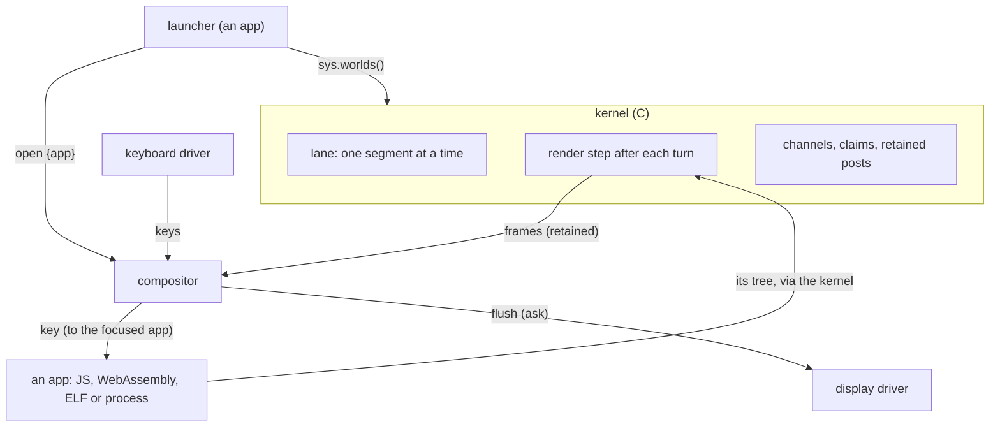
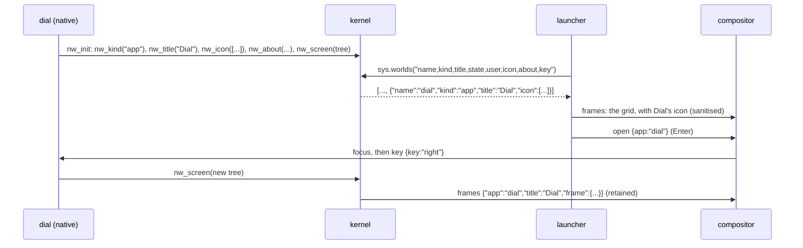

# Native screens and app icons: analysis, design and implementation guide

This guide is for an engineer who has not worked on picocalc-os before. It explains how an app gets onto the
PicoCalc's screen today, how the home screen (the *launcher*) knows which apps exist, and how *native worlds*
(programs written in C or C++ and run as WebAssembly, as machine code, or as a Linux process) talk to the rest of
the system. Then it designs and plans two features:

1. **Native worlds get a screen.** A native app can show a user interface and react to keys, exactly as a
   JavaScript app can. Today it can receive keys but has no way to show anything.
2. **Apps bring their own launcher icons.** Each app declares its title, icon, one-line description and shortcut
   letter in its own code. The launcher builds its grid from the worlds that are running instead of from a fixed
   list, so apps started from storage (JavaScript or WebAssembly) appear on it too.

The guide ends with a demonstration app, `natives/dial.c`, that is built three ways (a WebAssembly module, an ELF
module for the ESP32-P4, a host process), shows a screen, reacts to keys and has its own icon on the launcher.

> [!summary]
> - **The screen is data, not drawing.** An app's screen is a tree of ui nodes in JSON. The kernel asks a world
>   for its tree after each turn and posts it to the compositor, which draws it. Native worlds will hand the kernel
>   their tree with one system call, `nw_screen(tree, hints)`, and the kernel posts it exactly like a JavaScript
>   app's tree, retained and stamped with the app's name.
> - **An app describes itself.** `.icon(ops)`, `.about(text)`, `.key("x")` in JavaScript, `nw_icon`, `nw_about`,
>   `nw_key`, `nw_title` in C, all at start. The kernel validates and keeps them; `sys.worlds()` reports them; the
>   launcher shows every running app in manifest order.
> - **Untrusted apps stay recognisable.** An app from storage is shown under its world name (`u-dial`), with a
>   corner mark and no shortcut letter, and its icon is sanitised before it reaches the compositor. A tree that
>   cannot be drawn shows an error instead of crashing the compositor.

> [!note] Status (2026-11-01): implemented
> All four phases are implemented and committed (374e71d, 4e17af2, caa81ce, df0bec6, d90901e) and were run on the
> device: Dial as machine code on the ELF firmware, and `apps/dial.wasm` from storage on the normal firmware. Where
> the implementation differs from this guide:
>
> - **The launcher polls in two sizes (§7.3).** Every two seconds it reads only `name,kind,state,user` and reads the
>   icons again only when the set of apps changes; start and focus read everything. Reading and sanitising every
>   icon on every poll cost about 2.3 ms a time, seven times the old launcher.
> - **Icon text is bounded in width only (§7.4).** The compositor passes `maxw = 40 - x`; a height check would have
>   erased the REPL icon's 32-pixel `>`.
> - **The Loader opens a WebAssembly app after starting it** when the world reports kind `app` (not in this guide):
>   it used to open only JavaScript apps, because a WebAssembly world had no screen.
> - Dial's letter is `n`; in the ELF firmware the world is `nat-dial`.
> - A JavaScript `.title()` is still copied with truncation by `read_meta()`; only native titles go through
>   `kernel_present()`.
>
> The diary (`log/01-diary.md`, steps 2–6) has the measurements and the device captures (`various/`).

## 1. The system in one page

picocalc-os is a small operating system for the PicoCalc handheld (320×320 screen, a keyboard behind an I2C
microcontroller) on an ESP32-P4 board. The same kernel runs on a Linux host with a simulated board, which is where
most tests run.

Its programs are **worlds**. A world has its own memory and state and talks to others only through messages that
the **kernel** carries. The kernel (`picocalc-os/nucleus/`, C) runs one world at a time on one execution lane,
delivers messages, runs timers, enforces each world's memory and time budget, owns the hardware, and restarts a
world that crashes. The **manifest** (`js/system.json`) lists the worlds the system starts, with their files,
**claims** (the privileges each may use), memory limit and time budget.

A world runs on one of several **engines**:

| Engine | What runs | Isolation |
|---|---|---|
| `js` | a JavaScript file in QuickJS (most of the system) | its own JavaScript heap |
| `wasm` | a WebAssembly module in WAMR's interpreter | its own linear memory; only two imports reach the kernel |
| `native` (host) | a Linux process under a seccomp filter | an address space and a system-call filter |
| `native` (ESP32-P4) | an ELF module of machine code, loaded by `elf_loader` | none (trusted firmware drivers only) |

The last three are **native worlds** (PICOCALC-NATIVE). They are written in C or C++ against one SDK
(`picocalc-os/sdk/nw.h`) and built three ways from the same source.

**Apps from storage** are worlds the user starts from files in `apps/` on the device (the Loader app does it). They
are named `u-<name>`, get no claims, and may be JavaScript or WebAssembly, never machine code (PICOCALC-LOADER).



## 2. How an app gets onto the screen today

### 2.1 A JavaScript app

A JavaScript world is defined with a builder that the prelude (`js/prelude.js`) provides:

```js
app("snake")
  .title("Snake")
  .state({ score: 0 })
  .on("key", (s, k) => { if (k.key === "left") s.dir = "w"; })
  .every(110, (s) => step(s))
  .screen((s) => ui.col(ui.text("Snake", { font: "l" }), ui.text("score " + s.score)))
  .hints("←→↑↓ steer");
```

`screen(state)` returns a **tree of ui nodes**: plain objects such as `{t:"col", kids:[...]}`,
`{t:"text", s:"score 3"}`, `{t:"list", items:[...], sel:0}`, `{t:"canvas", w, h, ops:[...]}`. The helpers in
`ui.*` only build these objects; nothing is drawn by the app.

When the world starts, the prelude's `__init()` (`js/prelude.js:191`) returns what the world declared: its `kind`
(`app`, `service`, `driver`), `title`, the channels it `needs` and `provides`, its timers, and whether it has a
`screen`. `read_meta()` in `nucleus/vm.c` copies these into the world's `world_t`.

### 2.2 The render step

After every turn of a world that has a screen, `run_segment()` in `nucleus/kernel.c` (around line 682) asks the
engine for the world's tree as JSON (`eng_render(W)`), compares it with the last one (`W->frame`), and if it
changed, keeps it and posts it on the `frames` channel, wrapped with the world's name and title:

```c
// nucleus/kernel.c, run_segment(), simplified
if (rc == 0 && !booting && eng_running(W) && W->has_screen && shown && ...) {
  char *f = eng_render(W);                       // {"tree":{...},"hints":"..."}
  if (f && (!W->frame || strcmp(f, W->frame))) {
    free(W->frame); W->frame = f;
    char *post = frame_message(W);               // {"app":"snake","title":"Snake","frame":{...}}
    kernel_publish(W, "frames", post, NULL, 0);
  }
}
```

Two properties of this step matter for the design:

- **The kernel names the app.** The world never writes `"app"` itself, so no world can post a frame in another's
  name. `frames` is also a *guarded channel* (`nucleus/kernel.c:185`): only a world with the claim `frames.read`
  (the compositor) may listen, and no app may post on it directly.
- **The frame is retained.** Since PICOCALC-FRAMES, `W->frame` is the world's retained post on `frames`: a
  compositor that restarts is given every app's last frame when it starts (`replay_retained()`,
  `nucleus/kernel.c:313`).

### 2.3 The compositor and keys

The compositor (`js/system/compositor.js`) keeps the last frame of every app in `s.apps` (`.on("frames")`, line
424), and `paint()` draws the focused app's tree (line 352) with a status bar (title, battery, clock) and a hint bar.
It routes key events from the keyboard driver to the focused app as `key` messages, and brings an app to the front
when the launcher sends it `open {app}`.

```mermaid
sequenceDiagram
  participant App as an app
  participant K as kernel
  participant C as compositor
  participant D as display driver
  App->>App: a turn changes its state
  K->>App: render: the tree as JSON
  K->>C: frames {"app","title","frame"} (if it changed)
  C->>C: s.apps[app] = frame; draw if focused
  C->>D: flush the changed rectangles
  C->>App: key (when it is in front)
```

### 2.4 A native world

A native world is a program with two entry points and one way to call the kernel (`sdk/nw.h`):

```c
void nw_init(void);                    // once per start: declare channels, timers, kind
int  nw_on_event(const nw_event *e);   // a message, a tick, the start, a settled promise
// and system calls: nw_send, nw_publish, nw_ask, nw_every, nw_kind, nw_i2c, nw_store_save, ...
```

Every system call becomes one generic call, numbered in `sdk/nw_wire.h` and `nucleus/nucleus.h` (`NW_CALL_LOG`
= 1 … `NW_CALL_TIMER`), carrying up to three integers and three byte strings. Each backend carries it to the
kernel differently (a socket frame for a process, the import `nw.call` for WebAssembly, a function table for an
ELF module), and all of them end in one function, `nat_syscall()` in `nucleus/native.c`. That function checks
everything a binary passes: names are bounded and NUL-free, payloads must be strict JSON without handle markers
(`payload_ok`), and declarations (`nw_need`, `nw_provide`, `nw_every`, `nw_kind`) are refused outside `nw_init`
(`W->nat->in_init`).

So a native world can already do everything a JavaScript world can, except one thing: show a screen.

### 2.5 The launcher

The launcher (`js/apps/launcher.js`) is an ordinary app with the claim `sys.read`. Its apps are a fixed array at
the top of the file (line 2):

```js
const APPS = [
  { app: "chat", key: "c", label: "Agent", about: "Ask, read, and act with a focused assistant...",
    ops: [["rect", 2, 2, 36, 22], ["line", 9, 24, 9, 30], ...] },
  ... 14 apps ...
];
```

Each entry names the world to open, its shortcut letter, its label, a description, and its icon as a list of
drawing operations in a 40×30 box. The screen is a `grid` node of these items; the compositor's grid drawing
(`js/system/compositor.js:188`) draws each icon:

```js
// js/system/compositor.js, case "grid", per item
for (const [kind, a, b, c, d, e] of it.ops) {          // e: a colour name, or ink
  if (kind === "fill") fb.fill(ox + a, oy + b, c, d, col);
  else if (kind === "rect") fb.rect(ox + a, oy + b, c, d, col);
  else if (kind === "line") fb.line(ox + a, oy + b, ox + c, oy + d, col);
  else if (kind === "text") fb.text(ox + a, oy + b, c, d || "m", col);
}
```

The launcher shows four columns and three rows and scrolls by rows; arrows move the selection, Enter or an app's
letter opens it.

## 3. What is missing, with evidence

| Gap | Evidence |
|---|---|
| The kernel never asks a native world for a tree | `eng_render()` returns `NULL` for every engine but JavaScript (`nucleus/nucleus.h:378`) |
| A native world never has a screen | `nat_create()` sets `W->has_screen = false` (`nucleus/native.c:33`) and nothing sets it later |
| A native world cannot set its title | `nat_create()` sets the title to the world's name; there is no call to change it |
| A native world cannot post a frame itself | `frames` is guarded by `frames.read`, which only the compositor has; giving it to an app would let it read every app's screen |
| No app declares its own icon | the icons, labels, descriptions and letters live in `js/apps/launcher.js:2` |
| Apps from storage never appear on the launcher | the launcher's list is fixed; they appear only in the Loader's list |

One workaround exists and is deliberately not the design: a native world can `nw_send("compositor", "frames",
...)` a frame naming itself, because a channel post and a direct message reach the same handler and the
compositor only checks that the frame names its sender. A frame sent that way bypasses the render step: it is not
retained (it disappears when the compositor restarts), it is not deduplicated, and it depends on the compositor's
message format. The design keeps one path for every engine.

## 4. Design overview

The work has six parts:

1. **`nw_screen(tree, hints)`**, a system call that stores a native world's current tree in the kernel; the render
   step picks it up after the world's turn like a JavaScript world's tree.
2. **App presentation**: title, icon, description, shortcut key. Declared by the app at start (JavaScript builder
   or C calls), validated and kept by the kernel (`kernel_present()`), reported by `sys.worlds()`.
3. **The launcher built from the running worlds**, in manifest order, apps from storage included and marked.
4. **Defensive drawing**: the launcher sanitises icons; the compositor draws an app's tree inside a guard.
5. **`sdk/nw_ui.h`**, a small C helper that writes ui trees as JSON without a C library.
6. **`natives/dial.c`**, a demonstration app built as a process, a WebAssembly module and an ELF module.



## 5. Decision records

### Decision: native screens are pushed and rendered by the kernel's existing step

- **Context:** A JavaScript world is *pulled*: the kernel calls `__render()` after each turn. A native world could
  be pulled too (a new `render` event to the binary) or could push its tree with a system call.
- **Options considered:** (a) a render event after each turn; (b) a system call that stores the tree, read by the
  render step; (c) the binary sends frames to the compositor itself.
- **Decision:** (b), `nw_screen(tree, hints)`. The kernel keeps the latest tree in the world's native state;
  `eng_render()` returns a copy of it for native worlds; the existing render step deduplicates, retains and posts.
- **Rationale:** (a) costs an extra event, an extra crossing into the binary and its budget, after every turn,
  even when nothing changed; a C program knows when its screen changed. (c) loses retention and naming (section 3).
  (b) reuses every property of the JavaScript path with about thirty lines of kernel code.
- **Consequences:** A native app calls `nw_screen` whenever its state changes, typically at the end of each event.
  The frame is posted after the turn, like a JavaScript frame. Calling it in `nw_init` gives the app a screen from
  its first turn.
- **Status:** accepted.

### Decision: an app describes itself in its code; the kernel validates and keeps it

- **Context:** The launcher needs a title, an icon, a description and a shortcut letter per app. They could live
  in the manifest, in the launcher, or in the app.
- **Options considered:** (a) keep them in the launcher; (b) put them in the manifest entry; (c) the app declares
  them at start.
- **Decision:** (c). JavaScript: `.icon(ops)`, `.about(text)`, `.key(ch)` next to the existing `.title(t)`. C:
  `nw_title`, `nw_icon`, `nw_about`, `nw_key` in `nw_init`.
- **Rationale:** Apps from storage have no manifest entry and are unknown to the launcher, so (a) and (b) cannot
  show them. The title is already declared by the app. The manifest stays what it is: what the system grants a
  world (claims, budgets), not how it looks.
- **Consequences:** Fourteen apps move their icon and description from `launcher.js` into their own files. The
  kernel needs validation and storage for four small fields, cleared at every start.
- **Status:** accepted.

### Decision: one system call for presentation

- **Context:** Four C functions are needed. Each could be its own system call.
- **Options considered:** four calls; one call `NW_PRESENT(field, value)`.
- **Decision:** one call, `NW_PRESENT`, with the field name as its first string; the SDK wraps it in four
  functions. Like all declarations it is accepted only in `nw_init`.
- **Rationale:** One number on the wire and one case in `nat_syscall`, which hands both to the same
  `kernel_present()` that the JavaScript binding uses. Fields can be added without new numbers.
- **Consequences:** `kernel_present()` is the single place that validates presentation, for every engine.
- **Status:** accepted.

### Decision: the launcher shows apps in manifest order, then apps from storage

- **Context:** The launcher's current order (Agent, Files, Editor, Calc, Agenda, Settings, Logs, Loader, System,
  REPL, Snake, Faults, Keys, About) was chosen by hand. With the list gone, an order has to come from somewhere.
- **Options considered:** (a) manifest order; (b) an `order` field per app; (c) a list of names kept in the
  launcher.
- **Decision:** (a), with `sysmon` moved after `loader` in `js/system.json` so the grid stays exactly as it is. Apps
  from storage follow, in the order they were started.
- **Rationale:** The manifest is already the system's ordered list of worlds. (b) invites conflicts; (c) is the
  fixed list again.
- **Consequences:** World ids after `sysmon` shift by one; the System app lists worlds in id order, so its screenshots
  change. The launcher's screenshots must not change: they are the regression test for the new launcher.
- **Status:** accepted.

### Decision: apps from storage are visibly different on the launcher

- **Context:** An app from storage is untrusted (PICOCALC-LOADER). If it could look like Settings on the home
  screen, a user could type a Wi-Fi password into it.
- **Options considered:** hide them from the launcher; show them like system apps; show them marked.
- **Decision:** show them, marked: the label is the world's name (`u-dial`; the kernel already forces the title of a
  `u-` world to its name, `nucleus/kernel.c:593`), a filled corner mark on the tile, no shortcut letter (a declared
  `key` is ignored), and the description starts with "From storage:". Stopped apps from storage are not shown.
- **Rationale:** The feature exists to let such apps be launched; marking them keeps the system apps recognisable.
- **Consequences:** The grid node gets one new item field, `mark`.
- **Status:** accepted.

### Decision: validation in three places, each for what it can check

- **Context:** An icon is data from any app that ends up drawn by the compositor, which every app depends on. A
  native tree is hand-written JSON.
- **Decision:** the **kernel** checks shape and size (an icon is a JSON array of at most 1024 bytes; a tree is a
  JSON object of at most 16 KB with its hints; text fields are bounded and valid UTF-8); the **launcher** sanitises
  icon semantics (known operations, numbers clamped to the 40×30 box, known colours, at most 32 operations, text of
  at most 3 characters); the **compositor** draws each app's tree inside `try`/`catch` and shows "this screen could
  not be drawn" instead of crashing.
- **Rationale:** The kernel cannot parse a drawing language cheaply in C; the launcher can. The compositor guard
  covers JavaScript apps too, which could always return malformed trees.
- **Status:** accepted.

## 6. APIs

### 6.1 JavaScript (prelude)

```js
app("calc")
  .title("Calc")                        // exists
  .key("x")                             // its letter on the launcher (system apps only)
  .about("Scientific, with calculus and a solver; graphs of up to four curves; F6 help.")
  .icon([["rect", 8, 0, 24, 30], ["fill", 11, 3, 18, 7], ["fill", 25, 19, 4, 8, "accent"]])
```

`__init()` returns `icon`, `about` and `key` with the rest of the world's declarations. `sys.worlds(fields)` takes an
optional comma-separated list of fields; `icon`, `about` and `key` are included only when asked for, so the System
app's polling does not grow.

### 6.2 C (sdk/nw.h)

```c
// Presentation, in nw_init only. A storage app's title is always its world name.
int nw_title(const char *title);        // at most 31 bytes
int nw_icon(const char *ops_json);      // a JSON array of drawing operations in a 40 x 30 box, at most 1024 bytes
int nw_about(const char *text);         // one line for the launcher, at most 159 bytes
int nw_key(const char *letter);         // "a".."z" or "0".."9": its shortcut on the launcher (firmware apps only)
// The screen, at any time: the tree of ui nodes (a JSON object) and the hint bar's text. The kernel shows it after
// the current event, if it changed; at most 16 KB with the hints.
int nw_screen(const char *tree_json, const char *hints);
```

Wire numbers: `NW_CALL_SCREEN` and `NW_CALL_PRESENT` are appended after `NW_CALL_TIMER`, so every module built
before keeps its numbers.

### 6.3 C (sdk/nw_ui.h): writing trees

```c
char buf[4096];
nw_ui u;
nw_ui_begin(&u, buf, sizeof buf);
nw_ui_open(&u, "col", "\"gap\":6");                 // {"t":"col","gap":6,"kids":[
nw_ui_text(&u, "Dial", "\"font\":\"l\"");           //   {"t":"text","s":"Dial","font":"l"}
nw_ui_node(&u, "{\"t\":\"bar\",\"v\":0.5}");        //   any node as JSON
nw_ui_close(&u);                                   // ]}
if (nw_ui_end(&u) >= 0) nw_screen(buf, "←→ level");
```

It escapes strings with `nw_json_quote`, manages commas, and reports overflow; it uses no C library, like
`nw_json.h`, so it works in every build.

### 6.4 Kernel

```c
// nucleus/kernel.c: what a world shows about itself; field is "title", "icon", "about" or "key". 0, or -1 and why.
int kernel_present(world_t *W, const char *field, const char *value, char *why, size_t n);
// world_t gains: char *icon; char about[160]; char key[2];   cleared in boot_world before the engine starts
// nucleus/native.c
char *nat_render(world_t *W);   // a copy of the tree nw_screen stored, or NULL; eng_render calls it for native worlds
```

## 7. Pseudocode

### 7.1 The two system calls

```c
case NW_SCREEN: {                                  // nw_screen(tree, hints)
  if (!payload_ok(c, 0) || first byte of tree is not '{') return fail("a screen is a JSON object");
  if (!text_ok(c, 1, HINTS_MAX)) return fail("hints are text of at most %d bytes");
  if (c->n[0] + c->n[1] > NW_SCREEN_MAX) return fail("a screen is at most %d bytes");
  sbuf: {"tree":<tree>,"hints":<hints as a JSON string>}
  free(W->nat->screen); W->nat->screen = it; W->has_screen = true; charge(size)
  return 0;
}
case NW_PRESENT: {                                 // nw_title / nw_icon / nw_about / nw_key
  if (!W->nat->in_init) return fail("presentation is declared only while a world starts");
  field = str(c, 0); value = str(c, 1);
  if (field is "icon" && !payload_ok(c, 1)) return fail("an icon is a JSON array of drawing operations");
  if (field is not "icon" && !text_ok(c, 1, ...)) return fail("not text");
  return kernel_present(W, field, value, why) ? fail(why) : 0;
}
```

### 7.2 Presentation in the kernel

```c
int kernel_present(world_t *W, const char *field, const char *v, char *why, size_t n) {
  if (field == "title") { 1..NAME_LEN-1 bytes; copy to W->title }       // boot_world overrides it for u- worlds
  else if (field == "icon") { a JSON array ('[' first), at most ICON_MAX; W->icon = copy }
  else if (field == "about") { at most ABOUT_MAX - 1 bytes; copy to W->about }
  else if (field == "key") { exactly one of a-z, 0-9; copy to W->key }
  else error "a world presents title, icon, about or key"
}
// boot_world(): free(W->icon); W->icon = NULL; W->about[0] = W->key[0] = 0;  then eng_create(W)
// kernel_worlds_json_fields(): "icon", "about", "key" only when the fields name them
```

### 7.3 The launcher

```js
function lnRefresh(s) {                                        // every 2 s and on focus
  const ws = sys.worlds("name,kind,title,state,user,icon,about,key");
  s.apps = ws.filter((w) => w.kind === "app" && w.name !== self && !(w.user && w.state === "stopped"))
    .map((w) => ({ app: w.name, label: w.title, mark: w.user,
                   key: w.user ? "" : w.key || "",           // first system app with a letter keeps it
                   about: (w.user ? "From storage: " : "") + (w.about || ""),
                   ops: lnOps(w.icon) }));                    // sanitised, or a letter icon
  ... counts for the status line as before ...
}
```

### 7.4 The compositor guard

```js
if (app && app.tree) {
  try { draw(fb, app.tree, 8, TOP + 6, W - 16, BODY - 10); }
  catch (e) { fb.fill(body); fb.text(..., `${s.focus}'s screen could not be drawn`); fb.text(..., e.message); }
}
```

## 8. The demonstration app

`natives/dial.c` is a level from 0 to 100, set with the arrow keys, shown as a large number, a bar and a gauge drawn
on a canvas, with counters for keys and seconds. It uses only the SDK, `nw_json.h`, `nw_ui.h` and `snprintf` (which
every build has: the C library of a process, wasi-libc for WebAssembly, the firmware's for an ELF module), and no
floating-point library: the gauge's points come from a table.

```c
void nw_init(void) {
  nw_kind("app");
  nw_title("Dial");
  nw_about("A native app in C: the same source as WebAssembly, an ELF module or a process.");
  nw_icon("[[\"rect\",4,4,32,22],[\"line\",20,22,12,10,\"accent\"],[\"fill\",8,24,24,2]]");
  nw_every(1000);
  show();                                     // nw_screen(...) with the first tree
}
int nw_on_event(const nw_event *e) {
  if (e->kind == NW_TICK) seconds++;
  else if (e->kind == NW_MESSAGE && !strcmp(e->type, "key")) { read "key" and "state"; change the level }
  show();
  return NW_DONE;
}
```

It is built by `make natives wasm` (host process and WebAssembly) and by the P4's ELF build
(`port/esp32p4/main/CMakeLists.txt`), and listed in the ELF manifest (`optional/native_elf/system.elf.json`).
On the normal firmware it runs from storage: `apps/dial.wasm`, started by the Loader.

## 9. Implementation phases

1. **Kernel and native ABI**: `kernel_present`, `world_t` fields, `NW_SCREEN`, `NW_PRESENT`, `nat_render`,
   `eng_render`, `sys.worlds(fields)`, the SDK functions, `nw_ui.h`. Host tests with the echo native.
2. **JavaScript presentation**: the prelude builder and `__init`, `read_meta`; the fourteen apps declare their
   icons; `sysmon` moves in the manifest.
3. **Launcher and compositor**: the launcher from `sys.worlds`, the `mark` field, icon sanitising, the drawing
   guard. The launcher's screenshots must be byte-identical.
4. **The demo app** in three builds, an end-to-end host test, and the device (ELF firmware; WebAssembly from storage
   on the normal firmware).

## 10. Test strategy

- **Kernel and ABI** (`tests/test_native_worlds.py`, both engines): a native app's tree reaches a viewer with
  `frames.read`, stamped with its name and title; a key message changes it; `sys.worlds` reports kind, title,
  icon, about, key; `nw_screen` refuses non-JSON, non-objects and oversize trees; presentation after `nw_init` is
  refused; a bad key letter is refused.
- **JavaScript presentation** (`tests/test_sys_native.py`): a JavaScript app's icon, about and key in
  `sys.worlds`; not in the default field set; a storage app's title stays its name.
- **Launcher** (`tests/sysapps.test.mjs`): the grid from fake worlds in order; letters; a storage app marked,
  without a letter, its icon sanitised; a malformed icon replaced by a letter icon; more than twelve apps scroll.
- **End to end** (host binary, the real `js/` tree plus the dial process): the launcher shows Dial; opening it
  shows its screen; arrow keys change it; a JavaScript app with a malformed tree does not crash the compositor.
- **Regression**: every host suite; `make shots` with the launcher captures unchanged.
- **Device**: the ELF firmware shows Dial on the launcher and runs it; on the normal firmware `apps/dial.wasm`
  started by the Loader appears as `u-dial` with its mark.

## 11. Risks and open questions

- **Frame size.** A native tree is capped at 16 KB; JavaScript trees have no cap. Large lists should be windowed by
  the app, as the Logs app now does (PICOCALC-SPEED).
- **Icons of apps from storage** can still imitate a system icon's drawing; the mark and the name are what
  distinguish them.
- **PaperS3.** Its launcher and prelude are separate (`js-papers3/`) and are not changed here; its kernel binding
  (`vm_mqjs.c`) ignores the new fields.

## 12. References

| File | What to read there |
|---|---|
| `picocalc-os/nucleus/kernel.c` | `run_segment` (render step), `boot_world`, `replay_retained`, `kernel_worlds_json_fields` |
| `picocalc-os/nucleus/native.c` | `nat_create`, `nat_syscall`, `payload_ok`, `name_ok` |
| `picocalc-os/nucleus/nucleus.h` | `world_t`, `native_t`, the `NW_*` call numbers, `eng_render` |
| `picocalc-os/nucleus/vm.c` | `read_meta`, `op_sys_json` |
| `picocalc-os/sdk/nw.h`, `nw_calls.inc`, `nw_wire.h`, `nw_json.h` | the native SDK |
| `picocalc-os/js/prelude.js` | the builder, `__init`, `__render`, `ui.*` |
| `picocalc-os/js/apps/launcher.js` | the home screen |
| `picocalc-os/js/system/compositor.js` | `case "grid"`, `paint()`, `.on("frames")`, `.on("open")` |
| `picocalc-os/natives/echo.c` | the native test driver |
| `picocalc-os/tests/test_native_worlds.py` | native tests, both engines |
| `picocalc-os/port/esp32p4/main/CMakeLists.txt`, `optional/native_elf/system.elf.json` | the ELF build and manifest |
