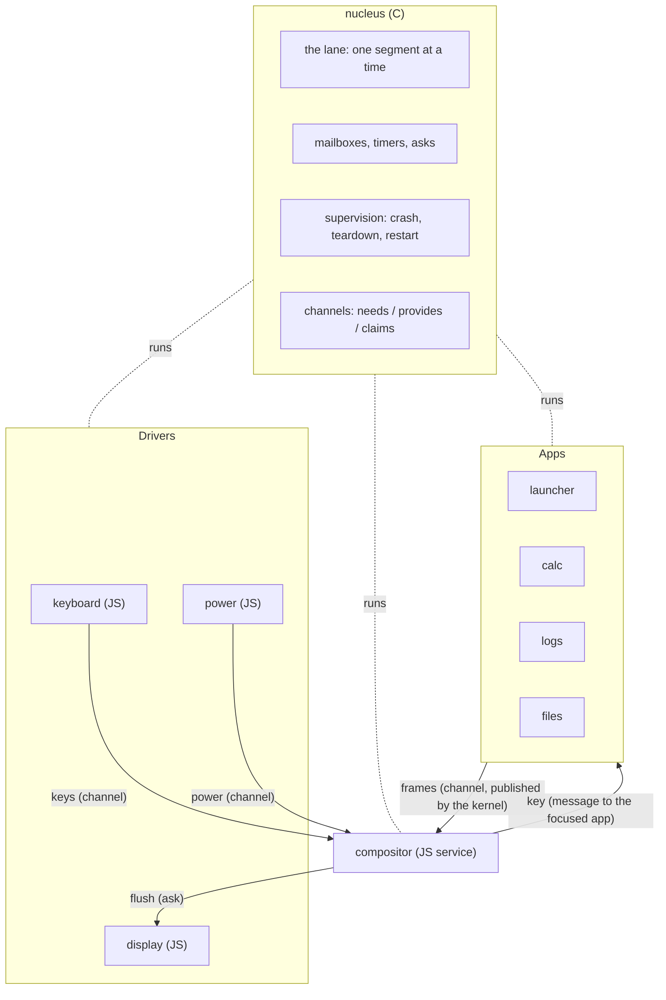
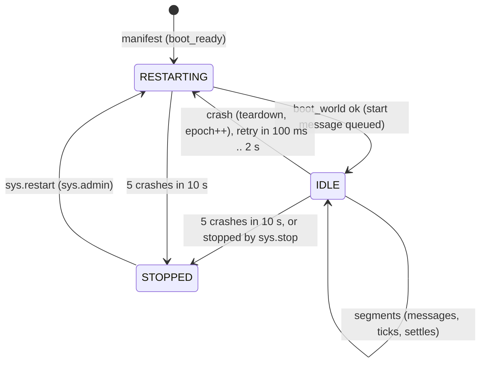

# Retained channel messages: analysis, design and implementation guide

This guide explains one bug in picocalc-os and the change that fixes it, and it explains enough of the system
around the bug that a new engineer can make the change and judge it. The bug is visible on the device: after the
compositor restarts, opening the calculator shows "starting calc…" forever, and the battery icon in the status bar
stays empty. Nothing crashes, nothing times out, and the calculator itself is fine. The reason is that the
compositor's knowledge of the screen is built from messages that were sent once, and when the compositor restarts,
nobody sends them again.

The fix is a small kernel feature, *retained channel messages*: the kernel keeps the last message a world published
on a channel when the world asks it to, and hands those messages to any world that starts later and listens on that
channel. A world's frame (what its screen shows) becomes its retained message on the `frames` channel.

The guide is long because the bug sits at the junction of four parts of the system: worlds and the kernel's lane,
messages and channels, supervision (crash and restart), and the screen pipeline. Sections 1 to 5 explain those
parts. Section 6 shows the failure with evidence. Sections 7 to 11 are the design and the implementation plan.
Section 12 is the test plan, and sections 13 and 14 are API and file references.

> [!note] Status
> Implemented as designed in commit 0da00ca (sections 9.1 to 9.5, without deviations). Validated on the
> host (section 12's tests, the repro of section 6.2 now gives the same capture before and after the restart) and
> on the device (a compositor killed from the console comes back with Calc and the battery level). See the diary.

> [!summary]
> - A world's state is lost when it restarts, by design. The compositor's state is a copy of other worlds' state
>   (their frames, the battery level), which it received as messages. After a restart it has nothing.
> - The kernel publishes a frame only when it changed, so an app that is not doing anything never sends its frame
>   again. The compositor shows its placeholder until the app's screen changes.
> - Retained messages make that copy recoverable: the kernel keeps the last *state* message per publisher and
>   channel, and replays them to a world that starts and needs that channel. Events (key presses, crash reports)
>   are not retained.

## 1. The system in one page

picocalc-os is a small operating system for the PicoCalc, a handheld with a 320×320 screen, a keyboard behind an
I2C microcontroller, and (in this project) an ESP32-P4 board. Its programs are *worlds*. Most worlds are JavaScript
files run by QuickJS; some are native (WebAssembly or machine code, see PICOCALC-NATIVE). Every world has its own
heap and its own state and talks to other worlds only through messages that the kernel carries.

The kernel (the *nucleus*, in `picocalc-os/nucleus/`) is written in C. It runs one world at a time on a single
execution lane, delivers messages, runs timers, enforces budgets (memory, time per turn), owns the hardware, and
restarts worlds that fail. The same kernel runs on the host (Linux, with a simulated board in `host/`) and on the
device (`port/esp32p4/`), so most behaviour, including this bug, can be reproduced and tested on a laptop.



The manifest `picocalc-os/js/system.json` lists the worlds the device starts, with their files, *claims* (the
hardware and privileged channels each may use), memory limit and turn budget. For example:

```json
{ "name": "compositor", "file": "system/compositor.js", "claims": ["dma", "keys.raw", "frames.read"], "budget_ms": 80, "mem_kb": 768 },
{ "name": "calc",       "file": "apps/calc.js",                                                 "budget_ms": 200, "mem_kb": 1024 },
```

## 2. Worlds and the lane

### 2.1 What a world is

A JavaScript world is defined with a builder that the *prelude* (`js/prelude.js`, evaluated in every world before
its own file) provides:

```js
app("snake")                         // or driver(...), service(...)
  .title("Snake")
  .state({ score: 0 })               // the world's state; a fresh copy at every start
  .needs("keys")                     // channels it receives
  .provides("news")                  // channels it may publish on
  .onStart((s) => ...)
  .on("key", (s, payload, msg) => ...)   // a message handler; msg.from is the sender's name
  .every(110, (s) => ...)                // a timer
  .screen((s) => ui.col(ui.text(`score ${s.score}`)))
  .hints("←→↑↓ steer");
```

When the world starts, the kernel calls the prelude's `__init()`, which returns what the world declared
(`kind`, `title`, `needs`, `provides`, timers, whether it has a screen). The kernel copies these into the world's
`world_t` (`nucleus/nucleus.h`): `needs[]`, `provides[]`, `has_screen`, and so on. Declarations happen only at
start; a running world cannot add channels.

### 2.2 Segments, turns and the mailbox

The kernel runs worlds on one *lane*. A *segment* is one stretch of one world's code: handling a message, a timer
tick, or the settling of a promise. A *turn* is one message handled to completion; an `async` handler's turn lasts
until its promise settles, over several segments. Each world has a mailbox (`W->mbox`); `pick()` in `kernel.c`
chooses the next world to run by priority and time, and `run_segment()` runs it.

Two rules from `run_segment()` matter here:

- **Effects are deferred.** Messages, channel posts, replies and bus transfers that a segment issues are queued
  with `defer()` and applied only when the segment ends (`apply_deferred()`). A segment that crashes has no
  effects: `crash_at()` calls `discard_deferred()`.
- **Rendering is part of the segment.** After a world's segment, if it has a screen, the kernel calls the engine's
  render function and may publish a frame (section 5).

```c
// nucleus/kernel.c, run_segment(), simplified
K.cur = W;
if (booting) rc = boot_world(W);           // eng_create, channel checks, queue the "start" message
else rc = eng_dispatch(W, m);              // or eng_settle(W, s)
if (rc == 0 && W->has_screen && ...) {      // render
  char *f = eng_render(W);
  if (f && (!W->frame || strcmp(f, W->frame))) { W->frame = f; kernel_publish(W, "frames", {app, title, frame: f}); }
}
... budget and error checks; crash(W, why) on failure ...
if (rc == 0 && booting && !why[0]) start_timers(W, ...);
K.cur = NULL;
apply_deferred(K.lane_free);               // the segment's effects happen now
```

### 2.3 Virtual time and real time

On the host the kernel runs on virtual time (`K.vnow`), so a script replays exactly. On the device
(`K.realtime`) it runs on the real clock and a turn that runs past its budget is an *overrun*, which is a crash.
That is how the compositor crashed on the device in section 6: its drawing took more than its 80 ms budget.

## 3. Messages and channels

A world talks to another in three ways (prelude section "messages"):

| Call | Meaning | Kernel function |
|---|---|---|
| `send(to, type, payload)` | one message to one world, by name | `defer_deliver(T, new_msg(M_ON, type, json, W->id))` in `op_send` |
| `ask(to, type, payload, {timeout})` | a message that expects an answer; returns a promise | `kernel_ask()` |
| `publish(channel, payload)` | one message to every world that needs the channel | `kernel_publish()` |

A message carries a type, a JSON payload, optional handles (capabilities, section 3.3), and the sender's world id;
the prelude turns the id into `msg.from`, a name. A channel post arrives exactly like a `send` whose type is the
channel's name: `kernel_publish()` creates `new_msg(M_ON, ch, json, from->id)` for each listener. So
`.on("frames", ...)` in the compositor receives both channel posts on `frames` and direct `send`s of type
`frames`; it tells them apart only by checking the payload against `msg.from`.

```c
// nucleus/kernel.c
void kernel_publish(world_t *from, const char *ch, const char *json, const int *hs, int nh) {
  K.published++;
  for (int i = 0; i < K.n_worlds; i++) {
    world_t *T = K.worlds[i];
    if (T == from || T->status == W_STOPPED || !world_needs(T, ch) || !world_may_use(T, ch)) continue;
    msg_t *m = new_msg(M_ON, ch, json, from ? from->id : -1);
    ... copy handles ...
    defer_deliver(T, m);
  }
}
```

The important property for this ticket: **a channel post goes to the worlds that need the channel at the moment it
is published, and is then gone.** A world that starts later never sees it.

### 3.1 Needs and provides

A world declares the channels it receives (`.needs`) and posts on (`.provides`). `op_publish` (`nucleus/vm.c`)
refuses a post on a channel the world does not provide. The kernel itself publishes on `worlds.status` (supervision
events, sender `null`) and on `frames` (on behalf of worlds with a screen; section 5).

### 3.2 Guarded channels

Some channels carry what the user types or sees. `GUARDED[]` in `kernel.c` ties each to a claim:

| Channel | Claim | Why |
|---|---|---|
| `keys` | `keys.raw` | keystrokes may be a password |
| `frames` | `frames.read` | another app's screen may show private data |
| `touch` | `touch.raw` | PaperS3 touches |

A world may need or provide a guarded channel only if its manifest entry has the claim (`world_may_use()`); the
check runs at start (`channels_allowed()`) and on every publish. Only the compositor has `frames.read`. An app
never provides `frames` itself: the kernel publishes its frame for it, stamped with its own name, so no app can
publish a frame in another app's name.

### 3.3 Handles

A handle is a capability for hardware (an I2C device, a framebuffer, a file). It travels inside a message; on
delivery (`handle_event`, `E_DELIVER`) the kernel grants it to the receiver. This matters for the design: a message
that is replayed later must not carry handles, or the kernel would grant a capability long after the sender meant
to, to a world that did not exist when it was sent.

## 4. Supervision: crash, teardown, restart

A world that throws, overruns its budget or runs out of memory *crashes*. `crash_at()` in `kernel.c`:

1. records why, writes a `#OCT1` fault line to the UART;
2. calls `teardown()`, which disposes of the world's VM (its whole heap and state), drops its handles, its pending
   promises, its timers' queued ticks, **and its last frame** (`free(W->frame); W->frame = NULL`), and increments
   `W->epoch` so stale timers and replies miss the new instance;
3. schedules a restart after 100 ms, doubling up to 2 s; after five crashes in ten seconds the world stays stopped;
4. publishes `{"world":..., "state":"crashed", ...}` on `worlds.status`.

When the restart is due, `run_segment()` boots the world again: a fresh VM, the world's file evaluated again,
`state` reset to its initial value, the `start` message queued. The new instance knows nothing the old one knew.
That is the intended behaviour: a crash wipes the state that may have caused it.



## 5. The screen pipeline

Apps never draw. An app's `screen(state)` returns a tree of ui nodes (`col`, `row`, `text`, `list`, `canvas`, …),
built with the prelude's `ui.*` helpers. The pipeline from state to pixels:

```mermaid
sequenceDiagram
  participant App as calc (world)
  participant K as kernel
  participant C as compositor
  participant D as display driver
  App->>App: a turn changes state
  K->>App: __render() after the segment
  App-->>K: {"tree":..., "hints":...}
  K->>K: same as W->frame? then stop here
  K->>C: frames: {"app":"calc","title":"Calc","frame":{...}} (deferred, then delivered)
  C->>C: s.apps["calc"] = {title, tree, hints}; dirty()
  C->>C: draw: paint(s) lays out s.apps[s.focus] into the back buffer
  C->>D: ask flush {rects}
  D->>D: SPI: CASET, RASET, RAMWR, pixels
```

Three details of this pipeline cause the bug.

**The kernel deduplicates frames.** `run_segment()` keeps the last frame in `W->frame` and publishes only when the
new render differs (`strcmp(f, W->frame)`). An app that handles a message without changing what it shows produces
no frame. This saves a lot of work: the logs app ticks every 500 ms and most ticks change nothing.

**The compositor's copy is plain state.** `s.apps` in `js/system/compositor.js` holds the last frame of every app,
and `paint()` draws `s.apps[s.focus]`. When there is no entry it draws a placeholder:

```js
// js/system/compositor.js, paint()
const msg = s.crashed[s.focus] ? `${s.focus} is not running` : `starting ${s.focus}…`;
```

The status bar shows `app ? app.title : s.focus`, which is why the title turns into the lowercase world name
("calc" instead of "Calc") when the frame is missing.

**The battery level is the same kind of copy.** `js/drivers/power.js` samples the battery every five seconds and
publishes on `power` only when the level or the charging state changed. The compositor keeps the last one in
`s.battery` and draws the battery glyph from it.

## 6. The failure

### 6.1 On the device

With the ELF test firmware, JavaScript runs about 2.8× slower than usual (that is PICOCALC-SPEED). Opening the Logs
app made the compositor's drawing turn overrun its 80 ms budget. The kernel trace (`trace on` on the console):

```
[7808518.438] compositor <- open from launcher {"app":"logs"}
[7808532.646] compositor <- draw from compositor
[7808616.068] compositor crashed handling draw: ran past its turn budget of 80 ms
[7808719.928] starting compositor (system/compositor.js)
...
[7815058.246] compositor <- open from launcher {"app":"calc"}
[7815128.148] calc <- focus from compositor
```

After `calc <- focus` no `compositor <- frames from calc` line follows, for the rest of the capture. The `stats`
command showed calc at 4 turns in two hours, idle, with no error. A screenshot showed the placeholder: a dark
status bar reading "calc", an empty battery glyph, and "starting calc…" in the middle of the screen.

### 6.2 On the host

The host binary reproduces it deterministically, with no slowdown needed; the `crash` script command kills a world
as a fault would:

```
wait 1500
key x                  # the launcher opens Calc
wait 800
capture 01-calc-before.png
key f1                 # back to the launcher
wait 400
crash compositor
wait 1500
key x                  # open Calc again
wait 1500
capture 02-calc-after-compositor-restart.png
```

```bash
cd picocalc-os && make
./build/picocalc-host -j js -o out -f fs script.txt
```

`01-calc-before.png` shows the calculator. `02-calc-after-compositor-restart.png` shows "starting calc…" and an
empty battery glyph.

### 6.3 Why

The sequence, step by step:

```mermaid
sequenceDiagram
  participant Calc as calc
  participant K as kernel
  participant C as compositor
  Note over Calc,C: earlier: calc rendered frame F; K keeps W->frame = F; C has s.apps.calc = F
  K->>C: crash (overrun) - teardown: VM, s.apps, s.battery gone
  K->>C: restart: fresh state, s.apps = {}, s.battery = null
  C->>Calc: focus (user opens Calc)
  Calc->>Calc: turn: nothing visible changes
  K->>Calc: __render() returns F again
  K->>K: F equals W->frame: nothing published
  C->>C: paint: s.apps.calc is missing -> "starting calc..."
```

Each piece is reasonable alone. The compositor losing its state on a crash is supervision working as designed. The
kernel not republishing an unchanged frame is an optimisation that is correct as long as every listener has seen
the previous frame. The power driver publishing only changes is the same optimisation. The bug is the combination:
**a listener that restarts has not seen the previous messages, and nothing gives them to it again.** "Starting
calc…" never ends because no part of the system is waiting for anything; there is nothing to time out.

### 6.4 Two kinds of channel message

The channels in the system carry two different kinds of message:

| Channel | Publisher | Kind | Replaying the last one to a new listener |
|---|---|---|---|
| `frames` | kernel, for each app with a screen | **state**: "my screen is now this" | correct and needed |
| `power` | power driver | **state**: "the battery is at 87 %, not charging" | correct and needed |
| `keys` | keyboard driver | **event**: "the key a went down" | wrong: a key would be pressed twice |
| `worlds.status` | kernel | **event**: "logs crashed" | wrong: old crash banners would come back |
| `time` (PaperS3) | clock driver | **state** | correct |
| `touch`, `gestures`, `activity` (PaperS3) | touch driver, compositor | **event** | wrong |

A state message replaces the previous one; only the latest matters, and a new listener needs exactly that one. An
event message is meaningful once, at the time it happened. The fix must keep the latest state and must not replay
events. Only the publisher knows which kind it sends.

## 7. Designs considered

**A. Forget every frame when the compositor starts.** When a world that needs `frames` boots, the kernel would
clear `W->frame` of every world, so each publishes its next render even if unchanged. This fixes Calc as soon as it
gets a turn (opening it sends `focus`), but an app the compositor shows without a turn stays blank until something
happens, and it does nothing for the battery. It also hard-codes "the compositor" into the kernel's restart path.

**B. The compositor asks for a redraw.** On start, the compositor would send every app a `redraw` message. Each
app would take a turn just to render a frame the kernel already has, and the dedup would still suppress it unless
the kernel also forgot `W->frame` (design A again). The battery would need its own request, and every future
state channel another.

**C. The compositor saves its copy in persistent storage.** `s.apps` would survive in the world's store. Frames
are several kilobytes each and change often; the store is flash with a small quota; and a frame from before the
crash may be the very thing that crashed the compositor.

**D. Retained messages (chosen).** The kernel keeps, for each publisher and channel, the last message the
publisher marked as retained, and delivers those messages to a world when it starts, for each channel it needs.
The publisher decides what is state. The kernel already keeps a world's last frame (`W->frame`), so for `frames`
the retained message costs no new memory: it *is* the kept frame. The mechanism is not specific to the compositor:
any world that needs a state channel and restarts gets the current state. It is the same idea as MQTT's retained
messages, reduced to what this kernel needs.

## 8. The design

### 8.1 Rules

1. **Retaining is the publisher's choice.** `publish(ch, payload, { retain: true })` posts the message as usual and
   also keeps it as the publisher's *retained message* on `ch`, replacing the previous one. A post without
   `retain` is delivered and not kept, and does not change what is retained.
2. **A world's frame is its retained message on `frames`.** The kernel already keeps `W->frame`; the retained
   frame message is built from it (`{"app": W->name, "title": W->title, "frame": W->frame}`), exactly as published.
3. **Replay on start.** When a world finishes booting (its start segment succeeded), the kernel delivers to it,
   for each channel it needs and may use, the retained message of every other world that has one on that channel.
   The messages arrive after the `start` message and before anything published later, with `msg.from` set to the
   publisher, exactly like a live post.
4. **Retained messages die with their publisher.** `teardown()` drops a world's retained messages along with its
   frame. A crashed or stopped publisher retains nothing; when it restarts it publishes its state again.
5. **No handles.** A retained post may not carry handles; `publish` throws if it does. A capability is granted
   when it is sent, to the worlds listening then, never later.
6. **Same checks as a live post.** Replay goes only to worlds that need the channel and pass `world_may_use()`
   (the guarded-channel claim), never to the publisher itself, never to a stopped world.
7. **Bounded.** A world's retained messages (other than its frame, which already exists) are at most 4096 bytes in
   total; a retained post over that throws.

### 8.2 What this changes for each channel

| Channel | Change |
|---|---|
| `frames` | retained automatically (rule 2); no change to any app |
| `power` | `power.js` posts with `{ retain: true }` |
| `time` (PaperS3) | `clock.js` posts with `{ retain: true }`; `power.js` on the PaperS3 likewise |
| `keys`, `touch`, `gestures`, `activity`, `worlds.status` | none: events stay unretained |

### 8.3 The corrected sequence

```mermaid
sequenceDiagram
  participant Calc as calc
  participant P as power
  participant K as kernel
  participant C as compositor
  Note over Calc,K: calc's frame F is kept (W->frame); power's last post is retained
  K->>C: crash, teardown, restart
  K->>C: boot ok: start
  K->>C: replay: frames {"app":"calc",...,"frame":F} from calc
  K->>C: replay: frames from launcher, logs, ... (every world with a frame)
  K->>C: replay: power {"pct":87,...} from power
  C->>C: s.apps and s.battery are whole again
  C->>Calc: focus (user opens Calc)
  C->>C: paint: s.apps.calc = F -> the calculator
```

### 8.4 The native API

Native worlds (WebAssembly, machine code, host processes; PICOCALC-NATIVE) publish through one system call,
`NW_CALL_PUBLISH`, whose integer argument `a` has always been 0. Bit 0 of `a` now means "retain", so every module
built before this change keeps working, and the SDK gains one function:

```c
int nw_publish(const char *channel, const char *json);            // as before
int nw_publish_retained(const char *channel, const char *json);   // posted and kept for worlds that start later
```

A native world has no `has_screen` today, so rule 2 does not apply to it yet. When native frames are added (the
`nw_frame` call discussed in PICOCALC-NATIVE's follow-up), they go through `W->frame` and are retained by rule 2.

### 8.5 Interplay with the PaperS3's front world

The PaperS3 build (MicroQuickJS, `nucleus/vm_mqjs.c`) has `sys.front(name)`: its compositor names the world on
screen, and the kernel renders only that world after its turns (`shown` in `run_segment()`). Other worlds keep
their last frame in `W->frame`. Retained replay of `frames` sends a restarted compositor those kept frames, which
may be older than the app's state; that is acceptable because the compositor only draws the front world, and
`sys.front` clears the front world's `W->frame` so its next turn publishes a fresh frame. Nothing in that path
changes.

## 9. Implementation

### 9.1 Data

```c
// nucleus/nucleus.h, in world_t, next to frame:
char *retained[MAX_LIST];   // its retained post on provides[i], or NULL (frames: see frame)
size_t retained_bytes;      // their total, at most RETAIN_MAX
```

Indexing `retained[]` by the position of the channel in `provides[]` needs no search structure and no channel name
copies: a world can only post on channels it provides, and `provides[]` is fixed once the world has started.

```c
#define RETAIN_MAX 4096     // bytes of retained posts per world (its frame not counted)
```

### 9.2 Kernel functions

```c
// nucleus/kernel.c

// Keep json as W's retained post on ch (a channel it provides): replaces the previous one.
int kernel_retain(world_t *W, const char *ch, const char *json, char *why, size_t n) {
  int i = index of ch in W->provides; if none: error "does not provide"
  size_t len = json ? strlen(json) : 0, old = W->retained[i] ? strlen(W->retained[i]) : 0;
  if (W->retained_bytes - old + len > RETAIN_MAX) error "retained posts are at most 4096 bytes per world"
  free(W->retained[i]); W->retained[i] = xstrdup(json ? json : "null");
  W->retained_bytes += len - old;
  return 0;
}

static void drop_retained(world_t *W) { free each W->retained[i]; zero; W->retained_bytes = 0; }

// The frame message as the kernel publishes it: {"app":name,"title":title,"frame":frame}
static char *frame_message(world_t *W);

// What a world that just started missed: the retained posts on the channels it needs.
static void replay_retained(world_t *T) {
  for each channel ch in T->needs:
    if (!world_may_use(T, ch)) continue;          // cannot happen after channels_allowed(), kept as a guard
    for each world P != T, P->status == W_IDLE:
      const char *json = NULL; char *own = NULL;
      if (!strcmp(ch, "frames") && P->frame) json = own = frame_message(P);
      else if ((i = index of ch in P->provides) >= 0) json = P->retained[i];
      if (json) defer_deliver(T, new_msg(M_ON, ch, json, P->id));
      free(own);
}
```

`frame_message()` replaces the inline `sbuf_t` code in `run_segment()`, so the live post and the replay are built by
the same function and cannot drift apart.

### 9.3 Hooks

- **`run_segment()`**: after a successful boot, next to `start_timers()`, call `replay_retained(W)` *before*
  `K.cur = NULL`, so the deliveries join the segment's deferred effects and are applied with them. If the boot
  failed, `why[0]` is set and nothing is replayed.
- **`teardown()`**: `drop_retained(W)` next to `free(W->frame)`.
- **`kernel_reset()`** (the host's power cycle): `drop_retained(W)` where `W->frame` is freed.
- **`op_publish`** (`nucleus/vm.c`, and the same in `nucleus/vm_mqjs.c`): a fourth argument, `retain`. If set and
  the post carries handles, throw "a retained post cannot carry handles"; otherwise call `kernel_retain()` and,
  if it succeeded, `kernel_publish()` as before.
- **`nat_syscall()`** (`nucleus/native.c`, `NW_PUBLISH`): if `c->i[0] & 1`, call `kernel_retain()` before
  `kernel_publish()`.

### 9.4 The prelude

```js
// js/prelude.js (and js-papers3/prelude.js)
g.publish = (ch, payload, opts) => { const [j, hs] = enc(payload); k("publish", ch, j, hs, !!(opts && opts.retain)); };
```

### 9.5 Publishers

```js
// js/drivers/power.js: both posts
publish("power", { pct, charging, backlight: s.backlight, screen: s.screen }, { retain: true });
```

On the PaperS3: `js-papers3/drivers/power.js` and `js-papers3/drivers/clock.js` (`time`).

### 9.6 Ordering, in detail

Replay uses `defer_deliver()`, which during a segment appends to the deferred queue; `apply_deferred(K.lane_free)`
turns each into an `E_DELIVER` event at the time the segment ends, and `handle_event()` appends the message to the
mailbox in event order. The `start` message was put at the head of the mailbox by `boot_world()`, with the boot
time. So the restarted compositor handles: `start` (it allocates its framebuffer and attaches the display), then
the replayed frames in world order, then the replayed `power`, then anything posted after its boot. A live post
that arrives later replaces the replayed state in `s.apps` because it is newer, which is the right outcome.

## 10. Security review

- **No new read access.** Replay applies `world_needs()` and `world_may_use()`, the same checks as
  `kernel_publish()`. A world without `frames.read` cannot need `frames`; it fails at start.
- **No impersonation.** The replayed message carries the publisher's world id as `from`, set by the kernel; a
  world cannot retain in another's name, and only on channels it provides.
- **No late capabilities.** Retained posts carry no handles (rule 5).
- **Bounded memory.** 4096 bytes per world for retained posts; frames are already kept today.
- **Apps from storage** (`u-…` worlds, no claims) can retain on channels they provide, within the same bound.
  They cannot provide guarded channels.

## 11. Implementation plan

1. Kernel: `retained[]`, `kernel_retain()`, `drop_retained()`, `frame_message()`, `replay_retained()`, the hooks.
2. JavaScript binding (`vm.c`, `vm_mqjs.c`) and the preludes.
3. Native: `NW_PUBLISH` bit 0, `nw_publish_retained()` in `sdk/nw.h` and `sdk/nw_calls.inc`.
4. Publishers: `power.js` (PicoCalc), `power.js` and `clock.js` (PaperS3).
5. Tests (section 12), README and SDK docs.
6. Device: flash, crash the compositor from the console, open Calc, check the screen and the battery glyph.

## 12. Test plan

Host tests in `tests/test_sys_native.py` (scenario harness: small worlds written inline, run by the host binary):

| Test | Setup | Expectation |
|---|---|---|
| frames replayed | an app with a screen that changes once; a viewer with `frames.read`; crash the viewer | after its restart the viewer logs the app's frame, and the app took no turn in between |
| retained post replayed | a publisher posts `{retain:true}` once; a listener; crash the listener | the restarted listener gets the post, `msg.from` is the publisher |
| plain post not replayed | the same without `retain` | nothing after the restart |
| latest only | two retained posts, then a listener starts | only the second |
| dies with the publisher | crash the publisher, then the listener | nothing replayed until the publisher posts again |
| guarded | a world without `frames.read` | still cannot need `frames` |
| handles refused | `publish(ch, handle, {retain:true})` | throws "a retained post cannot carry handles" |
| bounded | a 5000-byte retained post | throws, nothing kept |

Full-system test: the host repro of section 6.2, run against the real `js/` tree, asserting from the trace that
the restarted compositor receives `frames from calc` and `power from power` before Calc takes a turn, and comparing
the capture after the restart with the one before.

Native test: in `tests/test_native_worlds.py`, the echo native posts with `nw_publish_retained` and a listener
started afterwards gets it.

Regression: `make test-sys test-native test-fs test-clock test-agent test-apps`, the PicoCalc shots (`make shots`)
and the PaperS3 shots (`make BOARD=papers3 shots`), unchanged.

Device: flash; `crash compositor` on the console; `key f1`, `type x`; `shot`: the calculator and a filled battery
glyph.

## 13. API reference

| Function | Where | Contract |
|---|---|---|
| `publish(ch, payload, {retain})` | JS prelude | posts to listeners now; with `retain`, also keeps it for worlds that start later; throws with handles or over 4096 bytes |
| `nw_publish(ch, json)` | `sdk/nw.h` | posts; unchanged |
| `nw_publish_retained(ch, json)` | `sdk/nw.h` | posts and retains; `NW_CALL_PUBLISH` with `a = 1` |
| `kernel_publish(from, ch, json, hs, nh)` | `nucleus/kernel.c` | delivers to current listeners; unchanged |
| `kernel_retain(W, ch, json, why, n)` | `nucleus/kernel.c` | keeps W's retained post on ch; 0 or -1 with why |
| `replay_retained(W)` (static) | `nucleus/kernel.c` | called once per successful boot |

## 14. File reference

| File | What to read there |
|---|---|
| `picocalc-os/nucleus/kernel.c` | `kernel_publish`, `run_segment` (render and boot), `teardown`, `crash_at`, `handle_event` (`E_DELIVER`), `kernel_reset` |
| `picocalc-os/nucleus/nucleus.h` | `world_t`, `MAX_LIST`, the kernel API declarations |
| `picocalc-os/nucleus/vm.c` | `op_publish`, `check_grants`, the `__init` meta read (`has_screen`) |
| `picocalc-os/nucleus/vm_mqjs.c` | the PaperS3's `op_publish` and `op_sys_front` |
| `picocalc-os/nucleus/native.c` | `nat_syscall`, `NW_PUBLISH` |
| `picocalc-os/sdk/nw.h`, `sdk/nw_calls.inc` | the native SDK |
| `picocalc-os/js/prelude.js` | `publish`, the builder, `__render`, `ui.*` |
| `picocalc-os/js/system/compositor.js` | `.on("frames")`, `.on("power")`, `.on("worlds.status")`, `paint()` |
| `picocalc-os/js/drivers/power.js` | `sample()`, `setBacklight()` |
| `picocalc-os/tests/test_sys_native.py` | channel tests; the place for the new ones |
| `picocalc-os/host/main_host.c` | script commands: `wait`, `key`, `crash`, `send`, `capture` |
