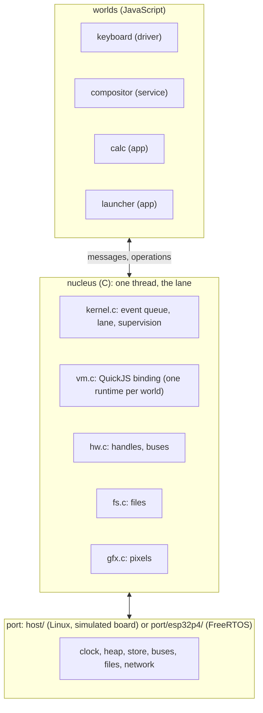
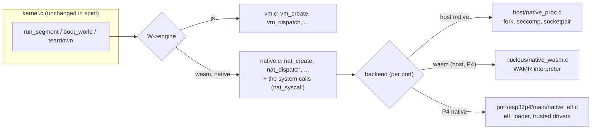
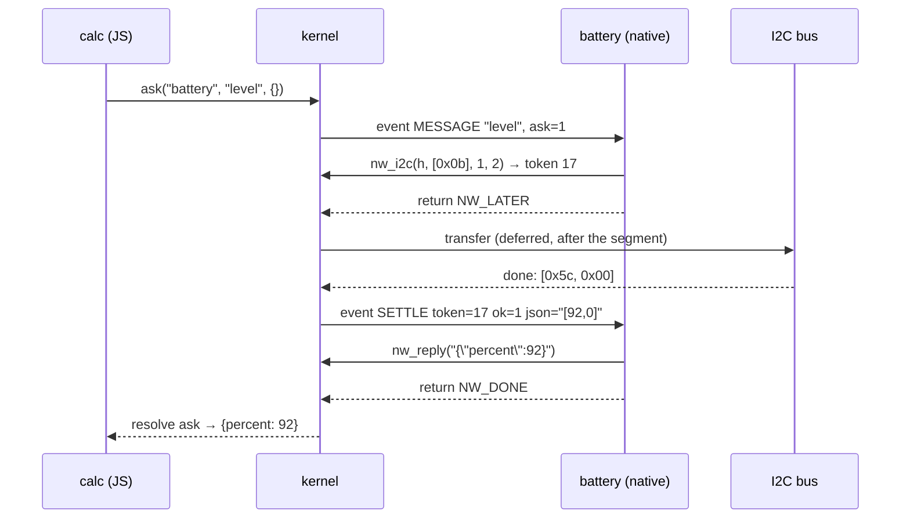

# Native worlds: analysis, design and implementation guide

picocalc-os runs every program as a **world**: a JavaScript runtime with its own heap, its own mailbox, a time
budget per turn and a list of **claims** (what the manifest allows it to touch). Worlds never share memory; they
talk only through the kernel. This ticket adds worlds whose code is a **binary**: a WebAssembly module, or machine
code compiled from C or C++. A native world looks exactly like any other world to the rest of the system. A JS world
sends it a message or asks it a question with the same `send` and `ask`, and receives its replies and channel posts
the same way. The kernel schedules it on the same lane, under the same budget and the same claims. When it crashes,
the kernel supervises it the same way: tear down, back off, restart.

The difficult part is not the messages; it is isolation. A JavaScript world cannot read the kernel's memory
because the JavaScript engine does not let it. A C program can read any address it likes, unless something below
it stops it. What can stop it depends on the hardware, so this guide spends a chapter on what each board can and
cannot enforce, and then designs one interface with three backends.

> [!summary]
> - **One kind of world, several engines.** A world's `engine` (from the manifest) is `js`, `wasm` or `native`.
>   The kernel calls the engine through the seven functions it already calls for JavaScript; a native world
>   talks back through a small set of **system calls** that mirror the JS operations and check the same claims.
> - **Isolation follows the hardware.** On the Linux host a native binary is a real process with its own address
>   space, under a seccomp filter that allows only reading and writing its one socket, and resource limits. On the
>   ESP32-P4, which has no MMU, untrusted binaries must be WebAssembly (software-isolated by the runtime); machine
>   code is reserved for trusted, manifest-installed drivers and is supervised, not memory-isolated.
> - **One source, several targets.** A driver written in C or C++ against `sdk/nw.h` builds as a host process, as
>   a WebAssembly module, or (later) as P4 machine code, without changes.

The reader should be comfortable with C, with processes and system calls on Linux, and with the idea of a message
loop. Nothing about picocalc-os is assumed: chapter 1 explains the system.

---

## 1. The system you are extending

### 1.1 What runs where

picocalc-os is a small operating system for two handheld devices (the PicoCalc with an ESP32-P4, and the M5Stack
PaperS3). It has a C core, the **nucleus**, and everything else in JavaScript: drivers, the compositor, apps.



- **The nucleus** (`picocalc-os/nucleus/`) owns everything shared: the clock and event queue (`kernel.c`), the
  JavaScript engine binding (`vm.c` for QuickJS, `vm_mqjs.c` for MicroQuickJS on the PaperS3), hardware handles and
  bus transfers (`hw.c`), files (`fs.c`), and pixels (`gfx.c`). Its public interface is `nucleus/nucleus.h`.
- **The port** is what differs per target: `host/` and `sim/` run on Linux against a simulated board on a virtual
  clock; `port/esp32p4/main/` runs on the device with ESP-IDF and the real clock. The port API is the last section
  of `nucleus.h` (`port_clock`, `port_heap_malloc`, `port_store_get`, `bus_run_i2c`, ...).
- **The worlds** are listed in the manifest `js/system.json`: a name, a file, claims, a turn budget and a memory
  limit for each.

```json
{ "name": "calc", "file": "apps/calc.js", "budget_ms": 200, "mem_kb": 1024 }
{ "name": "keyboard", "file": "drivers/keyboard.js", "claims": ["i2c0:0x1f", "keys.raw"], "budget_ms": 20, "mem_kb": 320 }
```

### 1.2 Worlds, turns and the lane

A **world** (`world_t` in `nucleus.h`) is one program with its own engine instance, heap and mailbox. The kernel
runs one world at a time on a single **lane** (one thread; on the P4 a FreeRTOS task pinned to core 1). A world
runs only when it has something to handle:

| Kind | Where it comes from | `msg_t.kind` |
|---|---|---|
| a message | another world's `send`, `ask` or channel `publish` | `M_ON` |
| a timer tick | the world declared `every(ms)` | `M_TICK` |
| start | once, after the world boots, if it has an `onStart` | `M_START` |
| an interrupt | a GPIO pin it watches | `M_IRQ` |
| a settle | an asynchronous operation finished (a bus transfer, a reply, a sleep) | `settle_t` |

Handling one message is a **turn**. A turn may be **asynchronous**: a handler that awaits a bus transfer gives up
the lane, and the transfer's completion arrives later as a settle, which resumes it. Each piece of execution, the
first part of a turn or a settle, is a **segment**. `kernel_run_until` picks the next runnable world
(`pick`: boot first, then priority, then arrival order) and calls `run_segment`.

```text
run_segment(W):
  begin the segment with W's budget (vm_begin_segment)
  if booting:            vm_create(W)                       the engine loads the code, reads its declarations
  elif a settle is due:  vm_settle(W, s)                     resolve a promise
  else:                  m = W->mbox.pop(); vm_dispatch(W, m)  call the handler
  render if W is on screen (vm_render)
  cost = what the segment took (virtual: steps × ns_per_step; real: the clock)
  if W ran out of memory, past its budget, threw, or failed its turn:  crash(W, why)
  elif the turn is finished:  finish_turn(W)                  answer the ask, re-arm an interrupt
  apply the deferred effects at the time the segment ended
```

### 1.3 Deferred effects: a crashed turn did nothing

Every operation a segment performs on the outside world is **deferred**: `send` queues a `deferred_t` that will
deliver the message, an I2C transfer queues one that starts the transfer, a store write queues one that writes.
When the segment ends normally, `apply_deferred` runs them at the time it ended. When it crashes,
`discard_deferred` throws them away. A turn is therefore atomic as seen from outside: either all of its effects
happen, or none do. A native world inherits this for free, as long as its system calls use the same `defer`
machinery (they will: they call the same kernel functions).

### 1.4 Messages, asks and channels

From JavaScript (`js/prelude.js`):

```js
service("echo")
  .needs("ticks")                                   // receive posts on channel "ticks"
  .provides("echoes")                               // may post on channel "echoes"
  .on("ping", (s, data, msg) => ({ pong: data.n })) // answers an ask with a value
  .on("ticks", (s, data) => publish("echoes", data))
  .every(1000, (s) => log("alive"));

const r = await ask("echo", "ping", { n: 1 });      // in another world: { pong: 1 }
send("echo", "ping", { n: 2 });                     // fire and forget
```

In the kernel: `send` becomes `defer_deliver(T, msg)`; `ask` becomes `kernel_ask`, which records an `ask_t`, delivers
the message with `m->ask = id`, and schedules a timeout; when the receiving world's turn finishes,
`finish_turn` calls `settle_ask` with the turn's result, which settles the asker's promise. `publish` delivers a
copy to every world whose manifest-declared `needs` include the channel. Payloads travel as JSON text (`msg_t.json`)
from end to end; the kernel never parses them.

### 1.5 Claims and handles: the capability model

A world can do nothing to hardware or to the system unless the manifest gives it a **claim**: `"i2c0:0x1f"` (one
I2C address), `"spi2"`, `"dma"`, `"fs:/notes"` (a directory), `"sys.read"`, `"sys.spawn"`, `"net.admin"`,
`"keys.raw"` and so on. Each operation checks the claim first:

```c
if (!world_claims(W, claim)) return fail(ctx, "%s has no claim on %s", W->name, claim);
```

Opening hardware gives a **handle** (`handle_t` in `nucleus.h`): an integer id the kernel maps to a type (i2c, spi,
dma, fs, gpio, ...), a resource (bus and address, a directory path) and **rights** (`R_READ`, `R_WRITE`,
`R_GRANT`). Every later use goes through `handle_use(W, id, type, right, err, n)`, which checks that `W` holds the
handle, that it is not revoked, and that it has the right. A handle can be **attenuated** (a child with fewer rights,
`handle_child`), **passed** in a message (if it carries `R_GRANT`), and **revoked** by the world that made the child.
This is the whole security model: a world holds exactly the claims the manifest lists and the handles it was given.

Some channels carry what the user types or sees (`keys`, `frames`, `touch`); a world needs or provides them only
with a claim (`channel_claim`, `world_may_use`).

### 1.6 Budgets, memory and supervision

- **Budget.** Each world has `budget_us` per segment. QuickJS calls an interrupt handler on loop back-edges and
  calls; the handler stops the world when the budget is used up (`W->overrun`). On the host the cost is virtual
  (`steps × PROFILE.ns_per_step`), on the device it is the real clock.
- **Memory.** A world's heap is counted by the allocator callbacks in `vm.c` (`w_malloc`); past `mem_limit` an
  allocation fails and the world is stopped (`W->oom`).
- **Supervision.** `crash(W, why)` logs, writes a fault frame (`#OCT1 {...}`) to the UART, and calls
  `teardown(W, why)`: the ask it was answering fails, its engine is disposed (`vm_dispose`), its handles are
  dropped (`handles_drop_world`), pending settles are discarded, and its **epoch** is bumped so that stale timers
  and replies miss it. It restarts after 100 ms, doubling up to 2 s; five crashes in ten seconds and it stays
  stopped. `worlds.status` is published so the compositor can show a banner.

### 1.7 The engine interface

The kernel never calls QuickJS directly. It calls seven functions declared in `nucleus.h`, implemented by `vm.c`
(QuickJS) or by `vm_mqjs.c` (MicroQuickJS); exactly one is linked into a build.

| Function | Called by | Does |
|---|---|---|
| `int vm_create(world_t *W)` | `boot_world` | make the runtime, load the prelude and `W->source`, read the world's declarations into `W` (`needs`, `provides`, `every_ms`, `has_start`, `has_screen`, `kind`, `title`) |
| `void vm_dispose(world_t *W)` | `teardown`, shutdown | free everything |
| `void vm_begin_segment(world_t *W, vtime_t budget)` | `run_segment` | arm the budget |
| `int64_t vm_steps(world_t *W)` | `kernel_now`, `run_segment` | interrupt-counter steps in this segment (virtual time) |
| `int vm_dispatch(world_t *W, msg_t *m)` | `run_segment` | call the handler; set `turn_done`/`turn_result`, or `turn_async` |
| `int vm_settle(world_t *W, settle_t *s)` | `run_segment` | resolve or reject promise `s->promise` with `s->json` |
| `char *vm_render(world_t *W)` | `run_segment` | the world's screen as JSON, or NULL |

A native world needs the same seven functions with a different implementation, and the kernel needs to choose
per world instead of per build. That is the core of this ticket.

### 1.8 Operations: how a world calls the kernel

A JavaScript world calls the kernel through two functions the binding installs, `__k(op, ...args)` for
synchronous operations and `__ka(op, ...args)` for asynchronous ones that return a promise. `vm.c` has a table
`SYNC_OPS` (`"send"`, `"publish"`, `"log"`, `"now"`, `"hw.i2c"`, `"store.save"`, `"turn.done"`, ...) and a chain of
`if`s in `host_ka` (`"sleep"`, `"ask"`, `"i2c"`, `"spi.cmd"`, `"fs"`, ...). Asynchronous operations allocate a
promise id (`++K.next_promise`) and pass it to the kernel; the kernel settles it later with
`kernel_settle_at(w, epoch, promise, ok, json, t)`, which becomes an `E_SETTLE` event and then a `settle_t` on the
world.

---

## 2. What "sandboxed to the extent of the hardware" means

### 2.1 What a native world must not be able to do

| Threat | JS world today | What must hold for a native world |
|---|---|---|
| Read or write another world's or the kernel's memory | the engine has no pointers | the binary's loads and stores reach only its own memory |
| Touch hardware without a claim | only through checked operations | peripherals reachable only through kernel calls that check claims |
| Open files, sockets, other processes | no such operations without claims | no system interface except the kernel's calls |
| Hold the lane forever | interrupt handler and budget | the kernel regains control when the budget is spent |
| Use unbounded memory | allocator limit | a hard limit, enforced below the binary |
| Survive its own crash in a bad state | teardown and restart | the same, and nothing of the old instance survives |
| Forge its identity | the kernel knows who is running | every call is attributed by the kernel, not by the binary |

The last two rows are easy: the kernel calls the binary, so it knows which world is running, and a restart discards
the instance. The first four depend on the hardware.

### 2.2 The Linux host: an MMU and a system-call filter

The host is an x86-64 PC running Linux. It has an MMU: each process has its own address space, and the CPU traps
every access outside it. The kernel (Linux) also lets a process restrict its own system calls with **seccomp**: a
small BPF program that runs on every system call and can allow it, fail it, or kill the process.

A native binary on the host therefore runs as a **child process**:

- **Memory isolation** comes from the MMU: the child cannot address the picocalc-os process at all.
- **No system interface** comes from seccomp: the filter allows `read` and `write` on one file descriptor (its
  socket to the kernel), memory management (`brk`, `mmap`, `munmap`, `mremap`, `mprotect`), the clock, signal
  return and exit, plus the few calls a static C runtime makes while starting. Anything else (`openat`, `socket`,
  `connect`, `clone`, `fork`, `ptrace`, `kill`, ...) kills the process.
- **Bounded memory** comes from `setrlimit(RLIMIT_DATA)` (heap and anonymous mappings) and `RLIMIT_AS`.
- **Bounded time** comes from the kernel side: while a turn runs, picocalc-os waits for the child's answer with a
  timeout equal to the turn budget, and kills it (`SIGKILL`) when the budget is spent.
- **Bounded descriptors**: the child starts with only descriptor 3, its end of a `socketpair`; 0–2 are `/dev/null`;
  `RLIMIT_NOFILE` is 4.

This is the strongest isolation the host's hardware allows, and it is the same mechanism browsers and container
runtimes use.

### 2.3 The ESP32-P4: no MMU

The ESP32-P4's application cores are 32-bit RISC-V (RV32IMAFC) at 360–400 MHz. Its FPU is single-precision, so
`double` arithmetic is done in software (PICOCALC-SCI measured about 5 µs per closure node in QuickJS). What it has
for protection:

| Feature | What it does | Usable here? |
|---|---|---|
| MMU with per-process address spaces | — | the P4 has none (its "MMU" maps external flash and PSRAM into the address space, for everyone at once) |
| RISC-V privilege levels M and U | code in U-mode cannot execute privileged instructions; traps go to M-mode | ESP-IDF runs everything in M-mode; no FreeRTOS task can run in U-mode without replacing ESP-IDF's trap entry |
| PMP (Physical Memory Protection) | per-region R/W/X rules; they bind U-mode, and M-mode only for locked entries | ESP-IDF configures and locks its own entries at boot (code/data split); a per-world U-mode sandbox would need entries of its own placed before them |
| PMA, APM (access permission management) | per-master, per-mode memory permissions | used by ESP-TEE on the ESP32-C6/H2; ESP-TEE does not support the P4 |
| Chip revision v3.x | adds interrupt delegation to user mode | a future U-mode sandbox would rely on it |

A real hardware sandbox for machine code on the P4 means running the binary in U-mode, with PMP entries that allow
only its own code and data, a trap handler that turns its `ecall` instructions into kernel calls, and interrupt
handling that works while U-mode code is running. That is ESP-TEE's job, which Espressif has not done for the P4.
Doing it ourselves means replacing ESP-IDF's trap vectors on a chip with a core-local interrupt controller, and a
mistake there wedges the device at boot. It is out of scope for this ticket; chapter 10 records what it would
take.

What the P4 can do without that is **software fault isolation**, and WebAssembly is the standard form of it. A
WebAssembly module addresses only its own linear memory: every load and store is an offset into it, and the
runtime checks each offset against the memory's size (or the compiler proves it in bounds). There are no pointers
to anything else, no system calls except the functions the host chooses to import into it, and the runtime can
count instructions and stop the module when a budget is spent. The cost is speed (an interpreter) or a compile step
(ahead-of-time compilation to RISC-V, which keeps the checks).

So on the P4:

- **Untrusted binaries** (apps from storage, anything not built into the firmware) must be **WebAssembly**. They are
  isolated by software, which is as strong as the runtime is correct.
- **Machine code** compiled for the P4 runs in M-mode with full access to memory and peripherals. The kernel can still
  give it only the kernel's calls as its interface, run it under a time budget, give it its own memory arena and
  restart it when it crashes, but it cannot stop a deliberate attack. Machine code is therefore allowed only for
  **trusted drivers** listed in the firmware's manifest, never from storage.

### 2.4 Summary

| Engine | Host (x86-64 Linux) | ESP32-P4 | Who may install it |
|---|---|---|---|
| `js` | QuickJS world | QuickJS world | manifest, storage |
| `wasm` | WebAssembly in-process (WAMR), software isolation | the same, software isolation | manifest, storage |
| `native` | a Linux process: MMU, seccomp, rlimits | machine code in M-mode: supervised, not memory-isolated | host: manifest, storage; P4: manifest only |

---

## 3. Design: native worlds

### 3.1 One world, several engines



- `world_t` gains `int engine` (`ENG_JS`, `ENG_WASM`, `ENG_NATIVE`), the binary's length (`source_len`), and
  `struct native *nat` (the native world's state, NULL for JS).
- The kernel calls `eng_create`, `eng_dispose`, `eng_begin_segment`, `eng_steps`, `eng_dispatch`, `eng_settle`,
  `eng_render`, small inline functions in `nucleus.h` that call `vm_*` for `ENG_JS` and `nat_*` otherwise. The rest of
  the kernel does not change: mailboxes, asks, channels, timers, epochs and supervision already work per world.
- `native.c` is engine-independent: it turns a kernel message into a native **event**, gives it to the backend, and
  carries out the **system calls** the binary makes, with the same claim checks and the same deferred effects as
  `vm.c`'s operations.
- A **backend** is a struct of three functions that the port provides for each engine it can run:

```c
typedef struct native_backend {
  const char *name;                                   // "proc", "wasm", "elf"
  int  (*load)(world_t *W, char *why, size_t n);      // make the instance from W->source / W->source_len
  int  (*event)(world_t *W, const nw_event_t *e);     // deliver one event; the binary may make system calls
                                                      // through nat_syscall; returns NW_DONE, NW_LATER or -1
  void (*unload)(world_t *W);                         // destroy the instance; nothing of it survives
} native_backend_t;
const native_backend_t *port_native_backend(int engine);   // NULL: this board cannot run that engine
```

### 3.2 The manifest

A world's engine is the manifest's `"engine"`, `"js"` if absent:

```json
{ "name": "echo", "file": "native/echo", "engine": "native", "budget_ms": 50, "mem_kb": 1024 }
{ "name": "prime", "file": "native/prime.wasm", "engine": "wasm", "budget_ms": 50, "mem_kb": 256 }
{ "name": "battery", "file": "native/battery", "engine": "native", "claims": ["i2c0:0x1f"] }
```

`add_world` reads the file as bytes (`port_read_file(path, &len)`) into `W->source` and `W->source_len`. A board
that has no backend for the engine still lists the world; it fails to start with "this board cannot run native
worlds (engine native)" and stays stopped after five tries, like any world that cannot boot.

### 3.3 The native interface (ABI)

A native world implements three entry points, and may call the system calls below. The SDK (`sdk/nw.h`) presents
them as C functions; each backend carries them differently (a socket for processes, imports and exports for
WebAssembly, a function table for P4 machine code).

**Entry points (the kernel calls the binary):**

| Entry point | When | May |
|---|---|---|
| `void nw_init(void)` | once per instance, while it boots (start budget, 600 ms) | declare: `nw_need`, `nw_provide`, `nw_every`, `nw_kind`; and log |
| `int nw_on_event(const nw_event *e)` | for each message, tick, start, interrupt and settle | everything else; returns `NW_DONE` or `NW_LATER` |

```c
typedef struct nw_event {
  int kind;            // NW_MESSAGE, NW_TICK, NW_START, NW_IRQ, NW_SETTLE
  const char *type;    // message type or channel name ("" for others)
  const char *json;    // payload or settle value, JSON text ("null" if none)
  int json_len;
  const char *from;    // sender world's name ("" for the kernel)
  int ask;             // 1 if the sender waits for an answer
  int timer;           // NW_TICK: which declared timer (0, 1, ...)
  int token;           // NW_SETTLE: the token an asynchronous call returned
  int ok;              // NW_SETTLE: 1 resolved, 0 failed (json is then the error text as a JSON string)
} nw_event;
```

**System calls (the binary calls the kernel):** each returns `>= 0` on success and `< 0` on failure, with the
reason readable through `nw_error()`. All of them act for the calling world only; the kernel knows which world is
running, the binary never names itself.

| Call | Kernel equivalent | Notes |
|---|---|---|
| `nw_log(const char *text)` | `op_log` | a line in the kernel log, prefixed with the world's name |
| `int64_t nw_now(void)` | `op_now` | microseconds since boot (virtual on the host) |
| `nw_self(char *buf, int n)` | `op_self` | the world's name |
| `nw_send(to, type, json)` | `op_send` | fire and forget; fails if there is no such world |
| `nw_publish(channel, json)` | `op_publish` | only a channel the world provides, and only with its claim if guarded |
| `nw_reply(json)` | `turn.done` | the answer to the ask being handled (once per turn) |
| `nw_reject(why)` | `turn.reject` | the ask fails with `why`; the world does not crash |
| `nw_need(channel)`, `nw_provide(channel)` | `.needs`, `.provides` | during `nw_init` only; guarded channels need their claim |
| `nw_every(ms)` | `.every` | during `nw_init` only; ticks arrive as `NW_TICK` with the timer's index |
| `nw_kind("driver" \| "service" \| "app")` | the builder | during `nw_init`; sets the scheduling priority |
| `int nw_ask(to, type, json, timeout_ms)` | `ka("ask")` | asynchronous: returns a token; the answer arrives as `NW_SETTLE` |
| `int nw_sleep(ms)` | `ka("sleep")` | asynchronous: a token settled after `ms` |
| `int nw_i2c_open(claim, hz)` | `op_hw_i2c` | needs the claim (`"i2c0:0x1f"`); returns a handle id |
| `int nw_i2c(handle, wr, nwr, nrd, gap_ms)` | `ka("i2c")` | asynchronous: settles with the bytes read, a JSON array; `gap_ms` (0–1000) between the write and the read, as `dev.read(reg, n, gap)` |
| `nw_release(handle)` | `op_h_release` | |
| `nw_store_load(char *buf, int n)` | `op_store_load` | the world's persistent record (JSON), length or `< 0` |
| `nw_store_save(json)` | `op_store_save` | a deferred write, within `store_kb` |
| `nw_timer(i, on)` | `kernel_timer_set` | stop or restart declared timer `i` |
| `nw_error(char *buf, int n)` | — | why the last call failed |

Later additions follow the same pattern (files through handles, SPI, GPIO interrupts, passing handles in messages).

### 3.4 Turns

A native turn has the same three outcomes as a JS turn:

```text
nat_dispatch(W, m):                    (called by run_segment for M_ON, M_TICK, M_START, M_IRQ)
  e = event from m: kind, type, json, sender's name, ask flag, timer index
  r = backend.event(W, e)               the binary runs; its system calls go to nat_syscall(W, ...)
  if r < 0:  return -1                  crash: why is in W->last_error (or W->overrun / W->oom)
  if r == NW_LATER:  W->turn_async = true     the turn stays open; a later settle may finish it with nw_reply
  elif not W->turn_done and not W->turn_rejected:
      W->turn_done = true; W->turn_result = NULL     an ask is answered with null
  return 0

nat_settle(W, s):                      (called by run_segment for a settle)
  e = { kind: NW_SETTLE, token: s->promise, ok: s->ok, json: s->json }
  return backend.event(W, e) < 0 ? -1 : 0
```

`nw_reply` inside the turn sets `W->turn_result` and `W->turn_done` exactly as `turn.done` does for JavaScript;
`finish_turn` then answers the asker. An asynchronous turn (`NW_LATER`) ends when a later segment calls `nw_reply` or
`nw_reject`. While it is open, the mailbox waits (as for JS); settles still run.

### 3.5 Asynchronous calls



Tokens are promise ids from the kernel's shared counter (`++K.next_promise`). A settle that arrives after a restart
is dropped by the epoch check, as for JS.

### 3.6 Time

| Backend | Budget enforced by | Cost charged to the virtual clock (host) |
|---|---|---|
| `proc` (host) | the kernel's `poll` timeout while it waits for the child, then `SIGKILL` | the real time the child took (`K.seg_cost`) |
| `wasm` | WAMR's instruction limit (`wasm_runtime_set_instruction_count_limit`), set from the budget and a calibrated instructions-per-µs | instructions × ns per instruction (calibrated like `ns_per_step`) |
| `elf` (P4) | the kernel's watchdog on the native task (chapter 10) | the real clock (the P4 runs in real time) |

On the device every engine is measured by the real clock; on the host the JS worlds use the virtual clock and a
process backend adds what the child actually took. An overrun sets `W->overrun`, and `run_segment` turns it into
the same crash as for JavaScript: "ran past its turn budget of N ms".

### 3.7 Memory

| Backend | Limit | Counted in `mem_kb` (stats) |
|---|---|---|
| `proc` | `RLIMIT_DATA = mem_limit`, `RLIMIT_AS = mem_limit + 64 MB` (code and stack) | the child's resident size (`/proc/<pid>/statm`) |
| `wasm` | linear memory pages (64 KB each) up to `mem_limit`; the module's declared maximum must fit | linear memory + runtime instance |
| `elf` | its own heap arena of `mem_limit` | the arena's use |

### 3.8 What counts as a crash

- The backend reports a failure: the process exited or was killed (by seccomp: `SIGSYS`; by a fault: `SIGSEGV`), a
  WebAssembly trap (out-of-bounds access, unreachable, division by zero, stack overflow), a protocol error.
- The budget was spent (`W->overrun`), memory was exhausted (`W->oom`, or the process died of it).
- A system call it may not make in that phase (a declaration outside `nw_init`) fails the call; it does not crash.
  A call without the claim fails the call too, as in JavaScript.

`teardown` calls `eng_dispose`, which calls the backend's `unload`: the process is killed and reaped, the
WebAssembly instance is destroyed, the arena is freed.

### 3.9 Native apps from storage

`sys.spawn(name, source)` starts a JS app from storage as `u-<name>` with no claims. Binaries are not text, so
native spawning takes a **file handle** instead: `sys.spawn(name, handle, { engine: "wasm" })`. The kernel reads the
file through the handle (the Loader holds `fs:/apps`), so the binary's bytes never pass through JavaScript strings.
On the P4 only `wasm` may be spawned this way; on the host `native` may be too.

---

## 4. The kernel side: `nucleus/native.c`

### 4.1 State

```c
typedef struct native {
  const native_backend_t *be;
  void *inst;                 // the backend's instance (a process, a WAMR instance, an ELF image)
  bool in_init;               // nw_init is running: declarations are allowed
  char err[160];              // why the last system call failed (nw_error)
  vtime_t budget_us, seg_start_real;
} native_t;
```

### 4.2 The engine functions

```c
int nat_create(world_t *W):
  be = port_native_backend(W->engine)
  if !be: W->last_error = "this board cannot run native worlds (engine %s)"; return -1
  W->nat = { be }; W->n_needs = W->n_provides = W->n_every = 0; W->has_screen = false
  W->has_start = true                      // a native world always gets NW_START after it boots
  if be->load(W, why) < 0: W->last_error = why; return -1
  W->nat->in_init = true
  r = be->event(W, &{ kind: NW_INIT })     // runs nw_init
  W->nat->in_init = false
  return r < 0 ? -1 : 0

void nat_dispose(world_t *W):  if W->nat: be->unload(W); free(W->nat); W->nat = NULL
void nat_begin_segment(W, budget):  W->overrun = false; W->nat->budget_us = budget
int64_t nat_steps(W):  0                   // backends add their cost to K.seg_cost directly
char *nat_render(W):   NULL                // native worlds have no screen (yet)
```

### 4.3 The system calls

All backends turn a binary's request into one `nw_call_t` and call `nat_syscall`:

```c
typedef struct { int op; int32_t i[3]; int64_t v; const char *s[3]; size_t n[3]; } nw_call_t;
int64_t nat_syscall(world_t *W, const nw_call_t *c, char *out, size_t out_n);
```

Its body is a `switch (c->op)` whose cases mirror `vm.c`'s operations and call the same kernel functions:

```c
case NW_SEND:
  T = world_by_name(s0); if !T: return fail(W, "there is no world called \"%s\"", s0)
  m = new_msg(M_ON, s1, s2, W->id); defer_deliver(T, m); return 0
case NW_PUBLISH:
  if !world_provides(W, s0): fail("%s does not provide the channel \"%s\"")
  if !world_may_use(W, s0):  fail("%s has no claim on %s")
  kernel_publish(W, s0, s1, NULL, 0); return 0
case NW_ASK:
  T = world_by_name(s0) ...; if T == W: fail("a world cannot ask itself")
  id = ++K.next_promise; kernel_ask(W, T, s1, s2, NULL, 0, id, i0 * 1000); return id
case NW_SLEEP:  id = ++K.next_promise; defer_settle(W, id, 1, NULL, i0 * 1000); return id
case NW_I2C_OPEN:  same checks as op_hw_i2c (claim syntax "i2c0:0xNN", world_claims) → handle_new → id
case NW_I2C:  h = handle_use(W, i0, H_I2C, R_WRITE, err); id = ++K.next_promise; hw_i2c(W, h, s0, n0, i1, 0, id); return id
case NW_REPLY:  if !W->in_turn or W->turn_done: return 0; W->turn_result = dup(s0); W->turn_done = true
case NW_REJECT: W->turn_error = dup(s0); W->turn_rejected = true
case NW_NEED/NW_PROVIDE/NW_EVERY/NW_KIND: if !W->nat->in_init: fail("... only while it starts"); add to W's lists
case NW_STORE_LOAD / NW_STORE_SAVE: as op_store_load / op_store_save (deferred write, quota, 15-character names)
```

Strings from a binary are length-delimited and untrusted: `native.c` copies each into a NUL-terminated buffer,
rejects embedded NULs where a name is expected, and checks JSON payloads only for length (the kernel never parses
payloads; receivers do).

### 4.4 Changes to `kernel.c`

| Place | Change |
|---|---|
| `add_world` | read the engine from the manifest; read the file as bytes with its length |
| `boot_world` | `eng_create(W)` |
| `run_segment` | `eng_begin_segment`, `eng_dispatch`, `eng_settle`, `eng_render` (native: none) |
| `kernel_now`, cost | `eng_steps(K.cur)` |
| `teardown`, `kernel_shutdown`, `kernel_reset` | `eng_dispose(W)` |
| `kernel_worlds_json_fields` | new field `"engine"` |

`vm_read_manifest` (in `vm.c` and `vm_mqjs.c`) parses the new `"engine"` key into `manifest_world_t.engine`.

---

## 5. The host backend: native processes (`host/native_proc.c`)

### 5.1 Starting a process

```text
load(W):
  sock[2] = socketpair(AF_UNIX, SOCK_SEQPACKET | SOCK_CLOEXEC)    message boundaries kept by the socket
  mfd = memfd_create(W->name, MFD_CLOEXEC); write(mfd, W->source, W->source_len)
                                                                   the kernel already holds the bytes; the child opens nothing
  pid = fork()
  child:
    dup2(mfd, 4) with FD_CLOEXEC; dup2(sock[1], 3); /dev/null as 0, 1, 2; close_range(5, ~0)
    setrlimit: DATA = mem_limit + 512 KB, AS = mem_limit + 64 MB, NOFILE = 5, FSIZE = 0, CORE = 0, STACK = 1 MB
    prctl(PR_SET_PDEATHSIG, SIGKILL)
    install the seccomp filter (5.3), which sets PR_SET_NO_NEW_PRIVS first
    execveat(4, "", argv = { W->name }, envp = { NULL }, AT_EMPTY_PATH)      the memfd; FD_CLOEXEC closes it
    _exit(127)
  parent: close(sock[1]); close(mfd); remember pid and sock[0]
```

The binary must be **statically linked**: a dynamically linked program's loader would open shared libraries, which
the filter forbids, and the child would be killed at once. The SDK's build commands link statically (`-static`).

### 5.2 A turn over the socket

```text
event(W, e):
  send an EVENT frame (e's fields and strings)
  deadline = now + W->nat->budget_us                               real time
  loop:
    wait for a frame with poll(sock, deadline - now)
    timeout:      kill(pid, SIGKILL); W->overrun = true; return -1
    EOF / error:  reap the child; W->last_error = how it ended ("the sandbox stopped it: it made a system call
                  native worlds may not make" for SIGSYS, "segmentation fault (an access outside its memory)",
                  "it exited with status 3"); return -1
    bad frame:    kill; "it broke the native protocol (a malformed frame)"; return -1
    CALL frame:   r = nat_syscall(W, call, out); send a RESULT frame (r, out)
    END frame:    K.seg_cost += real time taken; refresh mem_used from /proc/<pid>/statm; return status
```

### 5.3 The seccomp filter

A classic BPF program, installed with `prctl(PR_SET_SECCOMP, SECCOMP_MODE_FILTER, &prog)`:

```text
load arch;  if arch != AUDIT_ARCH_X86_64: KILL_PROCESS;  load nr;  if nr >= 0x40000000 (x32): KILL_PROCESS
read, write:            allowed if args[0] == 3 (all 64 bits), else the error EBADF   (only its socket; printf
                                                                      to the closed stdout fails quietly)
kill, tgkill:           allowed if args[0] is its own pid, else KILL   (abort() and raise())
prlimit64:              allowed if args[0] == 0 (itself), else KILL    (glibc reads RLIMIT_STACK)
execveat:               allowed if args[0] == 4, else KILL             (the exec of the memfd; FD_CLOEXEC closes 4
                                                                      and nothing can create a descriptor 4 again)
prctl:                  allowed if args[0] == PR_SET_DUMPABLE, else KILL   (the runtime turns core dumps off)
readlink, readlinkat:   the error ENOENT                              (glibc's start reads /proc/self/exe)
fstat, newfstatat, lseek: EBADF;  ioctl: ENOTTY                       (stdio probing standard output)
brk, mmap, munmap, mremap, mprotect, madvise:   allowed               (malloc)
exit, exit_group, rt_sigreturn, rt_sigprocmask, rt_sigaction, clock_gettime, clock_getres, gettimeofday,
getrandom, arch_prctl, set_tid_address, set_robust_list, rseq, futex, sched_yield, getpid, gettid:  allowed
                                                                      (a static C/C++ runtime's start-up)
anything else:          KILL_PROCESS                                  (the child dies with SIGSYS)
```

The filter is installed by the kernel's code in the child **before** `fexecve`, so a binary cannot skip it, and
`PR_SET_NO_NEW_PRIVS` makes it permanent.

---

## 6. The wire protocol (`sdk/nw_wire.h`)

Shared by `host/native_proc.c` and the SDK's process runtime. One frame per `SOCK_SEQPACKET` message:

```c
#define NW_WIRE_MAGIC 0x3130574eu            // "NW01" as bytes in memory (little-endian)
typedef struct {
  uint32_t magic;
  uint32_t op;                                // NW_F_EVENT, NW_F_CALL, NW_F_RESULT, NW_F_END
  int32_t i[3];                               // integer arguments
  int32_t pad;
  int64_t v;                                  // a 64-bit argument or result
  uint32_t n[3];                              // lengths of the byte strings that follow, in order
  uint32_t pad2;
} nw_frame_t;                                 // 48 bytes + n[0] + n[1] + n[2], at most NW_FRAME_MAX
```

| Frame | Direction | `i[0..2]` | `v` | strings |
|---|---|---|---|---|
| `NW_F_EVENT` | kernel → binary | kind; ask (a message) or ok (a settle); timer | token (a settle) | type, json, from |
| `NW_F_CALL` | binary → kernel | call op, int args | 64-bit arg | up to three |
| `NW_F_RESULT` | kernel → binary | — | return value | out (or the error text) |
| `NW_F_END` | binary → kernel | `NW_DONE` / `NW_LATER` | — | — |

The kernel validates every frame from a binary: magic, op, lengths that add up to the datagram's size, and
`NW_FRAME_MAX`. A malformed frame is a crash ("broke the native protocol").

---

## 7. The SDK (`sdk/`)

### 7.1 Files

| File | For | What |
|---|---|---|
| `sdk/nw.h` | every module | the API of chapter 3.3; C and C++ (`extern "C"`) |
| `sdk/nw_json.h` | modules that read payloads | header-only helpers: `nw_json_num(json, "n", &v)`, `nw_json_str(...)`, `nw_json_bytes(...)` |
| `sdk/nw_wire.h` | the process runtime and the kernel | frames |
| `sdk/nw_proc.c` | host processes | `main()`: the event loop over descriptor 3, the system-call stubs |
| `sdk/nw_wasm.c` | WebAssembly modules | the exports (`nw_wasm_event`, `nw_wasm_alloc`) and the imports' declarations |

### 7.2 A module

```c
#include "nw.h"
#include "nw_json.h"

void nw_init(void) { nw_kind("service"); nw_every(1000); }

int nw_on_event(const nw_event *e) {
  if (e->kind == NW_MESSAGE && !strcmp(e->type, "ping")) {
    double n = 0; nw_json_num(e->json, "n", &n);
    char out[64]; snprintf(out, sizeof out, "{\"pong\":%g}", n);
    nw_reply(out);
  } else if (e->kind == NW_TICK) nw_log("tick");
  return NW_DONE;
}
```

Build it for the host as a process, or for WebAssembly:

```sh
gcc -static -O2 -Isdk -o build/natives/echo natives/echo.c sdk/nw_proc.c
clang --target=wasm32 -O2 -nostdlib -Isdk -c natives/echo.c sdk/nw_wasm.c && wasm-ld --no-entry ... -o echo.wasm
```

C++ works the same (`g++ -static`, `clang++ --target=wasm32 -fno-exceptions -fno-rtti`).

### 7.3 The process runtime

```text
main():
  read frames from descriptor 3 until it closes:
    EVENT kind INIT:  nw_init(); send END(NW_DONE)
    EVENT other:      build nw_event (strings NUL-terminated in a buffer); r = nw_on_event(&e); send END(r)
  every nw_* call:    send CALL(op, ints, strings); wait for RESULT; return its value (and keep the error text)
```

---

## 8. The WebAssembly backend (`nucleus/native_wasm.c`)

**Status: built in N3 and N4.** What follows is the design; section 16.2 describes where the built backend
differs (one import instead of one per call, event strings in room the module gives, a patch for the instruction
count).

- **Runtime.** WAMR 2.4.5 (Bytecode Alliance, Apache-2.0 with LLVM exception), fast interpreter, no AOT, no WASI,
  no libc-builtin, `WASM_ENABLE_INSTRUCTION_METERING=1`, bulk memory on, threads and SIMD off. Vendored as a subset
  under `third_party/wamr/` (core/iwasm/{include,common,interpreter}, core/shared/{utils,mem-alloc,platform}), built
  by the host `Makefile` and by `port/esp32p4/main/CMakeLists.txt` from the same files, with the platform layer for
  Linux or ESP-IDF.
- **Imports.** One native module `"nw"` with a function per system call (`log (ii)`, `send (iiiiii)i`, ...), each
  a thin wrapper that validates the pointers with `wasm_runtime_validate_app_addr`, builds an `nw_call_t` and calls
  `nat_syscall`.
- **Exports.** `nw_wasm_init()`, `nw_wasm_event(kind, type, type_len, json, json_len, from, from_len, ask, timer,
  token, ok)` and `nw_wasm_alloc(n)`/`nw_wasm_free(p)`; the kernel copies strings into the module's memory with
  `wasm_runtime_module_malloc`.
- **Budget.** Before each call, `wasm_runtime_set_instruction_count_limit(env, budget_us × instr_per_us)`; an
  exhausted count is a trap ("instruction limit exceeded"), turned into `W->overrun`. `instr_per_us` is measured by
  `vm_calibrate` on each board.
- **Memory.** The module's memory maximum must fit `mem_limit`; instantiate with `max_memory_pages` from it.
- **Cost on the host.** Instructions executed × the calibrated ns per instruction, so host shots stay deterministic.

## 9. Bundling binaries on the P4

**Status: built.** `bundle_js.cmake` takes `*.wasm` from `js/` and, in an ELF build, the modules and their
manifest as `EXTRA` entries (16.4). The P4 reads `js/` from a table compiled into the firmware (`bundle_js.cmake` →
`js_bundle.c`).
Binaries (`*.wasm`, P4 `*.elf`) are added as byte arrays with their length; `port_read_file` returns them with
`len`. Apps from storage are read from the FAT partition through a handle (3.9).

## 10. Machine code on the P4: trusted drivers

**Status: built in N5, as an opt-in build (`PICOCALC_NATIVE_ELF`); see 16.4.** The function table, PSRAM, the
check after each event and the manifest-only rule are as designed below; events run on the kernel task.

- Build with the ESP-IDF RISC-V toolchain as a relocatable ELF against `sdk/nw.h`, with `nw_*` calls going through a
  **table of function pointers** the kernel passes at start (the module links against nothing in the firmware).
- Load with `elf_loader` into PSRAM (the P4's supported path), call its entry with the table.
- Run each event on the kernel task with a time check after it returns, or on a separate task that the kernel can
  delete when the budget is spent; free the module's arena on unload.
- Only manifest worlds may be `native` on the P4; `sys.spawn` refuses it.
- What a full hardware sandbox would need (out of scope): run the module in U-mode; PMP entries ahead of ESP-IDF's
  locked ones granting only the module's code (RX) and data (RW); an `ecall` handler in M-mode dispatching to
  `nat_syscall`; interrupt delegation (chip revision v3.x) so interrupts taken in U-mode reach ESP-IDF's handlers.

---

## 11. Tests

| Suite | What |
|---|---|
| `tests/test_native_worlds.py` (host binary, `make test-native`) | a native echo service answers JS asks (now, later through a settle, refused, unhandled → null); strict payloads (bad JSON and `"$h"` refused); publishes and needs; declarations only at init; ticks and stopping a timer; start; store within a run; asks of a JS world and sends to it; claims: `nw_i2c_open` without the claim fails, with it a transfer reads the simulated keyboard controller; a forged handle fails |
| the same, sandbox | binaries that call `open`, `socket`, `fork`, `execve`, `execveat` by path, `kill` of another process, `prlimit64` of another process are killed (`SIGSYS`) and stopped after five crashes; one that writes through a null pointer crashes and restarts while the JS worlds carry on; one that loops forever is killed at its budget; one that allocates 64 MB with `mem_kb` 1024 sees `malloc` fail; `printf` and `write(2)` fail quietly; a file that is not ELF and an engine the board lacks fail at boot |
| the same, C++ | `natives/battery.cc` (a class, `std::string`, `std::array`, a static object) reads the battery through its claim and answers asks |
| WebAssembly (after approval) | the same module source as `.wasm`: answers, traps on out-of-bounds, stops at its instruction budget |

## 12. Plan

| Step | What | Check |
|---|---|---|
| N1 | engines in the kernel (`eng_*`), the manifest's `engine`, `native.c` with the system calls, `"engine"` in `sys.worlds` | JS tests and shots unchanged |
| N2 | the host process backend: fork, memfd, rlimits, seccomp; the wire protocol; the SDK (`nw.h`, `nw_json.h`, `nw_proc.c`); example modules in C and C++ | `make test-native`: messages, claims, I2C, store, sandbox, budget, memory, C++ |
| N3 | WebAssembly on the host: WAMR vendored, `native_wasm.c`, `nw_wasm.c`, modules built with clang and wasm-ld | the same tests on `.wasm` (done, 16.2) |
| N4 | WebAssembly on the P4: build, bundle, calibration, a device run; native apps from storage through the Loader | device measurements (done, 16.3) |
| N5 | machine code on the P4 for trusted drivers | device run (done, 16.4) |

## 13. Files

- `picocalc-os/nucleus/nucleus.h` — `engine`, `native_t`, `eng_*`, `nw_call_t`, `native_backend_t`, `port_native_backend`
- `picocalc-os/nucleus/native.c` — `nat_*`, `nat_syscall`
- `picocalc-os/nucleus/kernel.c` — `eng_*` calls, the manifest's engine, bytes with length
- `picocalc-os/nucleus/vm.c`, `vm_mqjs.c` — the manifest parser reads `"engine"`
- `picocalc-os/host/native_proc.c`, `host/port_host.c` — the process backend; `port_native_backend`
- `picocalc-os/port/esp32p4/main/port_p4.c` — `port_native_backend` (WebAssembly; machine code in an ELF build)
- `picocalc-os/nucleus/native_wasm.c`, `third_party/wamr/` (and its `patches/`), `tools/vendor-wamr.sh`,
  `tools/wasm-toolchain.sh` — WebAssembly
- `picocalc-os/port/esp32p4/optional/native_elf/` (`native_elf_p4.c`, `system.elf.json`), `sdk/nw_elf.h`,
  `sdk/nw_elf.c` — machine code on the P4
- `picocalc-os/sdk/nw.h`, `nw_json.h`, `nw_wire.h`, `nw_proc.c`, `nw_wasm.c`
- `picocalc-os/natives/` — example and test modules
- `picocalc-os/tests/test_native_worlds.py`, `Makefile` (`natives`, `test-native`)

## 14. Open questions

- (Closed in N3–N5.) WAMR and `elf_loader` were approved, built and run.
- Passing handles in messages to and from native worlds (`hs`/`nh`) is designed but not in the first set of calls.
- A native world could have a screen by returning a frame tree as JSON (as `__render` does); not in this ticket.
- (Closed in N2.) `execveat` is allowed only on descriptor 4, the memfd, which the exec closes; a binary cannot
  exec any file from disk.

---

## 15. As built: N1 and N2

N1 and N2 are implemented and committed: `4b3ce2f` (the engine seam, `native.c`, the host process backend, the SDK
runtime, the P4 stub) and `199694d` (the examples in C and C++, `nw_json.h`, the tests). What differs from the design
above, and what was measured:

### 15.1 Changes made while building

- **Strict payloads.** `native.c` checks every payload a binary sends (send, publish, reply, ask, store save) with a
  strict JSON validator: RFC 8259 grammar, valid UTF-8 (no overlong forms, no encoded surrogates), nesting at most 64,
  and no key `"$h"`. Without it a binary could crash a JavaScript receiver, whose `decode()` would throw inside its
  turn, or make the receiver revive a handle it was never passed. Error texts need no check: `settle_ask` wraps them.
- **Core dumps off.** The system's core handler (here apport, through a piped `core_pattern` with
  `core_pipe_limit` 10) holds a dying process until it has read the dump, and `RLIMIT_CORE` 0 does not prevent that
  for a pipe. Every kill then arrived 100 ms late, as an overrun. `sdk/nw_proc.c` now calls
  `prctl(PR_SET_DUMPABLE, 0)` in a constructor that runs before the module's own; the filter allows that `prctl`.
  (Setting it before the exec would not last: exec resets the flag.)
- **Errors instead of kills** for what a C library does by itself: `readlinkat("/proc/self/exe")` at start,
  stdio's `fstat`/`ioctl` on standard output, reading or writing a descriptor other than 3. The first run of the
  tests showed every static binary killed by the readlink before `nw_init`.
- **Two holes closed** in the first filter: `execveat` with any arguments (a binary could exec `/bin/sh` by path)
  and `prlimit64` on any pid (a binary could change another process's limits, picocalc-host's included).
- **`nw_i2c` takes a gap** (`gap_ms`), as the keyboard controller needs 2 ms between the register number and the read.
- **Overruns of native worlds** are reported without "virtual": their budget is real time even in the simulator.

### 15.2 Measured on the host

| What | Time |
|---|---|
| load (memfd, fork, exec) and `nw_init` with four calls | about 0.6 ms |
| one system call (a CALL/RESULT exchange) | 10–20 µs |
| a JS ask answered by a native world, end to end | about 150 µs |
| a sandbox kill, from the attempt to the crash report | about 70 µs |

The binaries are 0.8 MB (C) and 1.0 MB (C++) with static glibc and libstdc++.

### 15.3 Validation

- `make test-native`: 12 tests, OK six runs in a row; the same against the AddressSanitizer/UBSan build, OK, and a
  mixed scenario with zero sanitizer reports.
- All earlier suites and both boards' captures unchanged, except the about screen's JS-heap total (+3 KB, the
  `"engine"` field in the worlds list).
- The P4 firmware with the engine seam, flashed to the PicoCalc: 22 JavaScript worlds, 0 crashes, 0 restarts after
  17 s; `"engine":"js"` in the worlds list. The P4 has no native backend yet: a native entry would fail at boot with
  "this board cannot run native worlds".

### 15.4 What remains

N3 (WebAssembly on the host through WAMR), N4 (WebAssembly on the P4) and N5 (trusted machine code on the P4 through
`elf_loader`) were built after the user approved building and running the third-party code: see section 16.

---

## 16. As built: N3, N4 and N5

All three remaining engines are built and have run on the hardware they target. This chapter describes what was
built where it differs from sections 8 to 10, how the three native engines compare, and what the measurements say.
Read it after section 3, which defines the native interface all three implement. The day-by-day record, with every
failure, is the ticket diary (`log/01-diary.md`, steps 5 to 7).

### 16.1 Three engines behind one interface

A native world is the same thing to the kernel whatever runs it. `nucleus/native.c` delivers events and carries out
system calls (`nat_syscall`) with the same checks for all of them, and a backend (`native_backend_t`: `load`,
`event`, `unload`) only translates. The module's source is the same as well. `natives/echo.c` is built three ways
and passes the same asks in each, because `sdk/nw_calls.inc` gives every runtime the same `nw_*` functions over a
`call()` that each runtime defines differently. What differs is how the module reaches `call()`, and what stops it
from reaching anything else.

| | process (host) | WebAssembly (host and P4) | machine code (P4) |
|---|---|---|---|
| backend | `host/native_proc.c` | `nucleus/native_wasm.c` | `port/esp32p4/optional/native_elf/native_elf_p4.c` |
| module runtime | `sdk/nw_proc.c` | `sdk/nw_wasm.c` | `sdk/nw_elf.c` |
| built with | `gcc -static` | clang 18, `wasm32-wasi`, reactor | `riscv32-esp-elf-gcc -fPIC -shared` |
| `call()` is | a frame on a socket | the import `nw.call` | a pointer in the kernel's table |
| its memory is protected by | the MMU (a separate process) | the interpreter's bounds checks | nothing |
| what it may call is limited by | a seccomp filter | its imports, checked before it runs | a symbol list, checked when it loads |
| its turn budget is | real time; the process is killed | an instruction count | real time, checked after the turn |
| a bad memory access | kills the process; the world crashes | traps; the world crashes | panics the board, which reboots |
| may come from storage | no (host only) | yes, through `sys.spawn` | never |

The last row is a policy that follows from the rows above it. A WebAssembly module can do nothing the kernel did not
give it, so the Loader may start one from a file. Machine code can do anything the firmware can, so only the
firmware may name it.

```mermaid
sequenceDiagram
    participant K as kernel (native.c)
    participant B as backend
    participant M as module
    K->>B: event(W, nw_event_t)
    Note over B: process: write an EVENT frame<br/>wasm: copy strings into the module, set the instruction limit<br/>elf: set now = W, note the time
    B->>M: nw_on_event(&e)
    M->>B: call(op, a, b, c, s0..s2, out)
    Note over B: process: CALL frame; wasm: WAMR checks each pointer pair; elf: direct
    B->>K: nat_syscall(W, nw_call_t, text)
    K-->>B: result, text
    B-->>M: result (text copied into out, what fits)
    M-->>B: NW_DONE or NW_LATER
    Note over B: cost to K.seg_cost; an overrun if the budget is spent
    B-->>K: NW_DONE, NW_LATER or -1
```

### 16.2 WebAssembly on the host (N3)

The design in section 8 proposed one import per system call and a module heap the kernel would allocate from. The
built backend is simpler in both places.

- **One import.** `nw.call(op, a, b, c, s0, n0, s1, n1, s2, n2, out, out_n)` carries the wire's CALL frame as
  arguments, with the WAMR signature `"(iiiI*~*~*~*~)I"`. Each `*~` is a pointer and a length, and WAMR checks that
  the whole range lies inside the module's memory before the native function runs. A module that passes a bad
  pointer gets an exception, and the kernel never sees the address. `nw.error(buf, n)` returns why the last call
  failed.
- **No other imports.** `wasm_load` walks the module's imports before instantiating it and refuses any that is not
  one of these: `it imports the function wasi_snapshot_preview1.path_open, which picocalc-os does not provide`.
  wasi-libc's stdio links `fd_write`, `fd_seek`, `fd_close`, `fd_read` and `fd_fdstat_get` even for `snprintf`, so
  those exist and fail with EBADF. `proc_exit` exists and ends the world.
- **Event strings.** Before each event the kernel calls the module's `nw_wasm_buffer(total)` export, which returns
  room in the module's own heap, and copies the type, payload and sender there. No second heap is needed.
- **The budget is instructions.** `wasm_runtime_set_instruction_count_limit(env, budget_us × 1000 /
  PROFILE.wasm_ns_per_op)`. The fast interpreter did not write the remaining count back, so the kernel could not
  charge what a turn used. Patch `third_party/wamr/patches/0001-instruction-count.patch` fixes that and adds
  `wasm_runtime_get_instruction_count_limit`.
- **Memory.** `max_memory_pages = mem_kb / 64`. A module whose initial memory is already larger is refused.

On the host, a JavaScript world's ask of the echo service costs 16.7 µs (wall time, averaged over 5,000 asks) when
the service is JavaScript, 31.6 µs when it is WebAssembly, and 49.9 µs when it is a process. Loading `echo.wasm`,
including the runtime's first start, takes 1.4 ms. Its `ping` takes 2,520 instructions and its init 6,237.

### 16.3 WebAssembly on the P4, and apps from storage (N4)

WAMR builds on the P4 from the same vendored files with its ESP-IDF platform layer (`port/esp32p4/main/
CMakeLists.txt`). Two patches were needed:

- `0002-esp-idf-linear-memory-in-psram.patch`: module memory comes from PSRAM, not internal RAM.
- `0003-esp-idf-self-thread-in-any-task.patch`: WAMR's `os_self_thread()` called `pthread_self()`, which asserts on
  a FreeRTOS task that pthread did not create. The kernel's task is one, so the first module load rebooted the
  board. The patch returns the FreeRTOS task handle.

A module from storage is started by the Loader. It opens `apps/name.wasm` for reading and calls `sys.spawn(name,
handle)`. The kernel then reads the bytes itself (`FS_LOAD`, up to 256 KB) and picks the engine from the content
(`kernel_spawn_loaded`): `\0asm` starts WebAssembly, UTF-8 text starts JavaScript, and anything else (ELF included)
is refused. JavaScript never holds the module's bytes, so no world can alter a module between check and use.

Measured on the device: `natives/bench.c` runs 69 ns per WebAssembly instruction (`PROFILE.wasm_ns_per_op` = 70).
Starting eight modules (three running, five stopped after their probes) took PSRAM free from 27.27 MB to 26.35 MB.
The probes run on the device (out-of-bounds load, bad pointer, stack overflow, busy loop, a refused import) stopped
as on the host, and none rebooted it.

### 16.4 Machine code on the P4 (N5)

Section 10 asked for a function table instead of linking against the firmware, for PSRAM, for a time check after
each event, and for a manifest-only rule. All four are built. The details below are what an intern needs in order to
add a module or review the backend.

**The ABI** (`sdk/nw_elf.h`) is two tables:

```c
typedef struct nw_elf_kernel {      // the kernel's, passed in
  int abi;                          // NW_ELF_ABI
  int64_t (*call)(int op, int a, int b, int64_t c, const char *s0, size_t n0, const char *s1, size_t n1,
                  const char *s2, size_t n2, char *out, size_t out_n);
  int (*error)(char *buf, size_t n);
} nw_elf_kernel;
typedef struct nw_elf_module {      // the module's, filled in by its entry
  int abi;
  void (*init)(void);
  int (*event)(int kind, int second, int timer, int token, const char *type, const char *json, int json_len, const char *from);
} nw_elf_module;
```

`elf_loader` calls the module's entry, `app_main(argc, argv)`, once after relocation. The backend passes `argc` = 2
with the two tables in `argv`, and `sdk/nw_elf.c`'s `app_main` keeps the first and fills in the second. Only
primitive types cross, because `nucleus.h` and `nw.h` both define event structures and the enum `NW_MESSAGE...`, and
one header cannot include both.

**Building a module.** `main/CMakeLists.txt` compiles each module named in its list with the firmware's compiler:

```text
riscv32-esp-elf-gcc -march=rv32imafc_zicsr_zifencei -mabi=ilp32f -Os -fPIC -shared -nostartfiles -nostdlib
    -e app_main -ffunction-sections -fdata-sections -Wl,--gc-sections -fvisibility=hidden -Wl,--strip-all
    -Wl,-z,max-page-size=16 -Isdk -o echo.elf natives/echo.c sdk/nw_elf.c
```

`-z max-page-size=16` matters. Without it the linker aligns the data segment to 4 KB, and the loader allocates the
gap: nat-echo took 13.5 KB instead of 9.5 KB. The result is a shared object whose only dynamic relocations are
`R_RISCV_JUMP_SLOT`s to the functions it calls. The loader supports exactly `R_RISCV_32`, `R_RISCV_RELATIVE` and
`R_RISCV_JUMP_SLOT`. `bundle_js.cmake` adds the modules and `optional/native_elf/system.elf.json` to the firmware's
file table as `EXTRA` entries, and `main_p4.c` boots that second manifest after `js/system.json`.

**What a module may link to.** The backend installs its own resolver (`resolve()` over `SYMS[]`). It gives 22 C
library functions (`memcpy` to `vsnprintf`), an allocator, and libgcc's soft-float and 64-bit division helpers, which
a position-independent module cannot link statically (libgcc.a is not built with `-fPIC`). On the P4 those helpers
are in mask ROM. A module that calls anything else is refused when it loads, by name: `nat-import crashed: it links
to path_open, which picocalc-os does not give a module`. This is a contract, not a wall. Machine code can compute any
address and jump to it, and the list's purpose is to keep honest modules inside the same API as WebAssembly ones.

**Memory.** `malloc`, `calloc`, `realloc` and `free` resolve to the backend's own functions. Each block has a
16-byte header that links it into the world's list. The world is charged for it, a request that would take the
world past `mem_kb` (code and data included) returns NULL, and `elf_unload` frees whatever is left. On the device a
16 KB allocation moved nat-echo from 10.6 to 26.6 KB, a further 64 KB was refused, and a restart brought it back to
10.6 KB.

**Time.** An event runs on the kernel's task until it returns. The backend measures it with `port_clock()`, and a
turn longer than the world's budget is an overrun, as for JavaScript on the real clock: `nat-bench crashed handling
loop: ran past its turn budget of 50 ms`. A module that never returns stalls the kernel. Running each module on a
FreeRTOS task of its own would not help, because a task that holds the heap lock cannot be deleted safely.

**Faults.** The module runs in machine mode with the firmware, and with our configuration no PMP entry covers PSRAM
(`CONFIG_SPIRAM_XIP_FROM_PSRAM` is off), which is why its code can execute there. Internal RAM is readable and
writable from it. A store to an address with nothing behind it is an access fault, and ESP-IDF panics:

```text
Guru Meditation Error: Core  1 panic'ed (Store access fault). Exception was unhandled.
MEPC    : 0x4862350a  ...  MCAUSE  : 0x00000007  MTVAL   : 0x00000000
Rebooting...
rst:0xc (SW_CPU_RESET),boot:0x30f (SPI_FAST_FLASH_BOOT)
```

`MEPC` is in the module's PSRAM segment. The board came back by itself. Before triggering it, the test held the
keyboard bus (`hold`) so that the reset could not cut an I2C transaction. A store to a valid address, such as the
kernel's own data, would not fault at all. This is why the policy is "firmware only", and why the build option is
off by default.

**Enabling it.** See `port/esp32p4/README.md`: `-D PICOCALC_NATIVE_ELF=ON` in its own build directory
(`build-elf`) with its own config (`sdkconfig.agent-elf`) and its own dependency lock
(`dependencies.agent-elf.lock`). It adds 39 KB to the image (2,652,592 bytes against 2,612,896 for the same tree
without it).

### 16.5 Measured on the device

The same `natives/bench.c` xorshift loop, 16,000 iterations, on the ESP32-P4 at 360 MHz:

| Engine | Time | Per iteration |
|---|---|---|
| WebAssembly (WAMR fast interpreter) | 13,884 µs | 868 ns (12.5 instructions at 69 ns) |
| machine code (ELF in PSRAM) | 535 µs | 33 ns |

| ELF module | File | In memory | Load and init (world CPU time) |
|---|---|---|---|
| `echo.elf` (every system call) | 5,940 bytes | 10.6 KB | about 7 ms |
| `bench.elf` | 3,080 bytes | 2.7 KB | about 5 ms |

### 16.6 The P4's layout sensitivity (open)

The P4's JavaScript speed depends on where code and data sit in memory, more than any change in this ticket. The
kernel's boot calibration (`vm_calibrate`: a 100,000-iteration loop and fib(20)) is the measurement.

| Image | 100k loop | fib(20) |
|---|---|---|
| before this ticket | 113 ms | 30.5 ms |
| N4, after any WebAssembly module load | 319 ms | 85 ms |
| N4, with a 16 KB static debug buffer, no module | 320 ms | 85 ms |
| N5 (as committed: 16 KB static result buffer in the ELF backend) | 113 ms | 30.8 ms |
| N5 with that buffer allocated in PSRAM instead, nothing else changed | 1,604 ms | 31.4 ms |

The last two rows differ only in 16 KB of internal `.bss`, and the calibration runs before any world or module
exists. In the 1,604 ms case only the loop is slower. Its sum passes 2³¹ after about 65,000 iterations, so the rest
of its additions are floating point, while fib(20) stays in integers. Two things are ruled out. A register-only
C loop and random PSRAM reads run at the same speed in fast and slow images (N4). The soft-float routines are in
ROM, so they cannot be what moved. The 128 KB L2 cache is shared by flash code and PSRAM data, and conflicts in it
remain the leading suspect. It deserves its own ticket. Until then, a change that moves internal RAM by kilobytes
should be checked against the boot calibration line.

### 16.7 Validation

- Host: `make test-native` (25 tests, process and WebAssembly, including the sandbox probes), also under the
  AddressSanitizer/UBSan build; `test-sys`, `test-fs`, `test-clock`, `test-agent`, `test-apps`; `make shots`
  unchanged.
- Device, WebAssembly (N4): modules from storage, every probe stopped without a reboot, the benchmark.
- Device, machine code (N5): every system call including an I2C read through a claim (keyboard controller register
  0x0B: 100), sleep and settle, reject, the store; the allocator and its limit; an overrun and its restart; a
  refused module; one deliberate fault and the reboot after it.

### 16.8 What remains

- The layout sensitivity (16.6).
- C++ modules for the ELF engine need a small runtime (out-of-line `std::string`, a throw that aborts), and nothing
  runs their static constructors. Today a module is C, or C++ that uses neither.
- `CONFIG_ELF_LOADER_LIBC_SYMBOLS` and `CONFIG_ELF_LOADER_ESPIDF_SYMBOLS` are unused once our resolver is installed.
  Turning them off may recover part of the 39 KB.
- Handles in messages to and from native worlds (14) are still not passed.
- A full hardware sandbox for machine code (U-mode, PMP, an `ecall` handler; section 10) is still out of scope.
