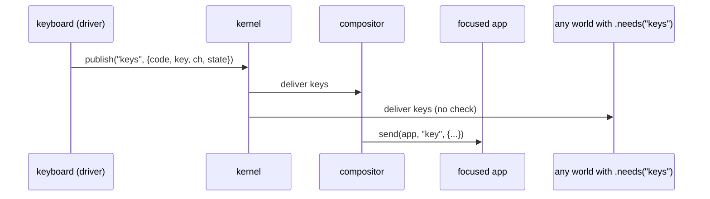
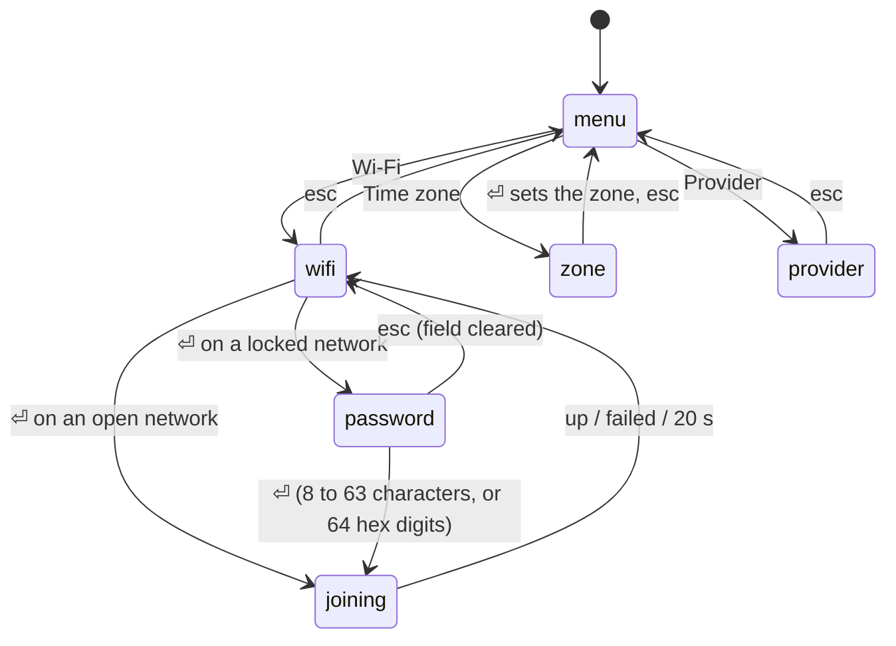

# System apps: analysis, design and implementation guide

This ticket adds the system tools the PicoCalc still lacks: a **Settings** app that shows the Wi-Fi state, scans for
networks, joins one with a password typed on the device and picks the time zone; a **Logs** app that shows what the
kernel and the network stack have printed; and a launcher that can hold more than twelve apps. Before any of that, it
closes a gap that typing a Wi-Fi password on the device makes urgent: today any world can subscribe to every keystroke
and every screen. The first part of the ticket makes those channels capabilities.

The guide assumes you have read the project overview note and know what a *world*, a *turn*, a *claim* and a
*handle* are. Briefly:

- A **world** is one QuickJS virtual machine with its own heap, running one JavaScript file from the manifest
  (`js/system.json`). Worlds share nothing; they talk by messages.
- A **turn** is one message handled by one world. A world runs in **segments** with a time budget; the kernel renders
  the focused world's screen after each segment.
- A **claim** is a string in the manifest, such as `fs:/notes` or `sys.read`, that a kernel operation checks before it
  does something privileged. A world cannot add claims to itself: they come from the manifest, which the user controls.
- A **channel** is a named broadcast. A world declares `.provides("keys")` to publish on it and `.needs("keys")` to
  receive it. The kernel delivers every publication to every world that needs the channel.

## 1. The problem with channels today

Typing goes like this:



`kernel_publish` (`nucleus/kernel.c:181`) delivers to every world for which `world_needs(T, ch)` is true, and
`needs` is whatever the world's own JavaScript declared (`read_meta` in `nucleus/vm.c:895`). The compositor
defends itself: it ignores `keys` that do not come from the world named `keyboard` (`compositor.js:433`, "Channel
subscriptions are not capabilities yet"). But nothing stops a world from *listening*. A snake game that adds
`.needs("keys")` sees every key the user types into the editor, the chat and, after this ticket, the Wi-Fi password
field. The `frames` channel has the same problem in the other direction: the kernel publishes every app's rendered
screen tree on it, so any world with `.needs("frames")` can read every other app's screen.

Two worlds legitimately need raw keys: the compositor, which routes them, and the Keys app, which shows them for
debugging. One world legitimately needs frames: the compositor. On the PaperS3, the same is true of `touch`.

### 1.1 The design: guarded channels

A small table in the kernel names the channels that need a claim:

| Channel  | Claim         | Who holds it (PicoCalc)            | Who holds it (PaperS3)          |
|----------|---------------|------------------------------------|---------------------------------|
| `keys`   | `keys.raw`    | keyboard, compositor, keys         | —                               |
| `frames` | `frames.read` | compositor                         | compositor                      |
| `touch`  | `touch.raw`   | —                                  | touch, compositor, touches      |

The rule is the same for both directions: a world may **need or provide** a guarded channel only if its manifest
entry has the claim. Requiring it for providers too means no world can forge keystrokes into the channel, so the
compositor's `msg.from !== "keyboard"` check becomes a second line rather than the only one. Keep it anyway.

Where to enforce it matters. `read_meta` is in `vm.c`, and the PaperS3 uses a different engine file,
`vm_mqjs.c`. Both call back into the kernel through `boot_world` (`kernel.c:364`), right after `vm_create`. Check
there, once, for both engines:

```c
static const struct { const char *channel, *claim; } GUARDED[] = {
  { "keys", "keys.raw" }, { "frames", "frames.read" }, { "touch", "touch.raw" },
};
const char *channel_claim(const char *ch);           // NULL for an open channel
// in boot_world, after vm_create succeeds:
for each name in W->needs and W->provides:
  claim = channel_claim(name)
  if claim and not world_claims(W, claim):
    W->last_error = "<name> takes the claim <claim>, which the manifest does not give <world>"
    return -1        // the world fails to start, like a syntax error, and supervision reports it
```

Failing the boot is deliberate. A world that silently lost its keys would look broken for no visible reason; a crash
banner that names the missing claim tells the developer exactly what to change. Then add the same check inside
`kernel_publish` (skip a receiver without the claim) and `op_publish` (refuse a sender without it). Those can only
trigger if the lists change after boot, which they do not today; they are there so that a later change to how
worlds declare channels cannot reopen the hole.

### 1.2 Trace lines

`trace on` (console) logs every delivered message with the first 120 bytes of its JSON
(`kernel.c:443`). With a password field on the device, that would print each keystroke of the password to the
UART. Print `key` and `keys` messages without their payload: `settings <- key from compositor [key]`.

## 2. The kernel log ring

`klog` (`kernel.c:85`) formats one line and writes it to `K.uart` (the serial port on the device, `out/uart.log`
on the host) and, with `-v`, to stderr. Nothing on the device can read it back. A log viewer needs the kernel to
keep the recent lines.

### 2.1 Shape

A fixed ring of `LOG_LINES = 256` entries, each holding at most `LOG_TEXT = 120` bytes of text:

```c
typedef struct { uint32_t n; int64_t t_us, wall_ms; char s[LOG_TEXT]; } log_line_t;
static log_line_t *ring;            // calloc'ed in kernel_init: 256 x 144 B = 36 KB (PSRAM on the device)
static uint32_t ring_next = 1;      // the number the next line gets; line n lives at ring[n % LOG_LINES]
void kernel_log_add(int64_t t_us, const char *text);   // locked; truncates on a UTF-8 boundary
```

Lines are numbered from 1 and never renumbered, so a reader asks for "everything after line 812" and learns from the
answer whether lines were lost: if the oldest line still in the ring is 900, then 813 to 899 were overwritten.

### 2.2 Who writes

- `klog` adds every line it prints, with `kernel_now()`: crash reports, "booting 19 worlds", every world's `log()`.
- On the P4, the ESP-IDF log (`I (1234) wifi: connected ...`) goes through `esp_log_set_vprintf`. A hook keeps the
  original output and also adds the line, with `port_clock()`, after stripping the newline.

The second writer runs on other FreeRTOS tasks: the Wi-Fi driver, the event loop, the `fs` worker. So
`kernel_log_add` takes a port lock, `port_log_lock()` / `port_log_unlock()`. On the ESP32 boards it is a
`portMUX_TYPE` critical section, which also stops preemption on that core; a plain spin flag would deadlock if the
kernel task (priority 5) preempted the `fs` worker (priority 4, same core) while the worker held it. On the host
everything runs on one thread and the lock is empty. Inside the lock there is only a `memcpy` of at most 120 bytes.

Calling `kernel_now()` from another task would read kernel state without a lock, so the hook passes
`port_clock()` instead; on the device both count microseconds since boot.

### 2.3 Who reads: `sys.log`

```js
sys.log(after)   // claim sys.log → { first, next, lines: [{ n, t, wall, s }] }, at most 64 lines after `after`
```

`t` is milliseconds since boot, `wall` epoch milliseconds or -1 if the clock was unknown when the line was written.

Why a new claim and not `sys.read`? `sys.read` is held by the launcher, System, About and the agent, and lets them
see the list of worlds and counters. Log lines carry whatever worlds print, including file names and the first words
of errors. The agent sends what it reads to a model provider, so it should not get the log by default. `sys.log` goes
to the Logs app only.

## 3. Settings and the network

### 3.1 What exists on the P4

`port/esp32p4/main/agent_p4.c` already runs a Wi-Fi station over ESP-Hosted, for the agent's HTTPS requests:

- Credentials live in NVS namespace `agentcfg`: `ssid`, `password`, `token`, `endpoint`, `model`. They are set over
  the serial console (`net ssid ...`, `net password ...`) by `tools/provision_agent.py`.
- One worker task, `agent-net` on core 0, does everything that blocks: `wifi_apply()` (read NVS, set the station
  config, connect), SNTP, and the HTTPS request. The kernel thread wakes it with `xTaskNotify` bits:
  `NOTIFY_CONNECT`, `NOTIFY_REQUEST`, `NOTIFY_DISCONNECT`, `NOTIFY_TIME`.
- `wifi_event` follows the station: `GOT_IP` sets `NET_UP`, `DISCONNECTED` retries five times.
- `network_state` is a short text under `lock` (`"Wi-Fi connected; waiting for clock if necessary"`).

Joining a network typed on the device is the same as `net ssid` + `net password` + `net connect`. Scanning is new.

### 3.2 What a world may do

Three new kinds of action, three claims:

| Op                          | Claim                    | What it does                                                  |
|-----------------------------|--------------------------|---------------------------------------------------------------|
| `net.info()`                | `net.admin` or `sys.read`| the station state, network, IP, signal, clock, provider facts |
| `net.scan()` / `net.scanResult()` | `net.admin`        | start a scan; read its result when done                       |
| `net.join(ssid, password)`  | `net.admin`              | save the network and connect                                  |
| `clock.setZone(tz)`         | `sys.clock`              | set the POSIX time zone, save it, apply it at once            |

`net.info()` returns:

```json
{ "mode": "esp-hosted", "wifi": "up", "state": "Wi-Fi connected", "ssid": "picocalc-lab", "ip": "192.168.1.23",
  "rssi": -54, "clock": true, "provider": "api.example.org", "api": "chat", "model": "gpt-x", "key": true }
```

`mode` is `esp-hosted` on the P4 with Wi-Fi, `simulated` on the host, `none` on a board without Wi-Fi; `wifi` is
one of `off`, `connecting`, `up`, `failed`. `provider` is only the host part of the endpoint, and `key` is a
boolean.

### 3.3 Secrets: what may be typed, and where it may go

The device holds two secrets: the Wi-Fi password and the provider's API key. They are treated differently.

**The API key and the endpoint stay serial-only.** The key is long and random; typing it on the PicoCalc's keyboard is
not realistic. The endpoint is not secret, but it decides *where the key is sent*: a world that could change the
endpoint could point it at its own server and receive the bearer token in the next request. So no op changes either,
and Settings shows only "key provisioned: yes" and the provider's host. The model is already chosen in the chat with
`/model`; Settings shows the provisioned one and says where to change it.

**The Wi-Fi password may be typed on the device**, because that is how people join a network. Its path:


- Keystrokes reach only the compositor, the Keys app (which records nothing unless it is in front) and the focused
  app, because of part 1.
- The Settings world keeps the password in its state while it is typed, and draws it as `•` characters, so the
  frame published on `frames` never contains it, and neither does a `shot` screenshot. After `net.join` it clears the
  field. A JavaScript string cannot be wiped from the heap, but the heap belongs to that world alone.
- The op copies the password into the port's join slot and wipes its own argument buffer before freeing it. The
  worker writes NVS, applies the config and wipes the slot, as `wifi_apply` already wipes its `wifi_config_t`.
- No op returns the password. `net.info` reports the SSID, never the password. Nothing logs it: the op does not, the
  trace line for `key` has no payload (1.2), and `ESP_LOG` output of the Wi-Fi driver does not include it.

Validation happens in the nucleus before anything is copied, and again in the port: an SSID of 1 to 32 bytes
without control characters; a password that is empty (an open network), 8 to 63 printable ASCII characters, or 64
hexadecimal digits (a raw PSK).

### 3.4 The port interface

```c
// Network administration (claim net.admin). All of these return promptly on the kernel thread; the P4 does the
// blocking parts on its network worker. A board without Wi-Fi reports mode "none" and refuses the rest.
char *port_net_info(void);                                        // malloc'ed JSON object (3.2)
int port_net_scan(char *why, size_t n);                           // start a scan; nonzero, why filled in: refused
char *port_net_scan_result(int *done);                            // *done 0: pending; 1: malloc'ed JSON array
int port_net_join(const char *ssid, const char *password, char *why, size_t n);   // copies both; never logs them
int port_tz_set(const char *tz, char *why, size_t n);             // setenv + tzset, and save it where the board can
```

The scan result is a list of at most 16 networks, strongest first, one entry per SSID:

```json
[{ "ssid": "picocalc-lab", "rssi": -48, "secure": true }, { "ssid": "cafe-guest", "rssi": -71, "secure": false }]
```

### 3.5 The P4 implementation

Two new notify bits on the existing worker, so no new task and no new lock order:

```c
#define NOTIFY_SCAN BIT4
#define NOTIFY_JOIN BIT5

network_task:
  loop:
    wait for flags, at most 10 s
    if flags & NOTIFY_JOIN:  take join slot under lock; config_write("ssid"), config_write("password");
                             wipe slot; mark configured; wifi_apply()
    if flags & NOTIFY_SCAN:  wifi_prepare(); start the station if needed (without connecting);
                             esp_wifi_scan_start(NULL, true); esp_wifi_scan_get_ap_records(≤ 20);
                             merge by SSID, sort by RSSI, format JSON; store under lock; scan.done = true
    on timeout while NET_UP: esp_wifi_sta_get_ap_info() → status.rssi (under lock)
```

Two details from the existing code shape this:

- `config_set` calls `refresh_configured`, which writes `cfg_api` and `cfg_model`. Those are read by the kernel thread
  without a lock (the comment says "kernel task only"). The worker must not call it. Split it: the worker writes NVS
  with a `config_write` that does not refresh, then updates only the atomic `configured`.
- A scan while the station is connecting fails with `ESP_ERR_WIFI_STATE` on some IDF versions. Report it in the scan
  result as an error (`{"error": "..."}`) rather than retrying in a loop; the user presses F2 again.

The IP address comes from `IP_EVENT_STA_GOT_IP` (`ip_event_got_ip_t`), recorded by `wifi_event` under the lock. The
SSID in `info` is the configured one from NVS. `port_tz_set` writes NVS `settings/tz` with the same `tz_ok` rule as
the console `tz` command; move that rule to a shared function.

### 3.6 The host simulation

The host has no Wi-Fi, but the Settings app must be testable and its screenshots reproducible. `host/net_host.c`
simulates a station on the virtual clock (`kernel_now()`), so the same script gives the same screens every run:

| Network        | RSSI | Password                | Result                         |
|----------------|------|-------------------------|--------------------------------|
| `picocalc-lab` | -48  | `correct horse battery` | up after 1.2 s, IP 192.168.4.23|
| `cafe-guest`   | -71  | none (open)             | up after 1.2 s, IP 10.0.0.57   |
| `neighbour-5G` | -83  | anything                | failed after 2 s, "wrong password" |

A scan finishes 1.5 s after it starts. `info` starts as `wifi: "off"` with no network, `clock: true` (the host
always has a clock), `provider` from `PICOCALC_AGENT_URL` if set. `port_tz_set` on the host calls `setenv` and
`tzset` and keeps nothing.

The PaperS3 port gets stubs: `mode: "none"`, and every other call refuses with "this board has no Wi-Fi".

## 4. The Settings app

`js/apps/settings.js`, manifest claims `net.admin` and `sys.clock`, launcher key `g`.

```text
┌ Settings ─────────────────────────────┐   ┌ Settings › Wi-Fi ─────────────────────┐
│ Wi-Fi        up · picocalc-lab        │   │ state     up, 192.168.4.23, -48 dBm   │
│ Time zone    New York (EST5EDT…)      │   │ network   picocalc-lab                │
│ Provider     api.example.org, key ✓   │   │ clock     set                         │
│                                       │   │ ─ networks ─────────────────────────  │
│                                       │   │ ▸ picocalc-lab        ▮▮▮▮  locked     │
│                                       │   │   cafe-guest          ▮▮    open       │
└ ↑↓ choose ⏎ open ─────────────────────┘   └ F2 scan ⏎ join esc back ──────────────┘
```

State machine:



- While Settings is in front it polls `net.info()` every second; in the background it does nothing.
- The scan is a detached chain: `net.scan()`, then `sleep(500)` and `net.scanResult()` until done or 10 s. The handler
  that started it returns at once, so keys keep arriving while the scan runs.
- The password field: printable characters are appended, backspace removes one, the input shows
  `"•".repeat(n)`. It is cleared on Esc, after `net.join`, and on blur.
- The zone page is a list of about twenty named zones with their POSIX rules (UTC, London, Central Europe, Eastern
  Europe, Moscow, Dubai, India, Bangkok, China/Singapore, Tokyo, Sydney, Auckland, Honolulu, Anchorage, Pacific,
  Mountain, Arizona, Central, Eastern, Atlantic, São Paulo). A provisioned zone that is not in the list shows as
  "custom" with its string. The page shows the current local time, which changes as soon as ⏎ sets a zone. It
  does not preview a zone before it is set: that would mean evaluating POSIX rules in JavaScript, while the C
  library already does it for the zone in effect.
- The provider page is read-only and explains: the key and endpoint are set over USB with `provision_agent.py`; the
  model is chosen in the chat with `/model`.

## 5. The Logs app

`js/apps/logs.js`, claim `sys.log`, launcher key `l`.

- When it comes to the front it reads everything after the last line it has (in pages of 64), then polls every
  500 ms while in front. In the background it does not poll; the ring keeps the last 256 lines, and on its return the
  app shows "… 140 lines lost" if it was away too long.
- It keeps at most 400 lines.
- The view is a `ui.lines` node with `bottom: true`, so new lines appear at the bottom; ↑↓ scroll one line, PgUp/PgDn
  a page; scrolling up stops following and End (or F3) follows again.
- F2 cycles a filter: all, problems (lines with `crash`, `fail`, `error`, `E (`, `W (`), kernel only, ESP-IDF only.
- Each line starts with the wall time `HH:MM:SS` if it was known, otherwise seconds since boot. Problem lines are
  drawn in the accent colour.

## 6. The launcher

Thirteen apps do not fit in a 4 × 3 grid: the body is 270 pixels high, and the title, the description and the
status line leave room for three rows of 58-pixel cells. The grid scrolls by rows instead: `s.top` is the first
visible row, moving the selection below the last visible row scrolls down, and the title shows `▲`/`▼` when rows are
hidden. Pressing an app's letter still opens it directly.

## 7. Implementation plan

| Step | What | Check |
|------|------|-------|
| S1 | Guarded channels in `boot_world`, `kernel_publish`, `op_publish`; manifests; trace redaction | native test: a world needing `keys` without the claim fails to start, with it receives keys; `make shots` unchanged |
| S2 | The log ring, `sys.log`, the P4 `esp_log` hook, stubs on the S3 | native test: lines, paging, loss, claim |
| S3 | `port_net_*` and `port_tz_set` on host (simulation), P4, S3; ops `net.*`, `clock.setZone` | native test: info, scan, join right and wrong, validation, the password absent from the UART log |
| S4 | Settings app | Node test: menu, scan, masked entry, join, zone; shots |
| S5 | Logs app, launcher scrolling | Node test; shots |
| S6 | P4 build, flash, device run: scan, join, zone, logs | captures; diary |

## 8. Files

- `picocalc-os/nucleus/kernel.c` — `GUARDED`, `channel_claim`, `boot_world`, `kernel_publish`, the ring, `klog`
- `picocalc-os/nucleus/vm.c` — `op_publish`, `op_sys_log`, `op_net_*`, `op_clock_setzone`
- `picocalc-os/nucleus/nucleus.h` — the new port functions and `kernel_log_add`
- `picocalc-os/host/net_host.c` (new), `picocalc-os/host/port_host.c` — the simulation, the empty lock
- `picocalc-os/port/esp32p4/main/agent_p4.c`, `store_p4.c`, `main_p4.c` — scan, join, info, zone, the log hook
- `picocalc-os/port/esp32s3-papers3/main/port_s3.c` — stubs and the lock
- `picocalc-os/js/prelude.js` — `sys.log`, `net`, `clock.setZone`
- `picocalc-os/js/apps/settings.js`, `logs.js`, `launcher.js`; `js/system.json`, `js-papers3/system.json`
- `picocalc-os/tests/test_sys_native.py`, `tests/sysapps.test.mjs`, `scripts/settings.txt`, `scripts/logs.txt`

## 9. As built and measured

The design above held; these are the places where the code differs from it, and what the device showed.

### 9.1 Differences from the design

| Design | As built | Why |
|---|---|---|
| `port_net_scan_result(int *done)` | `char *port_net_scan_result(void)`: `NULL` while scanning, else the last result | one return value is enough |
| `port_tz_set(tz, why, n)` | `int port_tz_set(const char *tz)`: 0 saved, 1 applied but not kept | the op validates first; the only failure left is storage |
| op names `net.scanResult`, `clock.setZone` | kernel ops `net.scanresult`, `clock.setzone`; the prelude keeps the camel-case names | op names are lower case elsewhere |
| P4 scan with `esp_wifi_scan_start(NULL, true)` | non-blocking start, then wait for `WIFI_EVENT_SCAN_DONE` on an event-group bit (12 s) | a blocking scan waits inside the event machinery |
| S3 stubs for the network | none needed | only `vm.c` (QuickJS, PicoCalc) has the network ops; the PaperS3 engine gets only the log lock |
| "the op wipes its argument" | `secret_wipe` in `util.c`, volatile writes, also used by `op_net_join` | a plain `memset` before `free` may be removed as a dead store |
| zone list shows the rule | shows `UTC-5 DST`, computed by `stOffset` from the rule | `AEST-10AEDT` meant nothing on screen |

Other details that the design left open:

- `util.c` holds the shared checks: `net_ssid_ok` (1–32 bytes of UTF-8, no control characters), `net_password_ok`
  (empty, 8–63 printable ASCII, or 64 hex digits), `tz_valid`. The console `tz` command uses `port_tz_set` too.
- The P4's `wifi_event` records a link state (`off`, `connecting`, `up`, `failed`), the IP address from
  `IP_EVENT_STA_GOT_IP`, and names the reason when the station gives up: 2, 15, 202, 204, 205 → "wrong password?",
  201 → "network not found", 203 → "association failed".
- The worker refreshes the signal strength every 10 s while connected (`esp_wifi_sta_get_ap_info`).
- The font has `█ ░ • ▲ ▼ ✓` but no `▪ ▮` and no accented letters, so the signal is `████`/`██░░` and the zone is
  "Sao Paulo".
- A `text` node ignores `grow`; the apps use an empty `ui.col({ grow: 1 })` to push the status line down.
- Settings follows a join for up to 90 s and says "Still trying" after 20: on the device the station needed about
  20 s to give up on a wrong password.

### 9.2 Tests

| Suite | Count | What |
|---|---|---|
| `make test-sys` (`tests/test_sys_native.py`) | 11 | listeners and providers of `keys` need `keys.raw`, `frames` needs `frames.read`, open channels need nothing; the ring: reading, a UTF-8 cut, paging, loss, the claim; scan, wrong and right joins, an open network, every `info` key, validation, claims, the zone; neither password appears in the UART log |
| `tests/sysapps.test.mjs` (in `make test-apps`) | 8 | Settings: menu, scan once, dots on screen, the password checked, handed over once and cleared, blur and Esc, a slow and a failed join, zones and offsets; Logs: pages, lost lines, filters, colours, a view held while scrolled back; the launcher: 13 apps by rows, letters |
| `make shots` | — | `scripts/settings.txt` → captures 80–86, `scripts/logs.txt` → 90–93 |

### 9.3 On the ESP32-P4

| What | Result |
|---|---|
| Boot | 21 worlds, no crash, no channel refused; `worlds` lists the new claims |
| Scan over ESP-Hosted | a full screen of networks, strongest first, ours marked |
| Join with a wrong password | `Wi-Fi gave up: wrong password? (reason 205)` after six attempts in about 20 s |
| Restore | `provision_agent.py --wifi-from-nm yolobolo --skip-token`, `wifi=up` 6 s later |
| Zone | Chicago: status bar 23:58 while New York was 00:58 EDT; saved; back to New York |
| Logs | kernel and ESP-IDF lines; seconds since boot before SNTP, wall times after |
| Keys app (`keys.raw`) | receives down and up events |
| `stats` | 0 crashes, lane busy 13.0 % |

### 9.4 Commits

`a8b4989` (S1 guarded channels), `7961ced` (S2 log ring), `5c5c386` (S3 network and zone ops), `fe411b0` (S4
Settings), `c095d0c` (S5 Logs and launcher), `cdbdabb` (S6 fixes from the device run).
