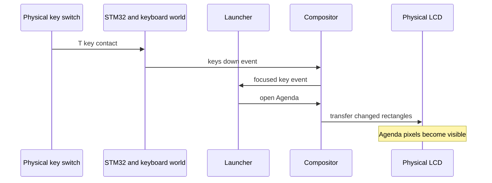

# Compiling a reminder through the PicoCalc event loop

A stored line such as `- [ ] dentist @2026-11-03 14:30 !15m` identifies a task, civil date and time, and a lead in minutes. Agenda must read it after restart, draw it in the appropriate group, and issue a reminder at 14:15 in the configured timezone. Persist the fired identity so the next clock tick does not repeat the notification.

## Implementation boundaries

1. Compile typed source locally into a validated Wasm module. The application owns parsing, calendar validation, task fields and collection traversal. The kernel owns authority, civil clock and durable I/O. Compare the typed parser field by field with agParse.
2. Generate the normal world entry points and route startup, events, render requests and settlements through them. Use the same seeded todo file, clock and messages in the simulator for both implementations. Retain unrecognized file lines on mutation.
3. On the P4, time cold source capture through the first real response. Record compile, validation/load, dispatch, peak memory and turn latency independently. On the assembled handheld measure the physical keypress through the changed frame. Record instrumentation endpoints and hardware configuration for each result.
4. After the Wasm path works, compile the same application to RV32 for the trusted operator path. Use the same behavioral oracle, input and measurement definitions. Compare the two-second cold-response target with the measured distributions.
5. Publish reproducible milestone reports to the go-go-parc vault with code references, hardware receipts and limitations.

## Measuring physical input through a panel change

Use the assembled PicoCalc with the STM32 keyboard and panel powered and the headless setting disabled. Verify that the real keyboard can navigate the launcher and that the display shows the launcher. The typed Agenda world declares the `t` shortcut in `picocalc-os/worlds/agenda/wasm-world.c`. The keyboard publishes a down event to `keys`, the compositor forwards it to the launcher, and the launcher sends `open` back to the compositor. The compositor already has Agenda's published frame and asks the display driver to transfer the changed rectangles. This exercise measures opening a ready Agenda, separately from building its parser.

Use a high-speed video or a shared acquisition clock to observe both ends of the interval. For electrical contact timing, use an available switch-contact observation with a photodiode over a high-contrast region that changes on opening Agenda. Record both edges on the same capture. If video is the available method, show the key and panel together, report the frame rate, and record the first frame with visibly depressed key and the first frame showing the designated change. Label that measurement as visible key motion to visible pixels, with frame quantization and the unknown offset between motion and switch contact.

1. Let the launcher and notes file stabilize. Choose a panel region that changes reliably when switching from launcher to Agenda. Record the expected Agenda text or visual feature ahead of time.
2. Press the physical `t` key from the launcher. For each trial record the trigger, first changed pixel region, and capture resolution.
3. Press `F1` to return to the launcher, wait for the prior transfer to complete, and repeat. Record the firmware commit, backend, sample count, and distribution. Preserve the original acquisition or frame indices.
4. Use firmware timestamps as intermediate diagnostics if needed. Keyboard I²C completion occurs after contact closure. SPI completion indicates transfer but may precede visible LCD response. The existing `agenda response` line measures an earlier frame-publication endpoint.

The headless captures can exercise source-to-publication, including the real notes file, and are recorded in the corresponding benchmark receipts. The physical input gate needs an assembled run and a captured change on the panel.
