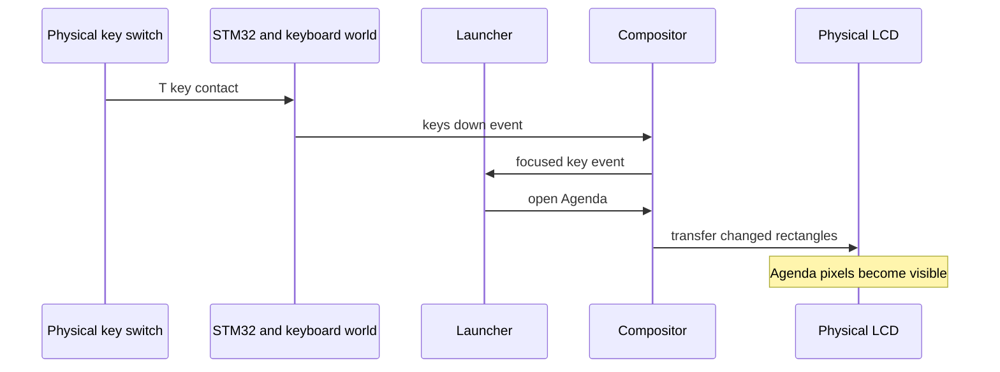

# Compiling a reminder through the PicoCalc event loop

A stored line such as `- [ ] dentist @2026-11-03 14:30 !15m` identifies a task, civil date and time, and a lead in minutes. Agenda must read it after restart, draw it in the appropriate group, and issue a reminder at 14:15 in the configured timezone. Persist the fired identity so the next clock tick does not repeat the notification.

## Implementation boundaries

1. Compile typed source locally into a validated Wasm module. The application owns parsing, calendar validation, task fields and collection traversal. The kernel owns authority, civil clock and durable I/O. Compare the typed parser field by field with agParse.
2. Generate the normal world entry points and route startup, events, render requests and settlements through them. Use the same seeded todo file, clock and messages in the simulator for both implementations. Retain unrecognized file lines on mutation.
3. On the P4, time cold source capture through the first real response. Record compile, validation/load, dispatch, peak memory and turn latency independently. On the assembled handheld measure the physical keypress through the changed frame. Record instrumentation endpoints and hardware configuration for each result.
4. After the Wasm path works, compile the same application to RV32 for the trusted operator path. Use the same behavioral oracle, input and measurement definitions. Compare the two-second cold-response target with the measured distributions.
5. Publish reproducible milestone reports to the go-go-parc vault with code references, hardware receipts and limitations.

## Feature parity acceptance

Use `picocalc-os/js/apps/agenda.js` and its tests as the reference for observable behavior. The completed typed app owns Agenda's task parsing, normalization, grouping, selection, editing, and reminder decisions in typed source. Keep platform file access, clock access, message transport, and display operations behind the existing world SDK.

- Open from the launcher with the existing shortcut. Refresh on focus and pick up changes made by another app. Preserve the original order of groups and tasks, selection and scrolling, completed-task visibility, and date rollover.
- Support the original keyboard commands for entering, editing, toggling and deleting tasks, including deletion confirmation and dismissal. Resolve date and time shorthand against the configured device clock and surface the original error cases.
- Preserve the `notes/todo.txt` format, unrelated lines, and the original behavior when a selected line has changed before an edit. Cover absent files, failed writes, and a file changed by the Editor.
- Transfer a narrow file capability to Editor, preserve the existing success, failure, timeout, and revocation behavior, and refresh the Agenda view on return.
- Check reminder text, lead times, an unset clock, timezone transitions, and deduplication after restart. Check that both compiled targets agree with the original app on notes bytes, visible view state, and notifications under the same input sequences.
- Re-run editable and cold-boot tests on the assembled handheld for both targets. Record compiler and world memory, turn latency, and the two-second cold-build target. Capture the physical keypress to first visible LCD change separately.

The interface details below describe the implemented reminder milestone. Full parity remains open.

## Source, module, and world interfaces

The editable language program is `picocalc-os/worlds/agenda/reminder.typed`. The compiler accepts typed text and lays out the fields of `Task`. The exported entry point `parseTask(line: string, title: buffer, task: Task): bool` writes the cooked task title and record to buffers supplied by the reactor. The return flag tells the caller whether a line was a task. String input and output use explicit UTF-16 lengths and spans. Date and lead-time routines operate on integer fields so the same test oracle can compare both targets.

`picocalc-os/worlds/agenda/compile.js` owns the source-level ABI check. It checks the parameter and result types, then checks the names, types, and offsets of all eleven fields. This protects the reactor even though differently typed source values can lower to the same machine representation. For Wasm, `typed-wasm.js` combines the generated functions with the prebuilt reactor. For RV32, `typed-rv32.js` generates machine instructions and patches a reserved executable slot in the shared ELF assembled with `rv32-slot.S`. The checked Wasm module uses offsets in linear memory. The trusted native module uses pointers and the board calling convention.

The shared reactor in `picocalc-os/worlds/agenda/wasm-world.c` implements the world SDK interface for both targets. Its `nw_init` declares Agenda and acquires the notes capability with `nw_fs_open`. Its `nw_on_event` starts a read through `nw_fs_read`, retains the operation token, and accepts only the matching settlement. It iterates over the bounded file and parses each line. The typed workflow here reads the notes file and persists fired reminder identities in its own store. Editing the task file itself remains the responsibility of the normal editor.

```text
initialize:
    open notes capability
    register 15-second timer

on startup:
    load fired identities
    request todo.txt

on timer, if no read is pending:
    request todo.txt

on matching successful file settlement:
    for each task line:
        decode the title and typed task record
        calculate the configured-zone fire time
        if the reminder is due and its identity is new:
            persist the identity and send its notification
    publish the task view
```

The kernel queues settlement, dispatches the world and publishes the changed frame. The compositor owns focus and transfers the appropriate frame to the display world. On the P4, `port/esp32p4/main/agenda_p4.c` compiles the bundled source at boot or the existing `notes/agenda.typed` through `agenda build`. It installs a newly compiled module under Agenda's manifest entry once compilation succeeds. This keeps the same note authority and app identity between compiler runs.

## Reproducing backend measurements

Use `scripts/03-check-task-records.mjs` to compare the typed parser with the existing Agenda JavaScript. `scripts/04-check-wasm-world.mjs` exercises the real simulator kernel, a seeded notes filesystem, timezone behavior, and a durable reminder restart. `scripts/07-check-rv32-parser.mjs` runs machine instructions for the same parser fixtures; `scripts/09-check-rv32-world.mjs` executes the relocated native reactor with deterministic SDK stubs. These tests establish different parts of the workflow and have separate receipts in `various/`.

For a hardware comparison, build both targets with the same ESP-IDF configuration and the same headless setting, CJI development compiler and native catalog. Build the Wasm reactor first with `make -C picocalc-os agenda-reactor`. Use `PICOCALC_TYPED_AGENDA=ON`, `PICOCALC_RV32_AGENDA=OFF`, and `PICOCALC_NATIVE_ELF=ON` for the Wasm target. Switch `PICOCALC_RV32_AGENDA` on for the native target. Keep copies of each image and its generated typed Agenda manifest. The matched sampler `scripts/12-measure-matched-targets.py` checks that the manifests agree except for Agenda's engine, measures cold boot and both source paths, and restores the verified original app partition.

Use the compiler allocator peak to compare compiler heap use on both targets. Compare module bytes separately. The world counter covers mapped segments plus live managed heap for RV32 and linear memory plus interpreter stack for Wasm. Both are useful within an engine. System-wide peak RAM would require a separate whole-device measurement.

## Measuring physical input through a panel change

Use the assembled PicoCalc with the STM32 keyboard and panel powered and the headless setting disabled. Verify that the real keyboard can navigate the launcher and that the display shows the launcher. The typed Agenda world declares the `t` shortcut in `picocalc-os/worlds/agenda/wasm-world.c`. The keyboard publishes a down event to `keys`, the compositor forwards it to the launcher, and the launcher sends `open` back to the compositor. The compositor already has Agenda's published frame and asks the display driver to transfer the changed rectangles. This exercise measures opening a ready Agenda, separately from building its parser.



Use a high-speed video or a shared acquisition clock to observe both ends of the interval. For electrical contact timing, use an available switch-contact observation with a photodiode over a high-contrast region that changes on opening Agenda. Record both edges on the same capture. If video is the available method, show the key and panel together, report the frame rate, and record the first frame with visibly depressed key and the first frame showing the designated change. Label that measurement as visible key motion to visible pixels, with frame quantization and the unknown offset between motion and switch contact.

1. Let the launcher and notes file stabilize. Choose a panel region that changes reliably when switching from launcher to Agenda. Record the expected Agenda text or visual feature ahead of time.
2. Press the physical `t` key from the launcher. For each trial record the trigger, first changed pixel region, and capture resolution.
3. Press `F1` to return to the launcher, wait for the prior transfer to complete, and repeat. Record the firmware commit, backend, sample count, and distribution. Preserve the original acquisition or frame indices.
4. Use firmware timestamps as intermediate diagnostics if needed. Keyboard I²C completion occurs after contact closure. SPI completion indicates transfer but may precede visible LCD response. The existing `agenda response` line measures an earlier frame-publication endpoint.

The headless captures can exercise source-to-publication, including the real notes file, and are recorded in the corresponding benchmark receipts. The physical input gate needs an assembled run and a captured change on the panel.

### Building a clean image for the physical test

Build from `picocalc-os/port/esp32p4` with the ESP-IDF 5.4.2 environment active. Copy the ESP32-P4 agent/ELF configuration into a new build directory so the experiment uses a separate generated SDK config. With the existing radio and development-compiler options enabled, use the same profile as the headless measurements and explicitly include the panel and keyboard.

```sh
panel_build=$(mktemp -d /tmp/p4-agenda-panel-XXXXXX)
cp sdkconfig.agent-elf "$panel_build/sdkconfig"
idf.py -B "$panel_build" \
  -D "SDKCONFIG=$panel_build/sdkconfig" \
  -D 'SDKCONFIG_DEFAULTS=sdkconfig.defaults;sdkconfig.agent-wifi' \
  -D PICOCALC_RV32_AGENDA=ON -D PICOCALC_HEADLESS=OFF \
  -D PICOCALC_AGENT_WIFI=ON -D PICOCALC_DEVICE_COMPILER=ON \
  -D PICOCALC_COMPILER_PROFILE=ON build
```

Check `esp-idf/main/system.typed-agenda.json` under the build directory. It should include `keyboard`, `display`, `power`, and `compositor`. Agenda should point to `agenda/compiled.bin` with the `native` engine and the existing `fs:/notes` claim. This manifest is derived from the same configured JSON as `system.cji.json`; a previously generated manifest is unnecessary. The image is `picocalc-os-p4.bin` under the build directory. Follow the existing application-partition restore procedure from the diary when testing on the device.

To prepare a Wasm image for the same physical test, first build the Wasm reactor from the repository root. Save the native image and its manifest, then rebuild the same peripheral-enabled configuration with `PICOCALC_RV32_AGENDA=OFF`, `PICOCALC_TYPED_AGENDA=ON`, and `PICOCALC_NATIVE_ELF=ON`. The Wasm Agenda entry changes to engine `wasm`. Keep the physical world list, SDK config, and note fixture fixed when comparing the two targets.
