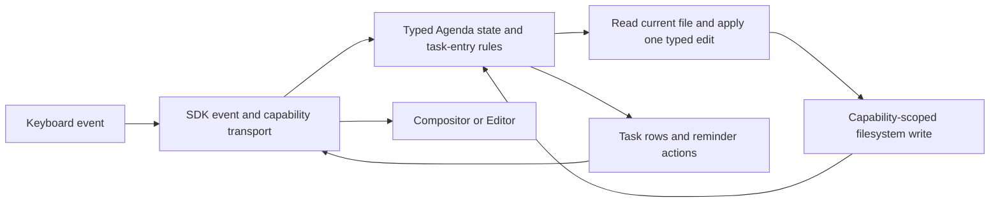

# Typed Agenda feature parity and runtime interface

A PicoCalc Agenda world reads `notes/todo.txt`, presents the tasks through the compositor, and sends reminders based on local civil time. The original implementation also edits the notes file, remembers its selected row, and opens the file in Editor through an attenuated capability. The completion criterion is to reproduce those observable workflows in typed source with the same outcomes for file bytes, visible state, and notifications. The current typed reminder viewer provides the first implementation of parsing, reminders, and rendering. Its date and time entry helpers pass a differential fixture and have yet to be called by the runtime.

## Follow a task from input to the next boot

The example `dentist @tue 2pm !15m` uses the local date to resolve the next Tuesday. Agenda normalizes the accepted date and time before adding the stored checkbox line. This gives the file a predictable syntax for both Agenda and Editor. The recall path parses the saved line, groups the task using its civil date, and compares its notification threshold with the wall clock. The reminder becomes due 15 minutes before the specified task time, so for 2pm it fires at 13:45 local time. Its persisted identity suppresses duplicate delivery across a reboot.



`picocalc-os/js/apps/agenda.js` defines the behavior to compare. Its `agExpand` normalizes the prompt, `agGroups` chooses the display order, `agChange` finds an unchanged source line before applying an edit, and `agKey` defines the commands. `worlds/agenda/reminder.typed` owns stored-line offsets and the cooked title. `entry.typed` owns time and date token interpretation. `worlds/agenda/wasm-world.c` is the existing reactor behind both backends. It marshals bytes, handles world events and capabilities, and sends display and notification messages.

## Keep application rules in typed source

Typed code should choose results such as the canonical prompt text, proposed line splice, selection and grouping, and reminder decisions. The reactor provides input buffers and record references, transfers output after success, and mediates system calls. File handles and async tokens belong to the runtime. This keeps the typed representation finite and gives both backends the same decisions to execute. Introduce bounded collections and richer strings when they replace real storage or view logic required for parity.

The initial input normalization accepts a UTF-16 string and a civil date or an unset-clock marker. It returns a normalized string length or a typed error. As the editor flow is added, retain the source span of invalid input for the status message. Use the existing whitespace and date helpers. The JavaScript behavior removes the first stored-syntax date and lead token when deciding whether a prompt contains a title. Preserve that rule, including multiple lead tokens, rather than checking whether any token survived date normalization.

```text
on save from the task editor:
    normalize prompt with typed token and civil-date rules
    on invalid input, show the matching diagnostic and retain the prompt
    request the current notes file from the existing notes capability

on matching read receipt:
    ask typed code to find the selected original line and propose an edit
    if the line changed, reload the view and show the conflict
    otherwise write the proposed contents through the existing capability

on matching successful write receipt:
    replace the task view state with the saved snapshot
```

At the Editor boundary the original code narrows the notes directory to one read/write file, sends an `open` request, waits for a reply, and revokes the previous transfer only on success. The native SDK currently exposes `nw_fs_open`, `nw_fs_read`, and `nw_ask`; inspect `sdk/nw.h`, `nucleus/native.c`, and the existing CJI world file-call bindings before adding the parity calls. Reuse the kernel's file operation queue and capability model. Tests should verify bytes written and which handles remain usable after a timeout, refusal, or replacement.

## Compile the same typed program to Wasm and RV32

Build parity first against Wasm. The reactor's exported callable surface has typed signatures. `compiler/typed-wasm.js` currently appends generated functions to a prebuilt module and replaces one reserved function body with a call. Add the callable entries required by Agenda using the same compiler pass, validating argument types and record offsets before activating the result. Bind entry dates or prompts through real reactor events. A test that calls a standalone parsed helper confirms semantics and still leaves runtime integration to verify.

The native template in `worlds/agenda/rv32-slot.S` reserves 16,384 bytes, including the four-byte jump. `compiler/typed-rv32.js` scans for the marker in the executable load segment. It inserts the generated program and binds the C reactor's parser call without moving sections. The stored-line parser alone emits 12,532 bytes. Adding the date and time helpers already emits 23,308 bytes. Before enabling the new calls in the device image, give the native packaging room for the parity code and verify the complete compiler, linker and loader path. Start with a sized region and shared entry table, measured against the flash partition and mapped world limit. Introduce a variable-size executable region only if measurements show the reserved region is an obstacle for the finished app. Keep the firmware application partition, compiler heap, stored file format, and native mapped-world budget as separate constraints.

## Validate behavior, then qualify the device

Use the original JavaScript app as the oracle for entering dates and text, selection and group order, file changes, and expected reminder messages. Pair fake clock tests with a real kernel simulator test for writes, Editor grants, and restart. Run the same public scenarios on the Wasm and RV32 implementations. Useful fixtures include next-week rollover, invalid date and time strings, notes changed concurrently, missing files, trailing newlines, completed tasks, and repeated reminder wakes after restart.

On the assembled PicoCalc, build both generated targets locally on the P4. Measure source capture through first file-backed publication, compiler allocation peak and module size, and turn latency. The headless comparison already met two seconds. The powered builds exposed work after a file reply, including measured compositor and keyboard segments. Recheck the same publication boundary in the parity firmware. Separately use a physical keypress and video or a shared acquisition clock to time the LCD response. Commit the source, fixtures and chronological diary at each milestone, and publish the verified results and their limitations to the go-go-parc vault.
