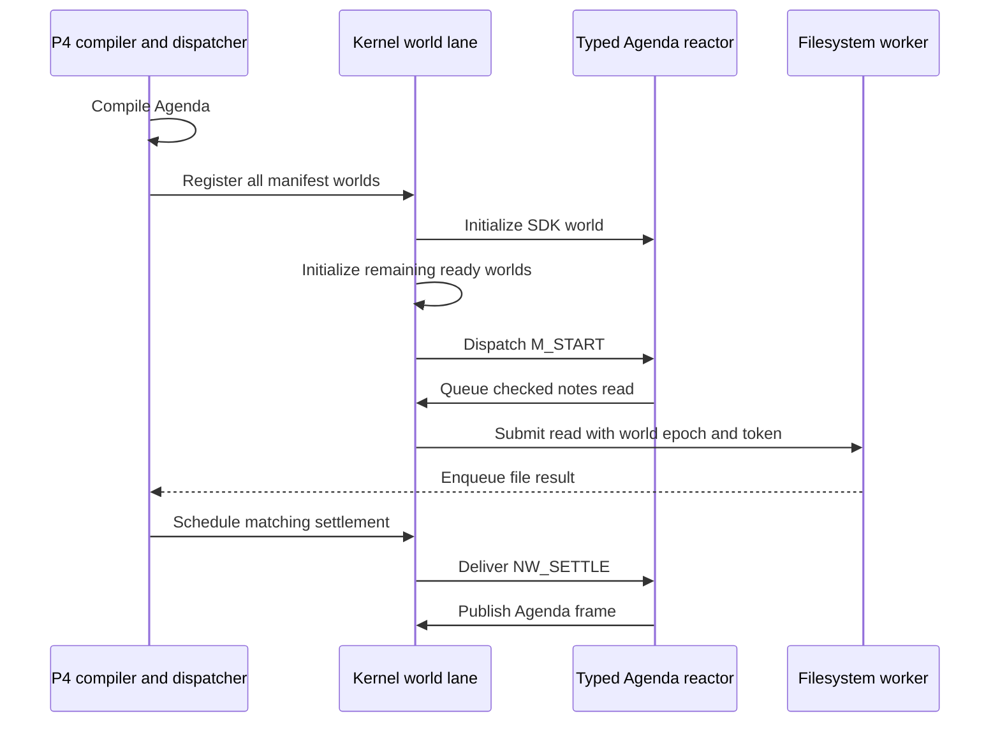

# Dispatch the first Agenda read and frame during system startup

The PicoCalc compiles Agenda when the ESP32-P4 starts. The typed functions implement task parsing, calendar decisions, and entry normalization. The generated functions use the same C reactor on both targets. The firmware’s kernel schedules that reactor, runs other worlds, and authorizes filesystem calls. A faster compiler helps before the reactor exists. The delay between a ready reactor and its first read needs a scheduler experiment.

The goal for this ticket is two seconds from source capture through Agenda's first useful notes-backed publication on the powered handheld. A second measurement starts at a physical keyboard press and ends at the first visible LCD update. The two endpoints use different evidence.

## Components and contracts

| Component | Responsibility | File or interface |
| --- | --- | --- |
| Typed Agenda compiler | Read source, emit a Wasm module or RV32 ELF, and install it in the startup manifest | `picocalc-os/port/esp32p4/main/agenda_p4.c`, `p4_agenda_prepare`, `compileAgenda`, `compileAgendaRv32` |
| Shared reactor | In its start turn, load reminder history and request `notes/todo.txt`. On a matching settlement, publish the Agenda screen | `picocalc-os/worlds/agenda/wasm-world.c`, `nw_on_event`, `nw_fs_read`, `nw_screen` |
| Kernel lane | Select one runnable world segment, run it, then commit its deferred effects | `picocalc-os/nucleus/kernel.c`, `boot_world`, `pick`, `run_segment`, `kernel_run_until` |
| Filesystem and P4 worker | Check the directory capability, enqueue a read, perform FAT I/O, and return its promise token | `picocalc-os/nucleus/native.c` at `NW_FS_READ`, `nucleus/fs.c` at `fs_defer`, `port/esp32p4/main/fs_p4.c` at `port_fs_submit` and `p4_fs_done` |
| P4 dispatcher | Drain device events, drive the kernel lane, and wait when appropriate | `picocalc-os/port/esp32p4/main/main_p4.c`, `kernel_task` |
| Compositor and panel | Retain a world frame, render the focused app, and pass changed pixels to the display driver | `picocalc-os/nucleus/kernel.c` at `frame_message`, `picocalc-os/js/system/compositor.js`, `picocalc-os/js/drivers/display.js`; the powered profile uses the bundled native compositor and drivers |

A *world* is a schedulable application, service, or driver. It can run JavaScript, Wasm, or trusted native machine code. Booting a world creates its VM or module instance and declares its channels, presentation metadata, and timers. When the world declares a start handler, `boot_world` then queues an `M_START` message for a separate ordinary turn. All manifest worlds are already registered in the kernel's world table before it starts choosing segments. Registration, instance creation, and the first application turn are three distinct stages.

The current scheduler gives every ready instance creation a priority of 10. Agenda's ordinary app priority is lower. This lets later worlds finish initialization before Agenda receives `M_START`, even when its own instance is ready. That first turn submits a deferred read. Its completion reaches the P4 dispatcher through a FreeRTOS queue and then becomes a kernel settlement. The reactor receives its own token and renders the resulting task list.



## Evidence and design decision

The powered RV32 build at `88f9e63` published in 2.130–2.141 seconds across three cold runs with a settled empty notes fixture. Compilation took 723.440–723.711 ms. The delay from Agenda initialization to the queued notes read was 539.078–539.581 ms. Sixteen world startup attempts that began inside that interval accounted for about 332 ms. File submission through callback return took 113–126 ms. The first Agenda publishing turn was about 1.5 ms. Optimizing the contents of that turn alone cannot recover the observed 130–141 ms gap. The raw profiles are in `PICOCALC-AGENDA-PARITY/various/p4-prompt-refresh-cold-rv32.json` under the date-based ticket directory.

The first candidate moves two ready turns ahead of unrelated startup work. Those turns are the initial Agenda start message and the matching notes result. This keeps the normal world registration and instance creation order. It leaves user key handling, periodic notes reads, and later development rebuilds at their ordinary priorities. Earlier start makes the file request available sooner. Early settlement makes a completed read useful without waiting for unrelated world creation.

The P4 kernel task has FreeRTOS priority 5 and the filesystem worker has priority 4 on the same core. Enqueueing a request while the kernel stays continuously runnable can still delay the worker. First measure a dispatch-only candidate with explicit worker start/end evidence if needed. If the worker remains delayed, test a short, bounded blocking receive in the P4 kernel task while its exact boot read is outstanding. Use the existing queue and message handler, then resume normal dispatch. Avoid changing task priority, core affinity, or the general filesystem queue for this experiment.

## Implement the smallest bounded startup policy

1. Add a build switch for the A/B candidate in `port/esp32p4/CMakeLists.txt`. Limit it to the typed Agenda profile. Test both Wasm and native output with the same policy and keep the existing compiled application unchanged.
2. Have the P4 startup state track whether the first frame is still pending, the initial read token and world epoch, and an expiry. Reuse the existing two-second deadline in `agenda_p4.c`. Track the first `FS_READ` for the typed Agenda world and its `notes/todo.txt` file at `port_fs_submit`. Confirm matching identity when `p4_fs_done` returns. A missing notes file is a completed startup result and the application may render an empty list.
3. In `pick`, preserve the existing selection of a candidate message within each world. For the compiled Agenda world only, raise the candidate lane priority when the selected message is the initial `M_START`, or when the selected settlement matches the recorded epoch and read token. Use a value strictly greater than the current boot-ready priority of 10, with no change to the order among other candidates. An ineligible, timed-out, or already-published world follows the ordinary path.
4. As an optional second experiment, offer a short filesystem-worker opportunity after the kernel enqueues that exact read. Measure the dispatch-only variant first. If useful, let the kernel block on the existing queue for up to 20 ms from submission, capped by the boot deadline. Use the ordinary handler for any message, including keys and console input. Reevaluate the remaining absolute window after any wake. The queue remains the only path to dispatching the I/O completion.
5. Clear the state after the first frame or after expiry and retain existing compiler-restore behavior. A failed compile continues to select the original JavaScript manifest. A failed or late file operation reaches the normal application error path. The candidate must neither busy-wait nor hold unrelated worlds until the entire two-second deadline.

```text
choose the existing per-world candidate

when candidate belongs to the initially compiled Agenda
    and the first publication is still pending
    and the startup deadline has not passed:
        when candidate is its initial start:
            prioritize this segment over instance creation
        when candidate is the tracked read settlement with a matching epoch:
            prioritize this segment over instance creation

when the kernel submits the tracked read:
    record token, epoch, and queue entry time

when the first frame is published, the world restarts, or the deadline passes:
    retire the startup state
```

The implementation should reuse the SDK event path and leave Agenda's error handling, filesystem capability checks, and production task schema in place. Increasing the compiler scratch arena or translating more JavaScript applications would change a different cost. A broader startup-policy API can be evaluated later if multiple apps need the same treatment.

## Validate the ordering, then measure the device

First verify that Agenda's init precedes start, that the first read happens exactly once, and that only its own first settlement can receive the special priority. Exercise a missing file, a delayed read, a compile failure, and a later editable-source rebuild. Test that other worlds still initialize and that the firmware returns to normal scheduling after any deadline. Use `make -C picocalc-os test-apps test-native` plus the parity ticket's full note-edit and Editor handoff probe. Reason separately about same-core FreeRTOS scheduling. A host simulator run cannot verify which ESP32 task woke first.

On the assembled board, build the control and candidate from the same source revision and SDK configuration. Keep native peripherals, the partition layout, the notes fixture, and the manifest order fixed. Measure Wasm and RV32 separately. Use at least six cold samples per measured variant when practical, preserve raw per-world segments, and report median, range and target pass count. Record compile time and allocator peak, world bytes, boot-to-read submission, submission-to-return, return-to-settlement, and the publishing turn. An improvement should move read submission and file-backed publication, with no material change to compile time or memory. Report process-local memory counters by target because Wasm and native memory accounting differ.

For the physical latency sample, use a camera that can see the PicoCalc keyboard and the LCD together. Start from a stable launcher, use the Agenda shortcut, and record the last frame before actuation and the first frame that shows the Agenda view. Record camera rate and state the frame-interval uncertainty. Repeat the same action from launcher state. The serial harness and CRC-checked framebuffer snapshots remain valuable functional evidence. Physical input and visible display timing require their own capture.
