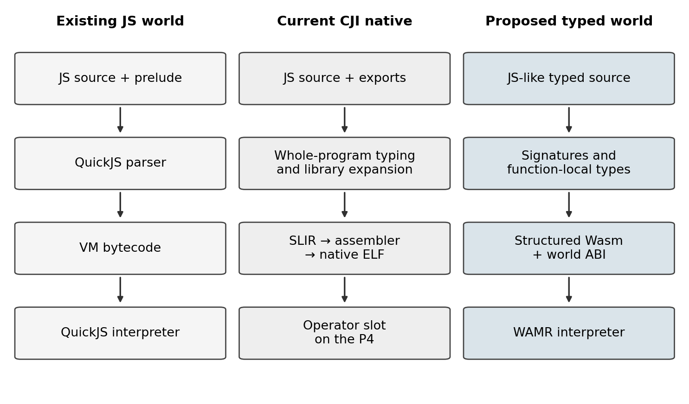
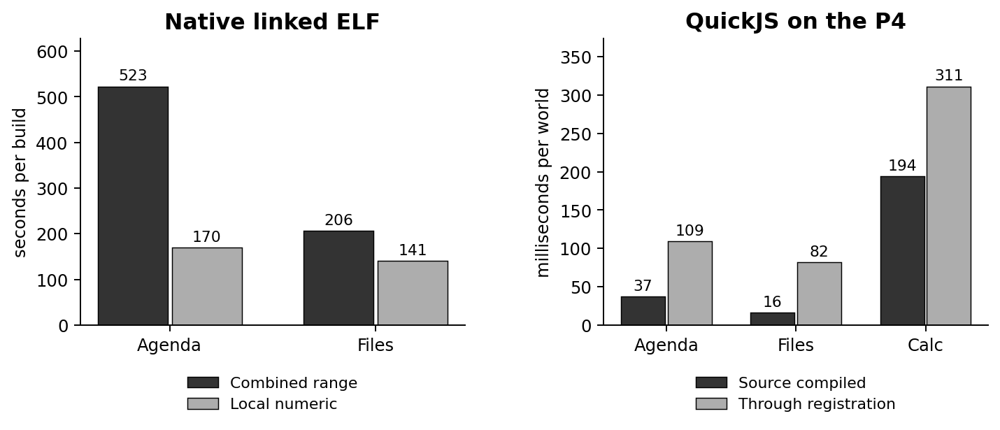
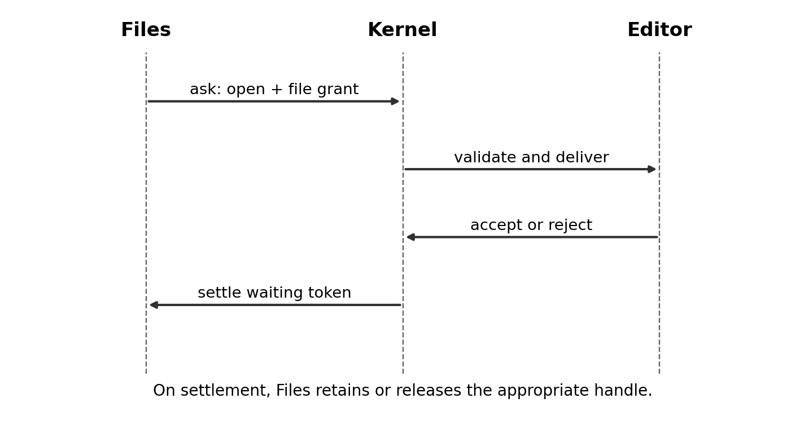

# Designing a JS-like language for interactive compilation on the PicoCalc

## The decision an editor has to make

When you edit the Files app on the PicoCalc, pressing Run should tell you about a syntax error or give you a working file browser while you still remember the edit. Compiling today's Files into a native module took 206.321 seconds with the previous best measured CJI variant. A different compiler already in the firmware, QuickJS, compiled exactly the same source in 15.931 milliseconds on the same headless board. The latter artifact executes in a virtual machine. Our diagnostic then loaded it into a fresh realm, evaluated the real OS prelude and initialized the world. That whole sequence took 82.127 ms. The distinction matters in the editor because an ELF is ready for the native loader, while the second measurement has already initialized an isolated JS world. [Device bytecode results](../various/board/quickjs-p4.csv) · [Previous native board study](../../PICOCALC-CJI-TRIE--avoid-redundant-range-state-writes-and-specialize-trie-node-copies/design-doc/01-persistent-range-states-and-statically-typed-array-copies.md)

**My recommendation is to run existing edited JS worlds directly in QuickJS, and build the new JS-like device language around declared representations, function-local checking and direct structured WebAssembly emission.** Use the WAMR interpreter that already ships on the P4. Prove the second choice with a complete event-driven world before moving the catalog. Keep native ELF as an explicit operator build for programs whose measured event latency or throughput warrants it. This gives each project a specific purpose. Making the current whole-program native optimizer fast enough to run on every save is a poor condition for delivering the editor.

A typed language earns its place by giving developers predictable behavior, data sizes, diagnostics and execution costs. The catalog's JS parsing latency already meets a plausible interactive goal. Relabeling JavaScript as a dialect, or translating every arithmetic operation to a machine integer, would leave the hard questions unanswered. Those questions concern events, data exchanged with the kernel, live state across suspension, strings and arrays, and the cost of executing handlers on the hardware. The ticket contains experiments and a design. The production compiler and device language have separate release decisions.



## How a PicoCalc program becomes a running world

A **world** is an application or service with a name, memory budget, event handlers and kernel-managed authority. `picocalc-os/js/system.json` associates a source file and budget with each world. Some worlds talk to devices. Others send messages, display a view, or open files through handles. A world gets a turn when the kernel delivers an event. A handler may finish during that turn or suspend while waiting for an answer. Successful compilation, successful initialization and successful delivery of the first useful response are three separately observable milestones.

- **QuickJS source.** The JS world boot code creates a private runtime, sets memory and stack limits, installs the OS bindings, evaluates the prelude and evaluates the source. The prelude supplies registration, deterministically seeded randomness, clock/handle wrappers, state construction, dispatch and JSON conversion. A user can load a JS source world through the existing storage loader. A source-backed start is the simplest first editor implementation. Serialization is optional work which becomes interesting for repeated starts. [VM boot](../../../../../../picocalc-os/nucleus/vm.c) · [World prelude](../../../../../../picocalc-os/js/prelude.js)
- **Current CJI native build.** CJI is a compiler written in its own supported JS subset. The compiler that is already native on the board is called stage 1. A build reserves a compiler heap, supplies the source to that executable, constructs compiler data structures, and emits textual SLIR, CJI's low-level instruction format. The device assembler consumes it, resolves calls through the shared prelude export list, and produces a relocatable RV32 ELF module. The board benchmark runs this entire job and hashes the result. Running the newly compiled application is a separate operation. [Device compiler entry](../../../../../../picocalc-os/port/esp32p4/compiler/tool.c) · [Installer and worker](../../../../../../picocalc-os/port/esp32p4/compiler/install.c)
- **WebAssembly worlds.** The kernel already accepts a Wasm module from storage. WAMR loads it, checks its imports, establishes per-world linear memory and creates an execution environment. The world implements three event ABI exports. Kernel calls travel through a small import surface. Wasm makes a promising target for user-created compiled programs since the project already has memory isolation and event metering for that representation. A valid arithmetic module can run in WAMR yet still lack the exports needed to be an OS world. [Storage spawn](../../../../../../picocalc-os/nucleus/kernel.c) · [WAMR backend](../../../../../../picocalc-os/nucleus/native_wasm.c) · [SDK event entry points](../../../../../../picocalc-os/sdk/nw_wasm.c)

A stored program has different privileges from the operator's native development slot. `kernel_spawn_loaded` inspects the file and accepts Wasm or bounded UTF-8 JS. `kernel_develop` updates the operator's `dev-cji` world. P4 machine code in that slot runs with a degree of trust unavailable to a user file. A new language can keep the spelling of `ask` and `world` while lowering its calls through the existing Wasm boundary. No user program gains native authority through a filename, an annotation or a cache hit.

### Where the native build spends its time

The native frontend first forms an abstract syntax tree (AST) describing the source. Name resolution associates a use of a name with its declaration. Structural inference determines types such as arrays, strings and callable objects. Numeric range analysis propagates facts about possible values. Library instantiation selects and constructs definitions needed to implement operations on particular receivers. Code generation turns the result into explicit control flow and machine-level instructions, assigns registers and materializes the ABI. Each stage solves a different problem.

`instantiateLibraryTaking` is particularly important here. Consider `xs.slice(1)`. When the receiver is known to be a string, or known to be an array of a particular representation, the compiler can select a specific implementation. For an unknown receiver it may need a dispatcher. A selected helper may need other helpers. The pass scans the evolving program and can trigger further inference while it discovers definitions. Some callers use numeric proofs to choose a representation. Traditional CJI can revisit facts as the definition set grows. Generated helpers and the compiler's own generated machine code make a small application an unexpectedly large compiler workload. The separate linked prelude shares code across applications. Library instantiation still runs on each application. [Library instantiation](../../../../../../cji/src/library.js) · [Range solver](../../../../../../cji/src/ranges.js)

The production sequence in `src/pipeline.js` includes async lowering, inference, library instantiation, type checking, closure conversion, explicit allocation, instruction selection, liveness, interference construction and register allocation. The memory-conscious backend already processes functions individually. It still takes one trip through middle passes for counts and names, then processes reachable bodies again with those counts. A monomorphic function such as a list offset calculation gains little from this on an interactive build. A single-pass target with local numbering can emit the result as soon as the expression and declared argument types are known. [Build entry](../../../../../../cji/src/build.js) · [Pass schedule and two rounds](../../../../../../cji/src/pipeline.js)

There are three distinct memory numbers in the native run. The 8 MiB setting reserves the frontend arena. `live_peak_bytes` measures live managed data seen by profiling collections. Job scratch also covers storage outside that arena, including compiler output and assembly. Free bytes reported by ESP-IDF describe yet another resource. Raising the limit can allow a program to finish but does not make repeated scans disappear. The physical port can allocate from PSRAM. Working sets larger than the cache can be considerably slower to revisit. We have measured collections, live data and elapsed job time. These runs do not measure cache misses or establish fragmentation as the cause. [ESP-IDF 5.4.2 external RAM](https://docs.espressif.com/projects/esp-idf/en/v5.4.2/esp32p4/api-guides/external-ram.html) · [Device heap selection](../../../../../../picocalc-os/port/esp32p4/compiler/tool.c)

## What changed when we removed numeric proof

An integer interval `[a,b]` says that every possible value is at least `a` and at most `b`. If a program uses one floating numeric type but an implementation opportunistically emits integer addition, the compiler needs evidence that every execution gives the language's specified answer. Rounding, overflow and signed zero can make this surprisingly expensive. At a control-flow join, information from both branches must be combined. In a loop, the result can feed its own input and a solver may revisit it until it stabilizes. A declared wrapping `i32` operation has a result at every bit pattern. The machine can implement that addition directly at any control-flow join.

We made a separate, more conservative experiment inside today's native compiler. Its default for uncertain arithmetic is the existing binary64 Number path. It keeps integer arithmetic when local, syntactic evidence guarantees an exact result and keeps checked conversions where an explicit Int contract requires them. It skips the former terminal proof-driven inference as well as the global numeric solve. It still performs structural inference and many native passes. There is also a deliberately unchecked host control. One overflow/cancellation probe produced 2 instead of 1 under that control, and an unsafe value passed an explicit Int boundary. This explains why simply removing the solver and keeping its old decisions is incorrect. [Candidate algorithm](../scripts/numeric/local-numbers.js) · [Behavior probes](../various/numeric/probes.jsonl)

The earlier optimizations solved real problems. Scheduling proof only when a consumer required it cut the ordinary physical Agenda job from 1,474.601 to 544.293 s. Avoiding redundant writes to its persistent range state and specializing node copies then gave 522.587 s. In a separate host instruction profile of the guarded version, inclusive range analysis accounted for 69.85% of executed x86 instructions in Agenda and 39.36% in Files. Those shares refer to the guarded host, not the board or the new compiler. If 70% of a job disappeared at zero replacement cost, the remaining 30% would limit the speedup to roughly 3.3 times. Changing the work required for the entire edit can exceed that ceiling. [Physical baselines](../../PICOCALC-CJI-TRIE--avoid-redundant-range-state-writes-and-specialize-trie-node-copies/various/physical/physical-summary.json) · [Original instruction measurements](../../PICOCALC-CJI-STATIC--static-representations-and-sparse-range-analysis-for-the-picocalc-compiler/design-doc/01-when-cji-can-compile-a-dynamic-operation-statically.md)

On the x86 host, five measured runs per configuration after warmup gave the following median times with the 8 MiB arena. These are native frontend timings. Each accepted catalog app was also assembled and linked for RV32. Eighteen of the 20 accepted apps changed ELF identity. Power and Flaky were byte-identical. Sandbox still had a syntax rejection. Calc still exhausted the 10 MiB experimental arena. Unmodified Files and Agenda produced the expected results in mock workflows. Independently extracted source slices also passed on RV32 emulation. Static floating additions in generated Agenda rose from 60 to 184, checked/projection `num_to_int` sites from 37 to 124. Counting emitted instructions does not reveal how many execute on an event. [Host timings](../various/numeric/native.json) · [Opcode counts](../various/numeric/opcode-counts.json) · [Catalog and native behavior](../analysis/02-catalog-contracts.md)

| Native host frontend | Combined range design | Local numeric decisions | Reduction |
|---|---:|---:|---:|
| Agenda | 4.257 s | 1.163 s | 72.7% |
| Files | 1.553 s | 0.828 s | 46.7% |

## The measurements on the physical PicoCalc

We used the attached ESP32-P4 with the headless profiling firmware. Keyboard, power, display and compositor were omitted from the active headless manifest. Their source files remained available to the compiler. Flash and boot receipts checked the idle compiler and zero peripheral bus transfers. The timing clock is on the board. Building the diagnostic firmware on Linux did not precompile the world sources being timed. The host independently produced candidate ELF hashes for comparison. A restoration smoke test returns the board to the ordinary headless image at the end of each series.

| World | Earlier combined CJI | Local numeric CJI | Native reduction | QuickJS compile | QuickJS through registration |
|---|---:|---:|---:|---:|---:|
| Agenda | 522.587 s | **169.739 s** | 67.5%, 3.08× | **37.059 ms** | **108.922 ms** |
| Files | 206.321 s | **140.602 s** | 31.9%, 1.47× | **15.931 ms** | **82.127 ms** |
| Calc | Baseline heap refusal | Host candidate still refused at 10 MiB | — | **193.839 ms** | **311.267 ms** |

The native columns are one complete physical build per world and compiler condition. The prior combined condition comes from the previous headless ticket. Each QuickJS cell is the median of three runs on actual hardware. Every run used fresh writer and reader runtimes. Across the 22 sources there were 66 successes and no registration failures. No on-device Calc native measurement was repeated in this ticket. [All QuickJS trials](../various/board/quickjs-p4.jsonl) · [Native Agenda](../various/board/native-agenda.jsonl) · [Native Files](../various/board/native-files.jsonl)



Native Agenda spent 168.420 of 169.739 s in the frontend, including 17.882 s in collection over 134 collections. Its peak live managed data was 4,357,696 bytes. Files spent 139.709 of 140.602 s in the frontend, including 6.057 s across 58 collections. Peak live data was 3,737,976 bytes. Their maximum whole-job scratch was 10,048,551 and 9,251,666 bytes respectively, including the 8,388,608-byte reserved frontend arena. Result sizes were 330,984 and 217,176 bytes. Both ELF SHA-256 digests matched the independent host compiler, even though these files changed relative to the old compiler. The hardware experiment validated generation. Running native Agenda and Files handlers on the P4 was outside this timed command.

This gives two useful bounds. Even eliminating *all* measured GC without moving other costs would leave roughly 152 s for Agenda and 135 s for Files. Eliminating the entire post-frontend portion would save about 1.32 s and 0.89 s. A 5 s cold-native target would still require about 34× and 28× acceleration relative to the new jobs. These are arithmetic on the measurements, not predictions for a new compiler. We should measure the new frontend's internal phase and memory-access breakdown before claiming a new largest function. Files already shows much less device benefit than its 46.7% host reduction.

The host and the device execute different native builds of stage 1. The host uses an x86 process and its memory system. The device uses RV32 code, the firmware libc, an arena in external memory, and the worker's scheduler. The RV32 tool link also includes soft-float support. Normalized to each platform's control, local lowering cuts Agenda frontend wall time substantially in both places. Dividing the new P4 frontend times by their x86 medians gives about **145× for Agenda** and **169× for Files**. These are observed frontend ratios for these inputs and builds. They are evidence against converting x86 timing or host instruction counts to device seconds with a single factor. The device live-data peaks agree with the host candidate values for these workloads. [Host benchmark driver](../scripts/numeric/benchmark.py) · [Native image build recipe](../scripts/board/build-native.sh)

In the QuickJS diagnostic the compile-only timer ends on a parsed bytecode object. Serialization, copying into RAM, teardown, a second fresh realm, cold evaluation of the production prelude, deserialization, evaluation and `__init` all fall inside the wider registration timer. Reading source/prelude bytes, SHA-256, a subsequent behavioral witness, UART, display and a real app event are outside that timer. Only seed and world identity host calls were permitted. The tests made three independent application observations on device. Agenda expanded a dated reminder, Files formatted 1,536 bytes as “1.5 KB”, and Flaky answered a ping. Other worlds were checked through registration. Per-world compile and registration spread, bytecode size and stages are recorded in the CSV. [Diagnostic code](../scripts/board/qjs_probe.c) · [Timing definitions and distributions](../various/board/quickjs-p4.csv)

The Linux simulator answers a different question: can the entire OS run the same real workflows when worlds are loaded from bytecode? Ten paired scripts booted and used the real simulated kernel. Fifty-eight of 59 screenshots matched byte for byte. The remaining About screenshot showed a different aggregate heap count. The intentional Sandbox exhaustion shifted by 1 µs of virtual time. The error class stayed the same. These are virtual time and event semantics. They do not measure P4 frame rate. The figure below is the identical Agenda screenshot taken after task entry in both artifact paths. [Workflow receipts](../various/fastpath/quickjs-host.json) · [Simulator and bytecode methodology](../analysis/03-fast-paths.md)

{width=53%}

Artifact size and latency give independent reasons to choose a representation. The 22 sources plus prelude totalled 278,453 bytes on the host. Unstripped QuickJS binary objects totalled 540,509 bytes, 285,046 bytes after stripping source and 219,676 after stripping all debug information. For physical Calc the bytecode artifact alone was 177,238 bytes from 95,967 bytes of source. Source support in the diagnostic does not lift the existing operator installer's 32 KiB source and 384 KiB module caps. Production support for editing that large world needs an explicit size/memory decision. Keep line information while developing diagnostics. A private cached artifact is worthwhile only when measured repeat starts offset its storage, invalidation and trust costs. [Catalog sizes](../various/fastpath/quickjs-host.json) · [Installer constants](../../../../../../picocalc-os/port/esp32p4/compiler/install.c)

## What the catalog actually requires

The audit covers all 22 manifest sources plus a separate parse of the prelude. It counts syntax sites. It does not describe execution frequencies or user-written programs loaded later. The evidence is specific enough to remove some obligations immediately and to show where a rewrite would break ordinary apps. [Catalog-by-world audit and migration evidence](../analysis/02-catalog-contracts.md) · [AST counts](../various/catalog/ast-counts.tsv)

| Observed use | Proposed language rule | First migration and test |
|---|---|---|
| All 21 loose comparisons in worlds and all seven in the prelude compare with null. There are 760 strict comparisons in worlds. | A single optional type expresses absence in application code. Equality compares like types. Decode missing and explicit JSON null separately when the schema gives them different meanings. | Stage explicit missingness tests and compare message and storage bytes. Preserve empty string, false and zero as present. |
| 575 object literals and 535 computed member accesses in worlds. Many are array indices. | Closed records have declared fields. Arrays store one element type and bounds-check at use. Runtime names live in typed dictionaries. Define dictionary iteration order where the UI observes it. | Give Files state an optional root and a current handle. Use a string-keyed table for Calc names. Diagnose undeclared field writes at the source span. |
| Four worlds use 14 Map/Set constructors, 11 in Calc. Agenda sorts unique date strings. | Provide typed string-key tables and sets. Make ordered traversal explicit. No general numeric/object key policy in v1. | Preserve Calc scope copying and shared value cells. Check duplicate-parameter reports and Agenda group order. |
| 43 async functions and 75 await sites spread across 14 worlds. Of 763 functions, 169 capture enclosing locals. | Retain lexical closures and cancellable async continuations. A capture-free function has a direct function ID. A captured mutable variable has one shared cell. | Stage Files directory load and Editor open/revoke, and confirm late replies cannot mutate a replaced world. |
| 73 regex literals, Date use in five worlds, and fractional math in layout, sizes, graphing and timers. | Supply audited string/regex, civil-time and f64 operations. Prefer fixed-width operators for counters, dimensions and bit fields. | Check leap dates, timezone-driven reminders, size formatting and graph discontinuities. |
| Agent and the prelude call JSON directly. Every app can send or receive data. One eval site in Sandbox. | Decode wire data at declared boundaries into records/tags. Expose arbitrary JSON only to code which really consumes it. Keep interactive source evaluation in the existing JS Sandbox. | Exercise unknown keys, malformed replies, persisted state, and real permitted/revoked handles. A dialect package containing eval gets a source diagnostic. |

We staged the null checks and collection replacements on scratch copies and changed the Files comparator to compare directory flags explicitly. The staged sources passed 113 existing logic tests and 12 host-kernel checks. The independent Wasm wire subset passed six tests. A broader Linux native-process test encountered multiple errors and was interrupted. Its incomplete run supplies no passing gate. These results demonstrate viable source migrations under the existing JS engine and specific ABI behavior. They cannot certify a future implementation of the dialect. [Staged rewrite receipt](../various/catalog/source-rewrites.txt) · [Wire checks](../various/catalog/native-wasm-wire.txt)

## Give the new language a small, explicit contract

The following is a proposed v1 contract. Only the i32/bool leaf compiler described below has executable dialect semantics today. There are two reasons to declare a representation. It determines the answer to an operation, and it tells the compiler how to store the result. A variable declared `i32` occupies one 32-bit word. A clock timestamp in milliseconds since the Unix epoch already requires more than 32 bits. Using the same type for those two quantities would make a fast compiler produce an incorrect calendar.

| Type or operation | Proposed observable rule | Consequence for implementation |
|---|---|---|
| `i32`, `bool` | Add, subtract and multiply modulo 2³². Comparisons use signed values. Shifts take the low five count bits. Boolean operators take booleans, evaluate left to right and short-circuit. | One Wasm i32 operation or structured branch. A boolean has its own source type even when the backend represents it as 0 or 1. |
| Division, fractions, conversion | Two i32 values divide toward zero. Zero divisor and `INT_MIN / -1` produce an arithmetic fault. Two f64 values divide with IEEE behavior. Mixed numeric operands require an explicit conversion. A checked f64-to-i32 conversion must be finite, integral and in range. | Use Wasm's defined integer division traps and explicit checked conversions. The f64 type retains signed zero, infinities and NaN. No invisible widening or run-time guessing of `+`. |
| Strings, arrays and indexing | Strings are immutable. Concatenation requires two strings. Pick and document code-unit vs code-point indexing before porting editor cursor movement. Arrays are dense, zero-based, length-checked sequences of one element type. | Reject an out-of-range array access with a source-located fault. Specify slicing separately from indexing. Preserve Unicode/regex behavior where the UI exposes it and use golden fixtures to decide the text API. |
| Records, options, dictionaries | Record layout is fixed by a declaration. `T?` means present or absent. Check presence before access. `Map<string,T>` owns runtime string keys. Return an option for missing keys. | A record access has a fixed field index. Decode boundary records once. Dynamic keys do not force every record to be a JS object. |
| Functions and effects | Declare parameter and return types at function boundaries. Infer simple local initializers. Mutable locals retain their declared type. A condition requires bool. Recursive calls use declared signatures. | Collect signatures once. Check each body with a local symbol table. A later call cannot change a previously compiled definition's representation. |
| Events, failure and ownership | Preserve mutable per-world state, lexical capture, deterministic clocks, structured error delivery, cancellation and revocation. Retain an explicit tagged `Json` value for open inputs. | Handle inspection and rights enforcement belong to the kernel. A typed wrapper conveys which operation can be attempted. A failed OS operation still produces a failure value or rejected continuation. |

For a newcomer, a **tagged value** is a value plus a small discriminator, such as `Json.String` or `Json.Null`. A **record** is a value whose field names and representations are known before execution. A record containing an optional field does not thereby become dynamic. For example, Files can declare `selected: string?` and initialize it to absent. When a file listing comes in, a decoder checks once that each name is a string and each directory flag a boolean. The sort loop then compares two records. Optionality, dynamism and authority have distinct representations.

Consider two operations used by different apps. The Files size formatter needs `1536 / 1024 = 1.5` to display “1.5 KB”, so it must convert to f64 before division. The compositor computes a list's first visible row using `visible >> 1`. Integer arithmetic naturally describes that operation. Calc needs non-finite results in parts of its numeric evaluator and must decide explicitly how to display a discontinuity or serialize it. JSON has no representation for NaN, infinities or undefined. The wire codec must handle those cases at the boundary. Our proposal rejects non-finite numbers in new typed wire messages unless the message schema supplies a separate tag. A decoder for existing persisted settings must follow the actual historical JSON shape and be tested with stored fixtures.

Other choices are deliberately narrow. Equality of strings uses content and equality of numbers uses their declared representation, with IEEE equality for f64. String maps avoid having to choose a universal key policy for NaN, minus zero, records and identity. Exclude implicit string/number/boolean equality, prototype mutation, dynamic source evaluation and adding undeclared record fields from typed v1. Implement constructors for agreed records and host interfaces. Require an explicit allowlist of built-ins with signatures. Make overload selection deterministic from the argument types. An unsupported overload yields a diagnostic. Leave user-defined classes, a general reflection system and generic specialization until a migrated world demonstrates a need. [ECMAScript equality algorithms](https://tc39.es/ecma262/2024/multipage/abstract-operations.html) · [WebAssembly arithmetic definitions](https://webassembly.github.io/spec/core/exec/numerics.html)

### A real function, from source to executed instructions

The compositor scrolls a list using the following function. Only its signature acquired types. In the source, `count - visible` is the greatest permissible starting index. `sel - (visible >> 1)` centers the selected entry when enough entries exist. The two clamps keep the first row inside the list. The early return also handles a cleared selection. [Original compositor](../../../../../../picocalc-os/js/system/compositor.js) · [Typed input](../scripts/fastpath/scroll.typed)

```text
function scrollStart(sel: i32, count: i32, visible: i32): i32 {
  if (count <= visible || sel < 0) return 0;
  return Math.max(0, Math.min(count - visible, sel - (visible >> 1)));
}
```

A handwritten emitter parses this function, checks operands while descending the expression and produces an ordinary 118-byte Wasm module with an exported `scrollStart`. It never asks which values of `sel` arrive from other functions. It gives both comparisons the result type bool, preserves short-circuit evaluation, and emits signed operations for the subtraction, shift and clamps. The compiler must evaluate each argument once and in order. Lowering a min/max expression by expanding a side-effecting argument twice would silently change behavior in the full language. [Emitter](../scripts/fastpath/04-typed-wasm.js) · [Host test, module bytes and types](../various/fastpath/typed-wasm.json)

Node instantiated the bytes and compared the export with the unmodified original for 667,780 inputs, including four signed-boundary cases. Separate probes made the new semantics visible. Adding 1 to `2147483647` gives `-2147483648` as i32. Integer `-7 / 2` gives `-3`. Dividing by integer zero faults. Integer truthiness and mixed bool arithmetic are compile errors. These examples are expectations for a new language, whereas the conservative CJI experiment above still tries to preserve its Number contract. The leaf contains no heap objects, strings, state, async handler or imports. It tests actual lowering and execution of the scalar language core. The OS ABI still needs a complete world test.

### The typed compiler on the real board

We embedded the **text** of the emitter and the annotated source in a headless diagnostic. For each trial the ESP32-P4 created a fresh QuickJS compiler realm, evaluated the emitter, compiled the text into a Wasm byte array, and passed those newly emitted bytes to the firmware's real WAMR interpreter. The module had no imports. Its SHA-256 was `1f33714cf1dd24f7926bf8995326e92c1da0b67686d3198d9aaea07a38ab0685`, equal to a separate Node build. The physical oracle calculated the expected layout in C for every test input. [Board harness](../scripts/board/typed_probe.c) · [Raw typed results](../various/board/typed-p4.jsonl)

| Device phase | Trial 1 | Trial 2 | Trial 3 | Median |
|---|---:|---:|---:|---:|
| Fresh QuickJS realm, evaluate the emitter, bind source | 37.894 ms | 36.975 ms | 37.548 ms | **37.548 ms** |
| Parse, type check, emit and return the Wasm buffer | 10.368 ms | 10.261 ms | 10.420 ms | **10.368 ms** |
| WAMR readiness, load, instantiate, look up export | 2.227 ms | 2.059 ms | 2.038 ms | **2.059 ms** |
| Call and verify all 396 layout cases | 1.395 ms | 1.407 ms | 1.416 ms | **1.407 ms** |

The input grid includes clear selection, lists shorter than the viewport, both clamp edges and scrolling through the middle. The execution timer includes argument packing, resetting the instruction allowance, the WAMR calls and the C assertions. It is not a pure cycle count for the function. Fresh compiler realms measure the cost of starting this prototype. WAMR global initialization may be reused between trials. Hashing and teardown lie outside the four phase timers. These results establish that the device itself can compile the new semantics and immediately execute its output. They do not establish an application-size scaling law or a complete event ABI.

### Crossing the world ABI with the generated code

We ran the same emitted arithmetic body inside a real Wasm world on the Linux simulator. A test service used the existing C SDK to supply the required initialization, buffer, event and JSON logic. The integration script located the service's placeholder function by its export and signature and substituted the exact function-body bytes from the typed compiler. A second QuickJS world exercised the ordinary kernel ask/reply path. It received 12 for a centered selection, 0 at the lower clamp, 14 at the upper clamp, 0 for no selection, 0 when all rows fit and 2,147,483,646 in the signed-boundary case. The boundary rejected a numeric string. The unmodified placeholder returned -999 on valid requests, demonstrating that the replies changed because the compiled body was reached. [Kernel-routed experiment](../various/fastpath/wasm-world.json)

This test covers real world startup, WAMR exports and cross-engine delivery on Linux. The P4 test above covers source-to-module generation and execution on the board. The test service's SDK and event glue were supplied in C. A compiler which emits its own complete world still needs to generate that glue and support app state, lifetimes and errors.

## Design of the compiler that runs on the device

**First compile a world as the unit of installation, and a function as the unit of analysis.** Perform a small declaration scan over one source file to index names, record layouts, ordinary function signatures, handler declarations and imports. Then parse and check each function in isolation. Shared runtime helpers have fixed versioned signatures. The compiler references the fixed helper once. This changes the cost of a method selection from “discover code, add it and reconsider its callers” to a lookup such as `(Array<Entry>, length) → array_length`. A homogeneous array needs a representation descriptor for its elements. Do not generate a new sort implementation for every record shape unless execution profiling justifies it.

For v1, emit structured Wasm directly from local typed expressions or a short-lived linear list of operations for the current function. Structured bodies encode if/else, loops and branches to enclosing blocks. The operand stack holds expression results. Store locals at named indices. Fix the type and layout of a local at its declaration. Two branches must leave the same result type and agree on definitely initialized locals. At a loop header the declared types already agree, avoiding a numeric fixed-point computation. Keep an explicit bounds check even when it could be optimized later. A guarded loop can hoist a check in a later measured optimization. [Cooper and Torczon, *Engineering a Compiler*, 3rd ed., §§4.4–4.4.2, pp. 175–179, and §§9.2–9.3, data-flow and SSA](https://shop.elsevier.com/books/engineering-a-compiler/cooper/978-0-12-815412-0)

```text
compileWorld(source, abi, limits):
    headers = collectDeclarations(source, abi)
    reject duplicate names, unknown types, unsupported imports
    for declaration in source order:
        if declaration is a function:
            env = newLocalScope(headers, declaration.parameters)
            body = parseBody(declaration)
            checkAndEmit(body, env, declaration.result, limits)
            storeFinishedFunction(bodyBytes, sourceMap, importIDs)
            release function-local compiler storage
    module = assembleTypeImportFunctionExportCodeSections()
    validate module, requested memory, imports and world exports
    start a candidate under its manifest
    publish the revision only after its startup succeeds
```

```text
emitBinary(op, left, right):
    if op is logical AND or OR:
        require Boolean(left) and Boolean(right)
        emit left, then a typed conditional block
        evaluate right only on the required branch
    else:
        evaluate left, then right
        signature = operatorTable.lookup(op, left.type, right.type)
        if missing: report source span and both types
        emit signature.instruction or call signature.helperID
        return signature.result
```

A full compiler must handle values whose lifetime outlasts a function. Captured immutable primitives can be copied into a closure environment. Captured mutable locals share a cell. Two closures must see the same assignment. At `await`, generate a continuation containing a program-counter tag and the locals needed after suspension. For an initial version it is safe to save all initialized locals with known layouts. Optimize the saved set only after measuring frame sizes. Resumption checks the world epoch and the pending token. Settlement, cancellation and world replacement must release the frame and its references exactly once. Include a case where two callbacks share mutable captured state and one suspends. The existing CJI async/closure passes and prelude behavior are executable reference points. [Async transform](../../../../../../cji/src/async.js) · [Closures](../../../../../../cji/src/convert-closures.js)

For managed values in a Wasm world, start with explicit per-world storage and traceable reference layouts for strings, arrays, records and closure/frame references. Keep immediate i32/f64 values unboxed in locals. Use the target's linear memory, enforce the existing page cap, and supply a bounded allocation failure. Reclaim temporaries at the end of a turn when their ownership is known. Values retained by state, closures or pending replies require a real lifetime policy. Reference counting alone leaks cycles. A small tracing heap with fixed root descriptors is one defensible first complete implementation. Build a cycle test and measure the longest collector pause before selecting that policy for production. The leaf prototype exercises none of this memory management.

### The API that makes a complete application possible

| Boundary | Existing entry points | What a typed implementation must do |
|---|---|---|
| Register and initialize | JS prelude `world(...)` and `__init()`, Wasm export `nw_wasm_init()` | Allocate initial state and register the same kind, handlers and view metadata. Report initialization failure before publishing a replacement. |
| Receive a turn | JS `__dispatch(kind,type,json,from,isAsk)`, Wasm `nw_wasm_buffer` and `nw_wasm_event(kind,second,timer,token,n0,n1,n2)` | Bound the sizes, copy the event strings, decode using the selected handler's schema, preserve the message/reply distinction, and dispatch exactly once. |
| Call the kernel | JS `__k` and `__ka`, Wasm imports `nw.call` and `nw.error` | Convert typed arguments at the edge, check host return status, and keep the world identity on each request. For async calls record the token before yielding. |
| Start and replace | Storage `kernel_spawn_loaded`, development slot `kernel_develop`, WAMR load/instantiate/event functions | Validate target identity, imports, limits and exports, then initialize a candidate. On invalid source or module keep the last working revision available. |
| Emit artifacts | `compileSource`, `compileBoxToText`, device `cji_main` and `slas_main`, prototype `compileTyped(source)` | Use the old compiler as a behavioral comparison where languages overlap. The prototype returns a Uint8Array. A deployable module also needs a data layout, shared functions, handlers and the three OS exports. |

[OS SDK header](../../../../../../picocalc-os/sdk/nw.h) · [Wasm calls and exports](../../../../../../picocalc-os/sdk/nw_wasm.c) · [Kernel event backend](../../../../../../picocalc-os/nucleus/native_wasm.c) · [JavaScript dispatch](../../../../../../picocalc-os/js/prelude.js)

Files illustrates a migration gate that arithmetic tests cannot cover. Its call to `root.at(path,"rw")` yields a narrowed handle. It asks Editor to open it, waits, then either retains the new handle and revokes/releases the previous one or revokes/releases the candidate on failure. The JS wire codec uses the kernel's side channel for handles. The current native/Wasm messaging wire only accepts strict JSON for these payloads and rejects embedded handles. A language-level `File` type or a JSON integer cannot confer that right. Migrate a plain-message world first. A full Files port requires a specific capability-transfer design in the kernel/SDK with targeted grant, rejection, release and revocation tests, or retention of Files on its current execution path. The native Files workflow mocks and the scalar size probe verify different properties. [Files open path](../../../../../../picocalc-os/js/apps/files.js) · [Boundary and wire evidence](../analysis/02-catalog-contracts.md)



A first implementation can bind a typed handler without general object reflection. The pseudocode below describes the proposed world entry for an ordinary text message. File grants require a separate authority path.

```text
onEvent(world, header, bytes):
    check total lengths, UTF-8 and the world budget
    handler = staticHandlers.lookup(header.kind, header.messageName)
    if handler is missing: deliver an ordinary unknown-message outcome
    input = handler.schema.decode(bytes)
    if input is invalid: reject the request before changing state
    step = handler.run(world.state, input, header.sender)
    case step of:
        Returned(value): encode the schema's reply and settle once
        Suspended(frame, token): register the frame at the current epoch
        Failed(error): deliver the declared failure or report the world fault
```

### Cold compilation, caches and SD storage

A **cold build** must succeed with the cache empty. Establish that latency before designing persistence. Number functions locally. Use stable declaration names/signatures and content fingerprints for persisted keys. Absolute function indices in a Wasm module can move when a declaration is inserted. Cache small relocatable function bodies with symbolic references or rebuild a compact function index during final assembly. A path/mtime or a source-text-only signature cannot safely key code which depends on a record layout or imported function signature.

```text
functionKey = hash(dialectVersion, emitterVersion, runtimeABI, target,
                   options, normalizedBody, ownSignature,
                   importedSignatures, referencedLayoutHashes)
on edit:
    rebuild declarations
    reuse function bytes when every recorded dependency still matches
    rewrite the caller when a callee signature or referenced layout changes
    assemble and validate a complete candidate
    commit candidate metadata after the artifact is durable
```

Start with cold compilation and a RAM-only whole-source cache if repeated starts justify it. Function caching adds complexity. An edit/compile measurement can show whether it is worth implementing. A body-only change to a non-inlined leaf can preserve callers whose signature and layout dependencies are unchanged. Changes to inlined functions require body dependencies as well. The Rust compiler's incremental query system gives a precise model for recording dependencies and revalidating results. It is a design reference. Its machinery and desktop costs do not set a budget for this device. [Rust compiler incremental compilation](https://rustc-dev-guide.rust-lang.org/queries/incremental-compilation.html)

The P4 file implementation in this checkout mounts a FAT partition named `files` on wear-levelled SPI flash. Firmware `tmpfile` in the CJI tool stores spill data through its in-memory libc. The installed SD card therefore does not enlarge the compiler arena simply by being present. If physical RAM prevents a cold typed build, spill *finished*, length-delimited function bodies and their checksums sequentially. Hold only signatures, the local emitter state and a bounded buffer in RAM. Compare it with a no-card cold build and count bytes, seeks, peak live memory and elapsed time. Spilling a live range-state map after each small update would add latency to an unnecessary proof. [Port filesystem mount](../../../../../../picocalc-os/port/esp32p4/main/fs_p4.c) · [Compiler firmware file implementation](../../../../../../cji/tools/rv32/fw/libc.c)

Before persistent publication, write a candidate with an explicit format version, lengths and digest, verify it, and publish the final generation as a separate durable step. On removal, full media, a short write, corruption or a power cut, discard the incomplete generation and permit source-based rebuild. Keep the running world and previous known-good installed generation. The existing CJI installer already compares source, firmware and artifact identities and has a rollback path. QuickJS binary objects need trusted provenance and an exact runtime/build configuration. QuickJS does no security validation of incoming bytecode. An unkeyed hash next to bytes on removable media can detect accidental corruption but provides no authenticity. The simplest editor path keeps source on storage and either compiles it directly or retains the private bytecode only in kernel-owned RAM. For user-distributed binaries, use the validated Wasm loader and its import and memory policy. [QuickJS bytecode documentation](https://bellard.org/quickjs/quickjs.html#Executable-generation) · [Installer cache and rollback](../../../../../../picocalc-os/port/esp32p4/compiler/install.c)

## What prior compiler designs suggest doing differently

- **Choose when code generation is necessary.** V8's Sparkplug starts with bytecode that already resolves variables and syntactic forms, then emits baseline machine code in a linear pass without constructing an optimizing IR. The transferable idea is an explicit boundary between a fast executable representation and optional machine-code generation. Our current device already has the former. A host JavaScript JIT's desktop performance is not an estimate for RV32. [Sparkplug design](https://v8.dev/blog/sparkplug)
- **Exploit typed, structured input.** V8's Liftoff uses Wasm's typed stack and structured control flow to emit one function directly. It tracks a small abstract operand stack and reconciles state at control merges. For our first compiler, Wasm itself is the output. If real handler profiles later require native code, a subset of the same typed operations could feed a baseline RV32 emitter using predictable frame slots. A second optimizing pass remains optional. [Liftoff design](https://v8.dev/blog/liftoff)
- **Choose representation from syntax and types.** AssemblyScript demonstrates that familiar TypeScript-style code can map to explicit machine widths with static restrictions. Luau demonstrates another choice: fast bytecode, specialized built-ins and direct import resolution while retaining dynamic operations. These designs support the local operator table and stable runtime imports proposed here. Adopting either full compiler on the P4 would need a separate bootstrap and memory measurement. [AssemblyScript language design](https://www.assemblyscript.org/concepts.html) · [Luau implementation](https://luau.org/performance/)
- **Separate a cheap baseline from later optimizations.** Xu and Kjolstad's copy-and-patch technique prebuilds binary instruction templates, then copies them and fills code or data references. This could replace some assembler work for an operator-only RV32 tier. It costs firmware space for templates and needs correct relocations, calls, GC roots and metering. The observed native assembler time alone is too small to repay such a change. Evaluate it only as a way to replace whole frontend/backend stages and after profiling real handlers. [Copy-and-patch paper](https://arxiv.org/abs/2011.13127)
- **Use data-flow where it buys something observable.** Cooper and Torczon describe linear IR, join equations, worklists and sparse representations. A future optional numeric pass could start from one safety-check or hot arithmetic consumer, follow use-def dependencies, summarize called functions by their declared interfaces and widen at loops. A proof timeout must fall back to a valid checked operation. For a wrapping i32 addition or declared f64 addition the proof budget is zero because the instruction is already determined. [*Engineering a Compiler*, 3rd ed., chapters 4 and 9](https://shop.elsevier.com/books/engineering-a-compiler/cooper/978-0-12-815412-0)

A typed frontend that prints ordinary JS is a useful way to test syntax and porting diagnostics, but it would still pay the QuickJS representation and operator costs at runtime and must implement i32 traps and wrapping explicitly. A custom compact VM gives maximum control over tagged values and instruction density but requires a validator, debugger, interpreter, memory accounting, dispatch ABI and toolchain. A full SSA optimizer could improve long-running handlers while imposing unnecessary first-use work on every edit. Direct machine code avoids interpreter dispatch but requires a trusted loading decision, instruction-budget enforcement and a correct register/root strategy. WAMR already integrates most of this infrastructure and provides a neutral first target. Change that decision when a working typed world demonstrates a concrete failing budget. [Alternative backend analysis](../analysis/03-fast-paths.md)

### When would native code repay its build cost?

For a repeatedly invoked handler, a first approximation is `total = build + N × timePerHandler`. If an ELF saves 1 ms per call, the 140.602 s Files build versus 0.082 s for the QuickJS registration experiment takes roughly **140,520 calls** to repay, using these endpoints as an approximation. The saving per call in this example is hypothetical. A missed hard turn deadline can justify a different engine immediately, even when cumulative CPU time would favor the cheaper build. Record actual handler deltas, startup, peak heap and worst-case scheduling before selecting an engine per world.

The project already has an example of this distinction. Native Agent once spent 147–160 ms in one restoration turn against a 100 ms budget. Splitting work at scheduler boundaries brought two measured restart sequences below the per-turn budget, with longest turns around 55 and 59 ms. The saved conversation still restored. It took a change in app scheduling to fix the user-visible issue. Use the same input/clock, state snapshot and event ordering to compare the new numeric candidate, QuickJS and a typed runtime. [Earlier physical Agent restoration study](../../../17/PICOCALC-CJI-PORT--ship-compiled-picocalc-worlds-with-a-shared-prelude-and-port-os-workflows/design-doc/01-porting-picocalc-workflows-to-shared-cji-machine-code.md)

## Implementation sequence and acceptance tests

These are proposed engineering budgets. “Reasonable” is a user objective. These numeric thresholds give an intern a falsifiable starting point. On the headless P4, target a small edited world reaching its first programmatic event response within **1 second**, and a cold representative larger world within **2 seconds**. On the assembled device measure an actual key-to-first-changed-frame interval as well. Preserve each world's existing per-turn, memory and authority limits. Measure cold and warm separately, and record p50, p95 and the slowest run over at least 20 repeats before releasing a default. The three catalog trials and single native comparisons here establish baselines, not a tail-latency guarantee.

1. **Make edit/start observable through the real kernel.** Connect the existing edit action to ordinary JS execution explicitly. First inspect its call path to avoid duplicating the existing storage source launcher. Record source capture, compile, prelude, world initialization, first event/reply and first frame under one revision ID. Expose parse errors at the edited span. Exercise a failed replacement followed by a successful one. Start with direct source evaluation. Measure optional private bytecode only on repeat starts.
2. **Ship one complete typed plain-message world on a test image.** Start with Flaky's ping behavior, then cover deliberate failure and `slow`. Add declared state, one mutable integer, string formatting, a handler table, the three required Wasm exports, token settlement and a source map for faults. Send ping twice from another world and expect “pong 1”, then “pong 2”. Ask for slow, replace the world before the reply, verify epoch behavior, recover from a deliberate throw. Run through the normal storage/WAMR world loader and the real event loop. An arithmetic export alone does not pass this gate. [Reference world](../../../../../../picocalc-os/js/system/flaky.js)
3. **Use one real application to force the runtime decisions.** Agenda exercises text parsing, civil dates, recurring reminders, records, sorting, views and an asynchronous clock. Preserve the entered appointment, notification and rendered screen after restart. In parallel test Files data/ordering in isolation. Port its full Editor handoff only once the explicit capability-transfer decision is implemented. Track f64 use in formatter/math code, integer conversion faults and allocations at input decoding. Test authoritative results in addition to pixels.
4. **Measure the whole catalog at each expansion.** Classify worlds into supported source, compiled and initialized, first event exercised, and validated workflow. Include all 22 in the denominator, and list any deliberate exclusion such as arbitrary Sandbox eval or a fallible Calc numeric policy. Record source/firmware/runtime digests, quotas, diagnostics, min/median/max, heap peak, code size, scratch and runtime latency. Do not silently fall back to JS and count that as a typed-world pass.
5. **Decide whether another backend or cache pays for itself.** Measure representative input, file, display and calculator turns using the same workload and capabilities in both engines. Spend the first native engineering time on a handler that repeatedly misses its budget. If typed/WAMR already meets both compile and runtime targets, finish its OS integration. If only warm edits miss the target, measure invalidation and SD before adding global optimizations. If cold compilation misses, instrument source bytes, functions, IR operations, helper instantiations and allocations before modifying the algorithm.

The minimum regression matrix has both positive and negative examples. A useful positive test has a known answer and an observable side effect. A useful negative test establishes where an incorrect or forbidden operation stops.

| Area | Test inputs | Acceptance observation |
|---|---|---|
| Numerics and types | Integer boundaries, zero, min/-1, f64 NaN and signed zero, formatter halfway cases, mixed bool/i32, recursion signatures | Defined result, fault or precise compile diagnostic according to the declared operation. Host and target agree |
| State and arrays | Shared mutable capture, absent/present field, empty array, first invalid index, growing collection | Correct mutations, defined failures, bounded peak and reclaim after teardown |
| Runtime ABI | One-way message, ask/reply/reject, timer, late settlement, malformed JSON, unsupported import, failed startup | Identical observable protocol, correct authority, previous world recoverable |
| Storage and caching | Warm no-op, changed function, changed record layout, changed compiler/ABI, truncated file, no SD | Accept only valid entries, permit a cold build and preserve the prior committed generation |
| Performance | Exact sources on host, RV32 emulation, P4 headless, then active peripherals | Record compile, registration and first-event times separately. Verify the same inputs and outputs on each platform |

## Source map for a first code walkthrough

All OS paths below are relative to `picocalc-os/`. CJI paths start at the top-level `cji/` directory. Experiment paths start at this ticket. These are reading entry points at the investigated revision.

| File | Start here | What to follow next |
|---|---|---|
| `js/system.json`, `js/prelude.js` | World file and memory budget, `__init` (line 196), `__dispatch` (211) | Follow one incoming message into an app handler, then follow its reply through the codec. |
| `nucleus/vm.c` and `nucleus/kernel.c` | `vm_create` (942), `vm_dispatch` (1002), `kernel_develop` (551), `kernel_spawn_loaded` | Trace which bytes the VM evaluates, where epoch/budget belong and which inputs storage can launch. |
| `nucleus/native_wasm.c` and `sdk/nw_wasm.c` | `wasm_load` (147), `wasm_event` (194), SDK buffer/init/event exports (35–46) | Inspect import verification, module bounds and copying of the three event strings. |
| CJI `src/build.js`, `src/pipeline.js` | `compileSource` (20), `compileBoxToText` (127) | Follow a body through repeated middle-pass work and final textual SLIR. |
| CJI `src/infer.js`, `src/library.js`, `src/ranges.js` | `inferTypes` (97), `instantiateLibraryTaking` (194), `analyzeRanges` (255) | Find the distinction between receiver type, numeric representation and an interval proof. |
| `port/esp32p4/compiler/tool.c`, `install.c` in the same directory | `cji_main` call, shared prelude injection, `slas_main` call, job and installer receipts | Identify what belongs to the compiler heap, assembler and installation checks. |
| `scripts/fastpath/04-typed-wasm.js` and `scripts/board/typed_probe.c` | `Lexer`, `FunctionEmitter`, `compileTyped`, WAMR call and independent C expected value | Compare the compiler's input/output and digest with the physical measurements. |

## How to reproduce and review

Start in the repository root. All experimental programs are under this ticket's `scripts/`. Source trees and large firmware artifacts used for the experiments are temporary. The four diaries record exact commands, intermediate failures, commits and limitations. The result files contain source or module hashes so a reviewer can distinguish new measurements from historical controls.

- **Catalog and boundary behavior.** Read the contract report, then run `scripts/catalog/audit.cjs`, `stage-rewrites.cjs`, `host-oracle.py` and `native-oracle.py` following the catalog diary. The receipt identifies which tests used a stub, Node, QuickJS, x86 native, RV32 emulation or the real simulated kernel. [Catalog investigator diary](../reference/03-catalog-semantics-investigation-diary.md)
- **Numeric policy.** Use `scripts/numeric/build.sh` and its configuration helper to build the combined control and local candidate, then use `benchmark.py`, `probes.py`, `compare-catalog.py` and `world-behavior.sh`. Check that the generated stage-1 compiler and the independent source frontend agree on the application ELF hashes. [Numeric investigator diary](../reference/02-numeric-lowering-experiment-diary.md)
- **QuickJS and typed host output.** The fast-path runner builds the vendored QuickJS host code and replays ten OS workflows from fixed inputs. The typed test compiles the annotated compositor function and executes the emitted bytes in the host Wasm engine against the original JS. Use the receipt's compiler, source and module digests before comparing a different checkout. [Compiler alternatives diary](../reference/04-fast-compiler-alternatives-investigation-diary.md)
- **P4.** The board scripts build isolated diagnostic images from the existing headless build. `qjs-series.sh`, `native-series.sh` and `typed-series.sh` take a new run directory, candidate image directory and the original ordinary snapshot. Run them sequentially with exclusive serial access. Each series checks identities, flashes the diagnostic, records results and restores the control. The summary and verification scripts replay the receipts without a device. [Board scripts](../scripts/board/) · [Architecture and board diary](../reference/01-architecture-and-board-investigation-diary.md)

The first design review should answer one question from evidence. Can an intern edit a real typed application's event handler, get a diagnostic or run the changed behavior on the P4 within the budget, and recover the previous state on failure? The measurements here establish affordable existing JS compilation and concrete lower-cost native and typed alternatives. A complete typed application with a functioning world ABI is the next decisive experiment.
