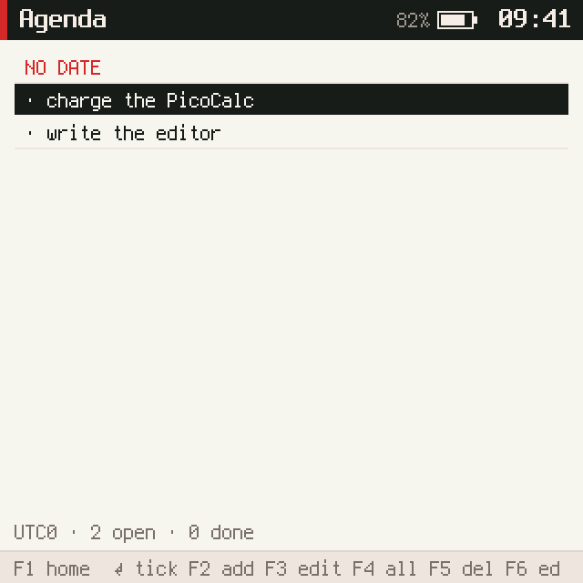
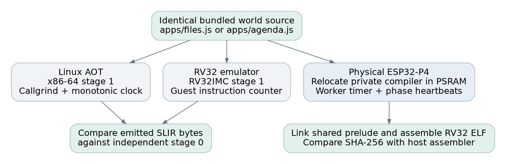
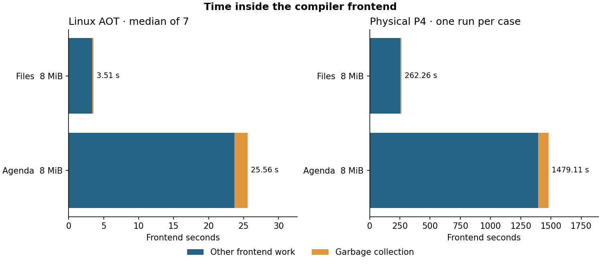
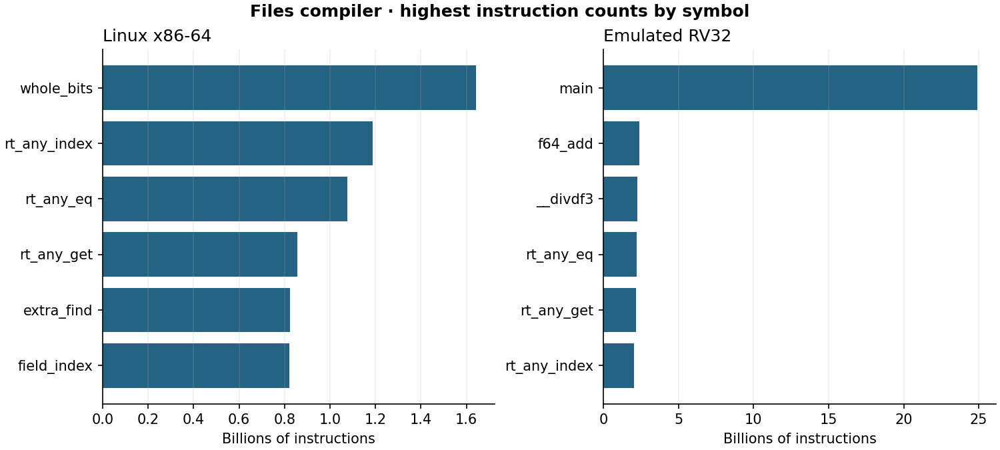
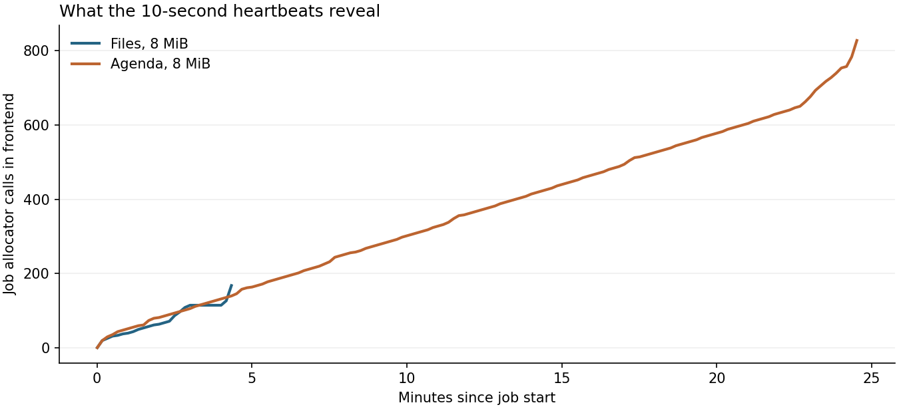
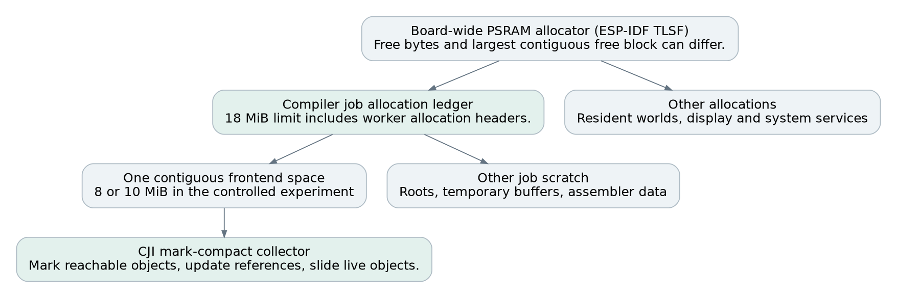
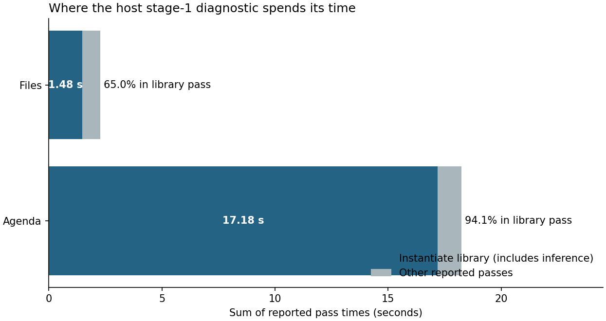
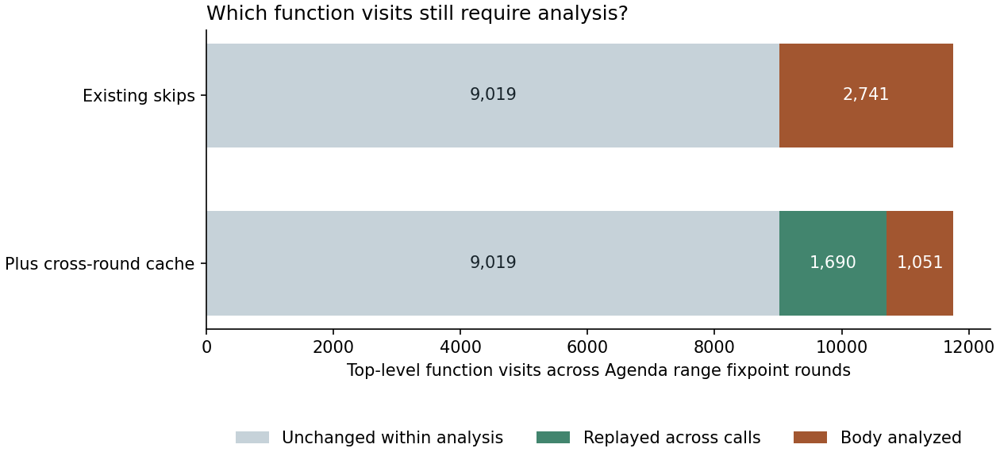

# Where compilation time goes on the PicoCalc

Agenda spends almost its entire physical compile inside stage 1. With an 8 MiB heap the frontend took **1,479.11 s** and the complete job took **1,480.34 s**. Of those frontend seconds, **85.90** were inside the compacting collector. Removing the entire measured GC cost would still leave more than 23 minutes of work. That bound sets the priority for optimization.



**Linux simulator framebuffer.** This is the application whose bundled source we compile. Its launch screen verifies what the workload represents. The compiler benchmark ends after hashing the generated module. It excludes world startup, drawing and typing latency.

## Which work crosses platforms



The Linux build executes the compiler's generated x86-64 code. A monotonic clock measures elapsed time and Callgrind counts machine instructions. The RV32 emulator runs the guest's RISC-V code and can attribute its guest instructions by program counter. The physical board executes that architecture on a 360 MHz ESP32-P4 alongside the kernel and its worlds, fetching code and touching working memory under the board's cache and PSRAM conditions. Emulation answers how much guest work an input induced. Hardware timing answers how long that work took on a particular build under a recorded operating condition.

The frontend reads a JavaScript world and emits SLIR, CJI's intermediate representation. The host and emulated frontend outputs must match an independent stage-0 byte sequence. The P4 also links the shared prelude, assembles the RV32 module and returns its SHA-256. A matching independent host module is the admission test for a P4 timing sample.

## Measured costs and their limits



**Within-target timing.** Each panel has its own scale. The blue portion is frontend time outside measured collections. The orange portion is elapsed time in completed collections. The host bars use separately computed medians of nested and total intervals from the first host matrix. The P4 bars use the recorded intervals from individual successful jobs.

| 8 MiB case | Linux AOT frontend, first matrix | P4 frontend | P4 GC | P4 whole job | Peak P4 scratch |
|---|---:|---:|---:|---:|---:|
| Files | 3.514 s | 262.264 s | 9.206 s (3.51%) | 263.136 s | 9,251,666 B |
| Agenda | 25.556 s | 1,479.109 s | 85.898 s (5.81%) | 1,480.340 s | 10,048,551 B |

On this matrix the P4 frontend took approximately 75 times as long as Linux for Files and 58 times as long for Agenda. Those ratios describe these builds, runs and timing boundaries. Frequency, target instruction expansion, cache behavior, clock variation and background work all affect them. We have no measured CPI or cache-miss attribution for the full P4 runs.



**Compiler code attribution.** Linux's top symbol, `whole_bits`, classifies a boxed number's bit representation. `rt_any_index`, `rt_any_eq` and `rt_any_get` implement operations on dynamically represented values. Those operations also appear among the leading named guest functions. RV32 additionally spends billions of instructions in software floating-point helpers. Its large `main` bucket includes generated addresses assigned to the nearest preceding symbol. A finer guest symbol map is necessary before assigning those instructions to parser, lowering or emission routines.



**Reading a slow run.** Each point is an observed frontend heartbeat. The same job can allocate, reuse and free temporary buffers throughout stage 1. A rising call count confirms activity. An interval with a flat count may still be running generated code. A terminal full-digest receipt establishes completion. Comparing the final link and assemble timestamps shows that improving them has very little leverage on Agenda's present wall time.

## Memory ownership on the device



The outer allocator manages available ESP-IDF heap regions. The compiler job separately charges allocations against its 18 MiB scratch ceiling. Inside that budget, CJI manages a contiguous arena and periodically compacts live values. A failure to obtain one region of a given size can occur even when total free PSRAM exceeds the requested number of bytes. A CJI frontend that reaches its compact heap cap can fail with ample free memory outside its arena. Distinguish these cases using the reservation, refusal reason, free PSRAM, largest block and peak job charge in the serial receipt.

Files and Agenda produced exactly the same collection count, survivor bytes and actual slide bytes on Linux and the P4 at 8 MiB. For Agenda the collector reported 1,434,574,696 cumulative survivor bytes and 211,914,816 bytes passed to the slide operation. Multiple collections can revisit the same live object. Counting its size on each visit describes repeated collector work and overstates actual memory movement if interpreted as physical traffic.

## Why library instantiation dominates the host compile



For a call such as `tasks.filter(isOpen).map(titleOf)`, CJI must decide what each method means for its receiver, adapt the callback's arity, and specialize the subset-language implementation. The first call becomes an ordinary call to a fresh helper for this site. The compiler can defer the second specialization until inference establishes what the first call returns. Constructors, dynamic receivers and user-defined methods add similar ordering constraints.

The build calls `instantiateLibraryTaking` in CJI's `src/library.js`. One round walks the program, rewrites resolvable calls and accumulates helper definitions. If it adds definitions, it feeds the expanded program back through `inferTypes`. Inference includes numeric range analysis. For example, an integer operation must preserve JavaScript behavior if an operand can be negative zero, NaN or outside the exact integer range. The analysis propagates bounds and flags across branches, loops and calls until its summaries stabilize.

```text
repeat
    select helpers for resolvable library calls
    if helpers were added
        infer types and numeric ranges of the expanded program
        use the new information in the next round
    else if unresolved receivers need the final dynamic fallback
        make one final resolution round
    else
        return the rewritten program
```

One diagnostic native AOT run reported 17,178 of 18,253 pass milliseconds in library instantiation for Agenda (94.1%). Files reported 1,475 of 2,268 ms (65.0%). The diagnostic forces a collection when reporting liveness. Some uninstrumented work and source preparation sit outside the summed timers, and the middle-pass timings are grouped. These percentages describe this diagnostic's reported pass times. They are independent of the plain Callgrind measurement.

The Agenda Callgrind graph attributes **120,492,745,140 inclusive instructions (88.03%)** to `analyzeRanges` across all inference calls. Generated symbols were resolved against a named executable with the same machine code. Inclusive function costs overlap. A separate 1 ms Linux process-CPU timer captured 35,612 Agenda instruction pointers. The largest self-sample shares were `whole_bits` (8.60%), `rt_any_index` (7.52%), `rt_any_eq` (6.60%) and `field_index` (5.42%). The range-interval join itself accounts for 3.88% of samples. Runtime operations can dominate a flat profile while a particular compiler algorithm accounts for most of their callers.

**What the reference implementation actually did.** A separate source-level trace compiled Agenda with the same world-unit and in-heap store policy and matched the reference SLIR. Six expanding rounds added 12, 58, 1, 4, 3 and 1 helper definitions. Across the compile there were seven range-analysis invocations and 95 fixpoint rounds. The trace counted 11,743,517 interval joins, including 9,195,456 (78.3%) with identical IDs. Files added eight definitions over two expanding rounds, with 12 fixpoint rounds and 1,013,096 joins. These are Node reference-path event counts. The independent native AOT pass times and instruction profiles establish which work is expensive on Linux.

**First optimization trial.** Test an immediate `if (a === b) return a` in `src/ranges.js:join`. Today the function checks emptiness and reads interval tables before identifying an unchanged answer. Identical IDs represent exactly the same bounds and flags. Measure the hit rate, the inclusive cost of joins and the before/after Files and Agenda outputs. This small change has a clear semantic condition and a straightforward falsification test.

**Next trial.** Count calls to range analysis per library round, fixpoint iterations, functions revisited and the number actually changed. Within a range-analysis invocation the compiler already skips functions whose recorded summaries remain valid. The existing cross-round episode cache costs substantial memory in stage 1 and is disabled in this configuration. A useful candidate would target repeated work with a small measured footprint. A general cache or broad change to type inference should come after those counters show which computations recur.

## Follow-up experiments

| Experiment | Hypothesis and measurement | Decision criterion |
|---|---|---|
| Change only the compact heap | Reserve 8 or 10 MiB before relocation. Collect frontend and nested GC time, module digest, peak scratch and PSRAM snapshots. | Require identical output. Compare the whole frontend improvement with the extra 2 MiB committed by an active OS. Repeat a close result in reverse order. |
| Improve generated-code attribution | Retain stage-1 labels when producing a profiling ELF or generate an offline map from the assembler. Associate hot guest PC ranges with actual emitted functions. | Require the same instruction stream and output. Reconcile named totals against the guest harness interval, then prioritize a specific routine. |
| Test one repeated dynamic operation | Find one hot call site with a provable type or repeated field lookup. Compare minimal variants while preserving JavaScript equality, numeric and property semantics. | Require equal Files and Agenda outputs, fewer guest instructions for the targeted operation, and a reproducible physical frontend improvement. |
| Attribute target memory latency | Bracket short repeatable phases with existing core-0 cache counters. Record accesses, misses and elapsed time with the same operating condition. | Require valid counter intervals and evidence that the proposed layout reduces misses or elapsed time. A 32-bit cycle delta wraps in about 11.9 s at 360 MHz. |
| Re-evaluate the running app | Replay the same deterministic messages in both engines with a separate state readback. Add measured UI latency only as a distinct experiment. | Compare per-event distributions with matching checksums. A faster compiler alone changes build latency. |

The existing dispatch control illustrates the last distinction. On Linux the compiled world won the 1,024-iteration integer batch (10.14 versus 44.38 µs). QuickJS won the Agenda string and regexp edit batch (22.60 versus 48.40 µs). These measurements distinguish workloads worth optimizing and give no direct estimate of physical frame latency.

## Reproducing the evidence

The [intern guide](../design-doc/01-profiling-cji-from-the-linux-host-to-the-picocalc.md) defines the APIs, tools, timing boundaries and expected digests. The [script index](../scripts/README.md) gives the execution order. The physical report reader validates the phase order, allocation snapshots, full source and module identities. The figures read the ticket evidence directly. The diagram sources, plotting program and screenshot capture recipes reside in [scripts/figures](../scripts/figures).

## How much repeated inference can Agenda reuse?



The first layer of reuse is already active on the device compiler's normal path. During one range analysis the compiler remembers which summaries each top-level function read. On a later fixpoint iteration it skips the body when those summaries still have the same values. Within a type-inference invocation it also reuses a complete previous range result when its recorded type questions still receive the same answers.

There is an additional cache between successive library expansion rounds. An entry records a function's code shape, the type questions and answers it used, the numeric summaries it read and fed, and its recorded range results. Replay also requires matching widening stage and thresholds. Adding a library helper can change existing call signatures and inferred return types. Identical function text alone is insufficient to establish that an old result is valid.

| Reference compiler work, same input and SLIR | Agenda | Files |
|---|---:|---:|
| Top-level function visits during fixpoint iteration | 11,760 | 348 |
| Visits already skipped by the ordinary path | 9,019 | 123 |
| Fresh body executions on the ordinary path | 2,741 | 225 |
| Additional visits successfully replayed with the cross-call cache | 1,690 | 56 |
| Body executions after enabling that cache | 1,051 | 169 |
| Reduction in interval joins | 44.5% | 5.5% |
| Peak retained cache text, UTF-16 code units | 1,530,495 | 429,257 |

For Agenda, this cache avoided 61.7% of the body executions remaining after existing skips. It tried 3,403 candidate episode validations for 1,690 successful replays. Evaluation still entered seven full range analyses and made 95 fixpoint iterations in both configurations. The separate whole-result reuse check succeeded seven times in each. None of these percentages measures the avoidable fraction of the entire compiler or of its elapsed time.

The cache's Agenda text payload alone corresponds to roughly 2.92 MiB at two bytes per code unit. Temporary objects, metadata, and allocator overhead are separate. Compare a native compiled stage-1 candidate using the same in-heap store, heap bounds and output reference before paying that cost on the board. The trace and the candidate build recipes are in the ticket scripts directory.
