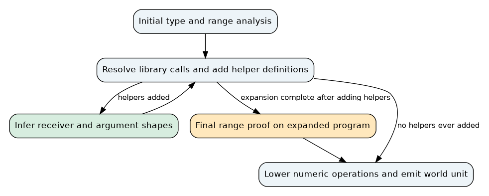
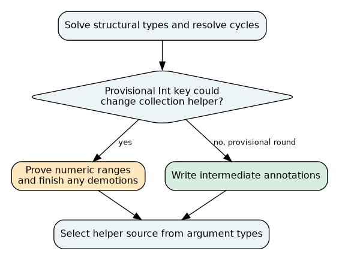
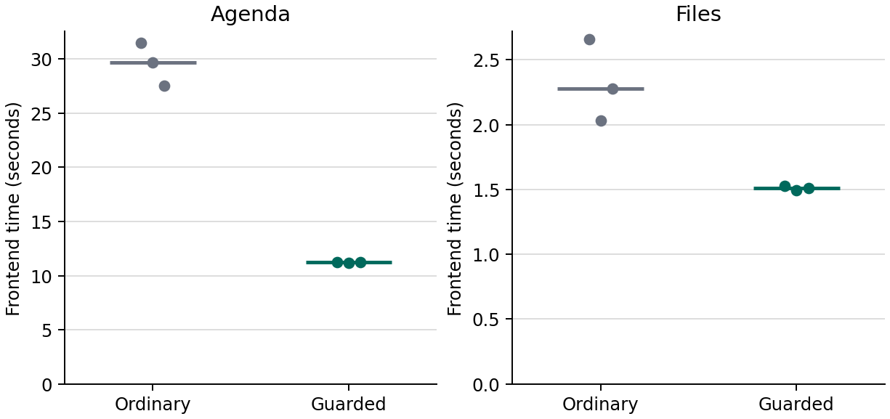

# Scheduling numeric range proofs in the CJI compiler

## Why one Agenda compile asks the same questions repeatedly

Agenda is a JavaScript world, an application whose entry points receive events from the PicoCalc kernel. The ESP32-P4 can run CJI's *stage-1 compiler*: the frontend itself translated into RISC-V code. Given Agenda's source, the frontend emits a world unit in SLIR, the intermediate language accepted by the assembler. The tool then links the shared prelude and assembles a native ELF module. An 8 MiB Agenda profile on the physical board spent 1,479.109 seconds in the frontend out of 1,480.340 seconds total. The following design changes how often the frontend analyzes a program while constructing that world unit.

Suppose a program contains `tasks.filter(isOpen).map(titleOf)`. To replace the two method calls with ordinary function calls, the compiler needs the receiver of each call. The second receiver is the result of the first. After adding a specialized filter helper, CJI can learn the result type, resolve the map call and add its helper. Agenda generated 79 helpers across six expansion rounds. The original compiler ran its whole-program numeric analysis seven times. This ticket asks whether every intermediate expansion requires a complete numeric proof.

**Decision at the first catalog checkpoint.** Implement deferred proofs as an isolated compiler candidate. Preserve the ordinary compiler as the reference. The candidate gives identical generated bytes for Agenda and all other accepted manifest worlds. A larger collection fixture already gives different machine instructions. The change needs both a performance measurement and an explanation of that difference before a default change is justified.

## The three facts a compiler intern needs

A *type* describes a set of values or an operation the compiler may perform. Knowing that a receiver is an array permits an array-method specialization. Knowing the number of parameters a callback accepts determines how the generated helper should call it. The implementation also tracks unresolved receivers. Treating one as dynamic too early can choose a different method implementation. Library constructors run in their own rounds because a newly introduced class can change the inferred type of a collection of objects.

A *range* describes possible numeric values at a program point. CJI tracks lower and upper bounds and flags for fractional values, negative zero and NaN. JavaScript numbers have observable behavior at these boundaries. For example, reciprocal operations distinguish positive and negative zero. The compiler uses range facts to decide whether a provisional integer operation can remain an integer operation. When the proof fails it can demote the operation, variable, return, element or field to a more general numeric representation.

A *fixed point* is reached when applying the analysis rules again leaves the relevant summaries unchanged. Suppose one function returns a value computed from its parameter and another passes a new range into that parameter. The analysis revisits the callee and propagates any change to its return summary. Loops can expand bounds indefinitely under naive iteration. CJI uses *widening*, which accelerates convergence by moving bounds to selected thresholds. Its thresholds depend on program literals and its widening policy depends on the iteration count. Changing visitation order can therefore affect the precision of the eventual bounds.

## What the original pipeline does

The ordinary frontend runs type and range inference before library expansion. Within expansion, a round walks the current tree, resolves calls for which it has enough information, creates specialized definitions and inserts the definitions into the tree. A successful expansion invalidates some facts about the previous program. The compiler calls `inferTypes(input, episodes, true)` on the new tree. The final argument transfers ownership so the input statements can be released as the annotated output is constructed.

Within `inferTypes`, the solver first computes structural types. It also resolves cyclic type descriptions. Numeric range analysis subsequently asks the type solver questions about cells, callees and fields. A range verdict can require a numeric demotion, which triggers another type-solving round. This feedback is the main correctness issue in splitting the passes. The existing implementation already skips top-level function bodies whose consulted summaries remain unchanged within one range analysis. The proposed saving comes from avoiding entire intermediate analyses.

| Interface | Inputs and result | Contract to preserve |
|---|---|---|
| `compileSource(text, native, options)` in `src/build.js` | Source plus compilation mode to SLIR text | Use the same native/world-unit settings for both outputs. |
| `instantiateLibraryTaking(box, store, memo)` in `src/library.js` | Owned program and optional store to expanded program | Preserve helper order, constructor handling, receiver deferral, callback arity and the final fallback round. |
| `inferTypes(p, episodes, consume)` in `src/infer.js` | Program plus optional cache to annotated program | Full inference must remain available for lowering and sidecar verification. |
| `analyzeRanges(p, ctx, ...)` in `src/ranges.js` | Program and type queries to per-operation records, variable hulls and summaries | Preserve exceptional-number flags, loop widening and summary convergence. |
| `cji profile 8 apps/agenda.js` over UART | Bundled source and 8 MiB arena to metrics and ELF digest | Verify the source and output identity and include only a completed frontend interval. |

A *sidecar* is an optional external record of inference facts that can be checked against a later compile. Its entries are tied to a sequence of inference calls. The experimental path explicitly checks `sidecarSession()` and uses the existing schedule during a sidecar session. Compatibility with this mode is a testable requirement.

## The alternative schedule



The prototype retains the first full inference. During intermediate expansion rounds it solves structural types and writes annotations after cycle handling. It returns before running numeric range analysis. Once expansion terminates, it performs one full inference on the expanded tree if it added helpers. When the program required no expansion, the initial full inference already supplied its range verdicts. The diagram describes ordinary compilation with the experimental schedule enabled.

```text
program = initially_inferred_program
expanded = false
repeat
    body, helpers = rewrite_resolvable_calls(program)
    if helpers exist
        expanded = true
        program = solve_receiver_and_argument_types(helpers + body)
    else if an unresolved receiver needs the existing final fallback
        enter_fallback_round(body)
    else
        if expanded
            return infer_types_and_numeric_ranges(body)
        return body
```

The prototype introduces a fourth parameter, `receiverOnly`, to inference. In that mode the solver returns `write()` once type cycles are resolved. It does not construct the per-program interval analysis. This is a scheduling experiment, not proof that all helper selection is independent of numeric representation. In particular, the writer copies annotations from input nodes and selectively updates them. A late full proof can see a tree with a different annotation history. A reviewer should examine all places where generated helper definitions depend on those annotations.

## Measurements and a counterexample

The same counter instrumentation compiled Agenda in the ordinary and candidate source frontends. Both runs emitted the independent reference unit. Helper expansion still took six rounds. Exactly which work disappeared is visible before any timing claim.

| Agenda work | Ordinary | Deferred |
|---|---:|---:|
| Full range analyses | 7 | 2 |
| Range fixed-point iterations | 95 | 20 |
| Top-level function visits in those iterations | 11,760 | 2,445 |
| Interval joins | 11,743,517 | 3,036,247 |

The 74.1% reduction in interval joins measures the execution frequency of one source operation. Native elapsed time must include retained work such as expression walking, helper generation, structural inference, final proof and collection. Physical elapsed time also depends on the RV32 code and the board's memory system.

At the reference CLI, all 20 accepted manifest worlds emitted the same bytes. Calc and Sandbox retained their rejection diagnostics. A broader archived input, `collections/hashed.js`, exercises maps and sets with numeric, string and object keys, including negative zero and NaN. Both compilers accepted it. The ordinary unit was 320,000 bytes of SLIR text and the candidate unit was 327,897 bytes. At the first difference the candidate emitted a `Map$set` specialization without the original conditional floating equality branch and later retained another specialization under the earlier name. Running both units with the native SLIR runner produced the ten expected output lines. This distinguishes an observed change in code generation from an observed execution failure. The example still blocks a claim of exact compiler equivalence.

A concrete investigation starts with the altered `Map$set`. Record the receiver class, argument types, helper identity and numeric annotations when the function is generated on each schedule. Trace the first difference back through `instance`, `make`, and the inference writer. A controlled fix should preserve those observations or justify a different result with a specified semantics and a regression test. Guarding by a particular application name would teach us nothing about the source-language rule.

## How the textbook informs the design

Keith D. Cooper and Linda Torczon, *Engineering a Compiler*, third edition, §9.2 (pp. 451–469), develops iterative data-flow analysis. Apply its separation of transfer functions, merge operations and convergence to CJI: expressions and calls update facts, joins combine intervals, and summaries propagate across functions. The book's framework supplies the concepts. CJI's range flags and widening thresholds are implementation-specific details to check in the source.

Section 9.3.6 (pp. 493–497), particularly Figure 9.21 on sparse simple constant propagation, describes revisiting users when an operand's value changes. Section 9.4 (pp. 497–505) extends the discussion to interprocedural facts. One alternative for CJI would index summary readers and revisit a function when a summary it previously read changes. That would preserve a full proof at every expansion round while reducing the cost of finding affected functions. It would require invalidating edges when helper definitions or type-cell identities change. Since CJI already avoids many unchanged bodies, the relevant comparison is residual body and dependency-check cost. A sparse worklist is a separate design experiment. No SSA conversion is needed to test deferred proofs.

## Implementation and reproduction sequence

All paths below start at the project root. The compiler source is in `ttmp/2026/11/17/PICOCALC-CJI--cji-workspace-import-and-picocalc-integration-analysis/sources/cji/`. This ticket owns the prototype patch and its experiments. The sibling `PICOCALC-CJI-PERF` ticket owns the baseline counters and the generic firmware comparison harness.

1. **Read the source in execution order.** Follow `src/build.js` to `src/pipeline.js`, then `instantiateLibraryTaking` in `src/library.js`, `inferTypes` and `inferOnce` in `src/infer.js`, and `analyzeRanges` in `src/ranges.js`. Within the latter, inspect `feed`, `topLevel` and the final iteration loop. Trace how a widening decision affects the next iteration.
2. **Build an isolated candidate.** From the repo root run the ticket's `scripts/20-build-deferred.sh OUT`. It copies the source, applies `19-defer-range-proof.patch`, bundles the changed compiler and compiles the bundle using the original stage 0. Using the original translator separates the behavior of the compiler being tested from that of the compiler that built it. It prints identities for the bundle, SLIR and native executable.
3. **Check source-level correctness.** Run `21-check-deferred.py CANDIDATE_SOURCE_DIR` and `23-check-original-fixtures.py ORIGINAL_ZIP CANDIDATE_SOURCE_DIR` with Python. These run independent CLI processes and compare exit status, stdout and stderr. The fixture reader uses the local archive and preserves world/driver pairs. Keep mismatches even when a benchmark world passes. A nonzero differential result is a finding to investigate.
4. **Measure the compiled candidate.** Run `25-time-deferred.sh BASELINE_DIR OUT`. Both executables receive the same source, 8 MiB arena and instrumentation. The first round warms each executable. Three subsequent rounds alternate order. Every output is compared with the reference. Report the raw samples, medians, collections, peak live bytes and GC time.
5. **Measure the actual target.** Build a headless profile firmware for the chosen variant. First reproduce the ordinary compiler module by relinking the measured runtime objects and checking its exact bytes. Then change only the stage-1 object in that link. Use a clean boot, an 8 MiB arena, UART progress and a terminal full module digest for each sample. Retain both firmware identities. Restore the ordinary headless firmware after the batch.
6. **Decide scope explicitly.** A matching Agenda run can support an Agenda performance result even while another fixture differs. A general rollout requires understanding the changed specialization, checking sidecar record/use, and explaining any intentional output changes. Record those results as new evidence in the diary.

The design is successful for a given input when we can explain which proofs were deferred, show that the final facts suffice for code generation, and demonstrate a meaningful reduction in time within the device's memory budget. A source counter, a host timing and a physical output receipt each establish a different part of that argument.

## Refined design and the signed-zero regression

The `classes.js` function `ZERO(t, x)` explains the changed `Map$set` branch. A map or set must canonicalize a numeric key of negative zero to positive zero on insertion. The `Number` implementation emits an explicit zero test. An exact `Int` cannot contain negative zero and can be used directly. An `Any` uses a dynamic helper. The value of the key can look like an integer before numeric inference examines the arithmetic that produced it. Once specialization selects helper source without normalization, a late proof cannot reinsert the lost operation.

The small regression in `scripts/fixtures/numeric-collection-keys.js` creates keys using `[0, 1].map(x => -x)` through a named callback. It tests insertion and construction separately. Dividing 1 by the first iterated key makes the sign visible. The JavaScript reference prints positive infinity for all four observations. The initial deferred candidate printed negative infinity for both constructor cases. The guarded candidate restored the ordinary instructions and all four expected results.

The guard runs during the existing annotation walk, after structural types have stabilized. It asks whether the *choice of helper* could use an early integer classification. When a provisional integer appears in the key position of an add/set method or in the element position of the relevant constructor, the solver completes the current numeric proof. A proof that has already begun its demotion rounds must finish. The ordinary and guarded paths both retain the complete final proof.

```text
at a call during the provisional type walk:
    add or set with first argument Int       -> require full proof
    new Set with first argument Int[]       -> require full proof
    new Map with first argument Int[][]     -> require full proof
after the walk:
    if receiver-only mode and no sensitive key and no proof in progress:
        write provisional annotations
    otherwise:
        finish numeric inference
```



The method test is deliberately conservative: an unrelated method named `add` can trigger a full proof. That costs analysis time but preserves the ordinary path. If a future helper begins using numeric precision to choose code, the guard needs to cover that consumer too. The fact that two JavaScript values compare equal does not imply they are interchangeable as inputs to every operation. This regression checks observable behavior as well as generated bytes.

### Validation at the guarded checkpoint

| Test | Observed result |
|---|---|
| Manifest worlds, reference CLI | 20 accepted SLIR units and two rejection diagnostics matched |
| Original archive fixtures, reference CLI | 289 accepted outputs and 46 rejections matched, 335 in total |
| Signed-zero regression, executing native SLIR | Both constructor outputs and both insertion outputs matched the JavaScript reference |
| Compile the original stage-1 source bundle using the guarded frontend | Byte-identical compiler SLIR, SHA-256 beginning `d4a68eaa` |
| Files sidecar recording and strict replay | Identical sidecar and emitted unit, all three sidecar entries accepted |

Run `20-build-deferred.sh OUT guard` to apply both patches. Script 26 contains the guard, script 27 compares sidecar recording and replay, and script 29 checks the original compiler bundle as input. The first prototype remains reproducible with the argument `defer`. Its single divergent archive fixture and the reduced signed-zero regression explain why its speed alone was insufficient.

### What the compiled host result establishes

On the corrected Agenda comparison, the median native frontend time fell from **29.708917 to 11.217008 seconds (62.24%)**, across three measured runs per executable following warm-up. Every emitted unit matched the independent reference. Full range analyses fell from seven to two. Collections fell from 424 to 255. Peak live data grew from 4,491,400 to 5,728,200 bytes, a cost of 1,236,800 bytes in the 8 MiB arena. Script 16 in PICOCALC-CJI-PERF computes the trial medians from the per-run records. The unguarded prototype's separate comparison was 35.125 to 13.869 seconds; the two controls ran under different host loads.

The deployment criterion is **elapsed time from submitting a source world on the PicoCalc to receiving its verified RV32 module**. Peak scratch, peak live data and completion status accompany that number. The main-board-only control reached a frontend heartbeat at 1,011.013 seconds. The operator disconnected the board before the terminal receipt. This is a censored observation: it confirms that the ordinary control ran at least that long. It supplies neither a completion time nor a candidate speedup. No candidate firmware was flashed in that series.

Files gave a second Linux result under the same paired protocol. Its median frontend fell from **2.276829 to 1.509269 seconds (33.71%)**. Collections fell from 80 to 74, while peak live data rose from 3,973,240 to 4,312,224 bytes. The smaller reduction on this workload is consistent with its fewer expansion rounds. Changes in host load also affect the absolute figures, so use the control measured within each trial. See `various/files-guard-native.json` for all eight runs.



### Checking the complete catalog with a compiled stage 1

Run `31-native-catalog.py COMPILER --link picocalc-os/port/esp32p4/build-elf/cji`. This executes the native Linux stage 1, selects the device's 8 or 10 MiB arena by source size, and compares the resulting SLIR to the reference. For each accepted world it then links the device prelude and assembles the RV32 module. All 20 supported catalog ELF digests matched the independent module ledger. This includes the 750,832-byte Agent module. Its single Linux run used 8,737,144 live bytes in the 10 MiB arena. The linker and assembler ran on the host. The resulting modules target the board.

For unsupported inputs the diagnostic can depend on the execution environment. The guarded compiled frontend reached the 10 MiB cap on Calc before it could produce the type error seen under Node. The result row retains this discrepancy. Sandbox still produced the parser diagnostic. To compare like with like, script 32 records the behavior of the ordinary and guarded *compiled* frontends under identical caps.

The host timer sample after the optimization gives a starting point for further investigation. In 7,207 Agenda instruction-pointer samples, 7.23% landed directly in `whole_bits`, 6.06% in `extra_find` and 6.04% in `rt_any_eq`. The runtime's `extra_find` scans dynamically added object properties; `field_index` searches the statically described object shape and has a separate cache. A follow-up experiment would first count calls, probes and hit distributions on the corrected compiler. The sample percentages alone cannot establish whether a different object representation would improve wall time.

The paired rejection check confirmed that both ordinary and guarded stage 1 exhausted the 10 MiB arena on Calc, and both reported the same parse error for Sandbox. The two frontend configurations therefore agree on the supported set at these memory limits.

## A first host reproduction

Start in the project root on Linux with the repository's Node, C and LLVM build tools. The following Bash session produces the original and guarded stage-1 executables in a fresh scratch directory and runs the paired Agenda comparison. It also checks the original compiler as an input program using the guarded source frontend. The native timing commands use no serial port. The baseline preparation builds RV32 prerequisites as well, so the RISC-V build dependencies in PICOCALC-CJI-PERF's intern guide apply.

```bash
set -euo pipefail
perf=(ttmp/2026/11/18/PICOCALC-CJI-PERF--*/scripts)
ranges=(ttmp/2026/11/18/PICOCALC-CJI-RANGES--*/scripts)
work=$(mktemp -d)
bash "${perf[0]}/01-prepare.sh" "$work/base"
bash "${ranges[0]}/20-build-deferred.sh" "$work/guard" guard
bash "${ranges[0]}/25-time-deferred.sh" "$work/base" "$work/guard"
python3 "${perf[0]}/16-candidate-report.py" "$work/base" guard \
  --case-dir "$work/guard"
candidate_source=("$work"/guard/source-*)
bash "${ranges[0]}/29-check-selfhost.sh" "${candidate_source[0]}" "$work/selfhost"
```

A clean result includes three post-warm-up samples per variant and a matching output hash on every run. Absolute times vary with the host. For the physical trial, use a known ordinary headless build, pin its ELF and binary before changing the working build directory, then follow scripts 22 and 24 in PICOCALC-CJI-PERF. Each validated result must identify its flashed image, heap configuration, source and complete ELF. Device wall time includes loading, frontend work, linking, assembly and the terminal receipt.

## What changed when the compiler executed RISC-V instructions?

Cross-assembling twenty world modules checks the output architecture. Running the *compiler itself* as an RV32 program in the host emulator measures the target instruction sequence required to generate those units. Script 30 links a known guest control, verifies it against the existing profiled guest, and substitutes the corrected stage-1 object. Each emitted unit must equal the independent reference. Script 37 records the executable identities and checks the nesting of frontend and GC instruction counters.

| World, 8 MiB | Ordinary RV32 frontend instructions | Guarded RV32 frontend instructions | Reduction |
|---|---:|---:|---:|
| Agenda | 291,433,489,291 | 108,188,425,787 | 62.88% |
| Files | 55,750,760,529 | 45,379,556,556 | 18.60% |
| Flaky | 1,169,986,185 | 1,169,968,003 | 0.00155% |

Agenda saved 183.245 billion frontend instructions. Collection accounted for 4.683 billion of the saved instructions, about 2.56% of the total saving. The remaining 178.562 billion came from work outside collection. Peak live data grew by 1,236,800 bytes to 5,728,200 bytes in the same 8 MiB arena. These results agree in direction and approximate magnitude with the native Agenda timing. The evidence supports testing this build on the board. [Paired Agenda guest receipt](../various/agenda-guest.json)

Files removed over ten billion guest instructions, even though the collector executed 1.727 billion instructions instead of 1.608 billion. Excluding collection, the frontend fell from 54.143 billion to 43.653 billion instructions. Flaky is a small control showing little benefit at this scale. The observed 18.60% reduction for Files differs from the 33.71% reduction in native Linux median frontend time. An RV32 instruction and an x86 elapsed second are different units. Target cache stalls, memory latency, instruction mix and the operating system influence the physical result; a terminal on-device timestamp remains the acceptance measurement.

When resuming on a newly attached board, a previous Flaky smoke record or interrupted Agenda capture is insufficient as the control. Script 24 checks that the control ledger includes a verified 8 MiB Agenda job and that the recorded firmware ELF identity matches the saved control snapshot. Use a fresh run directory or preserve the next ordinal alongside the incomplete one. Begin a new physical trial only with the board available and the pinned ordinary firmware identified.

### Testing the existing interval shortcut on the new schedule

The guarded Agenda trace still made 3,036,247 joins. Of these, 2,331,158 had identical interval IDs. The earlier shortcut experiment tested the ordinary schedule. To measure its incremental benefit here, use the guarded compiler as the *control* and add only the equal-ID return to the *candidate*. Both executables must emit the same Agenda SLIR under the same 8 MiB cap. Record the new medians and GC figures without combining percentages from independent experiments. This experiment changes the implementation of a remaining operation and leaves the proof schedule intact.

In the matched host combination trial, Agenda's guard-only median was 6.225 seconds and guard-plus-shortcut was 6.265 seconds (+0.63%). The measured ranges overlapped broadly. Files went from 1.723 to 1.620 seconds (−5.93%), also with overlapping ranges. All emitted units matched and collection counts and peak live data were identical for each workload. This gives no demonstrated incremental Agenda latency benefit in that trial. The prioritized P4 image therefore uses the guarded schedule alone. The paired receipts are in `various/agenda-guard-plus-join.json` and `various/files-guard-plus-join.json`.

The archive also includes the compiler author's own test harness. Script 38 ran its configured default suite using the guarded native stage 1. The harness checks intermediate passes, interpreters, stored expected outputs and the stage-1 backend where applicable. It reported **all 278 passed**. This supplements the separate 335-input byte comparison, which also covered inputs outside the harness's default set. These counts overlap and should not be combined.
