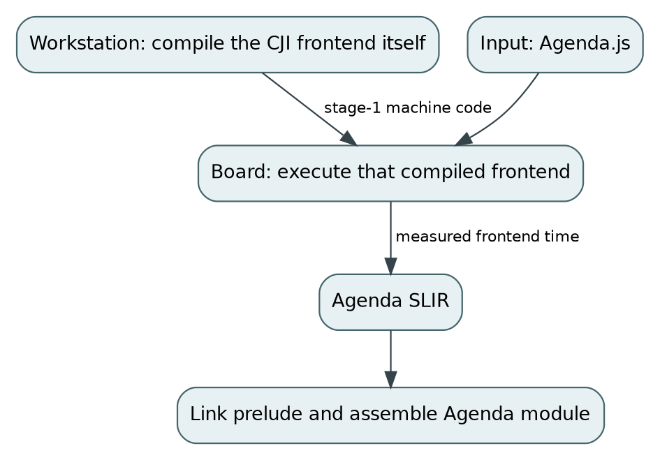
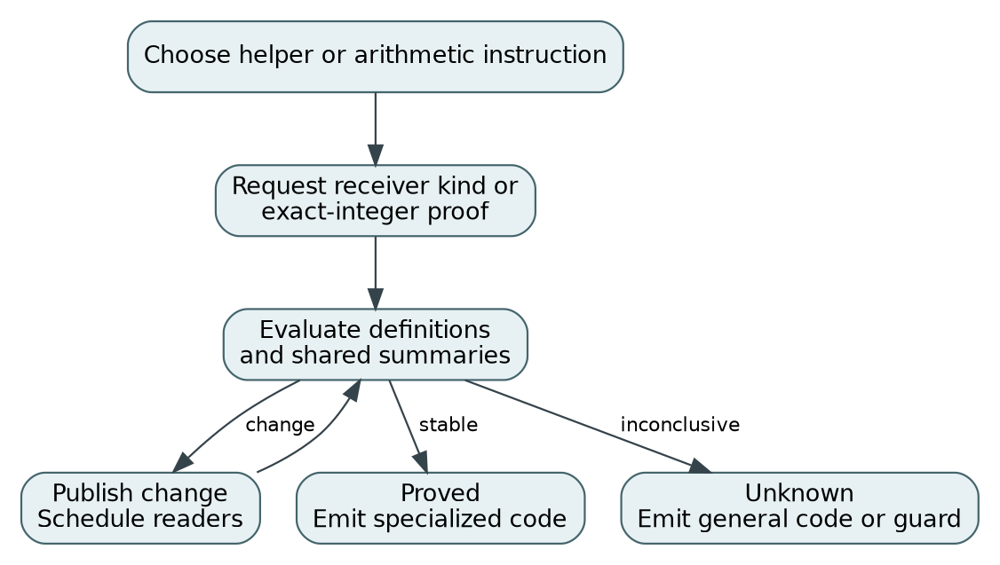

# When CJI can compile a dynamic operation statically

## What should become static?

A CJI program can use an integer, a floating-point number, a string or an object at a source expression such as `a[i]`. The compiler has to choose instructions before the user supplies all the inputs. When it knows the receiver is an ordinary array, how that array stores elements, and that the index is a valid integer, it can issue an element load. When any of those facts is missing it can retain the missing check. These choices are independent. An array can have a fixed layout while each element can hold a different kind of value.

Our objective is the time between requesting a compile on a PicoCalc ESP32-P4 and receiving a correct executable module. There are **two programs** in this experiment. Agenda is the input. CJI is also written in JavaScript and compiled ahead of time into the stage-1 executable that runs on the board. An improvement to Agenda's event handler would help someone using Agenda. An improvement to a library loop **inside stage 1** helps someone waiting for Agenda to compile. Building that stage 1 on the workstation allows us to spend effort once that would otherwise be repeated on the device.

The first experiment I recommend is suppressing unchanged writes to the range solver’s persistent local state. It has a narrow correctness argument and addresses a measured cause of array copying. A specialized array-read path in the generated slice helper is a second, independently measurable experiment. The case rests on a machine-code observation, a caller count, and a receiver census. The longer-term opportunity is to propagate only the type and numeric facts that affect emitted code. SD storage serves a third purpose: retaining completed work between compiles and reducing peak memory. These three interventions have distinct measurements and failure modes.



## Follow one read from JavaScript to the processor

Open `src/library.js` in the imported CJI tree. Its slice helper normalizes endpoints, obtains the source length, allocates a result and copies a span. In the generated guarded stage 1, find the function whose full name is `slice.4604fbb68ec0`. Its loop already subtracts and compares native integers. Here is the significant portion of its SLIR, the textual instruction representation consumed by the assembler. Register names are retained so the boxing step is visible.

```text
mov    r0, s3           # s3 holds the integer loop index
icall  any_from_int/1   # construct a dynamically represented number
mov    r1, r0
mov    r0, [s0-16]      # reload the receiver from its root slot
mov    r2, s0           # pass the root stack for operations that allocate
icall  any_index/3
```

Inside `rt_any_index` the runtime tests whether the receiver is an array or string and whether the key is numeric. It must handle other receivers, key conversion, errors and out-of-range reads as well. The consuming program needs just one element. The general ABI requires work on both sides of the call before reaching the ordinary array load. The result element may still need its tag after this operation. The direct optimization target is the round trip for the index and repeated receiver dispatch.

For example, take an ordinary array with values `["a", true, 7]` and an already normalized copy interval `[1, 3)`. The two result elements must be `true` and `7`, in that order. A loop can read both through one stable array representation while preserving each element's tag. CJI already requires an array injected into Any to have Any elements (see `isDynamicType` in `src/types.js`); a raw Int[] has a different element representation. Check that invariant at every entry, including native boundaries. Before replacing a dynamic load with a typed one, prove the element word convention and preserve the treatment of holes and absent elements used by this particular helper. The generic index helper returns undefined for certain invalid numeric indices; a typed access in generated SLIR can branch to an index error. Merely knowing the receiver is an array does not establish equivalence.

## Evidence from compiling two real applications

We linked the **guarded** named stage-1 object to three diagnostic runtimes. In every run the captured output matched the independently stored SLIR byte for byte. In the first experiment GNU linker wrappers counted direct calls from generated code and resolved the return address to a generated function. The second counted actual path selections and probes in the C implementation, including internally invoked lookups. The third counted receiver classes inside the indexing function only when the caller PC was in the exact slice specialization. Instrumentation changes elapsed time, so only counts are reported from these builds.

| Native stage 1, 8 MiB | Agenda | Files |
|---|---:|---:|
| Direct calls to dynamic equality | 145,851,991 | 34,829,510 |
| Direct calls to dynamic property get | 59,846,109 | 15,497,857 |
| Direct calls to dynamic indexing | 58,932,328 | 13,660,892 |
| Index calls from the named slice helper | 15,922,776 | 2,910,144 |
| Of those, ordinary array and numeric key | 15,922,776 | 2,910,144 |
| Of those, string or other path | 0 | 0 |

For Agenda, one generated slice body accounts for 27.0% of direct dynamic index calls. Another concrete source is the range expression evaluator, `ev` in `src/ranges.js`. Its generated symbol directly called dynamic equality 18,875,451 times and property get 3,913,332 times. A generated Map get specialization issued 12,221,134 property gets. Library and analysis code both contribute. Shared helpers and anonymous lambdas need call-chain evidence before assigning all their work to any particular pass. A receiver observed on two runs is evidence for choosing a specialization site. A correctness proof must cover every allowed invocation.

A separate Callgrind run against the named, guarded native frontend counted executed x86 instructions. Agenda executed 49.36 billion instructions; 34.47 billion (69.85%) were attributed inclusively to `analyzeRanges`. Files executed 15.28 billion, including 6.01 billion (39.36%) in range analysis. The named slice specialization and its callees account for 8.73% of the Agenda total and 3.78% of the Files total. This establishes range analysis as a major remaining consumer for Agenda even after removing five of its seven whole-program analyses. The slice number includes its entire call tree and allocation costs, so eliminating its index dispatch alone could only recover part of that number. Inclusive percentages for callers and their callees overlap; the P4 has a separate instruction set and memory system. Scripts 10 and 16 reproduce the counts.

The lookup measurements also change the priority of an apparent optimization. Agenda invoked the fixed-shape field lookup 51,039,567 times; 50,702,720 were cache hits on the instrumented host. It invoked the extra-property lookup 70,268,369 times; 50,465,661 immediately found no extras array. The remaining calls examined 52,346,290 name entries in total. Thus a general-purpose larger hash table for every record could add memory to handle objects that frequently need zero probes. Before changing lookup representation, measure cache behavior in the exact target build. The shared ESP runtime and loadable compiler have distinct builds and cache lifetimes.

## How the current compiler reaches a representation

Read the following files relative to the imported CJI directory under `ttmp/2026/11/17/PICOCALC-CJI--cji-workspace-import-and-picocalc-integration-analysis/sources/cji/`. The guarded scheduling changes used for the board experiment are the two source patches in the adjacent RANGES ticket. The original import remains the reference.

| File and interface | Input, output and why it matters |
|---|---|
| `src/pipeline.js`, `compileBoxToText(box, options)` | Orchestrates passes, accepts a store and can emit one function at a time. Trace the frontend from this entry. |
| `src/library.js`, `instantiateLibraryTaking(box, store, memo)` | Uses inference to select or generate a helper. Adding helpers can introduce more calls, so expansion repeats. Inspect `choose` and helper signatures when explaining a generic receiver. |
| `src/infer.js`, `inferTypes(p, episodes, consume)` | Joins the types reaching variables, fields, parameters, elements and results. Writes inferred facts into a program for downstream passes. The guarded variant can request just receiver facts in eligible expansion rounds. |
| `src/ranges.js`, `analyzeRanges(p, ctx0, episodes, seed, options)` | Computes operation records, variable hulls and shared summaries. `ev` evaluates an expression abstractly, `refine` restricts possible values on a branch, `feed` grows an interprocedural summary. |
| `src/types.js`, `recordType`, `recordFields` | Describes record layout and its consistent field order. Knowing only that a value is some record gives less information than knowing its shape. |
| `src/cast-insert.js`, `cast`, `castInsert` | Introduces boxing, checked projections and generic operators at representation boundaries. This is a place to inspect why a proven integer still becomes dynamic. |
| `runtime/runtime.c`, `rt_any_index`, `rt_any_get`, `rt_any_eq` | Implements dynamic behavior, checks receiver kinds, looks up names and handles numeric conversions. Use this code as the oracle for any fast path. |
| `picocalc-os/port/esp32p4/compiler/tool.c`, `compiler_entry` | Receives the job, initializes the reserved arena, calls `cji_main`, links the device prelude, then invokes the assembler. The complete-module time includes all those steps. |

Type inference uses a **cell** for a value whose possible types are discovered over time. At first no value may have reached a cell. An integer argument can raise a parameter cell to Int; another call passing a fraction raises it to Number. A mixture of unrelated types can end up at Any. Two aliases of a mutable array must see each other's writes. CJI unifies their element cells. If a function escapes into dynamic code it may be called with unknown arguments. CJI consequently loses precision for some cells even when a particular local use always sees one kind. The conservative choice prevents invalid code.

A small source file can still produce many such operations. A helper may serve many call sites. A loop runs its body for each element. The range solver reevaluates summaries until they stop moving, and generated helpers become new code to analyze. The static size of an application is a poor estimator of these products. The observed Agenda counts quantify that effect directly.

### A four-call experiment

Run the guarded Node CLI on `scripts/examples/13-three-additions.js` with `--emit` to see three representations for addition in one small program. The companion `--interp` run printed `3 2.5 3 21`. All three functions have the same broad purpose; the reachable inputs and operation decide their lowering.

| Expression in the example | Observed SLIR | Explanation |
|---|---|---|
| `exact(2)` computes `x + 1` | `add r0, r1, #1` | The incoming value and sum are exact integers. |
| `floating(2)` computes `x + 0.5` | `i2f` then `fadd` | The numeric operation is known statically. Its result requires a fraction. |
| `mixed(2)` and `mixed("2")` both compute `x + 1` | `any_from_int` then `any_add` | One shared entry must implement both addition and concatenation. The last call produces the string `"21"`. |

One possible alternative for the last function would be two statically selected entries when all call sites are known and the function never escapes. Every specialized entry adds instructions for the compiler to generate and the loader to hold. This tiny example explains *why* the general entry exists; it does not warrant creating two versions of every polymorphic function. The exact emitted bodies are in `various/three-additions.slir`.

## Why the numeric proof exists

A type answers **what operations are meaningful**. A numeric proof can answer **whether a cheaper implementation preserves all observable results**. Both operands of multiplication may be JavaScript numbers with integral inputs, yet the product of 94,906,267 with itself exceeds the safe integer range. Multiplying zero by a negative number can produce negative zero, observable through its reciprocal. Taking a remainder with a zero divisor can produce NaN. Keeping the numeric type known while selecting floating-point arithmetic is a successful static outcome for all three cases.

CJI represents an abstract numeric value with lower and upper bounds and three flags for possible fraction, negative zero, and NaN. Its exact-integer test also requires a nonempty value and strict bounds within ±2^53. A join summarizes alternatives. Joining integer values 2 and 7 produces the interval [2,7]; later reasoning has to allow interior values even when the original paths did not produce them. The implementation already interns intervals and stores bounds and flags in separate arrays. An interval ID lasts one analysis invocation. Saving the ID alone across invocations would silently reinterpret it.

For a loop that increments a counter, visited intervals can grow from [0,0] to [0,1], [0,2], and so on. Widening jumps an expanding bound to a selected threshold, ensuring convergence on long chains. CJI already widens inside loops and across summary rounds, and uses program literals and standard thresholds. It also skips unchanged function bodies. On guarded Agenda two analyses still used 20 fixed-point rounds and 3,036,247 interval joins. Implementing interning or widening again would miss the remaining issue. The design question is which facts need consumers, and how cheaply the solver can discover that a consumer is unaffected.

The guarded compiler has a specific counterexample to postponing every proof. A callback negates zero before its result is inserted into a Map or Set. The helper selected for numeric keys can depend on demotion from Int to Number and the collection's zero normalization. The regression fixture inspects the reciprocal of the first iterated key. The correct result is positive infinity. This is a demand for numeric information **during helper selection**, even though the final program-wide proof occurs later. Any replacement scheduler must enumerate these early consumers.

## What the literature contributes

**Constraint-based type inference.** Palsberg and Schwartzbach construct conditional constraints that propagate sets of possible receiver classes. A singleton set can justify a direct operation. Their language and worst-case analysis are different from CJI's. For CJI the transferable idea is to track just the distinctions a consumer observes, such as ordinary array versus string versus other. Associate facts with a program point or a particular helper entry when a whole-function join loses them. A known receiver class still leaves independent obligations about mutation and element storage. [Object-Oriented Type Inference](https://web.cs.ucla.edu/~palsberg/paper/oopsla91.pdf)

**Sparse propagation.** In *Engineering a Compiler*, third edition, Cooper and Torczon develop data-flow equations in §9.2, SSA construction and use in §9.3, and call-graph propagation in §9.4. In particular, the worklist in §9.3.6 reevaluates users of a definition whose value changed. SSA gives each assigned value one defining operation; a merge at a control-flow join selects a value from the incoming edge. Wegman and Zadeck also track which control-flow edges can execute, allowing unreachable alternatives to be excluded. Their constant domain has a shorter chain than numeric intervals. CJI would have to supply its own widening, mutable-memory dependencies and exception paths. [Brown technical report](https://cs.brown.edu/research/pubs/techreports/reports/CS-89-36.html)

**Widening and proof budgets.** Cousot and Cousot explain how to extrapolate increasing approximations to a sound result and, when worthwhile, refine it afterward. For CJI this suggests a practical stopping rule: when a finite analysis budget expires, choose a representation valid for every remaining value. For a numeric operation that can be Number, that choice can be floating point. At a polymorphic boundary it can be the generic operation. Discarding unexplored alternatives and claiming an integer would break soundness. More precise narrowing earns its CPU cost only when a consumer can select better code. [Comparing widening and narrowing approaches](https://www.di.ens.fr/~cousot/COUSOTpapers/PLILP92.shtml)

**Demand-driven proof.** Bodík, Gupta and Sarkar's ABCD algorithm starts at a bounds check and follows relevant relations through a sparse graph. A useful CJI adaptation is to begin at a representation decision, such as an array load with an integer induction variable. Ask whether the language-level value is integral and whether the load can observe a missing index. These are different questions. An index bound involving the length of a mutable array needs an invalidation rule for calls and writes. ABCD does not supply JavaScript coercion or negative-zero semantics; these remain obligations of CJI's transfer functions. [ABCD](https://homes.cs.washington.edu/~bodik/ucb/research/pldi00.html)

**Localized specialization.** Chevalier-Boisvert and Feeley propagate facts gained from type tests into specialized versions of basic blocks in a JIT. A PicoCalc ahead-of-time adaptation can emit a small fixed pair of paths before execution. A single dominating receiver test admits a loop with statically known representation. A general loop handles the remaining cases. This requires neither missing-code generation on the device nor speculative recovery midway through the loop. Price the duplicate code, root slots and extra frontend work. Their published JavaScript benchmark speedups are measurements of a different compiler. [Lazy basic block versioning](https://www.iro.umontreal.ca/~feeley/papers/ChevalierBoisvertFeeleyECOOP15.pdf)

**When to build SSA.** Braun and colleagues describe constructing SSA directly from a syntax tree while control flow is being built, including handling predecessors that become known later. This is a plausible implementation for a future per-function scalar IR. Building a second complete program IR alongside CJI's existing tree would increase peak memory. A smaller first experiment can use dependencies between function summaries and discard per-function local state on completion. Invest in full SSA once measurements show that local rescans dominate after eliminating interprocedural rescans. [Simple and Efficient Construction of SSA Form](https://pp.ipd.kit.edu/uploads/publikationen/braun13cc.pdf)

## Where the interval work and the array copies meet

Two source-level experiments explain why the range solver generates so much generic library traffic. Both ran the guarded JavaScript source under Node, left all original return values intact, and verified output against the independent reference. Script 11 identifies the caller of each interval join. Of Agenda's 3,036,247 joins, **1,826,045 (60.1%)** came from merging two local-variable states. Of those, 1,546,429 had identical inputs. The join performed by widening accounted for a further 537,621. Joining a previous operation record with new argument/result facts accounted for 386,142. These counts distinguish a repeated operation from the algorithm that repeatedly requests it.

Local state is a persistent 32-way tree. A branch can copy a state handle while retaining its root. To change one slot, `trieSet` copies each node on its path with `node.slice()`, then writes an interval ID at the leaf. Merging two states skips shared subtrees by pointer identity. Copying a leaf solely to write the ID it already contains therefore costs twice: it copies 32 entries now and makes later merges inspect distinct arrays that express the same facts. Script 12 observed the existing behavior without skipping any write.

| Guarded source observation | Agenda | Files |
|---|---:|---:|
| State writes | 490,367 | 84,941 |
| Writes of the ID already in the slot | 194,247 (39.6%) | 31,599 (37.2%) |
| Existing 32-slot nodes copied on write | 496,705 | 90,508 |
| Newly built merge arrays | 181,798 | 37,319 |
| Merge arrays already shallow-equal to an input | 53,062 | 12,600 |

There is an independent numerical check. For Agenda the 496,705 source-level copies imply 15,894,560 copied slots. The compiled frontend's slice helper actually issued 15,922,776 dynamic reads, a difference of only 28,216. The counts come from distinct executions and do not prove attribution for every call. Together with the explicit `node.slice()` in `trieSet`, they identify a far more specific mechanism than a general complaint about dynamic JavaScript. The generated SLIR also shows exactly three direct callers of this slice body, all named `slice_dispatch`. They branch separately for strings. Reaching the other branch only excludes a string; it does not prove a particular array representation.

### First prototype — Keep identical state roots

A leaf can compare the existing interval ID to the proposed ID before copying. At interior nodes, update the affected child first. When it returns the original child pointer, reuse the original parent. This avoids an additional preliminary lookup on every write. The proposed pseudocode assumes the node and its child can be absent; assigning an actual interval to an absent leaf still creates the path.

```text
set(node, key, interval, level):
    slot = five_bits_of_key(key, level)
    old = child_or_absent(node, slot)
    new = interval if level == 0 else set(old, key, interval, level - 1)
    if node exists and identical(old, new): return node
    copy = clone32(node) if node exists else empty32()
    copy[slot] = new
    return copy
```

The state handle remains mutable so exception handlers that share that handle see updates. The tree nodes remain immutable. Retaining the old node when its represented mapping is equal therefore preserves the existing snapshot behavior. Use identity only for interval IDs within one analysis invocation. Retain the special treatment of undefined slots. A second independent experiment can preserve the input node of a merge when every computed child matches it. For the first comparison, change only the write path so that savings from each decision can be attributed. Require the same records, hulls, helper selections and emitted bytes. Inspect the resulting self-hosted stage-1 code: if extra dynamic comparisons offset the avoided copies, the source-level saving will overstate the physical benefit.

## Design A — Preserve the receiver fact at the loop

Some calls already know the receiver statically. Inspect the receiver type before helper generation and the generated helper signature after specialization. If all incoming edges for that generated entry carry the same proven array layout, encode that fact in the entry and leave element values as dynamic where needed. A call arriving with an unknown layout uses the general entry. If a receiver fact cannot be recovered cheaply, test it once after evaluating and normalizing the arguments. The guard must dominate the entire fast loop.

```text
a, start, end = evaluate_inputs_once_in_language_order()
s, e = normalize_slice_bounds(a, start, end)
result = allocate_result_using_existing_semantics(s, e)
if proven_or_tested_ordinary_array_with_matching_element_layout(a):
    for i in [s, e):
        v = read_array_word_preserving_missing_and_hole_behavior(a, i)
        write_result_with_existing_barriers(result, i - s, v)
else:
    run_original_copy_loop(a, s, e, result)
return result
```

These names specify obligations for an implementation; they are proposed operations. The bounds normalization and allocation can throw or collect. Preserve evaluation order and keep the receiver and result rooted over allocations. A moving collector can relocate the array or its backing storage. Hoisting an object-kind test is distinct from hoisting an interior pointer across an allocation. Retain the existing roots and reload the backing pointer whenever its address may have changed. First retain the bounds check, then consider removing it only after proving that no intervening effect can change the length. A direct load must also handle arrays whose element representation differs from a dynamically tagged word.

The measured opportunity is to avoid up to the observed generic calls at this site if every corresponding invocation qualifies. The receiver census does not establish the word layout or demonstrate elapsed savings. One fallback per helper is a sensible initial version budget. If the prototype duplicates code in many generated helpers, quantify that added compile cost on Files and small worlds, where a longer analysis could outweigh runtime savings.

## Design B — Pay for interval proofs at their consumers

A practical intermediate unit is the **function summary**: an approximation of parameter values, return values and externally visible writes. The existing solver tracks shared variables and array element summaries as well. Record the summary keys read by each function evaluation. A changed key need only schedule readers of that key plus any newly discovered structural dependencies. AST node IDs and compact integer function IDs can identify readers without repeating string-keyed property lookups in a hot loop. Preserve a stable iteration order for reproducibility.



A demand is a question attached to a consumer. Examples include “must the generated Set helper normalize a possibly negative zero?” and “can this operator use exact integer multiplication?” A first implementation can keep today's full set of consumers and change scheduling alone. That isolates the effect of avoiding repeated discovery before attempting to drop proofs. A second version can start from observable consumers and traverse dependencies backward. Native calls, callbacks, mutable aliases and captured variables require conservative read/write summaries. A helper inserted in a later iteration introduces new edges and may invalidate an earlier answer.

```text
initialize all required entry and shared facts
seed the queue with reachable functions and mandatory proof consumers
while queue has work:
    take one function in deterministic order
    evaluate it using current summaries and record every summary read
    replace its reader edges, including reads of currently empty facts
    for each summary contributed by this function:
        join with the old fact; widen at designated cycles
        if the fact grew: enqueue its readers once
verify that every reachable transfer is contained in the final facts
emit integer code only for consumers whose exactness test succeeds
```

The final containment check expresses the condition for a sound post-fixpoint: reevaluating a transfer must not produce a possibility outside the recorded result. It is particularly valuable in shadow mode, where the new solver runs alongside the old one and does not control code generation. Mark all unknown external entry arguments conservatively. A change of program epoch, helper set, alias-class merge or widening stage can invalidate facts even when a numeric summary compares equal. A shrinking or rewritten program may require a fresh analysis; joining with stale facts can lose precision. Never reuse an invocation-local interval ID as a persistent fact.

Queue bookkeeping can itself cost more than it saves. Record evaluation count, inputs examined, enqueue attempts, successful changes, allocation and live bytes. Compare against the existing 1,793 skipped evaluations out of 2,445 top-level function visits. Existing skips are part of the control. If most time is in the 652 remaining visits, a coarse function queue alone has limited leverage. Then instrument `ev`, state merges and individual numeric consumers before committing to an SSA rewrite.

## Design C — Use the SD card for cold pass data

The port's device filesystem currently mounts a wear-levelled **internal flash** FAT partition named `files` in `main/fs_p4.c`. The loadable compiler links its own firmware libc, whose `tmpfile()` builds a growable memory file. On the host, `src/spill-file.js:fileStore` appends UTF-8 strings with offsets and lengths. The compiled runtime's `rt_spill_put/get` use UTF-16 units and their own index. The guarded host benchmark reported zero spilled bytes. Attaching a card does not connect any of these paths to removable storage. Card wiring, bus availability while headless, filesystem mount and available space are separate integration questions.

Prefer two experiments in this order.

1. **Verified sidecars for repeated compiles.** A sidecar records prior type and numeric facts. CJI already implements `recordingSession`, `usingSession`, `nextEntry` and summary validation. Given candidate summaries and loop invariants, it checks that reevaluation stays within them. Keep a versioned sidecar keyed by the exact input, compiler build, helper/prelude versions and compilation options. Use ordinary inference on a cache miss or failed validation. Benchmark the first compile including writing, the repeated compile including reading and checking, and a compile after editing the source. A warm hit can help an unchanged world. A whole-source key usually misses after an edit.
2. **Sequential spill for limited memory.** Add an explicitly bound store for serialized, completed functions or cold proof episodes. Append a complete record, check the returned byte count, then expose its offset and length. Keep the queue, active states, hot ID tables and the offset index in RAM. Reconstruct interval IDs from semantic bounds and flags. Make records private to one compile initially; it greatly simplifies lifetime and cleanup.

A persistent cache needs a completed-file marker, version, byte counts and integrity check. Write to a unique temporary name and publish only after all writes and close succeed. Verify what the actual FAT driver guarantees through reset and remount; a rename alone does not prove durable data. Reject short reads, invalid lengths, invalid handles, a missing card or a partially published entry. For an optional cache, discard the entry and compile normally. A spill required to fit a job needs a clean recoverable job failure if the card disappears. Abort that job and release memory, and leave previous installed modules intact.

**A measured sidecar trial.** Script 08 ran the guarded Node CLI in separate processes, primed the files, rotated cold/record/replay order, and measured three runs of each mode per application. Here “cold” means no proof file supplied; the operating system’s filesystem cache was warm. All outputs matched, and strict replay validated every entry. Files produced 22,664 bytes and had median times of 0.718 s without a sidecar, 0.914 s recording, and 0.592 s replaying. Agenda produced 142,671 bytes and took 1.239 s, 3.512 s and 0.801 s respectively. Recording Agenda costs about 2.27 s extra under Node; each later verified hit saves about 0.44 s. At these medians about six subsequent hits on the same source repay one recording. A sidecar produced on the host moves that recording cost off the board. These are host process times with local files. The stage-1 board entry currently supplies only the input and world-unit arguments; a device sidecar reader and physical SD timing would be additional implementation work.

**A measured spill trace.** Script 15 wrapped the actual Node file store and accounted for every byte. Agenda appended 593 records (2,120,161 bytes) and read 753 (2,633,617 bytes). For 549 reads the requested file offset differed from the cursor after the previous operation; 141 reads were under 512 bytes. The largest record was 97,009 bytes. Files wrote 1,312,100 bytes and read 1,406,615 bytes. This is the existing host file-store workload, which also enables the range-episode memo. Offsets measure logical discontinuities; the operating system and the SD controller determine physical transfers. A port that stores every record as one file would add filesystem overhead. An append file and a small read cache are more credible first experiments. These transient megabytes are separate from the 142,671-byte persistent Agenda sidecar.

The speed decision can be stated as a budget in seconds. On a warm run, saved recomputation must exceed serialization, transferred bytes divided by measured bandwidth, seeks, validation, and any extra GC. Measure sequential writes, reads and many small accesses on this board before choosing chunk sizes. For an out-of-memory workload, successful completion can justify slower elapsed time. For Agenda, which fits in the current configuration, moving frequently updated intervals onto SD could increase latency substantially. No SD writes were issued in this research.

## Implementation order and acceptance tests

**Start with an unchanged-write experiment.** Count identical writes, actual copied nodes, merged slots and generic index calls on the ordinary guarded control and the candidate. Check that the loop iterations, exception handlers and branch snapshots still see the correct local values. After correctness, compare untimed counts and independently timed end-to-end output. Do not combine this change with a specialized slice until both have standalone measurements; they target overlapping copies.

**For a specialized slice, first build a controlled microcase.** Compile a program exercising slice on a known array of mixed tagged values. Inspect the helper call site, its specialized entry and its emitted loop. Add cases with a string, sparse array, negative endpoints, omitted endpoint, out-of-range access, a collection triggered during copying and an exception during argument evaluation. Where source semantics differ between the typed and general helpers, record the current observable result before choosing the specialized operation. Include a case that enters the general fallback. The proposed optimization should remove repeated generic dispatch only for receivers that meet the proof or guard.

**Then rebuild the compiler with itself.** Enable a single change in a candidate tree, bootstrap it through the ordinary stage 0 and generate stage-1 SLIR and RV32 compiler objects. Inspect the actual copy loop again. Compilation of an application with stage 0 alone does not exercise the expensive machine code in stage 1. Re-run the site counters in an instrumented build to verify the intended calls disappear. Measure time in separate builds with the counters disabled. When a new code generator deliberately changes the emitted modules, compare behavior and independently assembled results and explain every expected digest change. For a pure scheduling change that aims to preserve output, require byte identity.

**Qualify the candidate under memory limits.** Run the original suite, the archived fixtures, compiler-as-input, the signed-zero collection regression and all 22 world sources. The current baseline links 20 modules. Compare the failure stage and diagnostic for the other two. Run Agent under the catalog's 10 MiB setting as well as Agenda and Files at 8 MiB. Track peak live data, peak scratch outside the heap, GC, generated helper count, module bytes and completion. Include Flaky, a small world, to expose fixed overhead.

**Test a new solver in shadow mode.** Record old and new facts by stable source identity. Two sound solvers may compute different bounds; verify containment of actual transfer results and integer decisions before requiring exact interval equality. For the scheduling-only variant require the same final emitted unit. Include a recursive call group, an unknown callback, shared-array writes through aliases, an unreachable branch, helper insertion and a threshold-changing integer literal. Verify every intermediate numeric-key helper choice. A missing dependency can pass tests on straight-line code while yielding a wrong answer only in a later iteration.

**Finish on hardware.** Use a clean ordinary/candidate pair at the same arena size, compiler settings and peripheral configuration. Verify firmware identities before boot and verify the full module hash or expected semantic change afterward. Report elapsed submission-to-module time alongside frontend and collector times, plus sample count. Repeat if establishing a stable production baseline. The host and emulator can rank candidates during development; the paired board measurement decides whether the user's compile wait improved.

### Reproduction map

Run from repository root. The scripts take directories as arguments to keep large generated objects and raw binaries outside Git. The RANGES and PERF tickets contain the bootstrap recipes that prepare these inputs.

```bash
ticket=(ttmp/2026/11/18/*CJI-STATIC*)
bash "$ticket/scripts/03-measure-sites.sh" "$named" "$scratch/callers"
bash "$ticket/scripts/06-run-probes.sh" "$named" "$scratch/probes"
python3 "$ticket/scripts/07-slice-receiver.py" "$named" "$scratch/slice"
python3 "$ticket/scripts/08-sidecar-trial.py" "$guarded_source" "$reference" "$scratch/cache"
node "$ticket/scripts/11-range-consumers.mjs" "$guarded_source" agenda "$reference/agenda.ref"
node "$ticket/scripts/12-range-state-copies.mjs" "$guarded_source" agenda "$reference/agenda.ref"
python3 "$ticket/scripts/09-figures.py"
```

Here `named` contains the named guarded stage-1 object and reference inputs produced by RANGES script 34. `guarded_source` is the guarded bootstrap source tree containing `cji.js`; `reference` contains Agenda and Files reference SLIR. The long board runner is `scripts/01-board-pair.sh NEW_OUTPUT SAVED_IMAGES`, where the image directory contains the ordinary and guarded snapshots. It uses the existing device port and restores the ordinary headless image after the pair. The board runner flashes the app partition. Source-level research proposals in this chapter have no effect on that image.

The adjacent research evidence includes `various/{agenda,files}-callers.json` for caller attribution, `*-probes.txt` for dynamic lookup behavior and `*-slice.txt` for the receiver census. Include the implementation diary when investigating a discrepancy in the evidence. A useful first exercise is to locate the slice helper's backend call, explain why the compiler boxes a known integer, and identify which condition allows the fast loop to keep the index in its existing register.
