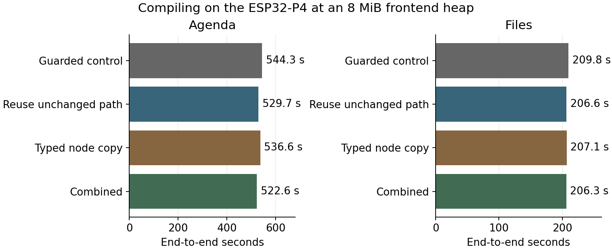

# Persistent range states and statically typed array copies

## The problem the user sees

The user compiles an application called Agenda on an ESP32-P4 board. The board runs a compiled copy of CJI, a JavaScript compiler written in JavaScript. CJI must discover which numerical operations can safely use exact integers before it emits an application module. This ticket changes the compiler performing that analysis. The user's application and the language rules are the reference against which changes must be validated.

An interval is a conservative range of possible numeric values, together with flags for exceptional values such as negative zero. A function-local state maps each numbered variable to its current interval. Where control flow branches, each path must retain its own facts. At the point where the paths meet, the solver joins their states, forming a conservative result that includes both possibilities. The existing compiler already interns equivalent intervals so that each distinct abstract value in one analysis has a small numeric ID.

## A store in the analysis

CJI represents a state using a small mutable record containing a root and a slot-number table. The root points to an immutable 32-way tree. Each level consumes five bits of a variable's slot number. Leaf entries are interval IDs and internal entries are child arrays. A missing slot reads as undefined. The static branch-copy operation creates a second mutable state handle pointing to the same immutable root. Updating one handle can then replace its root without changing the other's mapping. Exception processing also retains certain *handles*, so their identity and mutability matter independently of the tree's persistence.

Consider a depth-two tree and variable 37. The high five-bit group is 1 and the low group is 5. A store to this variable replaces child 5 of the leaf under root child 1. All other children can be shared. When the existing value of that slot is already the proposed ID, the entire existing root represents the required result. The current `trieSet` eagerly slices every node visited, including those on an unchanged path. Later joins first compare root or child identity. Creating a distinct copy of a semantically unchanged node removes the possibility of succeeding on that cheap test.

```text
state A ───► root ───► leaf at child 1 ───► slot 5 = interval 19
state B ────┘

write B[37] = 19          both handles may keep root
write B[37] = 21          B gets a new root and a new leaf
                          A can still read interval 19
```

This is path copying in a persistent data structure. Driscoll and colleagues formalize persistence as access to multiple versions after an update. For a direct implementation comparison, inspect Clojure's PersistentVector.doAssoc, which visits a vector trie and replaces children along a path. Here the compiler has a useful extra property: leaf equality is comparison of canonical IDs. [Making Data Structures Persistent](https://www.cs.cmu.edu/~sleator/papers/Persistence.htm) · [Clojure PersistentVector](https://github.com/clojure/clojure/blob/master/src/jvm/clojure/lang/PersistentVector.java)

## First change — Descend before copying

The proposed update accepts the current node, slot number, interval ID and remaining level. It obtains the old child once, computes the new child, and tests whether the node can be reused. The equality test compares IDs at a leaf and references at an internal node. It must be valid only within a single analysis, since interval IDs are recycled across runs.

```text
slot = (key >> (5 * level)) & 31
previous = child(node, slot) or absent
replacement = interval if at leaf else set(previous, key, interval, level - 1)
if node exists and previous equals replacement:
    return node
copy = clone existing node or allocate a fresh 32-slot node
copy[slot] = replacement
return copy
```

Correctness follows by induction on the depth. On a leaf the new mapping differs only at the chosen slot. When the old and new values compare equal, reusing the array preserves every lookup. At an internal node the recursive result already represents the required subtree. If it is the old child, every child remains valid. If the child changed, path copying preserves the old version while publishing the new child. The public assignment still writes the resulting root to its state handle. The argument does not depend on the order in which branch states are eventually joined.

## Second change — Teach one copy operation its receiver layout

The existing slice specialization visits ordinary arrays with numeric keys on all 15,922,776 measured Agenda reads at that helper. The generic helper boxes the integer index and dispatches on the receiver every iteration. A compiler-private trie node has a stronger invariant: every allocated node is an ordinary array of 32 slots. Entries may hold either a child reference, a number, or undefined. A specialized copy can declare the receiver as Any[] while retaining tagged entries. That preserves the independent facts that the container's layout is known and an element's value may be dynamic.

Use a private `cloneTrieNode` with a pinned Any[] parameter and result in the source subset's type comment syntax. Allocate the destination at 32 elements and copy indices 0 through 31 in order. This is narrower than globally assuming a receiver layout for library slice and is directly testable on the current workload. A dynamic caller may pay one checked projection at the call boundary. Inspect the generated helper body to verify that its inner loop omits any_index; type annotations alone are insufficient evidence. Check collection roots around the destination allocation. A read from a missing slot yields undefined. The trie only consumes slots by indexed read and tests presence with an undefined check. Verify all producers and consumers before relying on this fact: a generic array user observing property presence could distinguish a hole from an explicit undefined slot.

## Four controlled builds

Use the corrected guarded compiler from PICOCALC-CJI-RANGES as the control. Change only the range-state writer, only the private copy helper, then both. The copy helper runs less often in the combined version; benefits can overlap. All four executables should receive the same source and arena. Rotate their order across native trials after warming. Retain frontend time, GC time, collection count, live bytes, code size and output hash. Judge practical value by the time to a verified machine module on the physical board.

| Interface | What to inspect |
|---|---|
| Imported CJI `src/ranges.js:analyzeRanges` | Owns the current interval IDs, trie slot numbering and state lifetime. |
| `trieGet`, `trieSet`, `copyState`, `joinStates` | Read, update, take snapshots and test subtree identity. Mutation is limited to the state handle and newly allocated arrays. |
| `src/types.js:isDynamicType` and `src/cast-insert.js:cast` | Define which arrays can cross an Any boundary and how a checked projection is inserted. |
| `src/library.js` and `runtime/runtime.c:rt_any_index` | Explain the cost of the general slice path and the semantics it supports. |
| RANGES scripts 20, 23, 31, 35 and 38 | Bootstrap stage 1 and verify archived frontend cases, linked catalog binaries and original suite. |
| PERF scripts 05, 09, 18 and 22 | Build and identify an experimental image, run the board compiler, validate receipts and boot the ordinary headless image after testing. |

## Validation an intern can reproduce

1. Start from a clean copy of the imported source, apply the guarded scheduling patches, and apply the candidate edits. Use the unmodified stage 0 to compile the resulting frontend. This keeps changes to what executes on the device independent of changes to the compiler used to build it.
2. Compile representative programs through stage 1 at 8 MiB. Check the full emitted SLIR against the stored reference before comparing time. Run the catalog with its existing heap policy, including Agent at 10 MiB, and record existing failures separately.
3. Probe the changed operation with a multi-level tree, repeated write, changed leaf, missing leaf, and divergent snapshots. Validating both independent handles catches an accidental mutation of a shared node.
4. Examine the candidate's generated copy loop and run a counter on fresh and suppressed copies. Collect physical evidence using the same guarded control and board configuration. A lower number of writes is evidence about mechanism; elapsed seconds must come from a separate timed executable.
5. Restore the headless ordinary firmware and retain the boot and smoke test receipt. Publish the criteria, failures and observed results in the guide and report.

## Building and inspecting the implemented compiler

Scripts 01–04 implement the first two designs above. Script 01 performs source-anchor checks before editing a scratch copy of `src/ranges.js`. Script 02 applies the baseline proof-scheduling and numeric-key patches, builds the source bundle with the normal bundler, and translates it with the original stage 0. The resulting `stage1` is runnable on Linux. `stage1.slir` is the exact frontend to assemble into the firmware. These two artifacts let an intern measure compile latency and inspect the generated code from the same source. Create a fresh directory for each build to retain the original evidence.

```bash
p=(ttmp/2026/11/18/*CJI-TRIE*)
scripts="$p/scripts"
ranges=(ttmp/2026/11/18/*CJI-RANGES*/scripts)
scratch=$(mktemp -d)
refs="$scratch/reference"
mkdir "$refs"
bash "$ranges/20-build-deferred.sh" "$scratch/guard" guard
guard="$scratch/guard/stage1"
for world in agenda files; do
    node "cji/cji.js" "picocalc-os/js/apps/$world.js" --world-unit --emit > "$refs/$world.ref"
done
for variant in reuse typed both; do
    bash "$scripts/02-build.sh" "$scratch/$variant" "$variant"
done
python3 "$scripts/04-benchmark.py" "$scratch" "$guard" "$refs"
python3 "$scripts/08-inspect-copy.py" "$scratch/both/stage1.slir"
```

Here `guard` is the guarded native stage-1 executable from the RANGES ticket. The reference directory contains independently recorded Agenda and Files SLIR. The artifact directory for each variant also contains the source that generated it. The guide uses “typed” for the private clone variant and “reuse” for the equality-preserving write. These labels identify experimental builds.

The typed helper's machine representation makes its obligations visible. Its body calls a specialized `$read0` helper. That helper checks the index, reads the array data pointer, shifts the index left by three to obtain a byte offset, and loads an eight-byte element word. Its out-of-range path can return the undefined tag. The loop uses an integer from 0 through 31. The verified helper body contains no dynamic subscript dispatch or index boxing. Array bounds and exception checks remain. See `various/typed-copy.slir` for the exact generated program.

To package a variant for the measured ESP32-P4 configuration, run script 06 from a workspace where the PERF and RANGES tickets' ESP-IDF profile and headless configuration are already built. The script checks that linking the ordinary compiler object reproduces the pinned control tool. It substitutes only the selected stage-1 object, emits an application binary and ELF, records their SHA-256 and restores the ordinary setting of the local build directory. Script 07 accepts this build root, the saved ordinary headless firmware directory, a fresh run directory, and a list of variant names. It flashes the app partition, verifies boot conditions, checks Flaky, compiles Agenda and Files, then restores the ordinary image and runs Flaky again. Flashing requires exclusive access to the serial device.

```bash
bash "$scripts/06-make-firmware.sh" "$scratch" both reuse typed
bash "$scripts/07-board.sh" "$scratch" "$ordinary" "$runs" both reuse typed
```

The source-level snapshot checks found that path reuse removed 197,158 of Agenda's 496,705 existing-node copies. The result still represented the same 490,367 stores. The typed-only source had the same copy count as the control. These numbers count units of compiler work; the four executables' physical timings measure the consequence for the user.

## Measured results and conclusion

The ESP32-P4 ran each program once per firmware at an 8 MiB frontend heap. The guarded control came from the same headless board session. Each candidate started from a fresh flash and a Flaky smoke test. The timed application command included producing a linked module. The frontend's timer measures compilation inside that command, and its collector timer measures a subset of frontend time. The last column below comes from a separate Callgrind run of each native x86 compiler on the same application source. A counted instruction on x86 does not correspond to one cycle on the P4.

| World | Compiler | Module time (s) | Frontend (s) | GC (s) | x86 instructions (billions) |
|---|---|---:|---:|---:|---:|
| Agenda | guard | 544.293 | 543.063 | 58.914 | 49.355 |
| Agenda | reuse | 529.675 | 528.410 | 54.159 | 47.835 |
| Agenda | typed | 536.601 | 535.379 | 59.041 | 47.579 |
| Agenda | both | 522.587 | 521.380 | 54.173 | 46.764 |
| Files | guard | 209.770 | 208.873 | 9.838 | 15.278 |
| Files | reuse | 206.609 | 205.733 | 9.026 | 15.005 |
| Files | typed | 207.054 | 206.165 | 9.805 | 14.955 |
| Files | both | 206.321 | 205.457 | 9.121 | 14.802 |

| World | Compiler | Collections | Peak live (bytes) | Scratch peak (bytes) |
|---|---|---:|---:|---:|
| Agenda | guard | 255 | 5,728,200 | 10,048,551 |
| Agenda | reuse | 240 | 6,096,360 | 10,048,551 |
| Agenda | typed | 255 | 5,728,200 | 10,048,551 |
| Agenda | both | 240 | 6,096,360 | 10,048,551 |
| Files | guard | 74 | 4,312,224 | 9,251,666 |
| Files | reuse | 72 | 4,312,224 | 9,251,666 |
| Files | typed | 74 | 4,312,224 | 9,251,666 |
| Files | both | 72 | 4,312,224 | 9,251,666 |



The combined candidate reduced Agenda's end-to-end time by 21.706 seconds (3.99%) and Files' by 3.449 seconds (1.64%) against the guarded control. Its exact x86 instruction reductions were 2,591,424,342 (5.25%) and 476,352,366 (3.12%), respectively. The two independent changes overlap. For example, Agenda made 58,932,328 dynamic index calls in the guard and 43,343,705 in the combined executable, a 26.45% reduction. Typed copying alone made 43,031,072, slightly fewer than the combination. Descending before copying must inspect the old child. Other work, including proof traversal, survives both changes.

On Agenda, the combined collector ran fifteen fewer times and consumed 4.741 fewer seconds. Its largest sampled live set rose by 368,160 bytes. Peak live is measured when a collection happens, so changing allocation changes where the samples are taken. The scratch measurement includes reservations outside the 8 MiB frontend arena. All four configurations reported the same scratch peak for each world. The combined flashable application was 3,974,928 bytes, 176 bytes larger than the guarded image. Preserving sharing improves total work but can change the memory headroom needed by the workload.

Four timed native rounds followed a warm-up. Guarded and combined frontend medians were 7.286 and 5.553 seconds for Agenda and 2.126 and 2.127 seconds for Files. The workstation was shared, and individual timings overlapped. On the P4, the combined result was the shortest observation in each world. The difference between combined and path reuse for Files was 0.288 seconds. Without repeated board runs there is no estimate of run-to-run variation and no basis for a precise ranking of close variants.

### Qualification and reproduction

- Every variant passed all 278 original harness cases. Each produced all twenty reference ELF modules in the catalog, including Agent under its established 10 MiB cap. Calc reproduced its capped out-of-memory result and Sandbox its parser diagnostic.
- A separate differential compared the combined frontend with the original on 335 fixture files. It matched output on 289 accepted cases and reproduced all 46 rejections. The combined compiler also reproduced the original compiler's intermediate program when that compiler was the input. Strict replay of the original Files sidecar accepted all three recorded proofs.
- Script 03 checked snapshots at depths one, two and three and counted work on actual input. Script 08 inspected the generated typed private read. Scripts 09 and 12–13 independently gathered executed instruction and generated runtime-call counts. Instrumented timing was excluded from the physical comparison.
- Script 10 verified the firmware identity, program source hash, final module hash, heap reservation and board configuration. Raw UART records and firmware hashes are under `various/physical/`. The restore receipt identifies the ordinary headless firmware ELF by SHA-256 `49a7320315fa45896797f825760f8ca92cac9a0f485ea38c5da3a861bc97749b`. Its smoke test produced the reference 10,800-byte Flaky module.
- Script 11 regenerates the figure. Script 14 regenerates both tables from `various/physical/physical-summary.json` and `various/x86-instructions.txt`. The complete host trial sequence is in `various/native-trials.json`.

The larger scheduling change in the RANGES ticket took ordinary Agenda from 1,474.601 to 544.293 seconds on this headless board. The combined trie changes reduced it further to 522.587 seconds. This is a measured opt-in compiler build, and the user still waits over eight minutes. To target that remaining time, count proof consumers that are revisited despite unchanged relevant inputs. That measurement can guide a decision about avoiding entire traversals.
