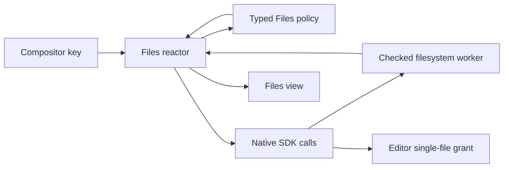
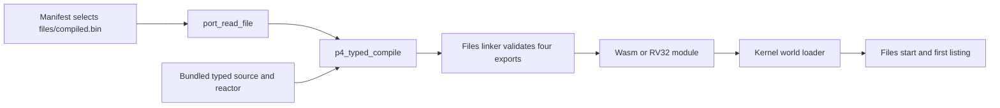

# Catalog migration and Files implementation guide

The PicoCalc manifest registers named worlds for hardware drivers, shared services, and applications. This migration covers all 15 shipped entries backed by `picocalc-os/js/apps/` in `picocalc-os/js/system.json`. QuickJS still provides the runtime for unported worlds. Some apps already have native CJI builds. Those builds remain useful as comparisons, and each catalog entry needs evidence from the typed compiler to count toward this ticket. Agenda supplies the existing example of a typed program linked to a shared reactor and executed on Wasm and RV32.

## Identify each workflow before replacing it

| App | Work to preserve and exercise |
| --- | --- |
| Agenda | Task display, reminders, stored edits, calendar prompts, diagnostics, and Editor handoff. The existing typed implementation is the starting evidence. |
| Files | Directory navigation, selection restoration, scrolling, creation, rename, confirmed deletion, and handing Editor one file. |
| Editor | Text and Markdown editing, cursor and selection behavior as implemented, search, preview, save and file capability ownership. |
| Launcher | App discovery, focus transitions, shortcut dispatch, and presentation metadata. |
| Settings | Wi-Fi scanning and joining, zone changes, and the exact permission boundary for administration. |
| Logs | Cursor-based log reads, filtering and display. |
| System monitor | World and resource reporting. |
| About | System details and app presentation. |
| Keys | Read-only display of key events under its current claim. |
| Snake | Movement, collisions, scoring and timer behavior. |
| Chat | Messaging, turn and status handling, and the agent boundary. |
| Calculator | Expression evaluation, history, plotting, scientific functions and help. |
| REPL | User input and interaction with the existing sandbox world. |
| Loader | Storage app discovery and lifecycle, with the generated Hello example as part of that workflow. |
| Faults | The existing controlled fault demonstrations and system administration requests. |

Read each original app and its tests before defining parity. The catalog excludes the separate keyboard, display, and power drivers and the compositor, agent, sandbox, and flaky fixture services. Apps that call those worlds keep exercising the existing interfaces. User-installed apps retain their existing loader path. The catalog boundary does not remove any app or capability from the shipped configuration.

## Follow Files from a key to the device

Files is a good next port because Agenda already exercised the `nw_fs_at` and `nw_ask_file` APIs. Files owns the directory capability `fs:/`. Editor receives a single child capability for the selected file. The kernel checks that the sending world holds the handle, the path is inside the directory and the requested operation has the required rights. The filesystem worker returns a settlement with the original token. A reactor consumes only the settlement belonging to its pending operation. Returning focus to Files triggers a fresh list and restores the selected entry by name when it still exists.



The typed source owns input validation, selection and command rules. The reactor owns capability handles, asynchronous operations, JSON conversion, and the UI transport. Text crosses the typed ABI as a length followed by UTF-16 code units. Directory listing and filenames arrive as UTF-8 in JSON from the worker. Preserve the original directory-first order and compare names in UTF-16 order when the filesystem order is insufficient. A bounded renderer can use the existing compositor list window, while the selection model retains all entries returned by the filesystem. Avoid substituting a direct file syscall or sending a root handle to Editor.

```text
on compositor key:
    ask typed policy for action using key, selection and modal state
    if action changes the selection, update the view
    if action needs a normalized name, validate it using typed policy
    if action requests I/O, record the returned token

on matching settlement:
    apply the list result or keep the error message
    if Editor accepted the file, revoke the previous grant and open Editor
    otherwise revoke the attempted grant and retain the previous one
```

Open a file with Enter and a directory with Enter or Right. Backspace and Left go to the parent. F2 opens a new file through Editor. F3 creates a folder. F4 renames the selected entry. F5 requires two presses on the same selection and disarms on intervening input. Filenames accepted from the prompt have 1–64 characters after trimming, use the exact ASCII character class in the original app, and reject trailing spaces or dots after normalization. Existing directory entries may have names outside that input class and still need to open and navigate correctly.

## Build, verify, and commit in app-sized steps

Start at `picocalc-os/js/apps/files.js` and `picocalc-os/tests/sysapps.test.mjs`. Consult `worlds/agenda/compile.js` for checked signatures and slot binding, `sdk/nw.h` and `nucleus/native.c` for public world calls, and `nucleus/fs.c` for worker operations and permissions. Add the smallest SDK surface required by each app, and exercise authorization with the original claims. Keep caller-visible results and custody of transferred handles the same. For new shared compiler features, include the program that requires the feature and check output on both backends.

First compare pure behavior against the original JavaScript. Then load the actual compiled Wasm module through the manifest and drive realistic UI actions. Repeat representative cases with the generated RV32 code and on the target device. A linked ELF size or successful standalone parser call alone cannot qualify an app. Record the manifest entry, actual backend, fixtures, behavioral evidence, and any separately pending device checks. Commit an app when its implementation reaches a coherent checkpoint and preserve commands and decisions in the diary. Keep the remaining apps listed until their corresponding integration checks pass.

## Compile Files on the ESP32-P4

The firmware build includes the compiler scripts, the typed Files source, and an unfilled reactor. The P4 runs the compiler in a short-lived QuickJS runtime backed by its aligned PSRAM allocator. The application then runs under the engine selected in the manifest. The same runtime wrapper also runs the existing Agenda compiler.



Set `PICOCALC_TYPED_FILES=ON` for Wasm. Build the template first with `make -C picocalc-os files-reactor`. Set `PICOCALC_RV32_FILES=ON` for RV32. That selects the trusted ELF loader and builds the template with the P4 toolchain. In both cases the Files entry keeps its original world name, root claim and memory limit. The option keeps the experimental firmware profile separately reproducible.

Use `scripts/03-build-files-firmware.sh IDF_EXPORT BUILD_DIR SDKCONFIG wasm|rv32` from the repository root to build an image with the usual panel worlds and RV32 Agenda. The script verifies both possible boot manifests and the bundle entries. Use distinct build directories or save the first application binary before rebuilding the other profile in the same directory.

Read the UART `files compile source=bundle` line for the compile duration, JS heap high-water mark, and module size. During cold boot each Files compile occurs while the kernel reads the Files entry. It adds to the time before dispatch, so a paired hardware trial should also record power-on to first interactive frame. Successful firmware builds verify the configuration and linkage. Physical qualification additionally requires the UART compile result, an on-screen listing, and a replay of the create, rename, remove and Editor save workflows.

## Map Editor storage offsets to display columns

Editor receives one file handle through the `open` ask. It loads UTF-8 text and normalizes CRLF and bare CR to LF. The typed layout routines operate on one document buffer with a 32-bit length followed by UTF-16 code units. Each logical line is a span inside that buffer. `editorWrapEnd` receives the absolute end of that span, so it can produce display rows without copying a line or looking past its separator.

A file offset counts UTF-16 units. A display column counts Unicode code points, matching the original `Array.from` behavior in `js/apps/editor.js`. A supplementary character advances the file offset by two and the display column by one. Combining marks still count individually. The 49-column soft wrap can break after the last ASCII space in the candidate row. If the entire remaining span fits, keep it together. For cursor motion, the exclusive end of a wrapped non-final row points to the following row. The exclusive end of the final row is a valid insertion position on that row.

```text
at = logical_line_start
repeat at least once:
    end = editorWrapEnd(document, at, logical_line_end, 49)
    render document[at:end]
    when mapping a cursor column into this row:
        use editorOffset(document, at, end, logical_line_end, column)
    at = end
until at == logical_line_end
```

Use `editorNext` and `editorPrevious` for code-point boundary movement and `editorColumn` for the reverse mapping. The native reactor will own file grants, document memory and screen JSON. Save must retain the exact submitted text until the write token settles, since the original app compares that snapshot with the current buffer when deciding whether the document is still dirty. Keep the `open` ask open until its read settles and check the real kernel scheduling for key events during saves.

`scripts/07-check-editor-layout.mjs` compares the emitted Wasm and RV32 calls against the original JS wrap logic. It runs the same deterministic vectors in both engines, including a logical line whose offsets cross 65,535. This is a text layout check. The reactor, file workflows, search, Markdown mode and device integration require their own checks.
