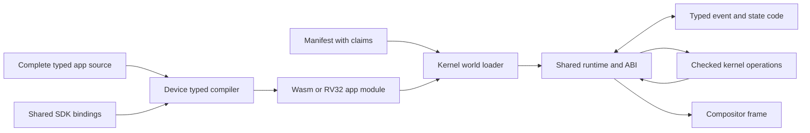

# Complete typed application runtime and catalog migration

“100% typed JavaScript” means the shipped application owns its state, event handlers, commands, domain rules, UI model, and workflow sequencing in typed source. A common runtime receives operating-system events, exposes SDK operations, transfers data across the ABI, and loads the generated code. That runtime may use C. Each app build must use the same runtime implementation. An app-specific C event handler, parser, view builder, or state machine fails this requirement even when it calls some typed functions.

## What the system does today

PicoCalc runs named actors called worlds. The manifest in `picocalc-os/js/system.json` declares their startup parameters and capabilities. Compositor delivers input messages and consumes screens. The kernel serializes a world's turns. When an SDK operation returns a token, the world receives a settlement with that token and either a result or an error. The filesystem worker in `nucleus/fs.c` validates authority and submits I/O. Files holds `fs:/`; Editor can read or write only the selected file it receives over an ask.

There are three relevant language paths. The original apps use QuickJS with `js/prelude.js`. Some full JavaScript worlds already compile to native ELF with CJI. Those are useful references for source-level ownership, while the device performance data on larger inputs motivates keeping the simpler typed compiler. The new typed linker currently fills a prebuilt reactor's function slots. It has typed integer, boolean, string, buffer, and record operations. It does not yet expose all the effects and data needed for a standalone typed world.

Agenda's `entry.typed` and `reminder.typed` provide task parsing, typed date/time normalization, and grouping and marker helpers. `worlds/agenda/wasm-world.c` drives the workflow, reminders, mutations, navigation and presentation. Files keeps sort order, name validation and key policy in `worlds/files/files.typed`; `worlds/files/world.c` owns its state, filesystem activity, handoff and screen. Their successful hardware tests qualify those hybrid implementations. Editor's typed layout code is independent and reusable. The catalog work must move the remaining app code, including Agenda and Files, into typed source.

## Execution architecture

Start with one runtime and one native SDK import surface. On both backends the generated world has initialization and event entry points. The runtime invokes them on the kernel lane. It translates wire values into the typed ABI and forwards SDK operations. It delivers every completion with the original token, and the typed world interprets the result. It carries no app-specific choices. The typed source constructs the same UI tree vocabulary used by the original apps, through shared typed helpers for text, columns, lists, and other nodes. Use shared wire and JSON helpers for representation conversion. Those helpers should not inspect an app's state or choose an app's screen.



The first implementation should use explicit bounded storage and signed offsets. The runtime supplies per-world memory, initialized at world start and discarded with the world. Keep typed function parameters small by passing checked records and views into that storage. Extend the string representation already used by the compiler, which stores a 32-bit UTF-16 unit count followed by its contents. Add string literals and efficient bounded construction where a first real app needs them. Dynamic objects and coercion are outside the initial design. Compiler diagnostics should say which construct is unsupported and point to its source location.

Prefer direct imports for the SDK over a C callback per app. A typed declaration or shared prelude signature supplies the names and types. Wasm linking should resolve these to fixed runtime functions, using the existing function-index machinery. RV32 linking should bind the same names to entry trampolines reachable by the generated code. Context and pointers are per-world. Take care with alignment and lifetime before exposing a writable view. Return a typed failure for invalid capabilities, paths, spans or tokens. Use the VM-native kernel checks for authority even when a request originated in trusted RV32 code. The RV32 loader's trust model remains the existing PicoCalc model.

## First vertical slice

Build the first complete world around Editor. Use its existing typed layout for soft wrapping and cursor mapping. The first runtime exercise should render the Editor's empty screen from typed source, then accept the narrowed file grant and display an opened document. Move commands, search, Markdown continuation and preview, position persistence, and screen construction into typed Editor. Keep the old Editor available as the behavioral reference while those pieces land. The Files world used to exercise the handoff can keep its current implementation.

```text
shared world bootstrap:
    allocate and zero the instance's state region
    construct typed event and host-call views
    typed init declares presentation and subscriptions

shared event adapter(raw_event):
    copy or validate the input against the current instance
    result = typed onEvent(state, event)
    publish requested effects through the checked kernel SDK
    report done or suspended using the kernel's existing turn contract
```

An event can trigger multiple SDK calls. Their execution order must match the typed program. A saved file grant must outlive each write already submitted and be released when replaced. A close after save needs the exact write snapshot, since additional keystrokes can leave the current document dirty. Keep those decisions in typed code. The runtime can reuse `nw_fs_read`, `nw_fs_write`, `nw_fs_at`, `nw_ask_file`, `nw_screen`, `nw_store_load` and the existing settlement paths. See `sdk/nw.h`, `sdk/nw_wire.h`, `nucleus/native.c`, and `nucleus/kernel.c`.

## Verification and rollout

Start review in `compiler/typed-wasm.js` at `compileFunctions` and `linkWorld`, and in `compiler/typed-rv32.js` at `compile` and `linkSlot`. Follow the SDK adapters in `sdk/nw_wasm.c` and `sdk/nw_elf.c`. Review the native and Wasm execution for identical inputs, with the existing safety and authority checks in place. Use one shared reactor per target. Every production app references it through the same bootstrap path.

For Editor, record the full typed source set, manifest selection, and source-to-artifact path. Check the original tests in `picocalc-os/tests/editor.test.mjs`, the real Files-to-Editor grant path, and compatibility with existing saved position records. Verify multiline Unicode and full-size documents, dirty-file refusal, the open-read settlement, and keystrokes while a save is pending. Run generated Wasm and RV32 on the host before qualifying them on the physical board. Measure compilation, module loading, and first useful UI separately. Check the link inputs and entry points to prove that the Editor build uses the common runtime and has no app-specific C. Other apps are outside the current Editor goal. This runtime may serve them in a separate migration.

## Build and qualify the Editor firmware profiles

The Editor profile uses the same typed compiler runner as Files and Agenda. The build reads `picocalc-os/worlds/editor/source.list` in order. It bundles the concatenated program, the common linker at `typed/world.js`, and the shared typed reactor template. `editor_p4.c` selects the compiler entry and supplies the buffers. Editor behavior enters through `typedWorldMeta` and `typedWorldEvent` in the typed source list.

Enable `PICOCALC_TYPED_EDITOR=ON` for Wasm and build the reactor with `make -C picocalc-os typed-world-reactor` first. Enable `PICOCALC_RV32_EDITOR=ON` for native RV32. The latter enables the native module loader and cross-compiles the shared reactor. Both experimental hardware profiles use a 768 KiB world quota and a 200 ms turn budget. The current Editor compiler invocation has a 4 MiB PSRAM heap limit and a six-second deadline. These are configuration parameters distinct from the application's own world quota.

The ticket's `03-build-editor-firmware.sh` verifies the manifest, the embedded source bytes, and the deliberate absence of a CJI Editor module in the selected bundle. `04-qualify-editor-on-p4.py` compares the full manifest and partition layout and flashes only the application partition after a backup. It logs on-device compilation and load timings, checks exact saved Markdown bytes, captures search and preview framebuffers, and deletes its scratch directory.
