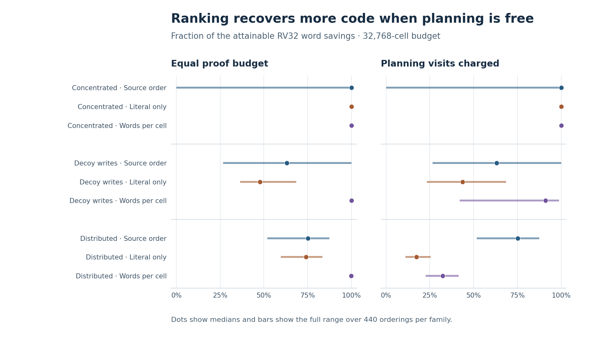

# Which functions deserve limited compiler analysis?

Ranking functions by estimated RV32 instructions saved per analysis visit recovered at least **99.3%** of the attainable savings in 1,320 held-out program orderings when the ranking pass had its own work allowance. Debiting the ranking pass from the same allowance reversed the outcome on broadly distributed opportunities. There, the ranking recovered a median **32.38%**, while source order recovered **75.15%**. The information required to choose the work can cost more than the choice saves.

## What a proof pass can remove

A signed native division has to preserve the language’s errors. The typed PicoCalc compiler emits checks for a zero divisor and for the single overflowing pair, the smallest signed 32-bit value divided by minus one. The RV32 instruction for division does not implement those traps on its own. Generated branches and a breakpoint instruction produce them.

In `return x / 60;`, the compiler can remove both checks once it proves the divisor is 60. Removing the zero guard saves two instruction words. Keeping the division and dropping its overflow guard saves another seven. Every native instruction here occupies one four-byte word. In `return x / -1;`, it can remove only the zero guard. In `return x / d;`, it can recover both savings if `d` is a local initialized once to the constant 60 before the read. A possible later assignment can invalidate that argument.

The existing divisor pass scans one function twice. It first records local definitions and writes. The second scan identifies division and remainder sites, proves where a guard is unnecessary and records the precise intermediate offsets. The native backend skips the corresponding guard instructions. The pass charges two visits per numeric cell, where a cell is an opcode or an operand in the per-function intermediate program. It caps each function at 2,048 cells. A module budget of 32,768 charged visits limits how many functions reach the pass.

The previous study held the program constant and moved its most profitable function from first to last. Source-order admission saved 720 words in the first order and zero in the second. It spent the same budget in both cases. Most of the other functions had a division that could not be proved safe.

## Three choices under the same proof budget

Source order admits each eligible function that fits in the remaining budget. It can make this decision as each function finishes parsing, immediately before native lowering. It charges a function even if the proof finds nothing useful.

Literal-only admission recognizes a nonzero constant directly before a division or remainder. It chooses those functions in stable name order. The words-per-cell ranker also estimates benefits from single-write locals. A pass over the numeric program classifies potential zero and overflow guards. For each local it records a possible dominating literal initialization and discards its contribution if it sees another write. It divides the estimated number of words saved by the function’s proof charge, sorts candidates by that score and admits each one that fits. Ties use function names. Both planners preserve the same proof logic in the backend. Neither can remove a guard merely because the selector predicted it.

Suppose two eligible functions cost 80 and 100 visits, with estimated gains of 9 and 18 words. The second function has the greater estimated gain per visit. A budget of 100 lets the ranker choose it and recover more possible savings. It first needs enough information about both functions to make that decision. This prototype obtains that information with an additional streaming parse, retaining at most 256 short function summaries. If the input crosses the summary limit, it falls back to source order. Its three local tables have 128 slots each and one function can retire before the next is summarized.

## What counts as attainable savings

We tuned the local estimate on Files, Agenda and eight generated training modules. We locked the compiler overlay, estimator, generator and evaluator before running Editor and the 60 reserved synthetic modules. The first held-out attempt failed on an unsupported generated return statement. We corrected its spelling under a new committed generator hash before reading results. The condition, intended trap, input seeds, chooser and evaluation rules stayed fixed.

The 60 held-out modules span three cases. Concentrated modules put most savings in one small function. Decoy modules give many functions a literal initialization that a later or conditional write can invalidate. Distributed modules vary useful opportunities across many functions with different body sizes. The generated functions are independent leaves. Each module has an original order, its reverse and 20 fixed shuffles that preserve function bodies. Every generated module has enough eligible proof work to exhaust the primary budget. Measuring a saturated budget matters because the policies can all choose the few profitable functions when there is enough budget.

The evaluator measures the exact word difference for every function by compiling with the proof disabled and again with every capped proof enabled. A 0/1 knapsack calculation finds the greatest sum of those measured savings that any set of functions can attain within the same budget. The compiler never sees those true values during selection. The evaluator combines each permutation’s admissions with the measured per-function word differences. Separate complete compiles of the representative original, reversed and shuffled inputs verify that the expected admission sets and total raw instruction counts match the real backend.

## Why the work accounting changes the winner

| Held-out family | Source order, median | Literal only, median | Words per cell, median | Words per cell with planning charged, median |
| --- | ---: | ---: | ---: | ---: |
| Concentrated | 100.00% | 100.00% | 100.00% | 100.00% |
| Decoy writes | 63.07% | 47.78% | 100.00% | 91.13% |
| Distributed | 75.15% | 74.01% | 99.91% | 32.38% |

*Each family contributes 440 orderings from 20 modules. Dots are medians and lines show the full range. The denominator is the best possible saved words with the full 32,768-visit proof budget, in both panels.*

The source-order median masks the failure in the concentrated case. Some orders saved nothing. Both ranked policies recovered all the available words in every order. Literal-only missed many useful single-write local opportunities in the decoy case. Its median fell below source order, and 314 of 440 orders lost more than five percentage points of oracle recovery versus source order. With the same proof allowance, words per cell did not regress by that threshold in any of the three families.

The planning-charge comparison subtracts one visit per numeric cell scanned for features before admission. It holds the denominator fixed to show how much savings a policy retains when it must spend part of its allowance to gather information. It still omits work from the initial parse and the sort. On the distributed family, the planner’s visit count left too little capacity for the many profitable functions, even with accurate estimates. For seed 501, the density ranker’s 24,692 planner visits cut its matched proof savings from 10,107 to 3,186 words. The source-order variants saved 6,399–8,478 words without a feature pass.

The real Editor link used 4,278 eligible proof visits, far below the 32,768 allowance. Every policy removed the same 83 words. Six fresh Node contexts per policy gave a median paired elapsed-time increase of about 34 ms for words per cell versus source order. These host samples reuse precompiled JavaScript scripts and include the extra parse and actual linked ELF generation. They do not establish the same elapsed time or allocator peak on the handheld.

## Independent checks and what the result supports

An independently written 72-function raster workload had 38,016 eligible visits and 19,008 planning visits. Moving its useful functions changed source-order savings from 1,386 to 407 or 1,232 words. Both ranked policies reached the 1,386-word oracle in all three orders, even after debiting planning visits. Like the concentrated cohort, this workload leaves enough budget after planning to admit its useful functions.

The selected native arithmetic programs matched WebAssembly on 987 returning inputs and trapped at all 16 required isolated cases under each policy. These checks cover division by zero, signed overflow, negative constants and mutable divisors. The native interpreter observes the resulting breakpoint. The Wasm oracle identifies the underlying arithmetic cause. The complete selector compiles also preserved the same diagnostics for invalid tokens, undefined locals and duplicate functions.

The strongest result is the separation between two questions. An inexpensive summary of literal producers and local writes can remove declaration-order dependence and nearly match the best allocation of proof work. A second parser pass and a broad scan can consume enough of the compile budget to leave the application worse off. The earlier physical PicoCalc trials measured the proof itself. This selection experiment measures host planning and validates emitted RV32 in an emulator. The practical value of ranking depends on how cheaply the production streaming frontend can collect the score.

[Preregistered design](../design-doc/01-a-preregistered-comparison-of-bounded-function-selectors.md) · [Policy lock](../various/frozen-policy.json) · [Full held-out results](../various/held-out.json.gz) · [Independent workload](../various/independent/scores.json) · [Guest checks](../various/guest-results.json)
