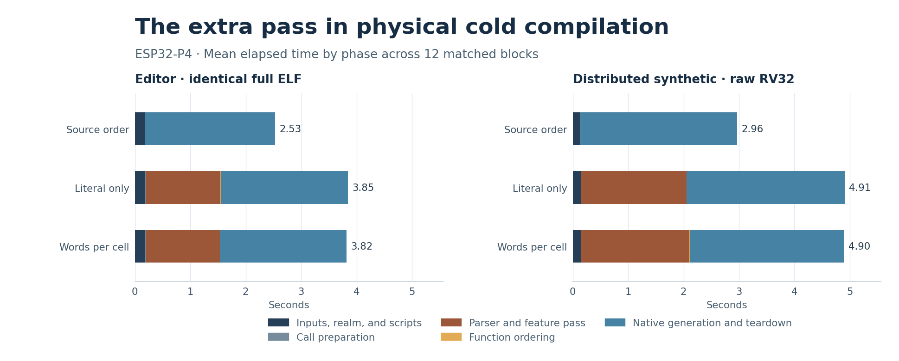

# The cost of ranking compiler work on the physical PicoCalc

Running the frozen ranking policies on the PicoCalc made Editor’s cold compile **1.29–1.31 seconds longer**. All three policies returned the same complete ELF. Most of the cost was the second parser pass. Ordering the candidates took under three milliseconds. In the binding synthetic program, ranking bought a smaller image and took about **1.93 seconds longer** than source order.

## Measure ranking where the compiler actually runs

The earlier selection study estimated how many RV32 instructions a divisor proof would remove and divided that benefit by its analysis cost. It ranked the functions with the best expected return on work. On the host this often recovered more of the available guard savings than declaration order. The planner needed an extra pass over the source to collect comparable summaries across the whole module.

This follow-up puts those exact rules in QuickJS on the ESP32-P4. All arms used the same 32,768-visit proof limit and the unchanged bounded proof implementation. Source order selected a function when it finished parsing. The literal and words-per-cell policies first parsed the source to collect summaries, ordered the functions and then parsed again in the ordinary streamed compiler. The source-order treatment loaded no unnecessary planner script. The firmware recorded every linked or raw output hash against the frozen host prediction.

We measured separately from input reading through QuickJS call preparation, across the planning parse and ordering, then through eventual native compilation, result copy and teardown. Every compile created a new QuickJS runtime and context. The maximum live allocator bytes, starting live bytes and successful allocations or resizes were recorded for each phase. A phase can retain memory from an earlier phase. Its allocation count captures traffic through QuickJS's hooks and its live total captures coexistence. C-owned buffers sit outside this allocator counter.

## Editor makes the time cost observable

The three selectors all removed exactly 83 native instruction words in Editor and returned the same 240,452-byte ELF. They each used 4,278 proof visits. The ranked arms both examined 2,139 feature cells and retained 120 summaries during planning. Editor had enough budget for all of the useful functions to reach the analysis pass under every treatment.

| Policy | Whole cold compile, ms | Setup, ms | Feature pass, ms | Ordering, ms | Peak QuickJS bytes |
| --- | ---: | ---: | ---: | ---: | ---: |
| Source order | 2,525.1 | 178.7 | — | — | 1,426,572 |
| Literal only | 3,838.4 | 188.8 | 1,348.7 | 2.72 | 1,458,232 |
| Words per cell | 3,813.7 | 188.9 | 1,342.5 | 2.68 | 1,458,226 |

Each cell gives the median of 12 physical samples. The paired increases were 1,311.1 ms for literal only and 1,293.7 ms for words per cell, with positive changes in all 12 blocks. Setup added a paired 10.2 and 10.5 ms. The measured feature pass alone exceeded each paired increase. The later native phase, including the second parse, was 53 and 66 ms shorter at the paired medians.

Loading the planner raised the setup peak by 20,180 bytes and increased successful allocator calls from 504 to 552. Each ranked feature pass started with a median of 721,156 allocator bytes live and added 89,648 bytes at its median high-water. It made 1,230 allocator calls for literal only and 1,240 for words per cell. The overall peak still occurred during native generation and increased by about 31.7 KB under either ranker. The largest Editor peak was 1,458,256 bytes within its existing 4 MiB allocation limit.

The allocator calls are calls to QuickJS's configured backing allocator. The engine serves small blocks from arenas and frees arenas when their last block is released. A count measures arena and large-block traffic. Small JavaScript objects can share a single backing allocation. One effect of the extra pass was that the ranked lanes had 2,087 successful backing allocations or resizes in the later native phase, compared with 6,427 for source order. The high-water still rose. The occupied blocks and their release timing matter alongside the total number of allocator calls.

## A binding-budget synthetic separates time from emitted code

The registered synthetic input, distributed seed 501, contains 52 independent functions and uses 49,384 eligible proof visits. Source order spent 32,166 and emitted 29,107 native words. The literal rule emitted 29,449 words. Ranking by words per cell used 32,088 proof visits and emitted 26,749 words, removing another 2,358 words relative to source order. All three outputs matched their distinct host hashes. This path returns raw instructions without linking an application reactor, so its times describe native generation under that entry point.

The source-order median was 2,961.9 ms. Literal only added 1,947.2 ms at the paired median and produced 342 more words. Words per cell added 1,927.9 ms and reduced the raw image from 116,428 to 106,996 bytes, a reduction of 8.1%. Its peak dropped by a paired 54,438 bytes. The density planner took 1,961.0 ms in its feature pass and 4.07 ms to order candidates. Its later native phase was about 42 ms faster. The result measures a time and space tradeoff under a saturated proof budget, where the policies emitted different amounts of code.

*Each stacked bar sums the mean phase durations from the same 12 physical samples. The report’s paired deltas use medians of within-block differences.*

## Predictions and scope

The two ranked Editor lanes exceeded the preregistered 400 ms paired increase and fell within the 3.35–4.25 s forecast range. The feature passes exceeded 70% of the wall change, ordering stayed below 20 ms, and setup took below 1% of the paired increase. Each median heap increase stayed below 256 KiB. The synthetic’s expected positive time changes and distinct raw outputs also appeared.

The observed Editor sort counts were 16 for literal only and 14 for words per cell. The host Node predictions were 15 and 14. The board counts matched the independent run of the vendored QuickJS engine, as did the synthetic’s 152 and 253 comparisons. The ordering callback counts differ across runtimes even though each lane’s feature and proof visits, ordered admission and emitted bytes agree.

The device confirms that an extra traversal of the whole source is the main cost of the current planner. Source order achieves the same Editor output without that cost. The synthetic experiment shows how much time and heap are exchanged for one smaller native image.

All 144 timed compiles matched their expected output. The matched runs use a single device, two firmware boots and a fresh QuickJS instance for every measured input. Files and Agenda also ran in every block and kept their verified ELF identities. The original factory application partition was restored and all three applications reported healthy native status. The held-out report and the ranking rules remain intact. Both device inputs come from the prior report, which remains the evidence about transfer to unseen programs.

[Physical preregistration](../design-doc/02-transfer-frozen-selection-to-the-esp32-p4.md) · [Device input and output identities](../various/p4-transfer-preflight.json) · [Full physical evidence](../various/p4-transfer/summary.json.gz) · [Original held-out study](01-which-functions-deserve-limited-compiler-analysis.md)
