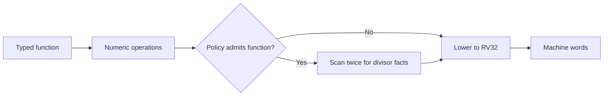

# When does a handheld compiler need more facts?

When the PicoCalc starts Editor, a small compiler on the device translates its typed source into RISC-V instructions. The compiler usually handles one function at a time and releases its intermediate operations when that function has been translated. We tested how much useful information it could compute within that short lifetime. On the held-out Editor app, a policy that screened for division and remainder saved **83 instruction words**, the full reduction from analyzing every eligible function. It used **7% as much charged analysis work**. The reserved code region inside the native module kept its original size.

## What a compiler can learn from a divisor

Consider a calendar function that computes `today / 10000` to find the year in a packed date. In this compiler the relevant intermediate operations are `local.get today`, `i32.const 10000` and `i32.div_s`. Each of the first two operations puts one operand on a temporary stack. The division takes the top operand as its divisor.

The typed language follows WebAssembly’s integer arithmetic. It traps if the divisor is zero and if the smallest signed 32-bit integer is divided by minus one. RV32 hardware division returns a value in each of those cases, so the production compiler emits two words to implement the zero check and seven more for the overflow check. A known divisor of 10,000 makes both checks unnecessary. The compiler still evaluates the operands and emits the division instruction. Signed remainder by minus one returns zero even for the smallest signed integer, so remainder has only the zero guard. [WebAssembly integer numerics](https://webassembly.github.io/spec/core/exec/numerics.html#op-idiv) · [RISC-V M extension](https://riscv.github.io/riscv-unified-db/manual/html/isa/isa_20240411/chapters/m-st-ext.html#_division_operations).

The experiment handles two ways to know the divisor. A literal can appear directly before the arithmetic operation in the intermediate stream. A local can hold a known literal when there is exactly one write to its slot and that write happens at the top level of the function before the later read. The first pass checks the whole function for writes, including instructions inside conditional blocks or loops. The second pass records only the operation offsets and guard decisions. When the backend reaches a recorded offset, it emits fewer instructions. The proof leaves scope when that function finishes.

For example, `let scale = 4;` followed by `if (small) { scale = input; }` gives the first pass two writes to the same slot. That prevents a constant proof for a later division by `scale`, including runs where the branch happens to be false. The compiler keeps both division guards. A branch boundary also interrupts the adjacency rule. A `local.get` before a conditional result is insufficient to prove the value after that conditional.

A fixed set of arrays holds 128 local slots and 128 arithmetic-site records, using 1,280 explicit backing bytes while both tables exist. This quantity includes array contents. The JavaScript allocator’s live high-water for the whole compiler also includes object headers, intermediate arrays, native code output and linking work. A bound on the proof’s array contents therefore gives a narrower guarantee than a whole-compiler heap measurement.

## Three policies, one proof

The **Control** compiles at production revision `40bcf850a5809ef6d839127869faa952596ed157`. **Always** attempts the proof on every function within a cap of 2,048 intermediate cells. **Select** requires the parser to have seen signed division or remainder in the function, then applies the same cap. It considers functions in source order and charges twice a function’s cell count for its two scans. It can charge up to 32,768 cells for an entire app. It skips a function that does not fit and can still admit a smaller one later.

Files and Agenda were the two training applications. Files has no divide or remainder instructions, so it exposes the cost of searching where there is zero opportunity. Agenda has calendar arithmetic with fixed divisors and a formatter that divides by a changing scale. We committed the code, training measurements and a numerical prediction before reading or compiling the held-out Editor source. The forecast expected 1–150 words saved by Always and expected Select to recover at least 75% of the savings while charging half the work or less. [Frozen design](../design-doc/01-when-a-streaming-compiler-should-remember-a-divisor.md) · [Prediction at `6e9a637`](../reference/02-prediction-frozen-before-editor-results.md).

| App | Control words | Always words | Select words | Functions admitted by Always / Select | Charged cells, Always / Select |
|---|---:|---:|---:|---:|---:|
| Files | 804 | 804 | 804 | 7 / 0 | 2,208 / 0 |
| Agenda | 4,058 | 3,898 | 3,898 | 34 / 9 | 10,558 / 4,284 |
| Editor | 21,886 | 21,803 | 21,803 | 118 / 7 | 60,740 / 4,278 |

Editor had 120 functions. Two exceeded the function cap. Seven contained one of the relevant arithmetic operations, and both candidate policies analyzed those seven. They omitted 17 zero guards and seven overflow guards, which accounts for all 83 words. Agenda omitted 31 zero guards and 14 overflow guards, which accounts for its 160 words. Neither application’s savings required a proof through a local slot. All three apps retained the same counts of hardware divide and remainder instructions. The 332-byte Editor reduction concerns the emitted machine words. Each linked Editor ELF remained 240,452 bytes because its code region is preallocated. [Training oracle](../various/host-training.json) · [Held-out oracle](../various/host-editor.json).

## Did the generated program still behave the same?

The arithmetic harness compared the results of compiled RV32 code with a separate WebAssembly execution of the same typed program. Every policy matched all 733 returning calls and trapped in 16 independently launched cases. The cases exercise zero, minus one, signed overflow, conditional and loop writes, a local declared inside a branch, and an expression that obtains its result through conditional control flow. The RV32 trap instruction carries no distinct divide-by-zero or overflow code. The WebAssembly oracle supplies the expected trap cause, and the RV32 harness observes the trap itself. A separate synthetic program exercised the slot, proof-site, function and module caps.

Agenda provided an actual application kernel, `entryWeekday(today)`. It calls calendar helpers as it counts the days before the given date. We ran eight preregistered dates, including a 2000 leap day and dates around the 2100 leap-year exception, with the same native test harness. All outputs matched. The emulator counted **3,719 retired instructions** with Control and **3,328** with either candidate across the eight calls. It includes a fixed harness in both counts. The number of instructions saved per call ranged from 23 to 81 as the month loop and its callees took different paths. Running the optimized code on a device can produce a different cycle difference because a retired instruction count omits hardware timing effects. [Guest expectations, results and counts](../various/rv32-guests.json).

After unblinding, I added one host check of the held-out app’s generated guest code. Editor’s `editorPreviewSlot(row)` computes `(row % 36) * 100` to locate a row in its preview buffer. The native harness executed the exact function from each full linked app build’s raw image. The arithmetic leaf needs no SDK calls. All eight boundary rows returned the same values as WebAssembly, including row 35 mapping to 3,500 and row 36 wrapping to zero. Retired instructions fell from 160 to 152 across the eight calls, including the harness. This probes one function selected after the static result. The full preview uses that function alongside rendering, editing and SDK calls. [Held-out kernel receipt](../various/rv32-guests.json).

## How to read the compile cost

The charged work is a deterministic upper bound on cells in the two scans. The two policies can allocate the same 1,280-byte arrays even when one analyzes far fewer functions. They can also incur the same maximum scratch size by admitting just one function each. The analysis policy can still change allocator high-water through allocation timing or differences in the later code image.

One instrumented host build of Editor spent 30.30 ms in the Always helper and 2.84 ms in the Select helper. Those samples come from separate JavaScript contexts. Twelve rotated-order cold builds on the host yielded a median paired Select-minus-Always change of +1.30 ms, with a range of −58.80 to +61.87 ms. This host run leaves end-to-end timing unresolved. The exact work counts and output bytes hold independently of the host timing. [Raw helper and whole-run measurements](../various/host-editor.json).

## What the transfer test shows

A parser can tell cheaply whether a function has any operation that consumes a given fact. That decision removed the majority of the proof work in Agenda and Editor while preserving every guard deletion from Always. The benefit was larger in number of words for Agenda than Editor, even though Editor was the larger program. Functions with relevant arithmetic were relatively rare in Editor. The work and value of the analysis thus depend on the distribution of candidate operations, their operands and the location of calls at runtime.

For this corpus, the static results motivate a narrower comparison. The best real-app reductions here came from literal operands, so a direct decoder match during lowering might produce the same images without the local proof table. That comparison would establish the cost of building facts beyond the literal case. The transfer result applies to this proof and the arithmetic distribution of one held-out app.

## Reproduce the study

From the checkout root, use the ticket’s `scripts/00-inputs.py` to extract the pinned training or held-out sources and `scripts/01-stage.py` to generate each compiler variant. Run `scripts/03-qualify.mjs` with Node and the corresponding native reactor directory. The script times clean runs in rotated policy order and validates every linked digest against the verified build. Run `scripts/05-guest-inputs.mjs` to generate the Wasm expectations, RV32 program and assembly harness, then `scripts/06-run-guests.py` with the ESP32-P4 RISC-V compiler and repository’s CJI RV32 emulator. [Compiler bytes and revision](../various/compilers.json) · [Detailed work history](../reference/01-bounded-divisor-analysis-investigation-diary.md).
