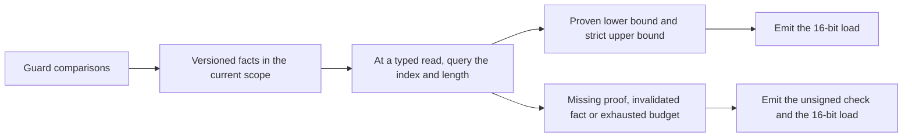

# Proving a text index safe in a streaming compiler

Editor copies part of a text span into a display row while preparing a Markdown preview. When the copy reads `text.charCodeAt(i)`, the checked operation compares `i` with the UTF-16 length in the text header. A compiler can omit that read check when every path to the read guarantees both a nonnegative index and an index strictly below the length.

## The facts at the read

Editor originally used `while (i < end)`. That establishes an upper bound relative to `end`. The source of the experiment adds the relation to the text header and checks the lower bound in the loop condition. It retains the original checked loop after the guarded copy.

```text
if (end <= text.length) {
    while (0 <= i && i < end) {
        rows.setCharCodeAt(at, text.charCodeAt(i))
        at = at + 1
        i = i + 1
    }
}
while (i < end) { original checked copy }
```

For length 6, `end = 5` and `i = 3`, the outer guard admits the span and the loop admits the index. The proof combines `3 < 5` and `5 <= 6`. The same reasoning holds for every value reaching that read. For valid string and buffer objects, a span that starts at −1 or has an end greater than the length follows the fallback. The original loop still executes the checked access when its condition requires a read. The check traps there in the same order as before, after the destination buffer position has been validated.

A strict inequality distinguishes a valid index from the first index beyond the text. The compiler can combine `i < end` and `end <= length`, or `i <= end` and `end < length`. Two non-strict edges also admit `i == end == length`, so that proof fails. The lower bound rejects negative signed values before the compiler omits the underlying unsigned check.

## Versioned terms and effects

A term identifies either zero, a scalar local's current value or the current length of a receiver binding. Assigning a fresh value gives the binding a fresh version. With `let i = start`, the guard initially relates the current version of `i` to `end`. After `i = fresh`, the read observes a different version. A fact about the first value cannot justify reading at the second.

An if-only statement has a path through its body and a path that skips the body. When the parser joins the paths, a fact survives only if it held before and remained valid through the body. When a value version differs, the join gives it a fresh identity. The true facts from a left operand of `&&` are available while emitting the right operand. Those facts leave the outer expression path whether the right side ran or was skipped. A true conjunction can later establish both conjuncts in its guarded body. A disjunction admits either side, which is too weak for this implementation to infer either individual conjunct.

The header can change through an alias. `typedSdkView` can change a counted buffer's header, and a record store can reach the same memory in a native fixture. The analysis discards facts on calls and record writes. It recognizes a small set of built-in operations whose memory layouts and effects are defined by the compiler. Before applying a length fact imported from outside a loop, a bounded lexical scan checks for calls and record writes anywhere in the loop, including after the candidate read. A write after a read can invalidate that claim before the next iteration. Loop-body facts recreated by the condition are distinct from outer facts.



## A bounded proof query

Each function tracks up to 24 live relations in its current scope. The query examines at most eight edges. The direct lane requires an upper edge straight from the index version to the receiver's length version. The bounded lane can use one intermediate. An attempt needing a ninth edge preserves the read check. The analysis leaves arithmetic expressions such as `i + 1` checked. An overflowing addition would require a separate proof.

At the real copy site the bounded query inspects the three current facts and follows the path to the length. The machine retains the destination write check. The bounded variant removes four RV32 words at the single proven site. A fixture with an explicit `i < text.length` guard distinguishes the direct policy from the current implementation even though the matched Editor source offers no direct proof sites.

| Matched guarded Editor | Current | Direct | Bounded |
| --- | ---: | ---: | ---: |
| Native instruction words | 16,214 | 16,214 | 16,210 |
| Static read-check sites | 116 | 116 | 115 |
| Executed checks in 64 KiB sparse preview | 4,740 | 4,740 | 4,538 |
| Executed checks in 64 KiB dense preview | 47,105 | 47,105 | 43,976 |

The native-loader replay puts a dedicated instruction marker immediately before each emitted read check in its instrumented image. Driver markers delimit the preview actions. The emulator counts executed instructions at those markers, including when the actual check succeeds. The complete native output has the same hash across all lanes for each workload and matches the JS and Wasm frame comparisons in the existing replay. The sparse and dense workloads cover different preview actions, so the useful comparisons are across lanes within each row. Buffer-write checks and SDK internals remain outside this count. The physical test uses clean code.

The adversarial fixtures cover empty strings, high code units, negative indices, the first invalid index, non-strict upper paths, a different text receiver, reassignment and joins, calls and record aliases, loop backedges and budget exhaustion. All 357 cases agreed with Wasm on values, traps and memory. Ninety-four cases trapped.

## What the physical trial measured

Each of two ESP32-P4 boots compiled the guarded source six times per lane in fresh QuickJS runtimes. The cold compile and peak heap effects are paired differences relative to current. Current and direct returned the same Editor ELF. The bounded ELF had 16 fewer occupied bytes in the same reservation. All 108 returned application module hashes matched the host oracle, and the backed-up firmware restored with Files, Agenda and Editor active.

| Editor measurement | Boot 1 / Boot 2 |
| --- | ---: |
| Current cold compile time | 3,101 / 3,085 ms |
| Direct analysis cold compile time change | +9.03% / +10.05% |
| Bounded analysis cold compile time change | +8.08% / +10.10% |
| Direct peak QuickJS heap change | +1.11% / +1.12% |
| Bounded peak QuickJS heap change | +1.11% / +1.11% |
| Current preview copy cycles per UTF-16 unit | 42.391 / 42.393 |
| Direct preview copy cycles per UTF-16 unit | 42.386 / 42.385 |
| Bounded preview copy cycles per UTF-16 unit | 38.378 / 38.379 |

The physical guest isolates the guarded copy function and its helpers from the full Markdown reactor. Host qualification compared their generated machine bytes to the corresponding full Editor text and located those bytes in the actual firmware. Each timed pass feeds 65,536 UTF-16 units in spans of at most 48, with a copy and state check for every span. Eight passes per lane on each boot ran at 360 MHz. Bounded reduced paired cycles per code unit by 9.49% and 9.46% against current. The direct lane performs the same native check and gave essentially the same cycle count as current.

The physical time is for the isolated copy on clean native code. The dynamic check counts above come from the full preview under the native loader with instrumented code. [Physical qualification](../various/physical.json), [paired timing and heap](../various/physical-summary.json), [UART capture identities](../various/preview-copy-captures.json).

## Compare the costs within the right source baseline

The source intervention adds a guarded copy and keeps the earlier checked copy. The unmodified direct-read Editor had 16,174 native words. The matched bounded variant has 16,210. Check removal saved 16 bytes relative to the guarded current variant and left the whole stock-sized ELF reservation unchanged. A compiler shipping this exact source would also pay for the new guards. The distinct question answered by the current/direct/bounded comparison is whether the compiler can derive a safe check removal from those guards and how often that removed site executes.

## Reproduce

Run from the repository root with a staged typed-ops compiler and the local P4 GCC toolchain.

```sh
bounds=(ttmp/2026/11/19/PICOCALC-BOUNDED-INDEX--*)
python3 -B "$bounds/scripts/01-stage.py" /tmp/index-study /tmp/typed-op-study
node "$bounds/scripts/04-verify.mjs" /tmp/index-study /tmp/typed-op-study
python3 -B "$bounds/scripts/05-preview-count.py" /tmp/index-study /tmp/index-counts "$p4_gcc"
```

Start at `BoundsFacts.proves()`, then follow the condition path through `expr()` and the read flag through the RV32 lowerer. Run the fixtures and find the counts for `direct`, `bounded`, `loopEffect` and `budget`. Read the two preview records to see the distinction between static check sites, dynamic check executions and total retired instructions. [Fact engine](../scripts/02-facts.js), [host proof and fixture oracle](../various/host.json), [full preview counters](../various/preview-counts.json).
