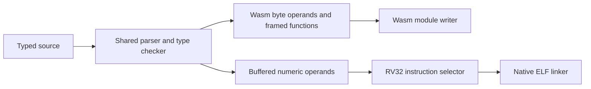

# Production integration of the typed compiler optimizations

## Where the change lives

The PicoCalc firmware loads `typed-wasm.js` first. It contains the lexer, record declarations, function declarations and function-body type checker. Both the Wasm and RV32 paths use these components. Wasm linking still needs to encode instructions and local declarations in WebAssembly binary format. RV32 lowering needs the values themselves. Passing an integer such as 130 directly eliminates a round trip through the bytes 0x82 and 0x01 for its signed constant operand.



## Native operand contract

`typedRv32.compile` selects numeric operations when calling `typedWasm.compileFunctions`. The mode applies once to an entire compilation. Every immediate occupies one number in the native function's operation array, including constants, call and local indices, memory alignment and offsets. Each function still has a parameter list, result type and local count. The native compiler retains completed functions until it has checked all the source, so a type error in a later function retains its existing precedence over an earlier backend limit.

The shared frontend still exports the public standalone Wasm compiler and `linkWorld` for the firmware's Wasm worlds. Code generation for other targets goes through the same source-language checks. Native bodies omit the duplicate Wasm body array and length prefix. The world manifest, import ordering, reactor slot, and loader contract have no reason to change.

```text
compile source once using the selected operand format
for each checked function in definition order:
    record its signature and generated operations
for each native function:
    read one cell per opcode or immediate
    emit RV32 words, then resolve call addresses and imports
```

## How to tell whether the integration works

1. Compile applications with the pinned previous compiler and the production version in separate JavaScript runtimes. Compare the full native image, signatures, entry offsets, relocations, record layouts, complete linked ELF and complete Wasm binary as applicable.
2. Include signed extrema, constants across consecutive LEB lengths, local and function indices above 127, and multi-byte memory offsets. Exercise malformed source and the public standalone and world linker paths.
3. Run the real Editor compiler entry on the P4. Use the production shared frontend in firmware and compare the linked result against the host on the *same* reactor. The earlier research prototype removed unused Wasm writer code entirely; the integrated file still has to serve Wasm users, so its measured time and peak can differ from the experiment.

## Existing experimental reports

The source and receipts are in the sibling PICOCALC-COMPILER-THESIS ticket. Its representation report explains operation encoding in detail. Its physical Editor report measures the change on the ESP32-P4. The separate bounds report explains direct and chained proofs, invalidation rules and the workload census. The negative-results report records limits on each conclusion. Production measurements belong in this ticket so readers can distinguish experimental results from the code that was merged.
