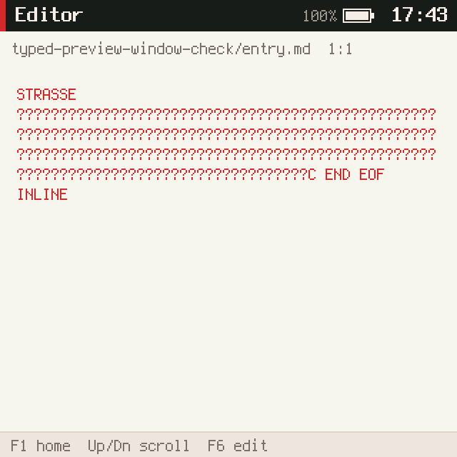

# What a native compiler needs to retain on the PicoCalc

The PicoCalc can compile its Files, Agenda and Editor applications into RISC-V executables during boot. To compile Editor, its native frontend processes 120 functions, the backend emits 87,544 bytes of native instructions and the linker produces a 240,452-byte executable with the reactor used in this qualification. The amount of working memory required to produce those instructions depends partly on two implementation choices. How does the frontend represent an operand? How long does the compiler retain a function's intermediate instructions?

## Representation and lifetime

In the original pipeline the JavaScript frontend wrote operations that resembled a WebAssembly function body. For example, an integer constant of 130 needs the bytes `82 01` in signed LEB128. The RV32 backend then decoded those bytes to recover 130. A Wasm module requires that particular format; the native instruction selector already accepts a numeric value. The new native emitter writes 130 directly into a JavaScript array and omits the duplicate array used to frame a Wasm body. This optimization reduces work in the compiler. With identical source and reactor inputs, every byte of the linked executable should match.

A separate decision concerns when to lower a checked function into native words. The buffered implementation checks every function in the source before lowering begins. In streamed mode the frontend invokes a consumer when each function finishes. The consumer generates the native words and clears the reference to the function's intermediate operation array. The compiler retains the function's signature, native output and pending call fixups for final assembly. It still holds the entire source, and a single large function must fit. There is no temporary file or SD card I/O in either mode.

```text
                            At the end of a function
Buffered   retain operation array  -> parse next function -> lower all functions
Streamed   lower now, release array -> parse next function -> assemble native words
```

This distinction can be observed directly. An independent host test counted live intermediate arrays at the first, eighth, sixteenth and thirty-second callbacks. The buffered counts were 1, 8, 16 and 32. Streaming retained one at each observation. When the third function failed a native constraint, the streamed frontend continued source checking while disposing of the subsequent bodies. This matters for diagnostics. A type error later in the file must still be reported before the earlier native error, as it was under buffering.

## Artifact and behavior checks

| Application | Functions consumed | Generated RV32 instructions, bytes | Linked ELF bytes |
| --- | ---: | ---: | ---: |
| Files | 7 | 3,216 | 24,424 |
| Agenda | 34 | 16,232 | 66,364 |
| Editor | 120 | 87,544 | 240,452 |

The integration test compared operation output, entry offsets, record layouts, import relocations, signatures and every byte of the linked native ELF against the buffered control. All three native executables and all three Wasm modules matched. A wide-index fixture exercised 136 functions and a relocated import. The independent examination added 13 exact diagnostic comparisons and a fixture with 130 imports and 138 functions. The default release compiler also passed 24 Wasm and RV32 application replays, including a dense Markdown preview and navigating to the end of a large Editor document.

## Repeating the measurement on the board

The physical test used two production firmware images built from the same JS compiler with the same source, SDK configuration and application reactors. The selectable difference was the CMake flag `PICOCALC_RV32_STREAM_FUNCTIONS`. The runner verified the five production compiler and world-wrapper files inside both binaries. The serial log identified streamed mode individually for each application. Four fresh boots per mode produced the observations below. Each duration covers the complete firmware compile-and-link entry. Peak allocation measures live bytes charged to QuickJS by the firmware allocator. Both metrics exclude subsequent application execution.

| App | Buffered time | Streamed time | Buffered peak | Streamed peak | Bytes saved |
| --- | ---: | ---: | ---: | ---: | ---: |
| Files | 248.5 ms | 260.0 ms | 366,164 B | 362,596 B | 3,568 |
| Agenda | 641.8 ms | 656.1 ms | 623,812 B | 578,920 B | 44,892 |
| Editor | 2,358.0 ms | 2,452.4 ms | 1,768,372 B | 1,410,844 B | 357,528 |

Editor shows the largest difference. Lowering one function at a time releases about one fifth of peak compiler allocation. Files has only seven functions; the live source, compiler runtime, reactor and output account for much of its peak even after the intermediate arrays are released. For all three apps, buffering completed sooner in this run. The prior controlled experiment with the native backend and Wasm framing held constant measured 2.725 s for encoded operands versus 2.303 s for numeric operands on Editor. That result isolates the operand change; the table above isolates the choice between buffering and streaming the numeric operands.

The fixture times characterize this board and firmware. The four boot observations per setting show the change in working set on these three inputs. In particular, the largest function's position changes how much earlier native code is still live while it is lowered.

The physical workflow opened a 65,536-byte Markdown file with a long formatted heading, entered preview and sent a page-down input. Both framebuffer captures passed their CRC checks. Comparing them to the existing reference image found identical pixels outside the clock. The scratch file was removed. This exercises the application produced on the device as well as the compiler that produced it.



## Selecting the mode

Buffered numeric operands are the production default. Enable streaming for a native build with `-D PICOCALC_RV32_STREAM_FUNCTIONS=ON`, or pass `{streamFunctions: true}` as the third argument to `compileTypedWorldRv32(source, reactor, options)` on the host. The source language, app ABI and runtime behavior are the same. The separate direct text-bounds candidate remains available at `e082ec3` for research; `3785155` reverted it from production.

The primary sources are `picocalc-os/compiler/typed-wasm.js` (the operation emitter), `picocalc-os/compiler/typed-rv32.js` (lowering and assembly) and `picocalc-os/port/esp32p4/main/typed_p4.c` (the device entry). In ticket `PICOCALC-COMPILER-INTEGRATION`, the implementation guide includes the API map and pseudocode. The receipts `various/streaming-parity.json`, `various/examiner-streaming.json` and `various/production-p4.json` contain the underlying observations. The implementation commits are `4452064`, `2317696` and `3c0add0`.

Two companion reports document the original experiments. *Numeric Operands on the Physical ESP32-P4* isolates the encoder/decoder cost, and *Function Representations and Streaming* examines the choice of function representation and lifetime.
