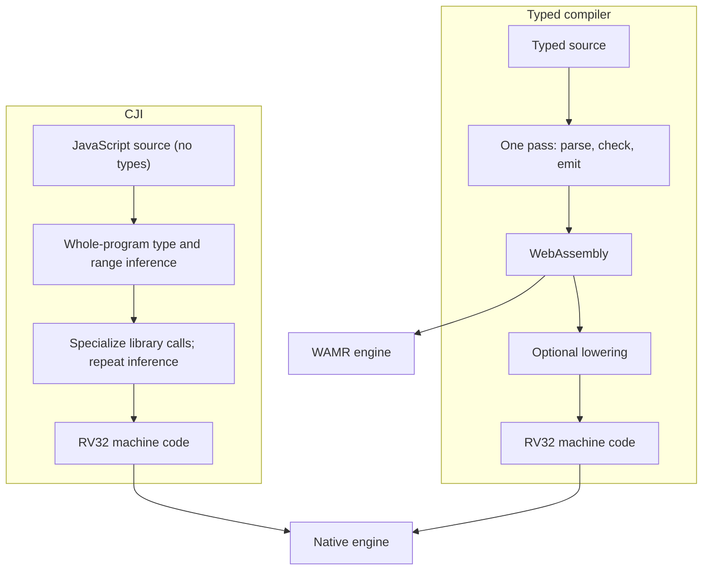

# 1. The Machine, the Mission and the Vocabulary

This article defines the system that the rest of the issue discusses. By the end you should be able to state the device's limits in numbers, say what a world, a turn and a reactor are, draw the two compilation pipelines from memory, and explain why the same handheld contains one compiler that takes 25 minutes and another that takes two seconds. Every later article depends on these definitions, so they are given here once, in dependency order, with one small program followed through both pipelines.

## 1.1 The machine

The PicoCalc is a handheld computer with a 320 × 320 pixel LCD and a physical keyboard. In this project its original controller has been replaced by an Espressif ESP32-P4. Five properties of that chip set the terms for every design decision in this issue.

| Resource | Amount | Consequence |
| --- | --- | --- |
| Processor | Two RISC-V cores (RV32, with multiply, single-precision float and compressed instructions), run at 360 MHz | Roughly 60–170 times slower than a laptop core on the compiler workloads measured in this project |
| Internal RAM | A few hundred kilobytes; 363,727 bytes free at one boot, 35,831 bytes free once all programs are running | Stacks and anything touched with the cache disabled must fit here |
| External PSRAM | 32 MB | Program heaps, compiled code and compiler work areas live here |
| Flash | 32 MB chip; the firmware image may use an 8 MiB partition, and files use about 8 MB | The firmware image is currently about 4.3–4.5 MB |
| Memory protection | Physical memory protection registers exist; there is no memory management unit and no virtual memory | Loaded machine code can read and write the whole address space unless the software prevents it |

The last row deserves emphasis because it is the source of the *trust* question that recurs throughout the issue. On a desktop operating system, a faulty program is stopped by the hardware when it touches memory it does not own. On this device, machine code loaded from storage runs with the same privileges as the firmware. Whether a piece of code may be run as machine code is therefore a question about where that code came from and who checked it.

## 1.2 The operating system in six terms

PicoCalc OS is a small operating system whose applications, drivers and services were all originally written in JavaScript. Six terms describe it.

A **world** is one scheduled program: an application such as Editor, a driver such as the keyboard driver, or a service such as the compositor. The system's manifest lists 22 worlds. Each world has a name, a memory limit, and a set of **claims**, which are entries in the manifest stating which hardware and which directories the world may open.

The **nucleus** is the kernel, written in C. It schedules worlds, delivers messages between them, and checks every use of hardware or storage against the world's claims. It does not interpret application code itself.

A **turn** is the handling of one event by one world: a key press, a timer, a message from another world, or the completion of an operation the world started earlier. Each world has a **turn budget**, the longest time one uninterrupted piece of a turn may run. Editor's budget on the device is 200 ms. A world that overruns its budget, or exceeds its memory limit, is stopped and reported; the other worlds continue. A handler that cannot finish in one budget must save its progress, ask for a timer, and continue when the timer event arrives. Articles 7 and 8 return to this rule, because it shapes both safety and language design.

An **engine** is the mechanism that executes a world's code. There are three.

| Engine | What it executes | Isolation | Speed |
| --- | --- | --- | --- |
| QuickJS | JavaScript, compiled at load time to bytecode and interpreted | The interpreter confines the program | Slowest |
| WAMR | WebAssembly, interpreted | Each world has its own linear memory; the interpreter checks every access | 2–6 times slower than native in the measurements here |
| Native | RV32 machine code loaded from an ELF file | None: the code runs with firmware privileges | Fastest |

The **compositor** is the world that owns the screen. Applications do not draw pixels. An application sends the compositor a description of its screen as a JSON document, and the compositor lays out and draws it. The compositor is itself a world, written in JavaScript. In the stock system it runs in QuickJS; in the device firmware measured in this issue it has been compiled to native code by CJI, the first of the two compilers described below.

A **reactor** is a prebuilt module, written in C and shipped in the firmware, that connects a compiled application to the nucleus. It receives events from the nucleus, converts them into the form the compiled code expects, and provides the functions the compiled code may call. When this issue says that a compiled program is *linked into a reactor*, it means the compiler copies the program's code into a reserved place inside that prebuilt module and patches the connections.

```mermaid
flowchart LR
    K["Keyboard driver world"] -->|key event| N["Nucleus (C kernel)"]
    N -->|turn: one event| A["Application world"]
    A -->|screen description (JSON)| N
    N --> C["Compositor world"]
    C --> D["Display driver world"]
    D --> L["LCD"]
```

## 1.3 The mission and the two compilers

The mission behind the work reviewed in this issue is to let the handheld compile its own applications, so that a program edited on the device can be turned into fast code on the device. Two compilers now exist in the repository, built in the same week, and they embody opposite answers to one question: *how much of the program must the compiler understand before it can emit the first instruction?*

**CJI** is the name of the first compiler. The letters come from the book it was developed in, *Compiling JavaScript, Incrementally*. CJI accepts a large subset of ordinary, unannotated JavaScript. Because the source carries no types, CJI *infers* them: it examines every function and every call in the whole program to discover, for example, that a variable always holds an integer. It then emits native RV32 code. CJI can compile itself, and the self-compiled CJI runs on the handheld.

The **typed compiler** is the second. It accepts a small language that looks like JavaScript with type annotations. Every function states the types of its parameters and its result. The language has five kinds of type: `i32` (a 32-bit integer), `bool`, `string` (a read-only counted sequence of UTF-16 code units), `buffer` (a writable one) and `record` (a fixed group of fields). There are no objects, closures, floating-point numbers or dynamic allocation. The compiler reads the source once, from top to bottom, and emits WebAssembly as it goes. A second, optional step translates that WebAssembly to RV32 machine code.



The measured compile times on the handheld differ by three orders of magnitude.

| Program | CJI on the device | Typed compiler on the device |
| --- | ---: | ---: |
| Files (file browser) | 262 s originally; 206 s after optimization | 0.20 s (Wasm), 0.25 s (RV32) for its typed part |
| Agenda (task list) | 1,475 s originally; 523 s after optimization | 0.52 s (Wasm), 0.72 s (RV32) for its typed part |
| Editor | 425 s | 1.99 s (Wasm), 3.14 s (RV32), the entire application |

The rows are not a controlled comparison: the programs were rewritten in the typed language, and for Files and Agenda only part of the application is typed. Article 3 presents the experiments that do isolate the cause. The table's purpose here is only to fix the scale of the difference.

A third number completes the picture. QuickJS, the interpreter that already runs every JavaScript world, compiles the 16,326-byte Agenda source to bytecode in 37 ms on the same device. Compiling for an interpreter was never slow. What is expensive is producing *machine code from untyped source*.

## 1.4 One function through both pipelines

A single small function will serve as the running example of this issue. It counts how many times a given code unit occurs in a string.

```
function countUnit(text: string, unit: i32): i32 {
    let at = 0;
    let n = 0;
    while (at < text.length) {
        if (text.charCodeAt(at) === unit) { n = n + 1; }
        at = at + 1;
    }
    return n;
}
```

In the typed compiler, this text is all the compiler needs. The parameter types are written down. `at` and `n` are initialized with integer literals, so they are `i32`. `text.length` is a load of the 32-bit count stored at the start of the string. `text.charCodeAt(at)` is a bounds check followed by a load of a 16-bit unit; if `at` is out of range the program stops with a **trap**, an immediate fault that the nucleus reports for that world. The compiler emits 77 bytes of WebAssembly for the body, and the optional lowering step turns them into 103 RV32 instructions. Article 5 examines those 103 instructions one by one.

For CJI, the same function without annotations would read `function countUnit(text, unit) { ... }`. To compile `at < text.length` as an integer comparison, CJI must establish that `text` is always a string at every call in the program, and that `at` never leaves the range of exactly representable integers. To compile `text.charCodeAt(at) === unit` without a general, slow comparison, it must know what `unit` can be, which depends on every caller. The facts needed to compile three lines are spread over the whole program. Article 3 explains why collecting them takes minutes.

## 1.5 Where the code runs, and what that costs

After compilation, an application is one of three things, and the choice has consequences that later articles quantify. For the complete typed Editor on the device:

| | QuickJS (original) | WebAssembly on WAMR | Native RV32 |
| --- | ---: | ---: | ---: |
| Compiled size | not measured here | 88,255 bytes | 240,452 bytes |
| Load time after compile | — | 176 ms | 14 ms |
| Memory used, of a 768 KiB limit | — | 528 KiB | 710 KiB |
| CPU time for a 33-turn editing session | — | 290.6 ms | 52.9 ms |
| May run untrusted source | yes | yes | no |

The native version is 5.5 times faster per turn, nearly three times larger, and leaves only 58 KiB of its memory limit free. It may also do anything the firmware may do. The WebAssembly version is slower and smaller, and it is confined. Most of this issue is about removing that trade: making native code small (Article 5), making it safe (Article 7), and deciding when it is worth producing at all (Articles 2 and 6).

## 1.6 Key points

- The device has 32 MB of PSRAM, very little internal RAM, an 8 MiB firmware partition, and no memory management unit. Loaded machine code is not confined by hardware.
- A world is a scheduled program with a memory limit and a turn budget. A turn is the handling of one event. Work that does not fit in one budget must be split by the program.
- There are three engines: QuickJS for JavaScript, WAMR for WebAssembly, and native RV32. Only the first two confine the program.
- CJI infers types from the whole program and takes minutes. The typed compiler reads declared types in one pass and takes seconds.
- A reactor is the prebuilt C module that a compiled application is linked into. It is the application's only connection to the nucleus.

## 1.7 Check your understanding

1. Why can a world on this device not simply run a long loop to completion, and what must it do instead?
2. Name the three engines and state, for each, whether a fault in the program can damage other worlds.
3. The typed compiler compiles `countUnit` using only the text of that function. Name two facts CJI would have to find elsewhere in the program before it could compile the same function without annotations.
4. The native Editor uses 710 KiB of a 768 KiB limit and the WebAssembly Editor uses 528 KiB. Give one reason from this article why the native version is larger.
5. An application wants to draw a line of text. Describe the path from the application to the LCD in terms of worlds and messages.
6. QuickJS compiles Agenda in 37 ms and CJI needs between 523 and 1,475 seconds. What is different about what the two compilers produce?
