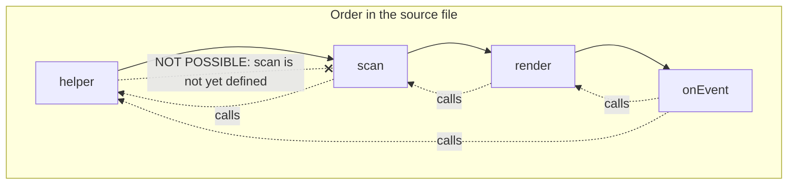

# 7. Safety by Construction: Running Native Code Without Trusting It

Native code on this device runs with the firmware's privileges, so today only code shipped in the firmware may run natively. This article asks what would have to be true for the device to run native code compiled from a source file it does not trust. By the end you should be able to state the three properties a confined program must have, name the four classical ways of enforcing them and what each requires you to trust, explain why the typed language's lack of recursion gives a compile-time bound on stack use, describe a fuel counter and what it does and does not provide, and list the checks a verifier would perform on emitted RV32 code.

The article relies on Article 1 for the terms *world*, *turn budget*, *engine*, *reactor* and *trap*, and on Article 5 for the shape of the emitted code.

## 7.1 What can go wrong

The comment at the top of the device's native loader states the present situation without softening it. Native modules "are for trusted drivers, and nothing here isolates them". A module "can read and write anything, including the kernel". What it may call is limited by the loader, and the comment adds: "That is a contract, not a wall: its code can jump to any address." On time: "a module that never returns stalls the kernel." The loader therefore accepts modules only from the firmware image: "the kernel starts JavaScript and WebAssembly from storage, never machine code."

Those sentences identify three properties that a confined program must have and that native code currently lacks.

| Property | Meaning | Violation today |
| --- | --- | --- |
| Memory safety | The program reads and writes only its own data | A stray store can overwrite the kernel |
| Control safety | The program executes only its own code and the entry points it was given | A jump can go to any address |
| Time safety | The program cannot hold the processor beyond its turn budget | A loop that never ends stops every world |

A fourth property, **stack safety**, is a special case of the first: the program's call stack must not grow into other memory.

There are also three different things that can be at fault, and a defence against one does not cover the others.

| Fault | Example | What defends against it |
| --- | --- | --- |
| The source program is wrong or hostile | A loop with a wrong exit condition | The language and its run-time checks |
| The compiler is wrong | A bounds check emitted with the wrong register | Checking the compiler's *output* |
| The stored module is damaged | A flash error in a cached module | A hash over the stored bytes (Article 6) |

Most of this article is about the first two rows.

## 7.2 Four ways to confine code

| Mechanism | How it confines | What must be trusted | Cost | On this device |
| --- | --- | --- | --- | --- |
| Hardware protection | The processor refuses accesses outside permitted regions | The kernel's configuration of the hardware | A mode switch on every system call | Not used for worlds |
| Interpretation | An interpreter performs each operation and checks it | The interpreter | Every operation is several times slower | QuickJS and WAMR |
| Software fault isolation | The machine code is constructed so that every access and jump is confined, and a checker confirms this before the code runs | The checker | A few instructions per access | Not present |
| Language-based safety | The source language cannot express a violation, and the compiler preserves that | The compiler | Only the checks the language defines | Partly present |

**Software fault isolation** was introduced by Wahbe, Lucco, Anderson and Graham. Their method reserves registers for addresses and inserts instructions before each store and jump that force the address into the program's own region, so that even a wild address lands inside the sandbox; a verifier then confirms that the inserted instructions are present. They measured an average of 4 percent added execution time [Wahbe et al. 1993]. Google's Native Client applied the idea to untrusted x86 code in a web browser and made the verifier the centre of the design: code is accepted only if a small validator can decode every instruction and confirm that every jump goes to a valid target [Yee et al. 2009]. RockSalt later showed that such a validator can be small enough to be proved correct [Morrisett et al. 2012].

**Language-based safety** takes the opposite route. Operating systems such as SPIN and Singularity ran extensions and whole processes in one address space, relying on a type-safe language to keep them apart [Bershad et al. 1995; Hunt & Larus 2007]. The price is that the compiler becomes part of what must be trusted. Two lines of research addressed that: *typed assembly language* carries the source program's types down to the machine code, where a checker verifies them [Morrisett et al. 1999], and *proof-carrying code* has the code producer attach a proof of safety that the consumer checks [Necula 1997]. Both replace trust in a compiler by trust in a checker.

The distinction that matters for design is the third column. Each mechanism moves trust to a different component, and the size of that component is the size of the risk.

## 7.3 What the typed language already guarantees

The typed language of this project is memory-safe at the source level, by a short argument.

- A value is an `i32`, a `bool`, or a reference to a string, buffer or record. There is no operation that converts an integer to a reference and none that adds to a reference.
- References originate only from the reactor, which hands the program its buffers and records, or from parameters that were themselves references.
- Every indexed access is checked. `text.charCodeAt(at)` compares `at` with the stored length using one unsigned comparison, which also rejects negative values, and traps on failure. A record field is at a fixed offset inside a record of known size.
- A call names either a function defined in the same source or one of the 28 functions the reactor offers. There are no function values and no computed calls.

A typed program therefore cannot express a read, a write or a jump outside what it was given. This is language-based safety, and its weakness is the one named above: the guarantee holds for the machine code only if the compiler translated correctly. Sections 7.4 and 7.5 extend the argument to stack and time. Section 7.6 removes the dependence on the compiler.

## 7.4 No recursion, therefore a bounded stack

The typed compiler reads a source file from top to bottom and keeps a table of the functions defined so far. A function's name is entered in the table when the compiler has *finished* translating its body. A call is translated by looking the name up in the table.

Consider what this means for a function that calls itself. While the body of `f` is being translated, `f` is not yet in the table, so the call fails to compile with the message `unknown function f`. Now consider two functions that call each other. For `f` to call `g`, `g` must appear earlier in the file. For `g` to call `f`, `f` must appear earlier. Both cannot be true. The same argument excludes any longer cycle.

Every call goes from a later function to an earlier one. The graph of calls has no cycles.

Three consequences follow, and all three are computable when the program is compiled.

1. **The depth of calls is bounded.** The longest chain of calls is at most the number of functions, and the actual longest chain can be found by one walk over the call graph.
2. **Each function's frame has a known size.** Article 5 showed that the backend fixes the frame size of each function from its locals and its deepest operand stack.
3. **The maximum stack use is a number.** It is the largest sum of frame sizes along any chain of calls, plus the stack needed by the deepest reactor function that chain can reach. The reactor is C code with no recursion of its own, so its part is a constant that can be measured once.

A loader that knows this number can refuse a program whose stack requirement exceeds what the world is given, before running a single instruction. No run-time stack check is needed. The nesC language for TinyOS sensor nodes was designed around the same observation: it forbids dynamic allocation and function pointers so that the whole call graph is known at compile time, which its authors used for whole-program analysis of exactly this kind [Gay et al. 2003].

One caution belongs here. The absence of recursion is a by-product of how the compiler happens to register names, and it is not stated as a rule of the language. Article 9 argues for letting functions be called before their definition, for convenience. If that is added, acyclicity must become an explicit check: after reading all signatures, search the call graph for a cycle and reject the program if one exists. The check is a few dozen lines, and without it the stack bound silently disappears.

## 7.5 Time: fuel for loops

With recursion excluded, every function body is a finite sequence of operations in which the only construct that can repeat without limit is a `while` loop. Calls cannot repeat without limit, because the call graph is finite and acyclic. The whole of time safety therefore reduces to bounding loops.

Today the nucleus checks a native world's turn budget when the handler returns. A handler that loops forever never returns, and the check never happens.

A **fuel counter** closes this gap. The world is given a number at the start of each turn. The compiler emits, at the end of every loop body where control jumps back to the loop's start (the **back-edge**), instructions that subtract from the number and trap if it has reached zero. Because no unbounded execution can avoid passing a back-edge, the program cannot run indefinitely. The cost is two or three instructions per loop iteration.

Three clarifications prevent misunderstanding.

- **Fuel stops a program; it does not schedule it.** When fuel runs out the turn ends with a fault, exactly as a budget overrun does for the other engines. A program that legitimately needs more time must still divide its work across turns, which is the subject of Article 8.
- **Fuel can be made to measure work accurately.** The number of instructions between two back-edges is known at compile time, so the amount subtracted at each back-edge can be the length of the loop body. The counter then bounds executed instructions, and the budget in milliseconds follows from the processor's speed.
- **Calls into the reactor must be charged.** A reactor function such as the one that searches a string does work proportional to the length it is asked to scan. Its charge can be computed from its arguments at the call.

Placing such checks well is a studied problem. Feeley analysed where to put polling instructions so that the interval between polls is bounded while their cost stays low [Feeley 1993]. The Erlang virtual machine is the best-known production system built on the idea: each process is given a budget of 4,000 *reductions*, roughly function calls, and is switched out when the budget is spent, which is how Erlang guarantees that no process monopolizes a scheduler. WebAssembly runtimes offer the same facility under the name of metering, and WAMR's is available to the WebAssembly engine on this device.

## 7.6 Verifying the output

Sections 7.3 to 7.5 are promises about the source language. A wrong compiler can break all of them: it can emit a bounds check against the wrong register, omit a fuel decrement, or compute a frame size too small. The remedy of software fault isolation applies: check the machine code itself, with a program small enough to inspect.

The emitted code is unusually easy to check, for reasons established in Article 5. The backend uses about twenty different instructions. Every instruction is 4 bytes, so instruction boundaries are fixed. All code lies in one contiguous slot inside the reactor, and calls to the reactor go through a table of **trampolines**, which are fixed single-jump entries, one per reactor function, placed at the start of the slot. A verifier for this code would establish the following, function by function.

| Check | Property it establishes |
| --- | --- |
| Every word decodes to one of the instructions the backend is permitted to emit | No instruction with unexamined behaviour |
| Every branch and jump target is a 4-byte-aligned address inside the slot, or a trampoline | Control safety |
| The only indirect jump is the return at the end of a function, and the return address was loaded from the frame slot where the function's entry saved it | Control safety across calls |
| `sp` changes only at function entry and exit, by the same constant; every frame access uses an offset below that constant | Stack safety within a frame |
| The call graph extracted from the jumps is acyclic, and the summed frame sizes fit the world's stack | Stack safety across calls |
| Every backward branch is preceded by the fuel decrement and test | Time safety |
| Every load or store that is not relative to `sp` is confined | Memory safety |

The last row is the difficult one, and there are two ways to satisfy it.

The first is **pattern checking**. The backend emits each indexed access as one fixed sequence: load the length, compare, trap if out of range, compute the address, access. The verifier accepts a non-frame access only as part of that exact sequence. Native Client used this approach for jumps, treating a fixed pair of instructions as a single unit that may not be split. Pattern checking confirms that every access is bounds-checked against *some* length word. It does not confirm that the base address really is a buffer, which still depends on the compiler having kept types straight.

The second is **address masking**, the original technique of Wahbe and colleagues. Give each world a data region whose size is a power of two, and before every non-frame access force the address into that region with a mask and an add. Whatever the compiler did, the access lands inside the world's own data. This costs two instructions per access and depends on nothing but the mask being present, which the verifier can confirm.

The combination gives defence in depth: language-level checks catch program errors with precise diagnostics, and masking guarantees that compiler errors stay inside the world.

There is direct precedent for verifying the native output of a WebAssembly compiler. VeriWasm checks, on the machine code produced by a production WebAssembly compiler, that linear-memory accesses, stack accesses and control transfers respect the sandbox, without trusting the compiler; the verifier's own soundness is proved in a proof assistant [Johnson et al. 2021]. A different approach to the same goal compiles WebAssembly into a memory-safe language and lets that language's checker provide the guarantee [Bosamiya et al. 2022].

With a verifier in place, what must be trusted changes as follows.

| | Today | With a verifier |
| --- | --- | --- |
| Trusted for memory and control safety of native typed code | Compiler frontend, backend, linker (about 1,070 lines of JavaScript), QuickJS running them | The verifier (a few hundred lines of C) |
| Trusted in both cases | Nucleus, reactor, loader | Nucleus, reactor, loader |
| Source that may run natively | Firmware-bundled only | Any typed source |

## 7.7 The hardware route

The processor offers its own mechanism. RISC-V **physical memory protection** (PMP) is a set of registers that each describe a region of memory and the access permitted to it. They are enforced when the processor runs in the less privileged **user mode**; firmware normally runs in machine mode, where it may do anything. A kernel that runs a world's native code in user mode, with PMP entries covering only that world's code, data and stack, obtains memory and control safety from the hardware. The world then reaches the reactor by a deliberate trap into machine mode instead of a jump.

The Tock operating system is built this way on microcontrollers with 64 kB of memory: processes are isolated by the processor's memory protection unit, and kernel extensions are isolated by the type system of the language they are written in [Levy et al. 2017]. The paper describes ARM processors; the project's documentation covers the RISC-V port, which uses PMP. It demonstrates that the two mechanisms of section 7.2 combine well, each used where it is cheaper.

For this device the hardware route is plausible and unproven. The chip's reference manual documents machine and user modes for its main cores, with no supervisor mode, and up to 32 PMP entries. The firmware already uses PMP to separate code from data in internal memory. What is not known is how many entries can be spared, whether the software stack tolerates worlds running in user mode, and what a trap costs for each of the frequent reactor calls. Those are questions for an experiment. The vendor's own isolation framework, ESP-TEE, does not support this chip at the time of writing. At the far end of the hardware spectrum, the CHERIoT architecture replaces addresses with unforgeable capabilities checked by the processor [Amar et al. 2023]; it is a different processor, mentioned here because it shows where the idea of handles, which the nucleus already uses for files, leads when hardware adopts it.

| | Software verifier | PMP and user mode |
| --- | --- | --- |
| Cost per memory access | 0 to 2 instructions | none |
| Cost per reactor call | a jump | a trap, tens of instructions or more |
| Protects against compiler errors | yes | yes |
| Works for native code from any compiler, including CJI | no, only code in the verified shape | yes |
| Depends on chip features | no | yes |

The last-but-one row is the hardware route's distinctive advantage. CJI's output is far too varied to verify by pattern, and hardware protection would cover it.

## 7.8 Key points

- A confined program needs memory safety, control safety and time safety. Native code on the device currently has none of them, and is restricted to firmware-bundled modules for that reason.
- Each confinement mechanism moves trust to a different component: the hardware configuration, an interpreter, a checker, or a compiler.
- The typed language cannot express an out-of-bounds access or an arbitrary jump. That guarantee reaches the machine code only if the compiler is correct.
- Because a function's name is registered after its body, calls go only to earlier functions. The call graph is acyclic, and maximum stack use is a number computed at compile time.
- Loops are the only unbounded construct. A fuel counter decremented at each back-edge bounds a turn; it ends an overrunning turn and does not resume it.
- A verifier over the emitted RV32 code can establish control, stack and time safety by simple checks, and memory safety by pattern checking or address masking. It replaces trust in the compiler by trust in a much smaller program.
- PMP with user mode would confine native code from any source at the cost of a trap per reactor call. It needs an experiment on this chip.

## 7.9 Check your understanding

1. The native loader's comment says the list of callable functions "is a contract, not a wall". Explain what this means and which of the three safety properties it concerns.
2. Give the argument that two typed functions cannot call each other. Then state what must be added to the compiler if the language later allows a function to be called before it is defined.
3. Why is a compile-time bound on stack use possible for the typed language, and what are the two quantities that are summed to obtain it?
4. A handler contains `while (true) { }`. Describe what happens today when it runs as native code, and what happens with a fuel counter. Does fuel let the handler finish its work later?
5. A compiler bug causes a bounds check to compare against the wrong register. Which of the two memory-safety techniques in section 7.6 still confines the faulty access, and why does the other not?
6. Give one advantage of the software verifier over PMP with user mode, and one advantage of PMP with user mode over the verifier.

## References

- [Amar et al. 2023] S. Amar et al. "CHERIoT: complete memory safety for embedded devices." *MICRO*, 2023.
- [Bershad et al. 1995] B. N. Bershad et al. "Extensibility, safety and performance in the SPIN operating system." *SOSP*, 1995.
- [Bosamiya et al. 2022] J. Bosamiya, W. S. Lim, B. Parno. "Provably-safe multilingual software sandboxing using WebAssembly." *USENIX Security*, 2022.
- [Feeley 1993] M. Feeley. "Polling efficiently on stock hardware." *FPCA*, 1993.
- [Gay et al. 2003] D. Gay, P. Levis, R. von Behren, M. Welsh, E. Brewer, D. Culler. "The nesC language: a holistic approach to networked embedded systems." *PLDI*, 2003.
- [Hunt & Larus 2007] G. C. Hunt, J. R. Larus. "Singularity: rethinking the software stack." *ACM SIGOPS Operating Systems Review* 41(2), 2007.
- [Johnson et al. 2021] E. Johnson, D. Thien, Y. Alhessi, S. Narayan, F. Brown, S. Lerner, T. McMullen, S. Savage, D. Stefan. "Доверяй, но проверяй: SFI safety for native-compiled Wasm." *NDSS*, 2021.
- [Levy et al. 2017] A. Levy et al. "Multiprogramming a 64 kB computer safely and efficiently." *SOSP*, 2017. RISC-V PMP support: Tock documentation, docs.tockos.org/riscv/pmp.
- Espressif. *ESP32-P4 Technical Reference Manual* (privilege modes, PMP); ESP-IDF ESP-TEE documentation (supported targets).
- Erlang/OTP documentation for `erlang:bump_reductions/1` (reduction budget).
- [Morrisett et al. 1999] G. Morrisett, D. Walker, K. Crary, N. Glew. "From System F to typed assembly language." *ACM TOPLAS* 21(3), 1999.
- [Morrisett et al. 2012] G. Morrisett, G. Tan, J. Tassarotti, J.-B. Tristan, E. Gan. "RockSalt: better, faster, stronger SFI for the x86." *PLDI*, 2012.
- [Necula 1997] G. C. Necula. "Proof-carrying code." *POPL*, 1997.
- [Wahbe et al. 1993] R. Wahbe, S. Lucco, T. E. Anderson, S. L. Graham. "Efficient software-based fault isolation." *SOSP*, 1993.
- [Yee et al. 2009] B. Yee et al. "Native Client: a sandbox for portable, untrusted x86 native code." *IEEE Symposium on Security and Privacy*, 2009.
- Native loader source: `picocalc-os/port/esp32p4/optional/native_elf/native_elf_p4.c`, header comment.
