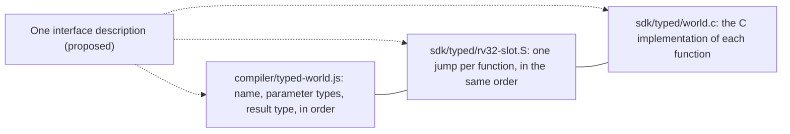
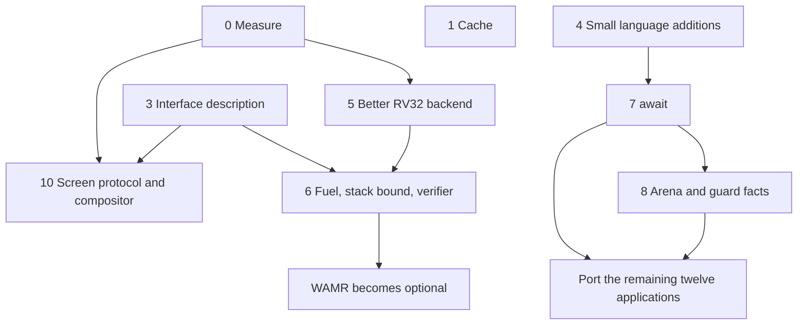

# 10. Architecture and a Roadmap

The previous articles each examined one part of the system. This one puts the parts together. It takes stock of what the firmware now contains, describes four structural changes that the earlier articles imply but did not develop, and then orders all of the proposed work by cost, risk and what each step makes possible. By the end you should be able to say how many execution mechanisms the device carries and which could go, explain why one description of the reactor's functions should generate the three lists that are now written by hand, state what a typed binary screen protocol would replace, and defend an order of work from the evidence in this issue.

## 10.1 What the firmware contains

After two days of rapid work the device carries more machinery than any one design would have chosen.

| Component | Role | Size or extent |
| --- | --- | --- |
| QuickJS | Runs JavaScript worlds; also runs the typed compiler | Part of the base firmware |
| WAMR | Runs WebAssembly worlds | Part of the base firmware |
| Native loader | Loads RV32 ELF modules | Small |
| CJI runtime | Dynamic values, strings and a garbage collector for CJI-compiled worlds | Linked into the firmware |
| CJI compiler tool | CJI itself, compiled to RV32, for compiling on the device | about 660 kB in the image; relocated at boot |
| Typed compiler | Frontend, WebAssembly linker, RV32 lowering | 43 kB of JavaScript source |
| Shared typed reactor | Connects a fully typed application to the nucleus | 508 lines of C |
| Per-application reactors | Hold the parts of Agenda and Files that are not yet typed | 869 and 334 lines of C |

That is three engines, two compilers, two run-time systems and three reactors. Each was a reasonable step. Together they are a cost in flash, in boot time and in the number of things a maintainer must understand.

A second inventory is as telling. The Editor exists twice: as 316 lines of JavaScript, which is the original and the reference for tests, and as about 1,730 lines of typed source. Agenda is 307 lines of JavaScript, and its typed version is 468 lines of typed source plus 869 lines of C. The typed versions are five to six times longer than the programs they replace. The difference is the price of the language's missing features: no allocation, no string operations beyond single code units, and no `await` (Articles 8 and 9). With twelve applications still to port, that multiplier is the main argument for extending the language before porting further.

## 10.2 One description of the reactor's functions

A typed application reaches the system through 28 functions that the shared reactor provides. Each is currently declared in three places that must agree.

The compiler's table gives each function's name and types and fixes its position. The assembly file lists one trampoline per function in the same order; native code calls function number *k* by jumping to the *k*-th entry. The C file implements them. A count of functions is also packed into a header word that the linker checks. If the order in the first two files ever differs, calls go to the wrong function with arguments of the wrong meaning, and no check detects it.

The remedy is an **interface description**: one file that states, for each function, its name, parameter types and result type, from which a build step generates the compiler's table, the trampolines and the C prototypes. This is ordinary practice wherever two languages meet. The WebAssembly Component Model's interface language, WIT, is a current example and has a useful property for this system: it can declare a *resource* type, an entity "that can only be passed around indirectly via handle values", with owned and borrowed handles. The same description could therefore carry the facts that Articles 7 and 9 need for each function: which capability it requires, how much fuel a call should be charged, and whether a handle argument is consumed or only lent.

This change is small, and it is a precondition for growing the set of reactor functions safely, which every ported application will require.

## 10.3 A typed screen protocol

Article 2 presented evidence that the compositor is the largest consumer of time on the path to the screen, and noted that in the measured firmware it was already native code. The cost lies in what the compositor is asked to do. It is worth following one screen update through the system as it works today.

1. The application builds a description of its screen as JSON text. In the typed language this is done by writing string fragments into a buffer one after another; Editor contains 104 such `writeLiteral` calls, for instance `output.writeLiteral(at, ",\"color\":\"accent\"}")`.
2. The reactor converts the buffer from UTF-16 to UTF-8, escaping characters as JSON requires. The design notes budget up to six output bytes per input unit for this step.
3. The nucleus copies the message to the compositor's queue. A message is limited to 16 KiB.
4. The compositor parses the JSON text into a tree of dynamically typed objects, which are allocated on a garbage-collected heap.
5. The compositor walks the tree, computes positions, and draws.

Steps 1, 2 and 4 exist only because the two sides exchange text. Both sides know the structure in advance: a screen is a list of rows, each with a style, an indentation and a run of characters.

A **typed binary protocol** states that structure once, as record layouts, and both sides use it directly. The application writes fields at fixed offsets, which the typed language already does for its own records. The compositor reads the same fields at the same offsets. Nothing is formatted, escaped or parsed, and nothing is allocated to hold a tree. A screen of 17 rows of 49 characters is under 2 kB in such a form.

The layouts belong in the interface description of section 10.2, so that the application's compiler and the compositor are generated from the same source and cannot disagree.

The natural companion is a compositor written in the typed language. It is today 485 lines of JavaScript compiled by CJI, with CJI's run-time system behind it. A typed compositor would have no garbage collector and no dynamic values, and it is the one world whose speed every other world's responsiveness depends on.

This is the largest single piece of work proposed in this issue, and it rests on a hypothesis. It should be started only if the key-to-pixel measurement of Article 2 confirms that the compositor dominates.

## 10.4 One source for both engines

When the typed compiler fails or is disabled, the firmware falls back to the original JavaScript application. Every ported application is therefore maintained in two forms, and the two can drift apart. The tests rely on the JavaScript original as the definition of correct behaviour, which is appropriate during a port and becomes a burden afterwards.

The typed source looks like JavaScript with annotations. Could QuickJS run it directly? Two developments in the JavaScript world suggest the shape of an answer.

The first is **asm.js**, a strict subset of JavaScript designed as a compilation target. Its insight was that type information can be written in valid JavaScript: a parameter is given the type *integer* "by means of an explicit coercion on function entry", written `x = x|0`, and a floating-point type by `x = +x` [Herman et al. 2014]. Code in this style runs unchanged in any JavaScript engine and can also be compiled ahead of time with unboxed integers. Because it is a subset, its meaning is JavaScript's; only validation is new.

The second is **erasable type syntax**. TypeScript 5.8 added an option that rejects every TypeScript construct with run-time behaviour, so that what remains can be turned into JavaScript by deleting the annotations, and a proposal before the JavaScript standards committee would have engines ignore annotations as if they were comments (it is at the first of the committee's stages).

For the typed language, deletion alone is not enough, because its semantics differ from JavaScript's in specific, enumerable ways.

| Construct | Typed language | JavaScript after deleting annotations | What a JavaScript emitter must add |
| --- | --- | --- | --- |
| `a + b` on `i32` | Wraps at 32 bits | 64-bit floating point | `(a + b) | 0` |
| `a * b` on `i32` | Wraps at 32 bits | May lose low bits above 2⁵³ | `Math.imul(a, b)` |
| `a / b` on `i32` | Truncates; traps on zero | Fractional result; infinity on zero | A checked helper |
| `s.charCodeAt(i)` out of range | Traps | Returns NaN | A wrapper class with a checked method |
| `record` declarations | Fixed layout in memory | Not JavaScript | An object or typed array |

Each row is a mechanical rewrite. A third, small backend that emits JavaScript with these rewrites, together with a JavaScript implementation of the reactor's 28 functions, would let QuickJS execute the same typed source. The project's device-language study considered and rejected compiling the typed language to JavaScript as a way to run applications, because arithmetic would still be boxed. The purpose here is different and does not depend on speed.

- **One source per application.** After a port is accepted, the JavaScript original can be retired. The fallback is the same program in another engine.
- **A reference for the compiler.** The JavaScript emitter is a second, independent implementation of the language's semantics. Running an application through both and comparing screens is a test of the WebAssembly and RV32 backends that needs no hand-written original.

One limit should be stated. A reference derived from the same source cannot reveal an error in the source's logic. During a port, the original JavaScript application remains the standard of behaviour.

## 10.5 Fewer engines

Which mechanisms of section 10.1 are needed in the long run depends on the outcome of earlier articles' proposals.

| Component | Needed as long as | Could be removed when |
| --- | --- | --- |
| QuickJS | Unported JavaScript worlds exist; it also hosts the typed compiler and the interactive console | Not in view; it is the system's base |
| WAMR | Typed applications from untrusted source must be confined | The verifier of Article 7 exists and is trusted, and no foreign WebAssembly modules are wanted |
| CJI runtime | Any CJI-compiled world ships, which today includes the compositor and the drivers | Those worlds are ported to the typed language |
| CJI compiler tool on the device | Compiling unannotated JavaScript on the device is a goal | Now. Its build times of minutes make it unusable interactively, and it costs 660 kB and a boot-time relocation that had to be scheduled around |
| Per-application reactors | Agenda and Files keep logic in C | Those applications are fully typed |

The clearest decision is the fourth row. CJI remains valuable as a workstation compiler that turns existing JavaScript worlds into native code for the firmware image, and the techniques of Article 4 would improve it in that role. As an on-device compiler it has been superseded.

## 10.6 The roadmap

The table gathers every proposal in this issue. Effort is a rough class: small is days, medium is one to two weeks, large is more. "Unlocks" names what becomes possible afterwards.

| # | Step | Effort | Risk | Unlocks | Article |
| ---: | --- | --- | --- | --- | ---: |
| 0 | Measure key press to pixels, and per-world time for one key press | small | low | Every later decision | 2 |
| 1 | Cache compiled modules under a content key | small | low | Removes 2–3 s from every boot | 6 |
| 2 | Take the CJI tool off the device | small | low | 660 kB of flash; simpler boot | 10 |
| 3 | Interface description for reactor functions | small | low | Safe growth of the reactor; data for steps 6 and 8 | 10 |
| 4 | Language: enumerations, distinct integers, `else`, `for`, `break`, forward calls with a cycle check | small each | low | Shorter, safer typed sources | 9 |
| 5 | RV32 backend with a compile-time operand stack | medium | medium | Native code about 2.7 times smaller; memory headroom | 5 |
| 6 | Fuel counter, static stack bound, output verifier | medium | medium | Native code from untrusted source | 7 |
| 7 | `await` compiled to state machines | medium to large | medium | Ports without hand-written continuations | 8 |
| 8 | Per-turn arena; guard facts for bounds checks | medium | medium | Applications that allocate; fewer checks | 9 |
| 9 | JavaScript emitter and reactor shim | medium | low | One source per application; a compiler reference | 10 |
| 10 | Typed screen protocol and typed compositor | large | depends on step 0 | Faster path to the screen for every world | 10 |
| 11 | Experiment: worlds in user mode under PMP | medium | high | Confinement of any native code | 7 |

Three features of the ordering deserve a sentence each. Steps 0 to 4 are small, independent and low-risk, and they should be done first in any order. Step 7 comes before the remaining ports because of the multiplier of section 10.1: porting twelve applications in the current style would produce a great deal of code that `await` would then make obsolete. Step 10 is deliberately late and conditional.

## 10.7 Predictions that would falsify the plan

A plan built on measurements should say what further measurements would refute it. Each of the following is a specific, checkable prediction made by an article of this issue.

| Prediction | Check | If it fails |
| --- | --- | --- |
| A compile-time operand stack gives 593 instructions for Files, where today there are 1,529 (Article 5) | Implement it for Files first and count | The counting model is wrong; re-examine before doing Editor |
| Application code is under 10 percent of key press to pixels (Article 2) | Step 0 | Raise the priority of step 5 for the affected application |
| With a cache, an unedited Editor costs under 100 ms at boot instead of 2–3 s (Article 6) | Time a boot with a warm cache | Look at hashing and load costs |
| A verifier accepts all code the new backend emits and rejects that code after random single-bit changes, or the changed code traps safely (Article 7) | Mutation testing of emitted modules | The list of checks is incomplete |
| The `await` transformation reproduces Editor's behaviour using no more than its current 71 state fields (Article 8) | Rewrite Editor's open and search paths with `await` and compare screens | Liveness-based saving is less economical than hand-written state |

## 10.8 Key points

- The firmware carries three engines, two compilers, two run-time systems and three reactors. The typed ports are five to six times longer than the JavaScript they replace.
- The reactor's 28 functions are listed by hand in three files that must agree in order. One interface description should generate all three.
- Screen updates are exchanged as JSON text that one side formats and the other parses into garbage-collected objects. A typed binary protocol removes both steps; it should be built only if measurement confirms that the compositor dominates.
- A JavaScript emitter for the typed language would give one source per application and an independent reference for the compiler.
- The CJI tool should leave the device now. WAMR can become optional once native code can be verified.
- Small, low-risk steps come first; `await` comes before the remaining ports; the compositor work waits for evidence.

## 10.9 Check your understanding

1. The compiler's table of reactor functions and the trampoline table list the functions in different orders after an edit. What goes wrong, and why does the proposed interface description prevent it?
2. List the steps of a screen update today that exist only because the application and the compositor exchange text.
3. Why is deleting type annotations not sufficient to make typed source run correctly in a JavaScript engine? Give two specific constructs and what must be added for each.
4. A JavaScript emitter gives a reference implementation derived from the same source. What kind of error can it detect, and what kind can it not?
5. Why does the roadmap place `await` before porting the remaining applications?
6. Choose one prediction from section 10.7 and state what observation would refute it and what the plan says to do then.

## References

- [Herman et al. 2014] D. Herman, L. Wagner, A. Zakai (eds.). "asm.js." Working Draft, 18 August 2014. Archived specification; source at github.com/asm-js/spec.
- TypeScript 5.8 release notes, `erasableSyntaxOnly` option, 2025.
- TC39. "ECMAScript proposal: Type Annotations." Stage 1. github.com/tc39/proposal-type-annotations.
- WebAssembly Component Model: explainer and WIT documentation (resources and handle types).
