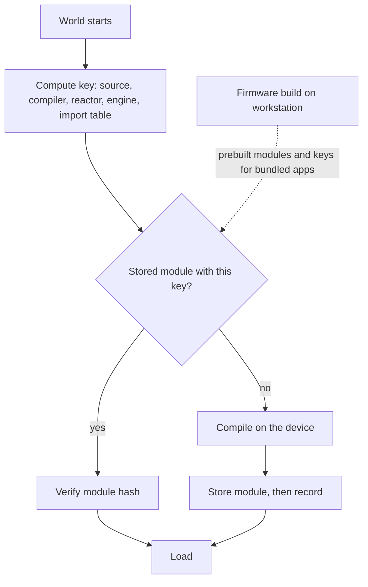

# 6. When to Compile: Caches, Load-Time Generation and Tiers

A compiler's output can be produced at four different moments, and the choice determines who waits and for how long. This article sets out those moments, states what the project does today, and works through the designs that would remove the compile from the path of an ordinary boot. By the end you should be able to list what a cache key for compiled code must contain and why, explain what is gained and lost by shipping a checked intermediate form instead of machine code, compute the break-even point for native compilation from the project's measurements, and say when mixing interpreted and native code in one application is worth its complexity.

The article uses the terms *reactor*, *engine* and *turn* from Article 1 and the measurements of Article 2.

## 6.1 Four moments

| Moment | Where | How often | Who waits |
| --- | --- | --- | --- |
| Build time | Workstation, when the firmware is built | Once per release | Nobody on the device |
| Install time | Device, when a source file changes | Once per edit | The person who edited |
| Load time | Device, when a world starts | Every boot | Every user, every boot |
| Run time | Device, while the program runs | When code proves to be hot | The running program, briefly |

The two compilers of this project currently sit in different rows. CJI compiles at **install time**: the result is stored on the device's file system and reused on later boots. The typed compiler compiles at **load time**: Files, Agenda and Editor are compiled from source on every boot. For Editor that is 1.99 seconds for WebAssembly or 3.14 seconds for native code, paid each time the device starts, to produce output identical to the previous boot's.

The reason is historical. Compiling from source on the device was the property the project set out to demonstrate, and compiling at boot demonstrates it on every run. Now that it has been demonstrated, the cost can be moved.

## 6.2 What on-device compilation buys and costs

Before optimizing the moment of compilation, it is worth stating why the device compiles at all. A user could, in principle, be given only precompiled modules.

Three things are gained. A program edited on the handheld can be run on the handheld, with no workstation. One source text serves two engines, since the same typed source produces a WebAssembly module or an RV32 module. A new firmware release with a changed reactor does not strand previously installed applications, because they can be recompiled against it.

Three things are paid. The compiler occupies flash: 43 kB of JavaScript source for the typed compiler, against about 660 kB for the CJI tool. It occupies memory while it runs: a peak of 1.5 MB for Editor's WebAssembly build and 2.5 MB for its native build. This memory belongs to a temporary interpreter that exists only for the duration of the compile; it is separate from the memory limit of the world being compiled. It must be trusted: an error in a compiler that runs on the device is an error in every program it produces, a point Article 7 develops.

## 6.3 A cache keyed by content

The direct remedy for compiling at every boot is to keep the result. A **cache** maps a key to a stored output. The entire difficulty lies in choosing the key so that a stored output is returned only when a fresh compile would have produced exactly the same bytes.

The output of the typed compiler is a function of five inputs, and the key must cover all of them.

| Input | Why it affects the output |
| --- | --- |
| The application's source text | It is what is compiled |
| The compiler's own source | A changed compiler emits different code for the same source |
| The reactor | The compiled code is copied into it and calls into it at fixed positions |
| The target engine | WebAssembly and RV32 outputs differ |
| The reactor's function table: the list of functions the reactor offers to compiled code | Calls are bound by position in that table |

The standard construction is to compute a cryptographic hash of each input and use the combination as the key. Two builds with the same key had the same inputs and therefore the same output. If any input changes, the key changes, the lookup misses, and the compiler runs. No input needs a version number maintained by hand.

This design has a precise description in the literature on build systems. Mokhov, Mitchell and Peyton Jones separate a build system into a *scheduler*, which decides the order of work, and a *rebuilder*, which decides whether a piece of work must be redone [Mokhov et al. 2018]. A record of input hashes together with the output's hash is what they call a verifying trace; storing the output itself under that record makes it a constructive trace, from which the output can be restored without rebuilding. The cache proposed here is a constructive trace with one entry per application and engine.

The project has already built this once, for CJI. The CJI installer keeps two storage areas on the file system, slot A and slot B, each able to hold one compiled module with its source. A small record, kept in the device's non-volatile settings storage, says which slot is active and holds the engine, the hash of the source, the hash of the compiled module, and the identity of the firmware build. The firmware identity stands for three of the five inputs at once: the compiler, the reactor and the reactor's function table are all part of the firmware image, so if any of them changes, the identity changes.

| Input to the compile | Field of the installer's record that covers it |
| --- | --- |
| Application source | Source hash |
| Compiler | Firmware identity |
| Reactor | Firmware identity |
| Reactor's function table | Firmware identity |
| Target engine | Engine field |

At boot the stored bytes are checked against the record, and a changed firmware identity discards the cached module. The effect was measured on a small test program. Compiling it during boot took 7,028 ms. With a stored module, reuse took 20 ms on a system that was already running; during a boot, the world was ready about 1,450 ms after the start of the boot, a figure that includes the startup of all the other worlds. For the typed Editor one should expect the loading time measured in Article 1, 14 ms for the native module, plus the time to hash about 240 kB, which has not been measured and should be tens of milliseconds.

Two engineering details from that implementation carry over.

- **Write order.** A new module and its source are written to the slot that is *not* active. Only when both are complete is the record changed to name that slot. A power loss before the record changes leaves the record naming the old slot, whose module was never touched.
- **Verification on read.** The stored module's hash is recomputed at boot. A damaged module is detected and rebuilt; in the project's test this took 7,047 ms and required no user action.

### A finer grain: one entry per function

Article 4 established that the typed compiler compiles each function from its own text and the declarations of what it calls. That property permits a cache with one entry per *function*. The key for a function is the hash of its text together with the hashes of the signatures and record layouts it mentions. After an edit to one function, only that function misses.

Editor has 120 functions. It compiles in 1.99 s to WebAssembly and 3.14 s to native code, so a function costs 17 ms or 26 ms on average, with large functions costing more. An edit-and-run cycle would then cost one function's compile plus a link step. The link step exists because functions call each other by index and the indices must be assigned consistently; in WebAssembly this is a renumbering of call operands, and it is the same kind of patching the reactor linker already performs. This design was listed in the project's device-language document and not built. A per-function cache needs no new analysis: local checking already guarantees that a function's compiled code depends on nothing but the inputs named in its key.

## 6.4 Shipping a checked intermediate form

A second design stores neither source nor machine code. It stores an intermediate form that has already been parsed and checked, and generates machine code from it when the program is loaded.

The reference work is **slim binaries**. Franz and Kistler distributed programs for the Oberon system as a compact encoding of the program's syntax tree, and the loader generated native code for whatever processor it ran on [Franz & Kistler 1997]. The motivation was portability: one file ran on several processor families. Their report on speed is careful. The compact encoding saved reading time, and that saving offset part of the cost of generating code. On the fastest machine they measured, loading a suite of applications from slim binaries took about two seconds, almost twice the time of loading native binaries. They judged that an acceptable price for a single file that runs on every processor. Franz's dissertation, on a different processor, reported that loading with code generation required "little more time than the input of equivalent native code" [Franz 1994].

On this device WebAssembly plays the role of the slim binary. It is target-independent, it is compact (88 kB for Editor against 240 kB of native module), and it can be checked for well-formedness in one forward pass. The designers of WebAssembly state that its structured control flow allows code "to be validated in a single pass, compiled in a single pass, or even transformed to an SSA-form intermediate form in a single pass" [Haas et al. 2017].

Three storage choices follow, and the measurements of Article 2 let us compare them for the native Editor.

| What is stored | Work at each boot | Approximate boot cost on the device | Flash used |
| --- | --- | ---: | ---: |
| Source only (today) | Tokenize, parse, check, emit, lower, link | 3.1 s | 71 kB |
| Checked WebAssembly | Translate to RV32 and link only | about 1.2 s (the measured difference between the two builds on the device) | 88 kB |
| Native module | Verify the hash and load | about 0.01 s to load, plus hashing | 240 kB |

The middle row is the slim-binary design. It removes the **frontend**, the part of the compiler that tokenizes, parses, checks and emits WebAssembly, and it keeps the stored form usable by either engine. The estimate of 1.2 s is the device's native compile time minus its WebAssembly compile time, 3.14 − 1.99 s. Experiment 3's workstation profile agrees roughly: it puts translation to RV32 at 41 percent of the native path, which would be 1.3 s on the device. The third row is the cache of section 6.3. Flash is not the scarce resource here, since the firmware partition is 8 MiB and the firmware image occupies about 4.2 MiB of it, so the third row is the better choice for boot time. The second remains useful as the form in which an application is *distributed*, because a module in that form can be given to either engine.

What is lost by storing a compiled form of any kind is exactly one thing: the stored form can become stale. That is the problem the content key of section 6.3 solves.

### Native modules and virtual machines on small devices

The comparison between loading native code and interpreting compact code has been measured before on machines much smaller than this one. Dunkels and colleagues built a loader for standard ELF object files in the Contiki operating system for sensor nodes and compared it with an application-specific virtual machine and a Java virtual machine [Dunkels et al. 2006]. Native code was cheaper to execute and more expensive to transmit and link, so each program had a break-even point. For their object-tracking program, interpretation became more expensive than native loading only after about 40,000 to 80,000 iterations. Their conclusion was that the right choice depends on how often code is replaced relative to how much it runs, and that a system can reasonably offer both.

The Maté virtual machine took the opposite extreme deliberately. It fitted in 1 kB of RAM and 16 kB of program memory, and its programs were capsules of at most 24 one-byte instructions, small enough to fit in one radio packet [Levis & Culler 2002]. Its authors argued that for programs replaced often, the energy saved by shipping tiny programs outweighs the energy spent interpreting them. Their scarce resource was radio energy. On the handheld the scarce resource is the time a person waits after each change to a program, and the reasoning has the same shape: code that is replaced after every edit should be in the form that is cheapest to produce. That is why QuickJS and WebAssembly remain the right engines for code under development.

## 6.5 Break-even arithmetic

The textbook states the constraint on any compiler that runs at the user's expense: "the system must recoup compile time through improved running time" [Cooper & Torczon 2023, §1.4]. The project's numbers allow the calculation.

For Editor, producing native code instead of WebAssembly costs 3.14 − 1.99 = 1.15 seconds more at compile time. In the measured editing session (Article 2, section 2.2), a turn took 8.8 ms of processor time in the WebAssembly engine and 1.6 ms as native code, so native code saves 7.2 ms per turn. The extra compile is repaid after 1.15 s / 7.2 ms ≈ 160 turns. If the compile happens at every boot, native code is a loss in any session shorter than 160 key presses. If the compile happens once per change of the source, it is repaid within the first few minutes of use and is free afterwards. Caching changes the answer to the question "should this application be native".

For CJI the same calculation was made in the project's device-language study. Compiling Files with CJI took 140.6 seconds in the best case, against 0.082 seconds to register the JavaScript version with QuickJS. The study illustrated the scale with an assumed saving, not a measured one: if native code saved one millisecond on every call into the application, the compile would be repaid after about 140,000 calls.

## 6.6 Tiers and mixed mode

A **tiered** system runs code in a cheap form first and produces a better form only for the parts that are executed often. Article 3 described Self's two compilers. The Smalltalk-80 system of Deutsch and Schiffman is the earlier instance: it translated a method from compact virtual-machine code to native code the first time the method ran, cached the native code, and discarded it when memory was short, regenerating it on demand. Their native code took about five times the space of the virtual-machine code [Deutsch & Schiffman 1984]. The textbook calls the discard policy throw-away code generation and gives the general range as a factor of two to five [Cooper & Torczon 2023, chapter 14].

This project's measured ratio is inside that range: 4.76 bytes of RV32 code per byte of WebAssembly function body for Editor. (The complete modules differ by less, 240 kB against 88 kB or a factor of 2.7, because each module also contains its reactor, which is the same C code in both.) The size has a concrete consequence, which is the reason mixed mode comes up at all. Each world has a memory limit, 768 KiB for Editor, and the native Editor uses 710 KiB of it where the WebAssembly Editor uses 528 KiB. The binding resource is the world's memory limit, and the native version is close to it.

**Mixed mode** would compile only the hot functions of an application to native code and leave the rest as WebAssembly. It would buy most of the speed for a fraction of the size. It costs three things: a way to find the hot functions, which means counters and a trigger [Cooper & Torczon 2023, §14.2]; a calling path between the interpreter and native code in both directions; and the acceptance of native code, which is not confined and can affect anything in memory, inside a world whose other code is confined by the interpreter.

The recommendation of this issue is not to build mixed mode now. Article 5's counting model predicts native code 2.66 to 3.32 times smaller than today's. Dividing today's ratio of 4.76 by those factors gives between 1.4 and 1.8 bytes of RV32 per byte of WebAssembly function body, at which point the whole application fits comfortably as native code and the selection machinery is unnecessary. Mixed mode remains the fallback if that prediction fails.

## 6.7 Doing the work before the device boots

The cheapest compile is the one done on the workstation. Two systems for microcontrollers show how far this can be taken.

The Moddable SDK's **preload** feature executes the top-level code of JavaScript modules during the build, on the build machine, and stores the resulting objects in flash, so that the device starts with those modules already initialized and their data out of RAM. MicroPython can likewise store precompiled bytecode, and since 2019 precompiled native code, in files produced on a workstation.

The project already avoids one repeated compile within a single boot. The JavaScript **prelude** is a library of common functions that every JavaScript world loads when it starts. Each of eleven worlds used to compile it from source. It is now compiled once per boot and the result shared, which reduced that work from 627 ms to 198 ms. Doing the same compile at build time would remove the remaining 198 ms.

For the typed applications bundled with the firmware, the same compiler can run under Node during the firmware build and place its output in the image. The compiler uses no clock and no randomness, so the same inputs should give the same bytes, and the harness built for Experiment 3 already produces a module of the same size as the device's. Equality of the bytes between a workstation build and a device build remains to be checked, as the project did for CJI. A bundled application would then start from a prebuilt module whose key is checked at boot, and the on-device compiler would run only for source that was edited on the device.

## 6.8 A combined design

With this design an unedited application costs a hash check and a load at boot. An edited application costs one compile, once. The on-device compiler remains fully exercised, because every edit runs it.

## 6.9 Key points

- The typed compiler runs at every boot and produces the same output each time. Editor pays 2.0 to 3.1 seconds for this.
- A cache key must cover every input that affects the output: source, compiler, reactor, engine and the reactor's function table. Hashing the inputs makes this automatic.
- Store the output first and the record last, and verify the output's hash when reading.
- WebAssembly can serve as a checked, portable distribution form from which native code is generated at load, as slim binaries did. Storing the native module is faster at boot when flash is available, as it is here.
- With compilation at every boot, native Editor repays its extra compile time after about 160 turns. With caching it is repaid once.
- Mixed mode is a response to native code size. A better backend makes it unnecessary.

## 6.10 Check your understanding

1. The CJI installer's record has no field for the compiler or the reactor. Which field covers them, and why is that sufficient?
2. The installer has two slots. Describe the order of writes when a new module is installed, and what the device finds after a power loss just before the last write.
3. Using the figures in section 6.5, compute how many turns are needed to repay the extra cost of native compilation for Editor, and state how caching changes the conclusion.
4. Franz and Kistler reported that loading from slim binaries took almost twice as long as loading native binaries on their fastest machine. Give the reason they still considered the design worthwhile, and name the form that plays the slim binary's role on the handheld.
5. Which resource limit makes native code size a concern for Editor, and what are the two memory figures that show it?
6. Section 6.6 gives two ratios between native and WebAssembly size for Editor, 4.76 and 2.7. What does each one compare, and why do they differ?

## References

- [Cooper & Torczon 2023] K. D. Cooper, L. Torczon. *Engineering a Compiler*, 3rd edition. Morgan Kaufmann, 2023. §1.4, chapter 14.
- [Deutsch & Schiffman 1984] L. P. Deutsch, A. M. Schiffman. "Efficient implementation of the Smalltalk-80 system." *POPL*, 1984.
- [Dunkels et al. 2006] A. Dunkels, N. Finne, J. Eriksson, T. Voigt. "Run-time dynamic linking for reprogramming wireless sensor networks." *SenSys*, 2006.
- [Franz 1994] M. Franz. "Code-generation on-the-fly: a key to portable software." Doctoral dissertation, ETH Zürich, 1994.
- [Franz & Kistler 1997] M. Franz, T. Kistler. "Slim binaries." *Communications of the ACM* 40(12), 1997. Quotations are from the technical-report version, UC Irvine ICS TR 96-24, 1996.
- [Haas et al. 2017] A. Haas, A. Rossberg, D. L. Schuff, B. L. Titzer, M. Holman, D. Gohman, L. Wagner, A. Zakai, J. F. Bastien. "Bringing the web up to speed with WebAssembly." *PLDI*, 2017.
- [Levis & Culler 2002] P. Levis, D. Culler. "Maté: a tiny virtual machine for sensor networks." *ASPLOS*, 2002.
- [Mokhov et al. 2018] A. Mokhov, N. Mitchell, S. Peyton Jones. "Build systems à la carte." *ICFP*, 2018.
- Moddable SDK documentation, "Using XS Preload to Optimize Applications".
- MicroPython documentation, "Maximising MicroPython speed".
