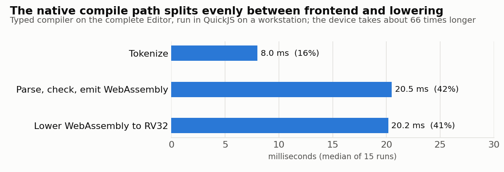

# 2. Measuring Before Optimizing

This article teaches how to read the project's measurements and how to decide, from numbers, which part of a system deserves work. By the end you should be able to state what each published timing does and does not include, apply Amdahl's law to a path through the system, read a phase-by-phase compile profile for both compilers, and name the measurements that are still missing. The article also reports four small experiments that were run for this issue; later articles build on their results.

Article 1 defined worlds, turns, engines, the compositor and the two compilers. This article assumes those terms.

## 2.1 Every timing has two ends

A timing is the interval between two events. A number without both events named cannot be compared with anything. The project's records contain four kinds of interval, and they end in different places.

| Interval | Starts at | Ends at | Does not include |
| --- | --- | --- | --- |
| Compile time | Compiler receives the source | Compiled module returned | Loading the module, first turn |
| Turn CPU time | Nucleus calls a world's handler | Handler returns | Time spent in other worlds for the same key press |
| First response after boot | The compile that runs during boot begins | Nucleus accepts the application's first screen description | Everything before the compile begins; compositor layout and drawing; transfer to the LCD |
| Framebuffer capture | Test script requests a capture | Pixel data received over the serial port | Anything about time; it is a correctness check |

No recorded interval ends at the LCD. Every latency in the project ends when the nucleus accepts a screen description, or earlier. The time from a key press to changed pixels has not been measured. This is the single most important fact about the current evidence, because the user perceives exactly that interval and nothing else.

## 2.2 Amdahl's law, with denominators

Gene Amdahl's 1967 argument is usually stated as a formula [Amdahl 1967]. If a fraction *p* of a total time is spent in the part being improved, and that part is made *s* times faster, the whole becomes faster by

```
speedup = 1 / ((1 − p) + p / s)
```

Letting *s* grow without bound gives the limit 1 / (1 − p). If the improved part is 10 percent of the total, no improvement to it can make the whole more than 1.11 times faster. The formula's practical content is a rule about order of work: find *p* before choosing what to improve.

Apply it to one key press in Editor, which is one turn of the application. Two measurements exist, and they come from different applications and different firmware builds, so what follows is a rough model and no more. The native Editor used 52.9 ms of CPU over a 33-turn session, which is 1.6 ms per turn. An earlier trace of a different application, recorded when the Snake game was first run as native code (the port's hardware-check record), measured 35.6 ms of elapsed time from the moment the compositor received a key to the moment the application's handler was called, and that interval contains no application code. Take these two numbers as a rough model of one key press, which normally causes one turn of the application: at least 35.6 ms before the application runs, 1.6 ms inside it, and an unmeasured time afterwards while the compositor draws. The model adds an elapsed time to a processor time, which is a further reason to treat it as rough.

Under that model the application is 1.6 / (35.6 + 1.6) = 4.3 percent of the part of the path that has been measured. The unmeasured drawing time can only add to the denominator, so 4.3 percent is an upper limit. Making application code infinitely fast would speed up the path by at most a factor of 1.045. The WebAssembly Editor needs 8.8 ms per turn. In the same model its share is 8.8 / (35.6 + 8.8) = 20 percent, so moving from WebAssembly to native code saved about 7 ms of a path that is longer than 37 ms.

The model is weak, and its weaknesses are instructive. The two numbers come from different applications, different firmware builds and a single trace. They are enough to form a hypothesis, which is that application code is no longer the largest part of a key press, and they are not enough to act on it. The first item on any work list is therefore to measure the whole path once.

## 2.3 A worked profile: one boot

One complete attribution does exist, for the interval during boot between the storage system returning Agenda's file and Agenda's handler receiving it. That interval was 559 ms in one recorded boot, and the nucleus logged which world ran in every segment of it.

| Where the 559 ms went | Time | Segments |
| --- | ---: | ---: |
| Compositor | 293 ms | 30 |
| Keyboard driver | 81 ms | 44 |
| Display driver | 32 ms | 46 |
| All other worlds | 123 ms | — |
| Not attributed to any world | 30 ms | — |

Agenda itself needed about 2 ms once it ran. The file was ready; the application waited 559 ms for its turn, and more than half of that wait was the compositor. A second boot was recorded with finer instrumentation. There the interval was 462 ms and the compositor's share 235 ms, made up of 84 ms of drawing, 5 ms of status updates and 146 ms of handling other messages.

Two lessons follow. First, this profile is the reason the project changed the scheduler so that the application's first turn runs ahead of other startup work. In a matched comparison of three boots with and without the change, the time to first response fell from 2.04 s to 1.70 s for the WebAssembly build and from 2.13 s to 1.79 s for the native build, about 340 ms in each case. A compiler improvement could not have found those 340 ms. Second, the compositor sits on every path to the screen, and its cost is not explained by slow execution: in the firmware that was profiled, the compositor had already been compiled to native code by CJI. The compositor was the largest consumer of time anyway. What it does per message is decode a JSON screen description into dynamically typed, garbage-collected values, lay the screen out, and draw it. That work, and not the engine, is the basis for the hypothesis in section 2.2.

## 2.4 A compile profile for each compiler

The same discipline applies to compile time. The phases of CJI compiling Agenda on the device, in one run of the original build that took 1,480 s in total (the run quoted in Article 1 took 1,475 s):

| CJI phase (Agenda, on the device) | Time | Share |
| --- | ---: | ---: |
| Load and relocate the compiler | about 0.5 s | 0.03% |
| Frontend: parsing, inference, specialization, emission of low-level code | 1,479.1 s | 99.9% |
| — of which garbage collection | 85.9 s | 5.8% |
| Link, assemble to RV32, hash | about 1.2 s | 0.08% |

Machine-code emission is a rounding error. A profile of the same compiler on a workstation attributed 88 percent of all executed instructions to one analysis: the numeric range analysis, which works out the smallest and largest value each number in the program can take and is described in Article 3. The first hypothesis in the project had been that garbage collection was the cost; the measurement showed 5.8 percent, and enlarging the heap saved 1.2 percent.

For the typed compiler no phase profile existed, so one was made for this issue (Experiment 3 below). Compiling the complete Editor:

| Typed compiler phase (Editor, QuickJS on a workstation) | Time | Share of the native path |
| --- | ---: | ---: |
| Tokenize (the compiler's regular expression alone) | 8.0 ms | 16% |
| Rest of the frontend: parse, check types, emit WebAssembly | 20.5 ms | 42% |
| Translate ("lower") WebAssembly to RV32 | 20.2 ms | 41% |
| **Native path: source text to RV32 code** | **48.7 ms** | **100%** |

Two further steps were timed separately and are not part of that total. Loading the compiler's own source into the interpreter took 2.4 ms. Linking the WebAssembly into its reactor took 1.3 ms. The WebAssembly path is the frontend (8.0 + 20.5 = 28.5 ms) followed by that link, 29.8 ms by addition; measured as one piece it took 29.9 ms.



The device takes 1,988 ms for the WebAssembly path that takes 29.9 ms here, a factor of 66. Editor's source has 16,792 tokens. Two per-token costs follow. The whole WebAssembly compile costs 1,988 ms / 16,792 = 118 microseconds per token, which at the device's 360 MHz clock is about 42,000 processor cycles. Tokenizing alone was not timed on the device. If it slows down by the same factor of 66 as the whole, which is an extrapolation, it costs about half a second per boot, or 31 microseconds and 11,000 cycles per token. Both figures say that the compiler's own speed is limited by the interpreter running it, and that the cheapest improvement is not to run it at all when the source has not changed (Article 6).

## 2.5 Four experiments run for this issue

The following experiments were run on the repository at revision `60a38f0`. The scripts and outputs are in the issue's workspace under `scripts/` and `various/`.

**Experiment 1: what the RV32 backend emits.** Every instruction in the RV32 output for Editor, Agenda and Files was classified by decoding its bits. The count is exact. As a check that the script compiles what the device compiles, its output for Agenda is 30,840 bytes (7,710 instructions of 4 bytes), the same size that the project's diary records for the device's build.

| | Editor | Agenda | Files |
| --- | ---: | ---: | ---: |
| RV32 instructions | 43,965 | 7,710 | 1,529 |
| Loads and stores of temporary values in the stack frame | 55.3% | 52.5% | 50.0% |
| All stack-frame loads and stores, including local variables | 70.2% | 65.8% | 61.9% |
| Instructions in a store immediately followed by a load of the same slot | 34.1% | 33.4% | 34.3% |
| Conditional branches written as a branch over an unconditional jump | 1,009 | 274 | 75 |
| Bytes of RV32 code per byte of WebAssembly function body (Editor: 175,860 bytes of RV32 for 36,917 bytes of function bodies) | 4.76 | 5.68 | 5.42 |

Half or more of the emitted instructions move temporary values to and from memory. Article 5 explains why and what to do about it.

**Experiment 2: a counting model of a better backend.** A script walks the same WebAssembly and counts the instructions a backend would emit if it kept temporary values in registers. The script first applies the current backend's rules and compares its count, function by function, with the number of instructions the real backend emitted. The two agree for all 161 functions of the three applications (120 in Editor, 34 in Agenda, 7 in Files), which shows that the script reads the code correctly. The model then predicts 16,544 instructions for Editor if temporaries stay in registers (2.66 times fewer) and 13,255 if local variables do too (3.32 times fewer). This is a model, not an implementation; Article 5 states its assumptions.

**Experiment 3: compiler phases under QuickJS.** Reported in section 2.4. The harness links the same QuickJS that the firmware uses and produces a WebAssembly module of 88,255 bytes, the same size as the one built on the device. Equal size is a plausibility check and not a proof that the bytes are identical.

**Experiment 4: one function in full.** The running example `countUnit` was compiled and disassembled: 77 bytes of WebAssembly, 103 RV32 instructions. A version written by hand needs 13. Article 5 reproduces both.

## 2.6 What is still unmeasured

| Missing measurement | Why it matters | How to obtain it |
| --- | --- | --- |
| Key press to changed pixels | It is what the user perceives | Toggle a spare pin when the keyboard interrupt fires and when the display transfer completes; read both with a logic analyzer. A high-speed camera is the alternative. |
| CPU time per world for one key press in steady state | It supplies *p* for Amdahl's law | The nucleus already attributes segments to worlds during boot; extend the same log to a key press |
| Repeated trials | Most device figures are one run, or three | Run each configuration at least ten times, alternate the order, report the median and the range |
| Whole-device memory | World counters measure different things in different engines | Sample the allocator's free and largest-block figures at fixed points |

The third row reflects a known hazard. Measurement bias from factors as incidental as link order or environment size can exceed the effect being studied [Mytkowicz et al. 2009], and single runs cannot distinguish a small improvement from noise [Georges et al. 2007]. The project already follows the main defence in its compiler experiments, where each candidate is compared only with a control run interleaved with it. Alternating the order of the configurations matters because conditions drift during a session, for example as the device warms up or its memory fragments; if one configuration always ran second, the drift would be counted as its effect. The device measurements should follow the same rule.

## 2.7 What each outcome would imply

The measurement in the first row of the table decides the order of the work described in the rest of this issue.

| If the key-to-pixel measurement shows… | Then the first investment is… | Article |
| --- | --- | --- |
| The compositor and screen description dominate | A binary screen protocol and a typed compositor | 10 |
| Application turns dominate for some application | A better RV32 backend for that application | 5 |
| Boot compile dominates perceived startup | Caching compiled modules | 6 |
| Display transfer dominates | Nothing in this issue; it is a driver and hardware matter | — |

## 2.8 Key points

- A timing is defined by its two end events. No timing in the project ends at the LCD.
- Amdahl's law gives the limit 1 / (1 − p) on what improving a fraction *p* can achieve. A rough model built from two unrelated measurements puts application code at about 4 percent of the measured part of a key press as native code and 20 percent as WebAssembly; this is a hypothesis to test, not a finding.
- On the device, CJI spends 99.9 percent of its time in its frontend. On a workstation, 88 percent of its executed instructions are in one analysis. Emitting machine code is negligible.
- The typed compiler's native path is 58 percent frontend, of which tokenizing alone is 16 percent, and 41 percent translation to RV32.
- Between 50 and 55 percent of the RV32 instructions the typed compiler emits are loads and stores of temporary values.

## 2.9 Check your understanding

1. A report says "Agenda's first response comes 1.8 seconds after the boot compile begins". Using the table in section 2.1, state where that interval ends and name one thing the user still waits for after it.
2. Using the two measurements in section 2.2 for the native Editor, compute the share of the measured key-press path spent in application code, and the largest speedup of that path that faster application code could give. Why is the share an upper limit?
3. In the boot profile of section 2.3, what was Agenda doing during the 559 ms, which world used the largest share of that time, and what change did the project make as a result?
4. The first hypothesis for CJI's slowness was garbage collection. Which two numbers in section 2.4 refute it?
5. What check gives confidence that the script of Experiment 2 reads the code correctly, and what does that check not establish?
6. Section 2.4 gives two per-token costs for the typed compiler on the device. State both, say what each one covers, and say which of them is an extrapolation.

## References

- [Amdahl 1967] G. M. Amdahl. "Validity of the single processor approach to achieving large scale computing capabilities." *AFIPS Spring Joint Computer Conference*, 1967.
- [Georges et al. 2007] A. Georges, D. Buytaert, L. Eeckhout. "Statistically rigorous Java performance evaluation." *OOPSLA*, 2007.
- [Mytkowicz et al. 2009] T. Mytkowicz, A. Diwan, M. Hauswirth, P. F. Sweeney. "Producing wrong data without doing anything obviously wrong!" *ASPLOS*, 2009.
