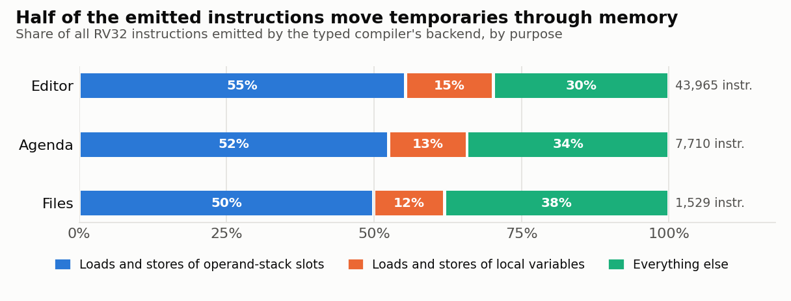
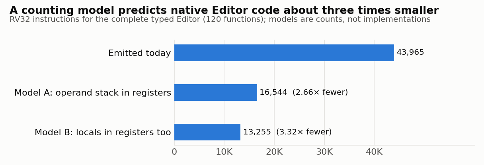

# 5. Code Generation: From a Stack Machine to a Register Machine

The typed compiler produces WebAssembly, which is code for a stack machine, and then translates it to RV32, which is a register machine. This article examines that translation instruction by instruction. By the end you should be able to translate a small expression by hand in the way the current backend does, explain where each wasted instruction comes from, apply the compile-time operand stack technique to the same expression, state the rule that governs control-flow joins, and judge the predicted gain from the measurements. The article ends with what a one-pass translator cannot do and why that is acceptable for now.

Articles 1 and 2 introduced the running example and the measurements. This article uses both.

## 5.1 Two machine models

A **stack machine** has no named places for intermediate values. Every operation takes its inputs from the top of an operand stack and puts its result back on top. To compute `b + c`, a stack-machine program pushes `b`, pushes `c`, and executes *add*, which removes both and pushes the sum. WebAssembly is such a machine with one addition: each function also has numbered **local variables** that can be read (`local.get`) and written (`local.set`). *Engineering a Compiler* says of stack-machine code that "it is easy to generate and to understand" [Cooper & Torczon 2023, §4.4.1], which is why a one-pass compiler favours it.

A **register machine** has a small set of named storage places inside the processor. RV32 has 32 registers, and four groups matter here.

| Registers | Conventional use |
| --- | --- |
| `sp` | Stack pointer: the address of the current function's **frame**, its private area of memory |
| `a0`–`a7` | Arguments to a call and its result; a called function may overwrite them |
| `t0`–`t6` | Temporaries; a called function may overwrite them |
| `s0`–`s11` | Saved registers; a called function must restore them before returning |

Every ordinary RV32 instruction occupies 4 bytes. The listings in this article use the following instructions.

| Instruction | Meaning |
| --- | --- |
| `lw t0, 12(sp)` | Load the 32-bit word stored 12 bytes above `sp` into `t0` |
| `sw t0, 12(sp)` | Store `t0` to that place |
| `lhu t0, 4(t1)` | Load an unsigned 16-bit value from the address `t1 + 4` |
| `li t0, 5` | Put the constant 5 in `t0` |
| `add t0, t0, t1` | `t0 = t0 + t1` |
| `addi t0, t0, 1` | `t0 = t0 + 1`: add a small constant |
| `slli t0, t0, 1` | Shift left by one bit: multiply by 2 |
| `slt t0, t1, t2` | `t0 = 1` if `t1 < t2`, otherwise 0 |
| `mv a0, t0` | Copy `t0` to `a0` |
| `blt t0, t1, L` | Jump to label `L` if `t0 < t1`. Likewise `bge` (greater or equal), `bne` (not equal), `bnez` (not zero), `blez` (zero or less) |
| `j L` | Jump to `L` unconditionally |
| `ret` | Return to the caller |

A conditional branch can reach targets within about 4 KiB of itself. An unconditional jump reaches about 1 MiB. Both limits come from the number of bits the instruction formats leave for the distance [RISC-V 2019].

The translation problem is to carry out stack-machine operations on a machine that has registers and memory but no operand stack.

## 5.2 The current translation, by hand

The simplest translation keeps the operand stack in memory. Give each stack position a fixed **slot** in the function's frame, and translate each WebAssembly operation by itself: load its inputs from their slots, compute, store the result to its slot. This is what the typed compiler's backend does today. Consider this function.

```
function bump(b: i32, c: i32): i32 {
    let a = b + c;
    if (a > 0) { a = a + 1; }
    return a;
}
```

The frame holds the locals `b`, `c` and `a` at offsets 0, 4 and 8. The operand stack never holds more than two values in this function, so it needs two slots: the first stack position is the frame slot at offset 12 and the second is the slot at offset 16. The statement `let a = b + c` is four WebAssembly operations. The backend emits ten instructions for them.

| WebAssembly | Emitted RV32 | Purpose |
| --- | --- | --- |
| `local.get b` | `lw t0, 0(sp)` | read `b` |
| | `sw t0, 12(sp)` | push it: first stack position |
| `local.get c` | `lw t0, 4(sp)` | read `c` |
| | `sw t0, 16(sp)` | push it: second stack position |
| `i32.add` | `lw t1, 16(sp)` | pop the right operand |
| | `lw t0, 12(sp)` | pop the left operand |
| | `add t0, t0, t1` | the only instruction that computes anything |
| | `sw t0, 12(sp)` | push the sum |
| `local.set a` | `lw t0, 12(sp)` | pop the sum |
| | `sw t0, 8(sp)` | write `a` |

One instruction in ten does arithmetic. The other nine move values between registers and memory, and several of them are immediately undone: the sum is stored to the slot at offset 12 and loaded from the same slot by the very next instruction.

The condition `if (a > 0)` shows a second pattern. It is three WebAssembly operations (`local.get a`, `i32.const 0`, greater-than) followed by the `if`, and the backend emits eleven instructions. The comparison is computed as a number, 0 or 1, pushed and popped like any other value, and then tested:

```
lw   t0, 8(sp)         # local.get a: read a
sw   t0, 12(sp)        #   push it
li   t0, 0             # i32.const 0: make the constant
sw   t0, 16(sp)        #   push it
lw   t1, 16(sp)        # greater-than: pop the right operand, 0
lw   t0, 12(sp)        #   pop the left operand, a
slt  t0, t1, t0        #   t0 = 1 if 0 < a, otherwise 0
sw   t0, 12(sp)        #   push the truth value
lw   t0, 12(sp)        # if: pop the truth value
bnez t0, +8            #   if it is not zero, skip the next instruction
j    after_if          #   otherwise jump past the block
```

Notice that a constant is treated like any other value: `i32.const` puts the constant in a register and stores it to a stack slot, two instructions, only for it to be loaded again.

The last two instructions are a **branch over a jump**. With `a` in a register, RV32 could express the whole test as one instruction, `blez`. The backend emits the two-instruction form because of how it works: it translates in a single forward pass, and when it reaches the `if` it does not yet know how far away the end of the block will be. A conditional branch reaches only 4 KiB; a jump reaches 1 MiB. The backend therefore always emits the long form, which is always correct. Wirth's compiler textbook calls unknown branch destinations "a difficulty inherent in all single-pass compilers" and resolves it by returning to patch the instruction once the destination is known [Wirth 1996]; section 5.6 applies that remedy.

The complete function is 41 instructions, which the output of the script used for Experiment 4 lets us tally.

| Part of `bump` | Instructions |
| --- | ---: |
| Entry: make the frame, save the return address, store the two parameters to the frame | 4 |
| `let a = b + c` | 10 |
| `if (a > 0)` | 11 |
| `a = a + 1` | 10 |
| `return a`: push `a`, pop it into the result register | 3 |
| Exit: restore the return address, release the frame, return | 3 |
| Total | 41 |

Written by hand the function is 4 instructions, because the parameters arrive in the registers `a0` and `a1` and the result is returned in `a0`:

```
bump:  add  a0, a0, a1      # a = b + c
       blez a0, done        # if a <= 0, skip
       addi a0, a0, 1       # a = a + 1
done:  ret
```

## 5.3 How much of the output is waste

Experiment 1 of Article 2 classified every instruction the backend emits for the three typed applications.

| | Editor | Agenda | Files |
| --- | ---: | ---: | ---: |
| Instructions emitted | 43,965 | 7,710 | 1,529 |
| Loads and stores of operand-stack slots | 55.3% | 52.5% | 50.0% |
| All frame loads and stores, including locals | 70.2% | 65.8% | 61.9% |
| Store immediately followed by a load of the same slot, both instructions counted (Editor: 7,490 pairs) | 34.1% | 33.4% | 34.3% |
| Branch-over-jump pairs | 1,009 | 274 | 75 |
| — of which the target is within reach of a plain conditional branch | 1,008 | 274 | 75 |



The pattern seen in `bump` is the whole program's pattern. Half of all emitted instructions shuttle operand-stack values through memory. In Editor, all but one of the 1,009 long-form branches could have been the short form.

Each row of the table corresponds to a known technique. The following sections take the techniques in order of increasing power, and each says which row it addresses.

## 5.4 Technique 1: a peephole pass

A **peephole optimizer** slides a small window over the emitted instructions and replaces known wasteful patterns with shorter equivalents. The idea is as old as compilers for small machines [McKeeman 1965], and it was later made systematic and machine-independent by Davidson and Fraser, whose conclusion was that a naive code generator can give good code when a peephole optimizer follows it [Davidson & Fraser 1980]. The textbook's first example is exactly the pattern above: "A classic example pattern is a store followed by a load from the same location. The load can be replaced by a copy operation" [Cooper & Torczon 2023, §11.3.1]. Peephole rules written for stack-machine intermediate code were used to good effect in the Amsterdam Compiler Kit, a compiler suite designed for machines with very little memory [Tanenbaum et al. 1982].

A peephole pass would be the smallest change to the backend. Its limit is that it sees only the window. Take the pair `sw t0, 12(sp)` followed by `lw t0, 12(sp)`. The load is redundant, because `t0` already holds the value, and the pass can delete it. Where the load uses a different register, as in `sw t0, 16(sp)` followed by `lw t1, 16(sp)`, the load becomes a register copy, which saves a memory access and no instruction. In neither case can the pass delete the *store*: that would be correct only if the slot is never read again, and the window cannot see that. So of the two instructions in each pair, at most one can be removed. The 34 percent in the table counts both, so 17 percent of all instructions is an upper bound on what a peephole pass can remove. The better remedy is not to emit the pair in the first place.

## 5.5 Technique 2: a compile-time operand stack

The operand stack exists in the WebAssembly program. It does not have to exist in memory at run time. While translating, the compiler can keep its own list that records, for each operand-stack position, *where that value currently is*. An entry in the list is one of three things (section 5.6 adds a fourth):

- **in register r**: the value has been computed and sits in a register;
- **the constant k**: the value is known, and no instruction has been emitted for it yet;
- **the current value of local i**: the value is in the frame, and no instruction has been emitted to fetch it yet.

Translating `let a = b + c` with such a list:

| WebAssembly | Compile-time list after the operation | Emitted RV32 |
| --- | --- | --- |
| `local.get b` | [local b] | nothing |
| `local.get c` | [local b, local c] | nothing |
| `i32.add` | [register t0] | `lw t0, 0(sp)`; `lw t1, 4(sp)`; `add t0, t0, t1` |
| `local.set a` | [] | `sw t0, 8(sp)` |

Four instructions replace ten. Reading a local or a constant emits nothing until an operation needs the value in a register, and results stay in registers until something consumes them. A constant operand often never needs a register at all: `a + 1` becomes the single instruction `addi t0, t0, 1`.

This technique has several names and a long history. Fabrice Bellard's Tiny C Compiler calls its list the *value stack*; its documentation says that "no intermediate representation of expression is kept except the current values stored in the value stack", and that each entry records whether the value is a constant, a local, in a register, or in the processor's flags [Bellard, TCC]. Lua's compiler delays code for variables and constants in the same way so that they can be used directly as operands [Ierusalimschy et al. 2005]. Ertl described the idea for stack-machine implementations as *static stack caching*, in which a state machine in the compiler tracks which stack items are in registers [Ertl 1995]. V8's baseline WebAssembly compiler, Liftoff, keeps a "virtual stack" that "exists only during compilation" and records small constants without emitting code for them until they are used [Backes 2018]. A survey of six single-pass WebAssembly compilers describes the general method as one forward abstract interpretation of the operand stack [Titzer 2024].

### The rule at control-flow joins

The compile-time list describes where values are *on the path the compiler is currently translating*. That is sufficient as long as code is reached in only one way. A **join** is a point reached from two or more paths: the instruction after an `if` block is reached both from the end of the block and from the branch that skipped it. The code after the join is emitted once, so it must find every value in the same place whichever path was taken.

This is a correctness requirement. If one path left a value in `t0` and the other left it in `t3`, no single instruction sequence after the join could be right for both. The simplest rule that guarantees agreement is: *before control flow splits or merges, move every pending entry to a fixed, agreed location.* This step is called a **flush**. The same applies at a call, for a different reason: the calling convention lets the called function overwrite `t0`–`t6` and `a0`–`a7`, so any value the caller still needs must be saved first.

WebAssembly makes the rule cheap to apply in one pass because its control flow is structured: blocks, loops and conditionals nest, and there are no arbitrary jumps. Titzer notes that every way of reaching a label, except the back-edge of a loop, appears earlier in the code than the label itself, so a single forward pass has seen all of them [Titzer 2024]. A loop is handled by flushing at its entry.

One might expect that the frame must also be brought up to date wherever execution could be interrupted. Two situations show that it need not be. A trap is a fault that ends the program's handling of the current event, so nothing reads the frame afterwards. A hardware interrupt saves and restores all registers itself. Between one flush point and the next, the frame slots may therefore hold stale values without harm; the flush rule itself is unchanged.

One further case forces a pending entry to be resolved early. If the program assigns to a local variable while a pending read of that same variable is still in the list, the compiler must first load the old value into a register, because the entry stands for the value the variable had when it was read.

Flushes are rare. In the counting model of section 5.8, they account for 155 of 16,544 instructions in Editor, under one percent. Pending values at a join are rare because most joins occur between statements, when the operand stack is empty.

## 5.6 Technique 3: branches without truth values

With the compile-time list, a comparison need not produce 0 or 1. The compiler can record a fourth kind of entry, **a pending comparison** of two operands, and emit nothing. If the next operation is a conditional branch, as it almost always is, the compiler emits one compare-and-branch instruction: `blez`, `blt`, `beq` and so on. The truth value is never materialized.

The branch-over-jump form can be avoided in the same pass by emitting the short conditional branch and recording its position; in the rare case that the target turns out to be out of reach, the compiler rewrites that one site in the long form.

One source of truth values lies in the frontend. The typed compiler translates `p && q` and `p || q` into a WebAssembly block that leaves 0 or 1 on the stack; there are 228 such blocks in Editor. When the operator appears in a loop or `if` condition, the value is tested immediately. The alternative is for the frontend to translate a condition directly into jumps. For `while (p && q) { body }` that means: evaluate `p` and jump to the loop's exit if it is false; evaluate `q` and jump to the exit if it is false; otherwise fall into the body. No 0 or 1 is ever produced. This is the classical short-circuit translation [Cooper & Torczon 2023, §7.4], and its systematic form is **destination-driven code generation**: every expression is compiled together with a statement of where its value should go and where control should continue [Dybvig et al. 1990]. Its authors report code mostly free of unnecessary loads, stores, tests and branches from a single pass, with no later patching. The frontend can do this because, while parsing a `while`, it knows that the expression it is about to read is a condition.

## 5.7 Technique 4: locals in registers

After the previous techniques, the remaining memory traffic is reads and writes of local variables, including the storing of arguments on entry: 12 to 15 percent of today's instructions. Locals can live in registers too, and the calling convention determines which.

A **leaf function** calls no other function. All of its locals can stay in the caller-overwritable registers, and it needs no frame at all. In Editor, 31 of 120 functions are leaves. A function that makes calls must keep locals in the saved registers `s0`–`s11`, storing their old contents on entry and restoring them on exit.

When a function has more locals than registers, some must stay in memory. Two classical policies choose which. To **spill** a value is to move it from a register to memory so that the register can be used for something else. Within straight-line code, **Best's algorithm** is the reference: when a register is needed and none is free, "spill the PR that contains the value whose next use is farthest in the future", where PR is the textbook's abbreviation for a physical register; the textbook notes that the method "dates back to the original FORTRAN compiler" and is among the strongest local methods known [Cooper & Torczon 2023, §13.3]. For example, with two registers holding `x` (next used three instructions later) and `y` (next used twenty instructions later), a new value displaces `y`. Across a whole function, **linear-scan allocation** gives each variable one interval from its first to its last use and assigns registers in a single sweep, trading some code quality for compile speed [Poletto & Sarkar 1999]. A cruder policy that fits a one-pass compiler is to count how often each local is mentioned and give registers to the most-used ones. For this compiler the counting policy is enough, and it is what the model of section 5.8 assumes; the other two are the references against which a later refinement would be judged.

How many temporaries are needed? For an expression tree, evaluating the operand that needs more registers first minimizes the total [Sethi & Ullman 1970]. The typed applications rarely stress this: the deepest operand stack in Editor is 8, and 100 of its 120 functions never exceed 5. Stack entries that are constants or pending reads of locals occupy no register, so the seven temporaries `t0`–`t6` cover almost all code. In the few places where more computed values are pending than registers are free, the compiler must spill one, and Best's rule says which.

## 5.8 A counting model of the gain

To estimate the combined effect without writing the backend, Experiment 2 walks the WebAssembly of each function and counts the instructions that would be emitted under stated rules. The walk first reproduces the *current* backend's rules; its count equals the real output exactly for all 161 functions of the three applications, which shows that the walk decodes and interprets the code correctly. It then applies two alternative rule sets.

- **Model A**: technique 2 and technique 3. Operand-stack entries stay in registers; constants and local reads are lazy; a comparison feeding a branch is one instruction. Locals remain in the frame. A function that makes no calls does not save its return address.
- **Model B**: model A plus technique 4. A leaf function keeps up to 10 locals in registers with no frame; other functions keep up to 11 in saved registers and pay two instructions each to save and restore them. The two limits are assumptions of the model: a called function may overwrite 15 registers (`a0`–`a7` and `t0`–`t6`), and in a leaf the model gives 10 of them to locals and keeps 5 for temporaries; of the 12 saved registers it uses 11, leaving `s0` free as compilers conventionally do.

The complete rules are the script itself, about 250 lines, kept with the issue as `scripts/03-register-cache-model.mjs`; its output, including the counts of leaf functions and stack depths quoted above, is in `various/03-register-cache-model.txt`.

| | Today | Model A | Model B | By hand |
| --- | ---: | ---: | ---: | ---: |
| `bump` | 41 | 15 | 5 (the hand version plus one copy of the result) | 4 |
| `countUnit` | 103 | 33 | 17 | 13 |
| Files (7 functions) | 1,529 | 593 | 470 | — |
| Agenda (34 functions) | 7,710 | 2,789 | 2,418 | — |
| Editor (120 functions) | 43,965 | 16,544 | 13,255 | — |
| Editor, bytes of code | 175,860 | 66,176 | 53,020 | — |



The model predicts code 2.7 times smaller from the compile-time stack alone and 3.3 times smaller with locals in registers. Editor's native code would shrink by about 107 to 120 KiB, in a world that currently has 58 KiB of memory to spare.

The model has limits that must be stated. It counts instructions and does not generate them, so it cannot be tested by running the result. The exact match with today's output shows only that the script reads the WebAssembly correctly; it says nothing about whether the rules of models A and B can be realized. It assumes a free temporary register is always available, and so counts no spills, although section 5.7 showed that a spill is occasionally needed. It ignores the 16-bit compressed encodings that RV32 offers for common instructions, which the specification says typically reduce code size by 25 to 30 percent [Waterman 2011] and which would apply to both old and new code. Its predictions are a hypothesis to be confirmed by an implementation, and the validation of the walk is the reason to take the hypothesis seriously.

## 5.9 What one pass cannot do

For `countUnit`, model B predicts 17 instructions and a hand translation needs 13: four to set up, seven in the loop, two to finish.

```
countUnit:
       lw   t1, 0(a0)          # text.length, loaded once
       li   t0, 0              # at = 0
       li   a2, 0              # n = 0
       bge  t0, t1, done       # empty string: skip the loop
loop:  slli t2, t0, 1          # at * 2
       add  t2, a0, t2         # address of the unit
       lhu  t2, 4(t2)          # text.charCodeAt(at), no bounds check
       bne  t2, a1, skip
       addi a2, a2, 1          # n = n + 1
skip:  addi t0, t0, 1          # at = at + 1
       blt  t0, t1, loop       # at < text.length, with the length held in t1
done:  mv   a0, a2             # return n
       ret
```

Three things in it are beyond a translator that looks at one operation at a time. The length of the string is loaded once before the loop, which requires knowing that nothing in the loop changes it. The bounds check on `charCodeAt` is absent, which requires proving that the loop condition already implies it. The loop test sits at the bottom. In the textbooks these are called loop-invariant code motion (moving a computation that gives the same result on every iteration out of the loop), range-check elimination (removing a bounds check that an earlier test already guarantees) and loop inversion (testing at the bottom of the loop). They are the subject of the optimization chapters of any compiler text [Cooper & Torczon 2023, chapters 8–10], and they need an intermediate representation of the whole function and an analysis of how values flow through it. Article 9 shows how a type system can supply the second of them without an optimizer.

Whether to go further is a question for Amdahl's law, the rule that improving one part of a system helps only in proportion to that part's share of the total (Article 2). On this one example, model B's 17 instructions are within a factor of 1.3 of the hand-written 13, and application code is a small part of a key press. The remaining gap does not currently justify an optimizing backend on the device.

## 5.10 Techniques considered and set aside

**Copy-and-patch.** This method builds machine code by copying precompiled fragments, one per operation, and filling in the operands [Xu & Kjolstad 2021]. Its authors report a WebAssembly compiler that generates code 4.9 to 6.5 times faster than Liftoff, and CPython's experimental just-in-time compiler uses the technique. Its ancestors include selective inlining of interpreter routines [Piumarta & Riccardi 1998] and template-based run-time code generators [Engler 1996; Consel & Noël 1996]. The fragments are produced ahead of time by an optimizing C compiler, so each is well optimized internally, and emission is very fast. It is a reasonable candidate here, and the reasons to defer it are practical. Values pass between fragments in a fixed set of registers, which yields code quality comparable to model A and not better. It requires a build-time toolchain step that generates the fragment library for RV32 and a place in flash to keep it. The compile-time stack reaches the same quality with a few hundred lines of code in the existing backend and no new build dependency.

**Tree-pattern matching.** Instruction selectors that match patterns over expression trees choose the cheapest instruction sequence for a whole expression at once [Fraser et al. 1992; Cooper & Torczon 2023, §11.4]. They need the expression as a tree, which a one-pass translator of stack code does not build. The lazy entries of section 5.5 are the depth-one case of the same idea: recognizing "add of a register and a small constant" as `addi` is a one-level tree pattern.

**An optimizing backend.** A backend built on static single-assignment form, the program representation that optimizing compilers use (Article 4), would close the gap of section 5.9. It would also add compile time and memory on a device where the compiler already takes two to three seconds. It belongs on the workstation, if anywhere.

## 5.11 The compiler's own speed

The typed compiler is itself a JavaScript program, run on the device by QuickJS, the system's JavaScript interpreter. Experiment 3 (Article 2, section 2.4) timed the steps that lead from source text to native code: translating WebAssembly to RV32 takes 41 percent of that time and tokenizing the source takes 16 percent. Two changes are indicated by precedent. The first is to build output in typed byte arrays instead of arrays of numbers; the project's records show one such change, in the step that links Agenda into its reactor, cutting that step from 483 ms to 259 ms and its memory from 1.36 MB to 0.41 MB. The second is to replace the regular-expression tokenizer by a scanner that switches directly on character codes, the form the textbook calls direct-coded [Cooper & Torczon 2023, §2.5.2].

The broader tradition is worth knowing. Wirth's Oberon compiler is a single pass that generates code while parsing, with no intermediate tree, and his textbook presents the whole design in a few thousand lines [Wirth 1996]. Lua's compiler likewise generates code in one pass with no intermediate representation [Ierusalimschy et al. 2005]. These systems accepted modest code quality in exchange for a compiler small and fast enough to be part of ordinary use, which is the trade this project has also chosen.

## 5.12 Key points

- The current backend translates each WebAssembly operation in isolation and keeps the operand stack in memory. More than half of its output is loads and stores of operand-stack slots.
- A compile-time operand stack records where each value is and emits nothing for reads of locals and constants until a value is needed in a register.
- At a control-flow join, and before a call, pending values must be moved to agreed locations. This is required for correctness, and it is rare in practice.
- A pending comparison turns a compare-then-branch sequence into one instruction. The branch-over-jump form exists because a one-pass translator does not know branch distances in advance.
- A counting model, validated against the real output, predicts native code 2.7 to 3.3 times smaller.
- Hoisting loop-invariant loads and removing bounds checks need analysis beyond one pass.

## 5.13 Check your understanding

1. Translate `x = y + 1` (three WebAssembly operations: `local.get y`, `i32.const 1`, `i32.add`, then `local.set x`) the way the current backend does, with `y` at offset 0, `x` at offset 4 and operand-stack slots at offsets 8 and 12. Count the instructions.
2. Translate the same statement using a compile-time operand stack with lazy constants and locals. Show the list after each operation and count the instructions.
3. Section 5.5 names two situations in which pending values do not have to be moved to agreed locations. Name both and give the reason for each.
4. Why does the current backend emit a conditional branch followed by an unconditional jump for every `if`, and what does the measurement in section 5.3 say about how often that is necessary?
5. Using the table in section 5.8, compute how much smaller Editor's native code would be under model A, in KiB, and explain why that amount matters for Editor in particular.
6. Name two things in the hand-written loop of section 5.9 that a one-operation-at-a-time translator cannot produce, and say what kind of knowledge each requires.

## References

- [Backes 2018] C. Backes. "Liftoff: a new baseline compiler for WebAssembly in V8." V8 project blog, 2018.
- [Bellard, TCC] F. Bellard. *Tiny C Compiler Reference Documentation*, chapter 8, "Developer's guide".
- [Consel & Noël 1996] C. Consel, F. Noël. "A general approach for run-time specialization and its application to C." *POPL*, 1996.
- [Cooper & Torczon 2023] K. D. Cooper, L. Torczon. *Engineering a Compiler*, 3rd edition. Morgan Kaufmann, 2023. §2.5.2, §4.4.1, §7.4, chapters 8–10, §11.3, §11.4, §13.3.
- [Davidson & Fraser 1980] J. W. Davidson, C. W. Fraser. "The design and application of a retargetable peephole optimizer." *ACM TOPLAS* 2(2), 1980.
- [Dybvig et al. 1990] R. K. Dybvig, R. Hieb, T. Butler. "Destination-driven code generation." Indiana University Computer Science Technical Report 302, 1990.
- [Engler 1996] D. R. Engler. "VCODE: a retargetable, extensible, very fast dynamic code generation system." *PLDI*, 1996.
- [Ertl 1995] M. A. Ertl. "Stack caching for interpreters." *PLDI*, 1995.
- [Fraser et al. 1992] C. W. Fraser, D. R. Hanson, T. A. Proebsting. "Engineering a simple, efficient code-generator generator." *ACM LOPLAS* 1(3), 1992.
- [Ierusalimschy et al. 2005] R. Ierusalimschy, L. H. de Figueiredo, W. Celes. "The implementation of Lua 5.0." *Journal of Universal Computer Science* 11(7), 2005.
- [McKeeman 1965] W. M. McKeeman. "Peephole optimization." *Communications of the ACM* 8(7), 1965.
- [Piumarta & Riccardi 1998] I. Piumarta, F. Riccardi. "Optimizing direct threaded code by selective inlining." *PLDI*, 1998.
- [Poletto & Sarkar 1999] M. Poletto, V. Sarkar. "Linear scan register allocation." *ACM TOPLAS* 21(5), 1999.
- [RISC-V 2019] A. Waterman, K. Asanović (eds.). *The RISC-V Instruction Set Manual, Volume I: Unprivileged ISA*, version 20191213. RISC-V Foundation, 2019.
- [Sethi & Ullman 1970] R. Sethi, J. D. Ullman. "The generation of optimal code for arithmetic expressions." *Journal of the ACM* 17(4), 1970.
- [Tanenbaum et al. 1982] A. S. Tanenbaum, H. van Staveren, J. W. Stevenson. "Using peephole optimization on intermediate code." *ACM TOPLAS* 4(1), 1982.
- [Titzer 2024] B. L. Titzer. "Whose baseline compiler is it anyway?" *CGO*, 2024.
- [Waterman 2011] A. Waterman. "Improving energy efficiency and reducing code size with RISC-V compressed." UC Berkeley Technical Report EECS-2011-63, 2011; and the RISC-V compressed instruction set specification.
- [Wirth 1996] N. Wirth. *Compiler Construction*. Addison-Wesley, 1996.
- [Xu & Kjolstad 2021] H. Xu, F. Kjolstad. "Copy-and-patch compilation: a fast compilation algorithm for high-level languages and bytecode." *OOPSLA*, 2021.
