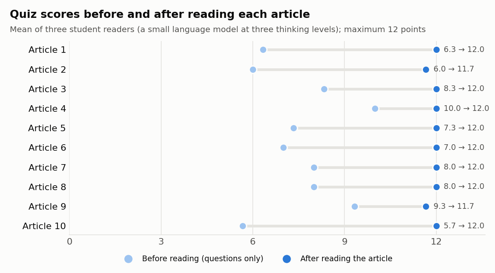
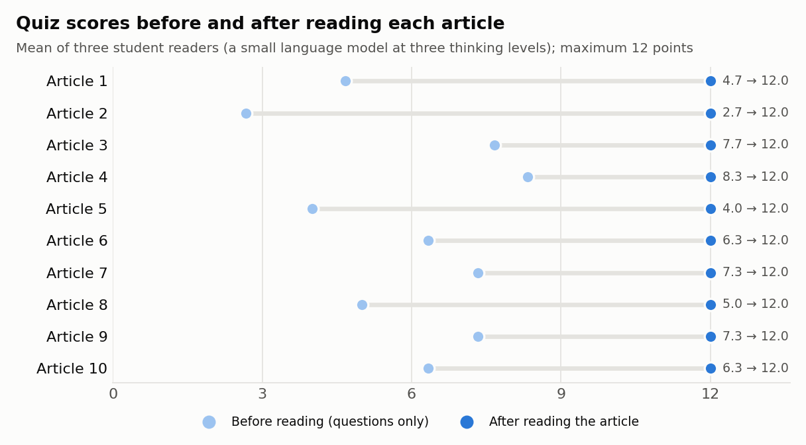

# The Reader Study

The articles of this issue were tested on readers before publication, and the tests changed both their order and their content. This appendix describes how the tests were run, what they found and what they cannot show. The readers were not people. They were instances of a small language model run as coding agents, and the appendix is explicit about what that does and does not allow one to conclude.

## Who the readers were

Each reader was one session of the `pi` coding agent running the model `deepseek-4.1-flash`, started in an empty directory that contained only the materials for one task. A reader could read, write and edit files in that directory and had no other tools and no web access. Three readers were used throughout, differing in how much the model was allowed to reason before answering. In all, the study ran 123 sessions: 3 in round 0 and 60 in each of rounds 1 and 2.

| Reader | Requested reasoning level | Level recorded by the session |
| --- | --- | --- |
| s1 | minimal | low |
| s2 | medium | medium |
| s3 | high | high |

A reader has no memory between sessions. Every session started from nothing, which makes "the same reader before and after" a statement about the same configuration and not about one individual who learned.

Each session produced a transcript, kept in full, and a work diary written by the reader in the project's diary format, with one step for each thing it did and sections for what worked, what did not, and what was hard. An audit of the transcripts confirmed that no reader opened a file outside its own directory, which matters for the sessions in which a reader was supposed to answer without having seen the article.

## Round 0: what should be taught, and in what order

The starting point was a compressed statement of the issue's argument, about 800 words written for experts. Each reader first answered fourteen general questions, then read the brief and reported every term it could not explain, every claim it could not follow, a clarity score for each section, the questions it would ask the author, the order in which it would want the material taught, and the three places where a worked example would help most.

The three readers agreed closely, and their agreement set the structure of the issue.

| What the readers asked for | What the issue does |
| --- | --- |
| Start with the device, its limits and the vocabulary; nothing else can be judged without them | Article 1 |
| Teach how to read the measurements second, "because without it everything after reads as opinion" | Article 2 |
| Explain whole-program inference with one function and two callers before naming any system | Article 3, section 3.1 |
| Treat declared boundaries as its own lesson | Article 4, section 4.2 |
| Show what the current backend emits for one line, instruction by instruction, before the technique | Article 5, section 5.2 |
| State the threat model before the verifier | Article 7, section 7.1 |
| Show one function with waits as source, as a state machine, and as today's hand-written code | Article 8, sections 8.2 and 8.5 |
| End with a table of effort, risk and what each step unlocks | Article 10, section 10.6 |

The readers also identified claims in the brief that were asserted without support, and each became a table or an argument: that the cost difference between the compilers comes from inference and not from JavaScript (Article 3, section 3.5); that values need to be written to memory "only at calls and joins" (Article 5, section 5.5); that larger native code implies mixed mode (Article 6, section 6.6); and that a checker of jump targets suffices for safety (Article 7, section 7.6).

## Round 1: every article, before and after reading

Each article ends with six questions. For each article, each reader ran two separate sessions. In the first it saw only the questions and answered from what the model already knew. In the second it read the article, answered the same questions, and wrote feedback under fixed headings: passages read twice, terms never explained, claims that could not be verified from the text, a score for each section, questions the text did not allow it to answer, and one thing to add and one to cut. That is 60 sessions and 360 answers.

The answers were graded 0, 1 or 2 against a written key by five further agents running a stronger model, which also checked every reported error against the article and condensed the feedback into a list of confirmed defects per article.

| Article | Mean score before reading (of 12) | Mean score after reading (of 12) |
| ---: | ---: | ---: |
| 1 | 6.3 | 12.0 |
| 2 | 6.0 | 11.7 |
| 3 | 8.3 | 12.0 |
| 4 | 10.0 | 12.0 |
| 5 | 7.3 | 12.0 |
| 6 | 7.0 | 12.0 |
| 7 | 8.0 | 12.0 |
| 8 | 8.0 | 12.0 |
| 9 | 9.3 | 11.7 |
| 10 | 5.7 | 12.0 |
| All | 7.6 | 11.9 |

Three findings came out of round 1.

**The quiz could not rank the articles.** After reading, 358 of 360 possible points were scored.

 An open-book quiz answered by a reader that can search the text measures whether the answer is in the text, and it was. The scores before reading were more informative: 24 of the 60 questions were answered correctly by readers that had not seen the article, either from general knowledge or because the question stated its own premise.

**The feedback found real defects.** The graders confirmed 68 errors, inconsistencies or ambiguities. A selection:

| Article | Defect found | Correction |
| ---: | --- | --- |
| 1 | "Three orders of magnitude" between the compilers, where the only whole-application comparison shows two | The claim now distinguishes whole applications from partly typed ones |
| 2 | A cost of 118 microseconds per token was attributed to the tokenizer; it is the whole compile divided by the token count | Both figures are now given, 118 and 31 microseconds, with what each measures |
| 2 | A compositor trace was summarized as 84 + 146 = 235 ms | The omitted 5 ms term is stated, and the two traces are distinguished |
| 3 | `(max + 2) - max` was said to be 1 in JavaScript without giving `max` | `max` is stated to be 2⁵³ − 1 and the rounding is explained |
| 5 | "The complete function is 41 instructions" could not be counted from the 15 shown | A tally by part is given, and the full condition sequence is shown |
| 5 | A peephole pass was credited with half of a 34 percent figure without a reason | The reason is given: the figure counts both instructions of each pair, and only one can be removed |
| 6 | A power-loss argument depended on an unstated fact | The article now says that a new module is written to the inactive slot |
| 7 | The fuel rule claimed to bound instructions exactly | It is now stated as an upper bound, with the rule for branches and calls |
| 8 | The state-machine outline used a variable that was out of scope | The outline is split into `start` and `resume` |
| 8 | "One frame per function suffices" was contradicted two paragraphs later | Storage is now assigned per task, with the reasoning |
| 10 | "Five to six times longer" where the second example is 4.4 times | Corrected to four to six |

**Readers of single articles reported borrowed terms as undefined.** Each session saw one article, so a term defined in Article 1 was reported as missing in Article 7. Two changes followed. Every article now restates, in its opening paragraph, the terms it borrows. And in round 2 the readers were also given the glossary.

After round 1 all ten articles were revised, and 30 of the 60 questions were replaced or reworded so that they need the article.

## Round 2: the revised articles

The second round repeated the first with fresh sessions on the revised articles, the revised questions, and one change of conditions: readers in the after-reading condition were also given the glossary.

| Article | Round 1: before | Round 1: after | Round 2: before | Round 2: after |
| ---: | ---: | ---: | ---: | ---: |
| 1 | 6.3 | 12.0 | 4.7 | 12.0 |
| 2 | 6.0 | 11.7 | 2.7 | 12.0 |
| 3 | 8.3 | 12.0 | 7.7 | 12.0 |
| 4 | 10.0 | 12.0 | 8.3 | 12.0 |
| 5 | 7.3 | 12.0 | 4.0 | 12.0 |
| 6 | 7.0 | 12.0 | 6.3 | 12.0 |
| 7 | 8.0 | 12.0 | 7.3 | 12.0 |
| 8 | 8.0 | 12.0 | 5.0 | 12.0 |
| 9 | 9.3 | 11.7 | 7.3 | 12.0 |
| 10 | 5.7 | 12.0 | 6.3 | 12.0 |
| All | 7.6 | 11.9 | 6.0 | 12.0 |

Three things changed between the rounds.

**The questions depend more on the articles.** The mean score before reading fell from 7.6 to 6.0 of 12, and the number of questions answered correctly without the article fell from 24 to 11. The fall is largest where the most questions were replaced: Article 2 went from 6.0 to 2.7 and Article 5 from 7.3 to 4.0. After reading, every answer in round 2 received full marks, 360 points of 360. The quiz remains at its ceiling and still cannot rank the articles; what it can now show is that most of its questions cannot be answered without them.

**Fewer defects were found, and they were smaller.** The graders confirmed 42 items in round 2 against 68 in round 1. Most were loose ends of the first revision: a subtraction given as 1.2 s in one section and 1.15 s in the next; a model result that depended on a rule the text had not stated; "about four" instructions followed by a list of three. A few were real errors of substance that the first round had not reached, among them these.

| Article | Defect found in round 2 | Correction |
| ---: | --- | --- |
| 2 | The share of a key press spent in application code was given as "under 5 percent", which holds for native code only; the article's own figure for WebAssembly gives 20 percent | Both figures are now given |
| 3 | 2⁵³ − 1 was called the largest exactly representable integer; 2⁵³ is itself exact | The value is now described as the largest safe integer |
| 3 | Two percentages describing the same build were used as if independent | The text now says they overlap, and that the division of the remaining time was not measured |
| 5 | Nothing said that a pending read of a local must be resolved before that local is assigned | The case is now stated |
| 7 | The verifier's branch check allowed a jump past a bounds check | Check sequences are treated as units, and branch targets are confined to the enclosing function |
| 8 | The example program held a buffer reference across a wait, breaking the rule the article states | The reference is now obtained inside the loop |
| 9 | The rule "any call discards the fact" discarded it at the very access it protects | Built-in operations are distinguished from function calls |

All of these were corrected in the published text. The articles as published were not read by a further round of readers.

**Borrowed terms stopped being reported.** With the glossary available and each article restating the terms it borrows, the reports of undefined terms shrank to a handful per article, mostly names of processor instructions and of general notions such as JSON.

One session in round 2 tried to list its parent directory. The attempt returned an error and the session saw nothing outside its own directory; the audit records it.

## What the study does and does not show

The study shows that the method finds defects. Weak readers asked to quote what they could not follow, combined with a stronger checker that verifies each complaint against the text, located arithmetic slips, undefined terms, unsupported claims and questions that did not test the article. Most of these would have survived an author's own rereading, because the author knows what was meant.

The study does not show that the articles teach people. The readers are language models. Before reading, they already answered many general questions about compilers correctly, which no beginner would. After reading, they answered questions with the text open in front of them. A model that reports confusion is producing a plausible report of confusion, and the appropriate use of such a report is as a pointer to a passage that a human editor then judges.

Four further limits should be stated. There were three readers, all instances of one model. The grading was done by language-model agents against a written key and was spot-checked, not repeated. The readers saw figures only as file names, so nothing was learned about the figures. And the corrections made after round 2 were not themselves tested.

## Where the records are

All materials are kept with the issue in the project repository, under the ticket `PICOCALC-COMPILER-ISSUE`.

| Path | Contents |
| --- | --- |
| `sources/students/round0/`, `round1/`, `round2/` | One directory per session with the materials given, the reader's `answers.md`, `feedback.md` and `diary.md`, the raw session transcript (`session/*.jsonl`) and a readable `transcript.md` |
| `sources/students/roundN/audit.md` | Per session: reasoning level, turns, tool calls, tokens, and whether any file outside the session's directory was read |
| `sources/students/roundN/grades/` and `grades-summary.md` | Every graded answer with a one-line reason, and the summary tables |
| `sources/students/roundN/synthesis/` | The confirmed defects and merged feedback for each article |
| `sources/quizzes/` | The answer keys and the instructions given to the graders |
| `sources/issue-round1/`, `sources/issue-round2/` | The article texts exactly as the readers of each round saw them |
| `scripts/run_students.py`, `run_round.py`, `render_sessions.py`, `summarize_grades.py` | The programs that ran the sessions and produced the tables |
