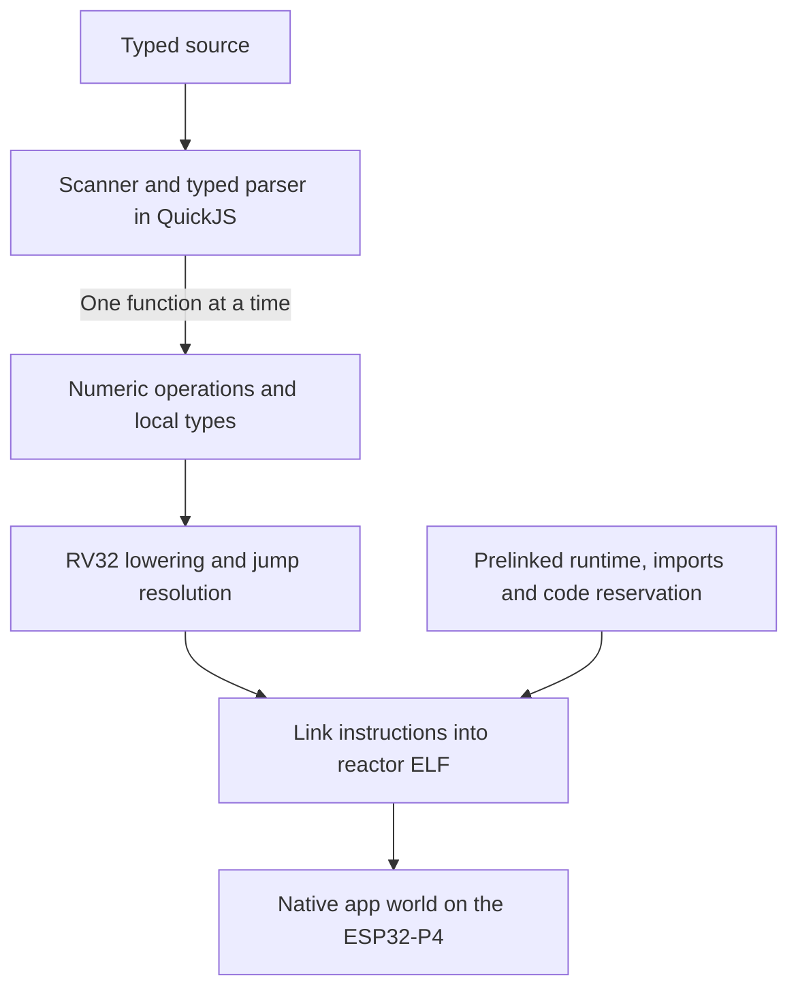
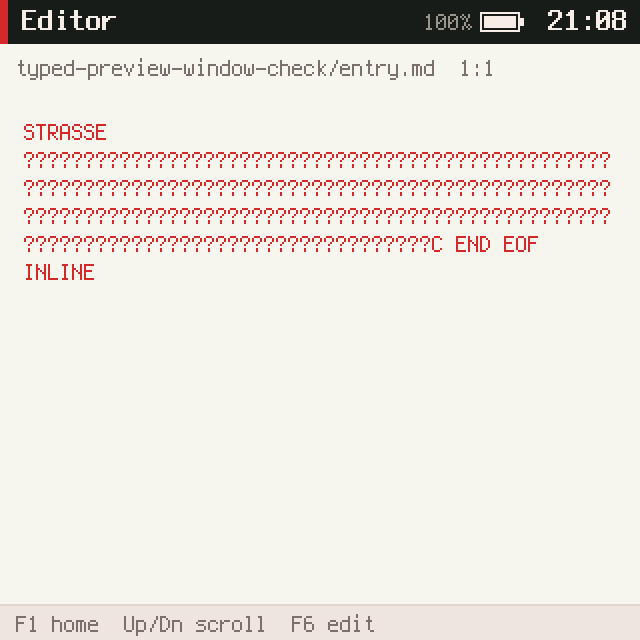
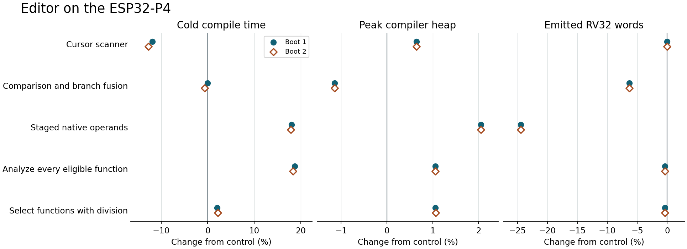

# Which compiler work pays for itself on a handheld?

An edit to one character in Files and a cold launch of Editor both end in an executable RISC-V program. They present different problems for the compiler. At cold launch it has a source bundle and a prelinked runtime. After an edit it can also have the previous source, machine instructions and information about their dependencies. On the ESP32-P4 a third quantity matters after compilation finishes: the memory that remains committed to the running application. A change worth roughly three tenths of a second during compilation and a change worth 144 KiB throughout the application's lifetime call for different experiments.

This lab studied four questions on the same typed compiler. How expensive is recognizing tokens? Where should temporary operands live during native compilation? Which functions deserve an extra proof pass? What evidence lets an editing session reuse the machine code of a function? Each researcher committed a design before implementing the candidate. An independent examiner then constructed cases outside those designs. The reference revision was `40bcf850a5809ef6d839127869faa952596ed157` in the `2026-10-20--ds-js-os` repository.

## Trace a source file into a running application

Start with `picocalc-os/worlds/files/files.typed`. Its functions declare ordinary typed parameters and return values. A call to `filesName` accepts or rejects characters in a filename. In Agenda, separate typed functions operate on dates. In Editor, functions inspect state, laid-out records and text. All three programs compile on the handheld. QuickJS executes the compiler, which is itself written in JavaScript. The resulting application executes native RV32 instructions. This distinction identifies which clock to start when someone says a change made the program faster.

The C entry point `p4_typed_compile` creates a QuickJS runtime with allocator callbacks, loads the compiler scripts, calls the application linker with the source and a reactor, copies out the linked bytes, and destroys the runtime. A *reactor* here is a prelinked executable containing a runtime, imports and space for the typed application's instructions. The native loader uses the completed ELF's loadable segments to create a world, the OS's unit for executing an application. A large reserved code section can make the world expensive even when many of its bytes contain padding. [Compiler entry and allocator](../../../../../../picocalc-os/port/esp32p4/main/typed_p4.c) · [Editor compile wrapper](../../../../../../picocalc-os/port/esp32p4/main/editor_p4.c)



In `typed-wasm.js`, `compileFunctions` parses each function, verifies its operations and can pass that function to a callback. In the streaming native path `typed-rv32.js` consumes its operations at that point. The next function can be parsed after the previous operation sequence is released. The compiler therefore needs whole-module information about declarations and output layout, plus temporary information for the current function. The structure of that boundary determines what a new optimization costs. [Typed frontend](../../../../../../picocalc-os/compiler/typed-wasm.js) · [Native generator](../../../../../../picocalc-os/compiler/typed-rv32.js) · [World linker](../../../../../../picocalc-os/compiler/typed-world.js)

Four units answer four different user questions.

| Quantity | Measurement boundary | Question it answers |
| --- | --- | --- |
| Cold build time and peak compiler heap | Fresh runtime, normal application compile wrapper, linked bytes copied out, runtime destroyed | How long must I wait and how much allocator space must be available? |
| Instruction payload, linked file size and resident world footprint | Generated RV32 words, then complete ELF, then loaded native world | Which resource gets smaller when I improve instruction selection? |
| Guest cycles per call | Repeated calls to a particular compiled function on the physical processor | Does this operation execute faster once the program is loaded? |
| Edit-to-run | An existing session receives a changed source snapshot, rebuilds the image, and executes an edited native entry | What does the developer wait for after making a real edit? |

## Measure the original compiler before interpreting a difference

For a clean comparison we staged compiler variants in a common firmware and generated their expected complete ELFs separately on the host. Each measured compile used a fresh QuickJS runtime. The test checked the compiler sources embedded in the firmware, the returned size and the digest of the complete module. A valid digest established which program had been produced. A separate guest check established behavior for exercised inputs.

The supervisor rotated variant order within a boot and repeated the experiment after rebooting. For each app and variant we compared its time with the control in the same block. We report median paired changes for each boot. The median of paired differences can differ from the difference between two reported medians. A two-boot range describes these observed boots on one board. It supplies no population confidence interval for other devices. [Physical protocol](../scripts/04-board.py) · [Paired estimator](../scripts/05-summarize.py)

An A/A experiment gave identical compiler bytes two labels. Files cold time differed by 2.17%, Agenda by 0.85% and Editor by 0.09% on that boot. Compiling an identical program can change measured latency because the machine is running other work. This explains why a few milliseconds for Files deserves caution. The null comparison also tested the instrumentation itself. Each physical batch called the same native function 128 times and returned a checksum or checked result. Those cycle counts measure a particular input family for the function. End-to-end time for navigating a large Editor document includes additional work. [Identical-control evidence](../various/identical-control-summary.json)

## A faster scanner and the cost of retaining its implementation

The original lexer recognizes a token with a JavaScript regular expression and named captures. It also creates an object through which the parser reads fields such as the token kind and spelling. The candidate advances a cursor through the common character classes and reuses a token record. An unmatched scan falls back to the original expression. The fallback mattered. A slash beginning a comment can lead the original expression to backtrack, and the position reported for a later invalid token forms part of the observable compiler behavior. Passing the three apps alone would have missed that issue.

The researcher's differential tests compared 71,814 lexical cases and 535 compiler cases. The examiner added 69,632 token traces that included every UTF-16 code unit between identifiers. For the supported cases, both candidates generated identical app ELFs and the independent traces agreed. The physical tests used clean compiles for the headline result. A second, separately instrumented build recorded 16,793 scanner visits and 120 lowering callbacks per Editor compile. The extra callbacks added 139–171 ms, depending on variant and boot. The instrumented run localizes work and the clean run measures the saving.

Editor saved 290 and 298 ms in the original trial. In separately staged firmware the saving was **292 and 315 ms**, or **11.92% and 12.77%**, and peak compiler allocation grew by 9,066 and 9,070 bytes. The latter amounts to roughly 0.64% of the reference peak. Agenda saved around 59 ms in the independent run. Files lay much closer to the negative control. Token handling had a larger observed phase change than character matching. A causal estimate for each individual optimization would require separately turning token reuse on and off on the board. The experiment did establish the cost of their combination. [Scanner report](../../PICOCALC-FRONTEND-COLD--measure-cold-typed-compiler-frontend-costs-and-compare-a-cursor-lexer-on-picocalc/analysis/01-where-cold-typed-compilation-time-goes-on-picocalc.md) · [Independent measurements](../various/scanner-independent-summary.json)

## Let the compiler remember where an operand already lives

A machine instruction such as RV32 `add` takes operands from registers. The typed frontend describes an expression with operations on a temporary operand stack. Consider computing `x + 1`. One lowering can materialize each intermediate value in a stack location and later reload it. A staged lowering keeps a compiler description of the pending value, such as a constant, a local or a register. It emits machine instructions when a consuming operation needs a physical value. At calls and control-flow joins it must ensure that the next block sees the agreed locations. A mistake at these boundaries can preserve arithmetic tests while breaking recursion, spills or a join reached from a different predecessor.

For Files the reference generated 804 words. The calibrated candidate generated 593. The researcher next recorded a prediction of 2,789 words for Agenda, then measured 2,793. Four words separate the observed total and the forecast, or 0.143%. The examiner found 25 of 34 functions exactly predicted. Errors of opposite signs cancelled in the total, and the sum of absolute function errors was ten words. See the prediction commit `a131f1a` for the exact inputs used before running Agenda.

Editor fell from 21,886 to 16,541 words, a **24.42%** reduction. On the physical board this compiler took **444–445 ms longer** to compile Editor and used about **28.94 kB more** peak compiler heap. Two pure guest functions nevertheless executed roughly **25–26% fewer cycles** per call. Across six whole workflows the instruction-count reduction in the emulator ranged from 0.21% for the Files startup/sort/mkdir sequence to 19.71% for late-document Editor navigation. The first property belongs to the compiler running in QuickJS, the second to two generated programs running on the chip, the third to complete workloads in an emulator. [Per-function model and workflow results](../../PICOCALC-STAGED-RV32--a-staged-operand-stack-for-picocalc-rv32-compilation/analysis/02-how-a-staged-operand-stack-made-room-for-picocalc-editor.md) · [Native board measurements](../various/native-summary.json)

The reservation experiment makes the code-size result consequential. An 80 KiB slot holds 81,920 bytes, of which 140 are metadata, entry stubs and import trampolines. Branch fusion alone generated 82,028 instruction bytes, exceeding the usable capacity by 248. The staged lowerer used 66,164 instruction bytes and left 15,616 bytes free. Relinking an actual reactor with that slot reduced the entire Editor ELF from **240,452 to 92,996 bytes**, a **61.33%** reduction. Shrinking the instructions in the original reservation had left its padded file size constant. A smaller reactor commits the released space to the whole system.

On three ordinary boots the smaller-reservation Editor reported **566.1 KiB** of live world memory. The digest was taken from the same 92,996-byte buffer returned to the loader. Through the actual Files and Editor interfaces, the test created a 65,536-byte UTF-8 Markdown document, opened its preview, paged down, and checked two CRC-verified screen captures. Every pixel outside the status clock matched the qualified reference screen. The test removed its temporary directory afterward. This checks the full ordinary path for this workload. [Normal-boot and screen receipts](../various/slot80-physical.json)

In a second normal firmware the same staged compiler, application, loader and SDK configuration used the original 224 KiB reservation. Its three boots all measured **710.1 KiB** resident. The smaller reservation therefore freed **144 KiB**, or **20.28%** of the measured running world, at the same 768 KiB limit. Compiler peak also fell from 1,439,808 to 1,284,204 bytes when the smaller reactor moved through QuickJS, a reduction of **155,604 bytes (10.81%)**. Both normal-boot groups executed on one board in successive firmware windows. Use the rotated multi-arm study for claims about the instruction selector’s cold time. The older as-found factory firmware supplied the restoration check. [Matched standard-reservation receipt](../various/staged-standard-world.json) · [Independent identification of installed and trial compilers](../../PICOCALC-LAB-REVIEW--independent-examination-of-the-picocalc-compiler-lab/various/firmware.json)



## Spend analysis work only where a proof could help

Signed integer division illustrates the work a proof can save. In this language a zero divisor traps. Signed division of the minimum 32-bit integer by −1 also traps. The RV32 division instruction has defined results for both cases, so the baseline compiler emits explicit tests to implement the language rules. In `date / 10000`, both exceptional cases are impossible. A proof allows the lowerer to omit the conditional tests and leave the division intact. An unknown divisor still needs the original guards. These are arithmetic guards. The experiment supplies no new proof for a text access.

Part of the science here was specifying the information available *before* deciding whether to analyze a function. The experiment compared a control with no extra proof, an Always policy that analyzes every eligible body within the per-function cap, and a Select policy that records whether the parser saw a relevant arithmetic operation and allocates a module-wide work budget. The proof recognizes eligible literals and certain locals assigned exactly once. Eligible functions are processed in source order. Each function's analysis state is discarded on completion, preserving the streaming architecture. [Arithmetic proof and admission design](../../PICOCALC-BOUNDED-FACTS--budget-per-function-facts-in-the-picocalc-streaming-compiler/design-doc/01-when-a-streaming-compiler-should-remember-a-divisor.md)

```text
for each function in declaration order:
    parse and type-check the function, recording relevant arithmetic
    if the function qualifies and the two scans fit the remaining budget:
        count assignments and identify valid fixed divisors
        use each proved fact at its particular operation
    emit all guards whose safety conditions still require a runtime test
    release the facts
```

Editor was withheld while the rule was set on Files and Agenda. Select admitted seven of Editor's 120 functions. Always admitted 118. Both produced the same complete ELF, with 83 fewer words than the control. The number of operation cells charged to the two scans fell from 60,740 to 4,278, a **92.96% reduction in counted proof work**. That is a deterministic count in the algorithm. Its effect on the physical clock is a separate result. Select took 398–403 ms less than Always but **50–54 ms more** than the original Editor compiler, with roughly 15 kB additional peak allocation. Agenda's weekday kernel ran about 11.7% fewer cycles with Select. Files had no eliminated words. [Held-out results and proof accounting](../../PICOCALC-BOUNDED-FACTS--budget-per-function-facts-in-the-picocalc-streaming-compiler/analysis/01-when-does-a-handheld-compiler-need-more-facts.md) · [Physical comparison](../various/bounded-summary.json)

A separate normal-world firmware then returned the exact held-out Select ELF to the loader. The on-board digest was `06a85ff6…`, the app reported 710.1 KiB resident, and both frames of the 65,536-byte document preview agreed with the reference outside the status clock. The test also checked cleanup and restored the prior firmware. This establishes observed physical behavior for the selected policy beyond its arithmetic fixtures. [Selected Editor live receipt](../various/select-world.json)

The examiner supplied the boundary case that the three apps had left open. Construct 37 functions of equal size. Give 36 of them divisions whose divisor comes from an argument. Give one function 80 divisions by the literal 3. Place that function first and then last. Both runs qualify the same number of cells for analysis and charge 31,752 visits. Select saves **720 words** in the first order and **zero** in the second. Always saves 720 in both. This is a counterexample to the proposition that the cheap predicate predicts profit under a binding budget. A literal-aware admission rule, evaluated on new held-out programs in several declaration orders, would test a stronger proposition. Given that the application corpus obtained its savings from literals, a direct lowering rule for literal divisors also deserves an independent control. [Examiner's order experiment](../../PICOCALC-LAB-REVIEW--independent-examination-of-the-picocalc-compiler-lab/various/policy.json)

## Recompile a changed function and still resolve every affected call

Suppose a developer changes `filesAlnum` to accept underscore. The return type and parameter count stay the same, and `filesName` still calls the same function. That makes the caller a reuse candidate. However, adding instructions to the first function can move the second function. A RISC-V call instruction carries a displacement measured from its current instruction address to its target. Copying the final call word from the previous ELF could produce a jump to the wrong place.

The prototype saves a compact machine-code fragment for each function, its exact source span, the declarations and record layouts consulted while compiling it, and a list of symbolic calls. A symbolic call names its target and reserves a place for the assembler to write a displacement. On an edit the compiler can skip scanning an unchanged body if its span and dependencies agree. The assembler then lays out the selected fragments and writes every required call displacement. Finally the normal application linker validates the exported ABI and writes the complete ELF. If an input is invalid, the last successful revision remains available for the next edit. [Implementation and invalidation guide](../../PICOCALC-FUNCTION-REBUILD--rebuild-changed-typed-native-functions-on-picocalc/design-doc/01-compile-one-edited-function-and-rebuild-its-native-links.md) · [Session and fragment representation](../../PICOCALC-FUNCTION-REBUILD--rebuild-changed-typed-native-functions-on-picocalc/scripts/02-incremental.js)

```text
begin from the last successful source revision
for each declaration in the newly supplied snapshot:
    parse its header and record its current binding
    if the old body, callable signatures and observed layouts still agree:
        reuse the fragment
    otherwise:
        type-check, lower and record a fresh fragment
assign addresses to all fragments and resolve calls by name
validate the app ABI, link the ELF and publish the new revision together
```

On the host an independent examiner edited the full 120-function Editor and compared every accepted 240,452-byte ELF with a separately evaluated clean compiler. One body edit rebuilt one function and reused 119. Repairing a signature and its callers rebuilt four, yet 42 linked bodies changed. Moving functions changed the encoded offsets in calls even where the source and cached fragments were reusable. Swapping two fields in the `WorldState` record rebuilt 77 functions. Seventy of those yielded identical linked instructions, since a dependency on an entire record layout invalidates more than a dependency on an individual field. A rejected change to the shared `WorldEvent` ABI left the previous revision usable. Adding a comment that shifted source offsets then reused all 120 bodies. Those cases illustrate both a correctness requirement and a concrete opportunity to narrow invalidation. [Independent edit sequence](../../PICOCALC-LAB-REVIEW--independent-examination-of-the-picocalc-compiler-lab/various/rebuild.json)

## Compare the machine before and after each change

Every percentage below uses the concurrent control for that design and boot. The displayed control row provides the absolute scale from the independent scanner experiment. Compiler peak is the high-water mark of the QuickJS allocator. Code bytes count four bytes per emitted RV32 word. Each Files guest call compares long names. The Agenda guest statistic times weekday evaluation over a rotating set of eight dates. Cycles are converted to microseconds using the recorded 360 MHz clock. These microbenchmarks did not call a dedicated Editor kernel. [Complete paired rows and denominators](../various/cross-study.json)

| App | Compiler | Cold ms, boots 1 / 2 | Cold change, % | Peak KiB, boot 1 | Code bytes | Guest µs/call, boot 1 |
| --- | --- | ---: | ---: | ---: | ---: | ---: |
| Files | Control (scanner trial) | 235.9 / 236.8 | reference | 354.1 | 3,216 | 18.121 |
| Files | Cursor | 232.5 / 231.7 | -1.3 / -2.3 | 367.0 | 3,216 | 18.120 |
| Files | Fusion | 239.2 / 238.9 | +0.4 / +0.8 | 364.0 | 2,952 | 15.591 |
| Files | Staged | 277.9 / 275.6 | +17.1 / +16.6 | 383.5 | 2,372 | 13.552 |
| Files | Always | 270.4 / 269.4 | +14.3 / +14.1 | 371.1 | 3,216 | 18.118 |
| Files | Select | 250.1 / 248.1 | +5.5 / +5.2 | 371.1 | 3,216 | 18.118 |
| Agenda | Control (scanner trial) | 661.2 / 665.3 | reference | 565.4 | 16,232 | 2.009 |
| Agenda | Cursor | 601.7 / 602.9 | -8.8 / -8.9 | 578.2 | 16,232 | 2.024 |
| Agenda | Fusion | 666.1 / 659.2 | +0.6 / -0.1 | 570.4 | 15,136 | 1.891 |
| Agenda | Staged | 776.2 / 771.1 | +16.9 / +16.9 | 590.6 | 11,172 | 1.497 |
| Agenda | Always | 774.7 / 774.0 | +16.5 / +16.7 | 577.9 | 15,592 | 1.777 |
| Agenda | Select | 721.5 / 715.2 | +8.5 / +7.7 | 577.9 | 15,592 | 1.777 |
| Editor | Control (scanner trial) | 2455.5 / 2469.7 | reference | 1,377.8 | 87,544 | — |
| Editor | Cursor | 2163.9 / 2151.4 | -11.9 / -12.8 | 1,386.6 | 87,544 | — |
| Editor | Fusion | 2464.5 / 2465.0 | -0.0 / -0.6 | 1,362.0 | 82,028 | — |
| Editor | Staged | 2918.5 / 2925.1 | +18.0 / +17.9 | 1,406.1 | 66,164 | — |
| Editor | Always | 2925.1 / 2907.4 | +18.7 / +18.3 | 1,392.4 | 87,212 | — |
| Editor | Select | 2515.9 / 2508.7 | +2.0 / +2.2 | 1,392.4 | 87,212 | — |



The figure uses a separate horizontal scale for each physical quantity. Circles and diamonds represent two boots of the same chip. Moving left means a shorter compile, a smaller compiler heap or fewer words, depending on the column. The bound-analysis policies generated identical bytes yet differ substantially in cold time. The scanner generated the same executable as the control in much less time. Together these observations rule out using machine-code length as a proxy for compiler performance on the P4.

## How these results relate to compiler research

The Liftoff implementation describes a single-pass compiler that keeps a representation of operand locations while lowering WebAssembly. Titzer compares baseline compilers using compilation speed and generated-code performance as separate axes. Those are direct precedents for staging operands. The handheld contributes an additional measurable constraint. Generated-code size can cross a reservation threshold and change an application's resident footprint. Our results measure that threshold in this particular runtime and processor. [V8's Liftoff design](https://v8.dev/blog/liftoff) · [Titzer's empirical study](https://arxiv.org/abs/2305.13241)

Xu and Kjolstad construct a library of precompiled instruction sequences with values filled in during compilation. Their copy-and-patch results suggest a testable alternative to spending QuickJS time constructing each instruction individually. A future PicoCalc experiment would need to report the flash consumed by the instruction sequences, supported relocation forms, emitted bytes, and the end-to-end clock through the same app wrappers. The published benchmarks used different workloads and hardware. [Xu and Kjolstad, *Copy-and-Patch Compilation*](https://arxiv.org/abs/2011.13127)

The Rust compiler tracks dependencies between queries and uses those recorded inputs to determine when results can be reused. A PicoCalc function fragment uses a smaller unit and an intentionally conservative dependency record. The full Editor field-swap example gives a count of the conservatism: 70 computations produced byte-identical output after rebuilding. Tracking dependencies at field granularity would reduce some of that work and would add metadata to each cached fragment. Comparing both quantities is a research question the current prototype can support. [Rust compiler incremental compilation guide](https://rustc-dev-guide.rust-lang.org/queries/incremental-compilation-in-detail.html)

## What the lab would fund next

The joint cold-build goal required at least half a second less time for a clean Editor compile and no additional peak compiler heap. No measured candidate met both conditions. The cursor scanner gives the best direct lead for this goal. Its clean saving repeated across four boot medians, while the heap increase also repeated. Separate scanning code from token-record reuse in a two-by-two experiment and measure where the live objects at the peak were allocated. Keep the existing diagnostic differential and clean wrapper as the acceptance tests. If the scanner can meet the heap condition, its independent timing still leaves roughly 185–208 ms to find against the half-second target.

For the running application budget, pursue the staged lowerer and the 80 KiB reservation as a coupled design. The staged version puts a real Editor inside the smaller slot and the CPU executes its two measured kernels faster. It also takes longer to compile the module. A cold-start product decision needs a stated willingness to pay that setup time for memory savings throughout the life of the world. The independent scanner and staged results were measured in separate builds. Combining their percentages would presume an interaction that this experiment did not measure.

For research on bound analysis, retain the reordered 37-function case in the next training protocol and obtain new programs where the module budget binds. Compare a literal-only lowering rule, the frozen selector, and a selector that predicts value per scanned cell. Score total saved words, physical guest cycles and compilation work on the unseen programs. This is an opportunity to test a predictive policy rigorously even when the best outcome is that a simpler decoder performs just as well.

For the edit path, retain the whole-module clean compiler as the reference and keep persistent session memory visible. The full Editor experiment identifies field-level dependencies and relocation as distinct causes of downstream changes. A useful next application test is a series of real Editor edits on the device under a bound on retained fragments. Evicting a fragment should cause a recompile, and accepting a stale one should fail a clean-ELF comparison. A persistent SD cache would introduce another question about I/O and invalidation after firmware updates. The current experiment isolates reuse during a live session.

The independent model forecast also belongs on the lab record. Opus High through Claude Code and GPT‑6.2 Sol High received the same masked data from a previous combined-optimization experiment. Both predicted all six directions correctly. Their mean absolute errors were 1.00 and 1.13 percentage points. The lead reversed when the examiner excluded Editor after scoring. A single retrospective case with one known supervisor result cannot rank models as researchers. Asking each to commit a prediction first gave the lab concrete disagreements it could adjudicate against measurements. [Common prompt and protocol](../various/paired-review/01-protocol.md) · [Original answers and numerical score](../various/paired-review/02-result.md)
