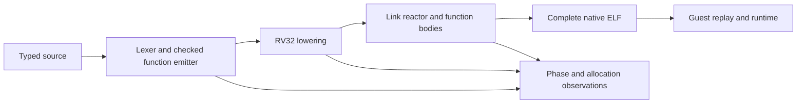

# Experimental design for cold builds and bounded compilation on the ESP32-P4

## Question and physical target

Can the handheld compile Editor at least 500 ms faster without increasing the production compiler's peak heap? Can a bounded policy predict where retaining information about a function will pay on an application withheld from its design? Each question can receive an independent answer. Files and Agenda catch costs that an Editor-only experiment can miss. The current three-app comparison does not establish a population average for arbitrary programs.

A cold build starts a fresh QuickJS runtime, reads bundled source, checks it, emits native instructions and links a complete RISC-V executable into a precompiled reactor. The reactor supplies services to the application. Compilation ends at the production app wrapper's reported interval. Peak compiler heap is the largest number of live usable bytes counted by that runtime's allocator. Memory charged to the running Editor includes its loaded code segment and has a different owner and lifetime.

## Source and evidence contracts

The control is revision `40bcf850a5809ef6d839127869faa952596ed157`. It streams each checked function into the native backend. Retaining one function body is enough to lower it. A scope that changes the machine instructions may alter the executable hash. Two builds using the same compiler implementation, identical source and reactor must produce the same bytes. A scanner-only change should preserve the full artifact across implementations as well as syntax error locations and order.



The normal entry points for the three apps are different. Files reads one bundled source, Agenda joins two sources, and Editor reads a generated source list joined at build time. Use the normal C wrappers when measuring a cold build. A loop that calls a scanner on a string in Node can answer questions about work per token. It cannot be used as a substitute for the physical interval.

## Experiments and independence

| Study | Hypothesis and comparison | Check that can disprove it |
| --- | --- | --- |
| Frontend | Attribute initialization and the work between native callbacks. Compare the measured bottleneck with a clean optimized implementation. | An expensive timing hook can move the bottleneck. Reconcile disjoint intervals, then remove the hooks and repeat. |
| Native instruction selection | Lazy operands and short branches can explain the model for Files and predict Agenda. | Freeze the Agenda prediction before its first run. Compare per-function differences, run deep-stack and long-branch checks, and qualify Editor if the design generalizes. |
| Bounded facts | A policy can choose functions cheaply enough to retain useful facts within fixed resources. | Freeze the held-out workload and the selection rule. Compare always, never and selective policies, including overhead on unchanged code. |
| Incremental | Work after an edit can be proportional to affected functions, even when some interface changes require a wider rebuild. | After body, signature and shared-layout edits compare diagnostics, relocations and the complete output with a clean build. Time the edit and its relink. |
| Supervisor | The leading isolated result should survive rebuilding in an independent measurement and using a subsequent boot. | Change the order of control and candidate, report matched differences per boot, and inspect differences across all three apps. |

The first three researchers own separate designs, scripts and diaries. The fourth study starts when an initial lane finishes. Each author records a prediction, negative results and limits before writing the final report. The supervisor alone schedules the physical port. Prototype changes stay in ticket staging until the evidence supports a production decision.

## Reading a result

For each successful block, save the variant name, source and firmware identity, app, run order, clean wall time, live compiler peak, entire module size and generated word count. Record guest timing separately with its workload. If the code bytes are identical, say so; guest timing still refers to a named workload and measurement. Preserve outliers and failures. Report median paired percent changes within each boot and retain each replicate; a second boot of one device is not an independent device.

```text
for each boot:
    for each balanced block:
        compile every selected variant with fresh runtime per app
        require an ordinary success receipt and expected complete ELF
        record elapsed time, peak bytes, and position
    report median((control - candidate) / control) within this boot
```

A gain of at least 500,000 microseconds with a nonincreasing paired peak is the ambitious Editor target. Smaller gains remain results. The earlier 2.45-second baseline is a planning value; each comparison gets a contemporary control. The initial code-generation model, the memory of an already running app, and edit-to-run latency each use their own units and controls. Independent physical repeats, semantic replay, and host/source receipts are what make these distinctions recoverable.

## Review and publication

Read the project research index in `AGENTS.md`, `picocalc-os/compiler/typed-wasm.js` at `compileFunctions`, `picocalc-os/compiler/typed-rv32.js` at `compile`, and `picocalc-os/port/esp32p4/main/typed_p4.c` for the physical boundary. The previous combined ticket supplies mature app-wrapper, independent executable hash and backup/restore fixtures. Its previous firmware is a reference; capture the current hardware image before changing it. The supervisor's final report will tie each number to its source and each new algorithm to a worked example.
