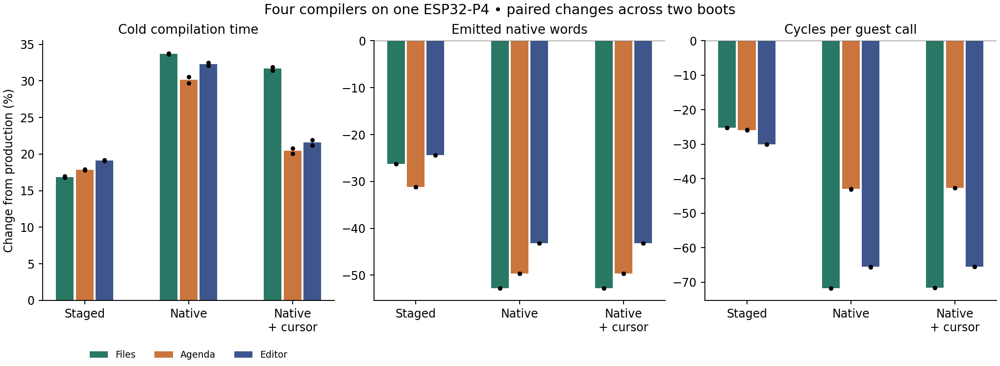

# What a compiler can afford on the PicoCalc

A user edits a command in Files or opens a 64 KiB document in Editor. Both applications have typed JavaScript source. On the ESP32-P4, QuickJS executes the compiler, the compiler emits RV32 instructions, and the kernel loads the resulting module. When a generated instruction appears to be faster, three clocks can tell different stories. The user waiting for a clean compile pays for lexing, type checking, instruction selection and linking. A user editing one function may reuse a session that has already done some of that work. The running application pays for each instruction that executes after the compiler exits.

The fastest clean builds on this board were **about 232 ms for Files and 2.15 s for Editor**, using the cursor scanner and token reuse. In a prepared session a real one-function edit reached native return in **43–44 ms for Files and 487–490 ms for Editor**. A more aggressive backend produced an Editor in **3.00 s**. It cut the native instruction count by **43.14%**, the peak compiler heap by **11.31%**, and the cycles of the measured search routine by **65.5%**, while taking **21–22% longer to compile** than its same-firmware production control. These configurations serve different user actions. The following experiments identify which decisions account for the differences.

## Follow one function from source to the device

Consider the actual Editor helper `editorPreviewSlot(row: i32)`. It returns `(row % 36) * 100`. Editor stores ring-buffer rows at positions computed by this helper. The parser can establish immediately that `row`, the integer constants and the result have type `i32`. A Wasm encoder can put the operands on a stack. A RISC-V processor expects register operands. The backend has to decide where each temporary lives, where a callee expects its arguments, and how to find the same value again after a call. A streaming backend may give up the intermediate operations for each function as soon as it has emitted that function. In the source tree, `compiler/typed-wasm.js` contains the frontend shared by the two targets, `compiler/typed-rv32.js` handles native lowering and linking, and `compiler/typed-world.js` specifies the application's exported entries and imported SDK calls. These paths are relative to `picocalc-os/`.

A module is an ELF that already contains the SDK reactor. The native linker writes instructions into its reserved slot, fixes call targets, and installs jumps in two public entry stubs for a complete typed world. A 240,452-byte Editor ELF can contain less than 90,000 bytes of generated app instructions. A change to the generated text can leave the final file length exactly the same. Our experiments count RV32 words, hash the full ELF, measure the compiler allocator, and run selected guest code separately.


The earlier research candidate tracked where the compiler placed each value on the operand stack. Its native lowerer passed the full set of 24 historical application replays at the start of this wave. The processor executes a regular addition once its inputs are in registers. Materializing both inputs in the function frame between every pair of operations consumes instructions and data accesses. The choice to keep register locations as compiler state is familiar in baseline compiler design. The physical cost depends on the host executing the compiler. Here that host is a handheld executing JavaScript. [V8’s Liftoff implementation](https://v8.dev/blog/liftoff) · [Titzer’s comparison of baseline compilers](https://arxiv.org/abs/2305.13241)

The production path has four useful entry points. The firmware selects the runtime and records elapsed time. The world wrapper supplies the SDK contract for a particular application. The frontend sends each completed function to the selected backend. The native linker knows where the reactor reserved its entry points and generated code.

| Where to read | Contract |
| --- | --- |
| `picocalc-os/port/esp32p4/main/typed_p4.c`, `p4_typed_compile` | Creates a QuickJS runtime with an accounting allocator, loads the compiler and returns module bytes. The log records microseconds, allocator high-water mark and output length. |
| `picocalc-os/compiler/typed-world.js`, `compileTypedWorldRv32(source, reactor, options)` | Selects the native compiler, the world's signatures and its entry points. Its sibling `compileTypedWorld` produces the Wasm module. |
| `picocalc-os/compiler/typed-wasm.js`, `compileFunctions(…, onFunction)` | Parses functions in declaration order and calls the sink with each completed body in streaming mode. |
| `picocalc-os/compiler/typed-rv32.js`, `compile` and `linkSlot` | Lower the frontend's stack operations to machine words, resolve calls and place the program in the reactor's executable slot. |

A correctness check can fail at any of these boundaries. For example, an allocator improvement can preserve an ELF byte for byte but take longer because the parser now does more work. A register change can legitimately alter the entire function while preserving its output. Our physical trial checks each candidate against its own complete host-generated artifact and separately executes named kernels with known results.

```text
for each physical boot:
    for each balanced comparison block:
        for each compiler in the block's rotated order:
            create a fresh compiler runtime
            compile identical typed source against the same reactor
            record elapsed microseconds and peak allocated bytes
            verify the entire ELF against this compiler's reference digest
    run timed batches of native calls with known inputs and expected results
    compare candidates within the same boot and comparison block
```

## The cost of reading the program

The production lexer ran a regular expression on the input and created a fresh token record. The original fast-scanner experiment changed both decisions at once. In this wave the four-way test varied each decision independently. The scanner had to recognize the same identifiers, numbers, string escapes, comments and punctuation. A reused token record also changes its ownership. A parser that needs a token after advancing the scanner must first copy the relevant data. The host differential covered 69,643 lexical cases as well as successful and unsuccessful program compilations through both targets.

Editors are a better test of total scanner cost than Files because their source contains many more tokens. Across the two counterbalanced physical boots in the factorial experiment, cold Editor medians were 2.470 and 2.455 s for production, and 2.158 and 2.157 s for cursor scanning with a reused token. Files medians were 239 and 236 ms versus 233 and 232 ms. Replacing both components helped Editor on both boots. The absolute Files difference was small enough to compare with the earlier A/A run which assigned two labels to the same compiler.

A fifth parser kept source offsets and delayed extracting each lexeme until it needed text. The approach reduced Editor slices from 16,792 to 6,496. Nevertheless its paired Editor cold time increased by 213 ms on each boot against the eager cursor. Extra comparisons and character tests are possible contributors. This trial measures their combined cost with string creation and parser execution. All 300 measured compiles over the two firmware images produced their expected complete ELF.

## Give a Boolean expression a destination

When compiling `if (ready && hasData())`, the consumer needs a choice between continuations. The right-hand expression may call the SDK or trap. A direct branch can skip evaluation when the left operand is false. When compiling `let flag = ready && hasData()`, a later user of `flag` needs a Boolean value. The A6 compiler preserves that distinction. The tests distinguish an incorrect call from a correct result by recording which calls actually execute and in which order. They also put a trap on the short-circuited side. Both Wasm and RV32 must agree. Dybvig, Hieb and Butler distinguish data and control destinations in the original presentation of this technique. [Destination-Driven Code Generation](https://guenchi.github.io/Scheme/doc/Destination-Driven%20Code%20Generation.pdf)

A6 emitted 516, 2,496 and 15,954 instructions for Files, Agenda and Editor. These pass the professor’s 547, 2,611 and 16,210 instruction ceilings. The measurements count *static* instructions in the source corpus used by the experiment. Agenda here measures the typed parser and reminders. Each number belongs to an exact app source and post-link digest.

## Preserve a text read until instruction selection

A source-level operation such as `text.charCodeAt(i)` identifies a receiver, a signed index, a width and the need to check a boundary. Encoding it immediately as a sequence of lower-level operations makes the later backend reconstruct what it used to know. The streamed operation trial marks the high-level operation while one function is being compiled. Its middle arm records the operation and generates the same image as the staged control. Comparing that arm with the control measures the cost of retaining information. Comparing it with direct native consumption identifies what the consumer buys. Host tests validate traps, memory effects and complete app images.

The P4 measured the cost of observation itself. The byte-identical observation arm increased Editor cold time by 6.18% and 6.79% across its two boots and increased peak heap by 0.42%. Direct consumption reduced the overhead to 3.42% and 4.12% relative to staged, reduced peak heap by about 15.7 kB and removed 367 Editor words. A Files comparison of two 91-unit strings that differ in their last unit took 18.86% fewer cycles on both boots. The Agenda weekday kernel did not consume the changed operation on its measured path and stayed close to its baseline. Transporting typed information has a measurable price even when it produces the same native bytes. Its value depends on which backend optimizations and guest computations use it.

A second experiment follows two guards across a small proof graph. In `0 <= i < end <= text.length`, the index is safe for that receiver once all three inequalities hold for the current values. An assignment to `end`, a new text receiver, a join where only one path established the guard, or possible signed overflow can invalidate the proof. In an edited Editor test harness one static check in the preview copying routine accounted for 202 checks on one 64 KiB workload and 3,129 checks on another. The change in dynamic checks depends on the input even when the machine code is fixed. The source and the control must have the same guards for that comparison. Bodík, Gupta and Sarkar established a more general demand-driven approach using sparse constraints. The present experiment retains a much smaller set of facts and has its own measured coverage. [ABCD](https://homes.cs.washington.edu/~bodik/ucb/research/pldi00.html)

The real copy routine processed exactly 65,536 UTF-16 units on the P4. In boot order, the baseline took 42.391 and 42.393 cycles per unit. Bounded reasoning took 38.378 and 38.379. This was a 9.49% and 9.46% paired improvement. The one-guard rule was nearly indistinguishable from ordinary checks on the same source. The whole native Editor preview replay on the host counted the operations actually executed, while this physical microbenchmark timed the affected routine. These two observations support a performance mechanism. A complete on-device frame comprises additional work, so a 9.5% faster copy does not give a 9.5% faster display update.

The proof had a measurable cost even when it produced no better code. On the guarded Editor source, enabling the direct analysis increased cold compile time by 9.03% and 10.05% across the two boots while preserving every output byte. The bounded analysis added 8.08% and 10.10% to cold compilation and 1.11% to peak compiler heap on both boots. Writing an explicit fast and fallback loop also made the source larger. The original, unmodified direct-read Editor occupied 16,174 words. On the guarded source the ordinary and direct compilers occupied 16,214 and the bounded variant occupied 16,210. Four words saved by one compiler rule and 36 extra words relative to the original application answer different engineering questions.

## Spend a limited analysis budget

The selector chooses which functions receive additional analysis. The source-order policy admits eligible functions encountered first until the visit budget is exhausted. The literal policy finds syntactically promising arithmetic. A third candidate ranks estimated profitable checks per unit of analysis work. The study froze these policies before evaluating the reserved applications and permutations. An exact offline knapsack calculation establishes the best savings attainable for a given proof budget when benefits are already known.

A separate examiner workload comprises 72 fixed-point arithmetic functions. Placing precisely the same bodies in three orders changes the source-order savings at a 32,768-visit budget from 407 to 1,386 RV32 words. A fixed shuffle gives 1,232. Both ranked and literal policies recover all 1,386 words on each. The metadata pass itself visits 19,008 cells. If those visits count against a budget of 9,504, neither policy can start proof on this module, while source order still saves 55 to 1,386 words depending on order. A policy that ranks already-known opportunities well can still be too costly to discover them. The budgets and workload constrain how far that result generalizes.

The physical transfer put all three selectors into one test firmware. The real Editor used 4,278 eligible proof visits under a 32,768-visit allowance. Every selector therefore saved the same 83 words, producing 21,803. Source order took 2.522 and 2.541 s on the two boots. The density-ranked version took 3.820 and 3.805 s, adding a median 1.298 and 1.275 s within matched blocks. Roughly 31 KiB more compiler heap bought the same executable. The compiler had performed an extra parse to discover where to spend a budget that was already sufficient.

A constructed program with enough work to exhaust the budget gave the ranking algorithm a choice that mattered. Source order emitted 29,107 words in about 2.96 s. The density ranker emitted 26,749 words in about 4.89 s, saving 2,358 words (8.10%) at an additional 1.93 s of compilation. The literal policy took about as long and emitted 29,449 words. The synthetic result establishes what selection can buy when opportunities differ. The Editor result establishes the cost of using this particular discovery mechanism on a real app.

## Rebuild a real Editor revision

On the host we compiled the actual Editor's 120 functions, changed a body, changed a signature and its callers, then exchanged record field positions. A session stores native instruction fragments together with symbolic calls and dependency fingerprints. After assembling the functions in order, it patches calls using their new byte displacements. This also handles the case where a function keeps its source and its neighbor grows. Fingerprints must cover inputs capable of changing emitted code. Incompletely changing a signature has to give the same error as a clean compile and leave the last valid session intact. Demand and validity are separate design decisions in the incremental-computation literature. [Hammer et al., Adapton](https://matthewhammer.org/adapton/)

At a 40 KiB cap on resident native words, the body edit retained 72 fragments, reused 71 and rebuilt 49. At a 256 KiB cap all 120 fit and it rebuilt one. Both produced exactly the clean ELF of the edited source. Returning from the real Editor preview helper also exercised the altered function. The ring header previously written at UTF-16 index 200 appeared at 198. A separate field-order witness moved the state indices which that helper actually reads. The budget applies to retained word arrays. The compile can temporarily hold other fragments, linker buffers, source and dependency records. Their combined cost appears in the measured heap.

On the P4, the body edit went from 2.288–2.303 s with a warm full build to **487–490 ms** with all function fragments retained. The paired reduction was **78.57–78.78%**. The corresponding signature edit took **576 ms**, nearly 75% faster. Widen the change to a record layout and the improvement fell to roughly 6–8%. At the tighter 40 KiB native-payload cap both layout edits became 1.7–2.5% slower than clean. All 72 edited native executions passed, and the board returned to its original factory image and three native applications. The handoff and return timestamps exclude the cost of initially creating and seeding the editing session.

The independent audit also varied an input that the native-word limit cannot see. Adding 8,192 spaces to a retained body preserved its emitted instructions and its linked image. The 40 KiB cache still contained 40,892 bytes of native words in 72 fragments. The spellings held by these entries grew from 34,431 to 42,623 UTF-16 code units. An API that advertises a byte limit needs to name the data it charges. The runtime's physical peak remains the observable cost to the user. [Independent methods report](../../PICOCALC-LAB2-METHODS--independent-validation-of-eight-picocalc-compiler-studies/analysis/01-what-a-compiler-experiment-on-one-handheld-can-establish.md)

## Choose a register for a long-lived local

A function's operand stack describes the intermediate results of expressions. A local variable can survive across multiple statements or a call. Keeping a frequently read local in a register can eliminate repeated loads from a stack frame. It also introduces an obligation. When the calling convention lets a caller expect a particular register to survive a function call, a callee which uses that register must preserve its incoming contents. Saving and restoring a register adds instructions even when the function runs only once. A compiler can count local reads and writes cheaply. Weighting accesses inside a loop may better predict their dynamic frequency, but the compiler also pays to compute the weights. [RISC-V calling convention](https://riscv-non-isa.github.io/riscv-elf-psabi-doc/)

The A7 study uses the same A6 compiler under both placement policies. Its fixtures include eight incoming arguments, an imported callee that overwrites caller-saved registers and two control paths that can otherwise read a stale local. These cases test the compiler's register choices on events that can change a live value. The study compares the number of native instructions, the cycles taken by real guest functions, and the cold cost of running the register analysis itself.

Across two physical boots the raw-use register policy removed 20.24% of Editor's A6 native words, reduced compiler peak heap by 13.89% and reduced cycles for the measured Editor search routine by 41.29%. The compiler took 6.73% and 6.80% longer to produce that program. The loop-weighted alternative removed 20.10% of the words, took 7.20% and 7.33% longer to compile, and matched the raw-use policy's search time within a few hundredths of a percentage point. A source-level count already captured most of the opportunity on this workload. A register selector that improves a different program's loop still needs a workload that exercises it. The integration compares the raw-use policy with production because it is simpler and showed the same benefit on Editor's measured search.

## Suspend and resume a file read

A file read issued by a world returns a request token. The response arrives on a later kernel turn. The compiler cannot continue running on the old call stack while other work executes. A typed `await` can be implemented by splitting the function into a request-issuing entry and a later entry which resumes after that request. Liveness determines which values a later use might still read. The Editor experiment generated a saved handle and name length, plus an active token. These three integer fields occupy 12 bytes. The event records and output buffers for a new turn are supplied fresh. The compiler rejects a scratch buffer read after the await if that pointer would have needed to survive it. The broader compiler technique is state-machine lowering of asynchronous functions. [Bierman et al., *Pause ’n’ Play*](https://gavinbierman.github.io/assets/pdf/ecoop2012.pdf)

The native program for the hand-written Open control contains 16,812 RV32 words. The comparable generated-await program contains 16,993, an increase of 181 words (1.08%). Both complete ELFs occupy 240,452 bytes. The new program has 74 state fields against 71 in the control, which exceeds the professor's full port target by three. This experiment covers the initial `typedSdkFileRead` suspension. The existing normalization of long input still uses Editor’s established continuation.

In four P4 boot traces the real Files-to-Editor path issued its read, returned control to the kernel, and later resumed through the native Editor entry. The hand-written and compiled versions agreed on successful text, an invalid UTF-8 rejection, ownership after cancellation and the reply and screen after reopening. The fixture sent a cancellation into the loaded Editor handler to control its order. It also delivered an older token while a newer request was pending. A real late filesystem completion after a canceled read left the observed state and screen intact. Token identity is the protection here. Reusing a token while an older request carrying that same value is still in flight needs an additional guarantee from the request allocator.

The two manual builds took 3,060.5 and 3,054.1 ms. The generated versions took 3,145.5 and 3,126.3 ms. This amounts to 72–85 ms more at a cold compile, plus approximately 168 KiB of peak QuickJS heap. Each variant includes its own instrumentation and a source-level lowering pass runs for the await build. These two-boot observations cannot apportion the overhead among lowering, extra source and evaluation. The 12-byte persistent application frame and the extra 168 KiB of temporary compiler heap have different lifetimes and belong to different components.

## How the changes behave in one compiler

The final firmware ran four compilers on the same input sources and the same native reactor per application. Production and the qualified staged compiler identify the two historical reference points. The native arm adds destination-driven conditions, direct checked reads and register homes chosen by local-use counts. The combined arm adds eager cursor scanning with token reuse to that native arm. Every integrated ELF matches the corresponding native-only ELF. Its RISC-V instruction words and guest behavior can therefore serve as controls for a frontend-only change. The separate incremental, bounds, selector and async studies have different inputs or clocks and are reported independently.

| App | Production cold ms | Integrated cold ms | Paired cold change % | Peak QuickJS change KiB | Native words, before → after |
| --- | ---: | ---: | ---: | ---: | ---: |
| Files | 237.6 / 236.4 | 313.0 / 311.3 | 31.9 / 31.4 | 78.7 / 78.7 | 804 → 380 |
| Agenda | 663.4 / 664.9 | 801.3 / 799.9 | 20.8 / 20.0 | 15.0 / 15.0 | 4,058 → 2,044 |
| Editor | 2,471.2 / 2,459.6 | 2,995.1 / 3,002.4 | 21.2 / 21.9 | -155.9 / -155.9 | 21,886 → 12,444 |

Every slash separates the two physical boots. Time changes and heap changes are medians of within-block differences. Native text reductions were 52.74% for Files, 49.63% for Agenda’s parser and reminders, and 43.14% for Editor. The benchmark used equal reactor reservations. The full output ELF lengths consequently remained equal across arms.



| Directly measured operation | Production cycles per call | Integrated cycles per call | Paired cycle change % | Cold change from adding scanner to native arm % |
| --- | ---: | ---: | ---: | ---: |
| Files directory comparison | 6,525.6 / 6,525.3 | 1,852.4 / 1,852.3 | -71.6 / -71.6 | -1.6 / -1.5 |
| Agenda weekday | 725.0 / 725.1 | 416.2 / 417.2 | -42.6 / -42.6 | -7.4 / -7.6 |
| Editor literal search match | 16,077.2 / 16,071.1 | 5,542.4 / 5,543.0 | -65.5 / -65.5 | -8.7 / -7.9 |

Each guest batch executes 128 checked calls. Files compares a particular pair of names. Agenda evaluates weekday over a fixed date sequence. Editor matches a specific search query. The chart describes those kernels. A keypress, a redraw or a whole application turn exercises more work than a single kernel.

A sensitivity calculation gives one interpretation of the additional cold work. Let ΔC be extra microseconds at build time and ΔG be cycles saved per measured guest call at frequency F hertz. If these calls were the only beneficiary, ΔC × F / (1,000,000 × ΔG) calls would repay the extra compilation. Repeated operations, source edit frequency and changes in other functions determine the application's actual break-even.

- Files directory comparison — boot one, 5,847 calls. Boot two, 5,726 calls.
- Agenda weekday — boot one, 161,052 calls. Boot two, 154,994 calls.
- Editor literal search match — boot one, 17,870 calls. Boot two, 18,447 calls.

The combined firmware passed 24 historical host replays. Both hardware boots returned all 192 expected ELF digests in total and completed 384 guest batches, comprising 49,152 timed calls. After writing the original factory image back, Files, Agenda and Editor each started natively with no reported error. The computer running each measured compiler was the ESP32-P4. The host generated the expected artifacts and parsed the measurements. [Two-boot physical receipt](../various/combined-physical.json) · [Per-boot paired summaries](../various/combined-summary.json)

## What to implement for a person using the handheld

For a cold launch, the evidence favors eager cursor scanning and one reusable token. It saved about 0.31 s on Editor across matched blocks, produced identical native modules and diagnostics, and cost roughly 9 KiB at the compiler's peak. The earlier target was to save half a second. The fastest reproducible Editor result is about 2.15 s, leaving another 0.19–0.21 s to find to meet that target against the measured production control. Files already cold-compiles in about 0.232 s, and setup takes a larger share of its interval. The same frontend change saves only a few milliseconds there.

For the edit loop, preserve the editing session and native fragments. A one-function Editor edit ran through native return in under half a second on both boots. The next compiler question is whether an unchanged function really depends on an entire shared record layout. Record which offsets it used and test edits to used and unused fields separately. A correct improvement must emit the exact clean executable and invalidate a function when any offset or field type on which its instructions depend changes. Compiler memory can be traded for this speed. The measured program and the device allocator provide the budget evidence.

For native execution, local register homes deserve a separate decision. The combined backend can shorten frequently executed code substantially. A user who recompiles repeatedly and runs one small command pays a different price from one who opens a large document and searches it for the rest of the session. Measure a complete keypress or search across representative documents before choosing a single production default. The earlier research demonstrated that changing the actual Editor reactor reservation can free 144 KiB at run time. The combined study held the reservation fixed to isolate compiler effects. [Earlier reservation experiment](../../PICOCALC-COMPILER-LAB--measure-cold-compilation-and-test-bounded-compiler-designs-on-the-handheld/analysis/01-which-compiler-work-pays-for-itself-on-a-handheld.md)

For compiler research, learn only facts that can influence a decision. A ranker that discovers opportunities in a second parse spent over a second on an Editor whose budget already admitted every eligible function. Two-hop bounds analysis improved one hot copy while slowing cold compilation by roughly 8–10%. Collecting cheap eligibility facts during the existing streaming pass would remove the second traversal in principle. Its measurement should reserve a new program, charge all discovery work, and verify which checks actually execute. The current experiment establishes the cost of the extra traversal and the potential benefit of a choice. An implementation is needed to determine the cost of collecting equivalent facts in one pass.

## Reading the individual studies

The following reports give each study's implementation, controls, rejected hypotheses and reproduction details. The independent methods report checks the host artifacts, physical accounting and several additional fault cases.

- [What made tokenization faster on the handheld](https://github.com/go-go-golems/go-go-parc/blob/90d7417ca05104400ee749cfb80a687bca14f0ab/Projects/2026/11/19/ARTICLE%20-%20PicoCalc%20Compiler%20-%20What%20Made%20Tokenization%20Faster%20on%20the%20Handheld.md)
- [When a Boolean becomes a branch on the PicoCalc](https://github.com/go-go-golems/go-go-parc/blob/e536819c57702b434c1db208bdc0dce4fa6d0bc3/Projects/2026/11/19/ARTICLE%20-%20PicoCalc%20Compiler%20-%20When%20a%20Boolean%20Becomes%20a%20Branch.md)
- [Preserving checked text reads through native lowering](https://github.com/go-go-golems/go-go-parc/blob/b8a73faf417a7749514292947dd1f75bd749576c/Projects/2026/11/19/ARTICLE%20-%20PicoCalc%20Compiler%20-%20Preserving%20Checked%20Text%20Reads%20Through%20Native%20Lowering.md)
- [What it costs to rebuild the typed Editor after a real edit](https://github.com/go-go-golems/go-go-parc/blob/a2fe6cd9e914be7216b640fd9b83f42359ae96cc/Projects/2026/11/19/PROJECT%20REPORT%20-%20PicoCalc%20Compiler%20-%20What%20It%20Costs%20to%20Rebuild%20the%20Typed%20Editor%20After%20a%20Real%20Edit.md)
- [What register homes save in a PicoCalc function](https://github.com/go-go-golems/go-go-parc/blob/713ee66051eb3ca89d89de4ad63eb068be4b2cef/Projects/2026/11/19/ARTICLE%20-%20PicoCalc%20Compiler%20-%20What%20Register%20Homes%20Save.md)
- [Two guards can prove a text read safe](https://github.com/go-go-golems/go-go-parc/blob/31a17a798bc08af9f3a2a0378c561fab6b0a9cbe/Projects/2026/11/19/ARTICLE%20-%20PicoCalc%20Compiler%20-%20Two%20Guards%20Can%20Prove%20a%20Text%20Read%20Safe.md)
- [Which functions deserve limited compiler analysis?](https://github.com/go-go-golems/go-go-parc/blob/450e9267c5ff7c7e99d3eae96d7048c9888fe411/Projects/2026/11/19/ARTICLE%20-%20PicoCalc%20Compiler%20-%20Which%20Functions%20Deserve%20Limited%20Analysis.md)
- [How PicoCalc Editor resumes a compiled file read](https://github.com/go-go-golems/go-go-parc/blob/49ab18ebf9fd15474649bd3dddc80e1425ca31d3/Projects/2026/11/19/ARTICLE%20-%20PicoCalc%20Compiler%20-%20How%20Editor%20Resumes%20a%20Compiled%20File%20Read.md)
- [What a compiler experiment on one handheld can establish](https://github.com/go-go-golems/go-go-parc/blob/147f625caee4dfb493eb48f694f07f66cdf185c6/Projects/2026/11/19/PROJECT%20REPORT%20-%20PicoCalc%20Compiler%20-%20What%20a%20Compiler%20Experiment%20on%20One%20Handheld%20Can%20Establish.md)

The [subsequent physical selector report](../../PICOCALC-ANALYSIS-SELECTION--predict-analysis-benefit-under-a-fixed-compiler-work-budget/analysis/02-the-cost-of-ranking-compiler-work-on-the-physical-picocalc.md) describes the two-boot cost of building the candidate list and ordering it. The [supervisor diary](../reference/01-supervising-experimentalist-diary.md) records the experiment sequence, failed attempts and artifact identities.
