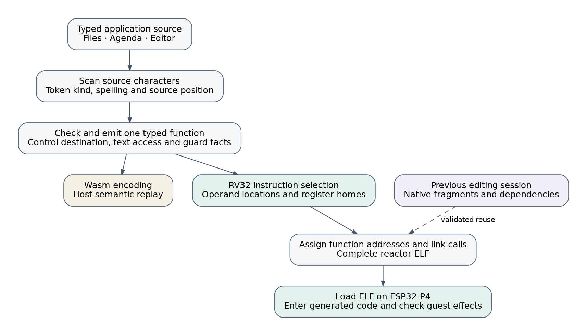

# What a compiler can afford on the PicoCalc

A user edits a command in Files or opens a 64 KiB document in Editor. Both applications have typed JavaScript source. On the ESP32-P4, QuickJS executes the compiler, the compiler emits RV32 instructions, and the kernel loads the resulting module. When a generated instruction appears to be faster, three clocks can tell different stories. The user waiting for a clean compile pays for lexing, type checking, instruction selection and linking. A user editing one function may reuse a session that has already done some of that work. The running application pays for each instruction that executes after the compiler exits.

## Follow one function from source to the device

Consider the actual Editor helper `editorPreviewSlot(row: i32)`. It returns `(row % 36) * 100`. Editor stores ring-buffer rows at positions computed by this helper. The parser can establish immediately that `row`, the integer constants and the result have type `i32`. A Wasm encoder can put the operands on a stack. A RISC-V processor expects register operands. The backend has to decide where each temporary lives, where a callee expects its arguments, and how to find the same value again after a call. A streaming backend may give up the intermediate operations for each function as soon as it has emitted that function. In the source tree, `compiler/typed-wasm.js` contains the frontend shared by the two targets, `compiler/typed-rv32.js` handles native lowering and linking, and `compiler/typed-world.js` specifies the application's exported entries and imported SDK calls. These paths are relative to `picocalc-os/`.

A module is an ELF that already contains the SDK reactor. The native linker writes instructions into its reserved slot, fixes call targets, and installs jumps in two public entry stubs for a complete typed world. A 240,452-byte Editor ELF can contain less than 90,000 bytes of generated app instructions. A change to the generated text can leave the final file length exactly the same. Our experiments count RV32 words, hash the full ELF, measure the compiler allocator, and run selected guest code separately.

The earlier research candidate tracked where the compiler placed each value on the operand stack. Its native lowerer passed the full set of 24 historical application replays at the start of this wave. The processor executes a regular addition once its inputs are in registers. Materializing both inputs in the function frame between every pair of operations consumes instructions and data accesses. The choice to keep register locations as compiler state is familiar in baseline compiler design. The physical cost depends on the host executing the compiler. Here that host is a handheld executing JavaScript. [V8’s Liftoff implementation](https://v8.dev/blog/liftoff) · [Titzer’s comparison of baseline compilers](https://arxiv.org/abs/2305.13241)

## The cost of reading the program

The production lexer ran a regular expression on the input and created a fresh token record. The original fast-scanner experiment changed both decisions at once. In this wave the four-way test varied each decision independently. The scanner had to recognize the same identifiers, numbers, string escapes, comments and punctuation. A reused token record also changes its ownership. A parser that needs a token after advancing the scanner must first copy the relevant data. The host differential covered 69,643 lexical cases as well as successful and unsuccessful program compilations through both targets.

Editors are a better test of total scanner cost than Files because their source contains many more tokens. Across the two counterbalanced physical boots in the factorial experiment, cold Editor medians were 2.470 and 2.455 s for production, and 2.158 and 2.157 s for cursor scanning with a reused token. Files medians were 239 and 236 ms versus 233 and 232 ms. Replacing both components helped Editor on both boots. The absolute Files difference was small enough to compare with the earlier A/A run which assigned two labels to the same compiler.

A fifth parser kept source offsets and delayed extracting each lexeme until it needed text. The approach reduced Editor slices from 16,792 to 6,496. Nevertheless its paired Editor cold time increased by 213 ms on each boot against the eager cursor. Extra comparisons and character tests are possible contributors. This trial measures their combined cost with string creation and parser execution. All 300 measured compiles over the two firmware images produced their expected complete ELF.

## Give a Boolean expression a destination

When compiling `if (ready && hasData())`, the consumer needs a choice between continuations. The right-hand expression may call the SDK or trap. A direct branch can skip evaluation when the left operand is false. When compiling `let flag = ready && hasData()`, a later user of `flag` needs a Boolean value. The A6 compiler preserves that distinction. The tests distinguish an incorrect call from a correct result by recording which calls actually execute and in which order. They also put a trap on the short-circuited side. Both Wasm and RV32 must agree. Dybvig, Hieb and Butler distinguish data and control destinations in the original presentation of this technique. [Destination-Driven Code Generation](https://citeseerx.ist.psu.edu/document?doi=16f189ec98c0a9bd0c672ce14799347fab8b4726&repid=rep1&type=pdf)

A6 emitted 516, 2,496 and 15,954 instructions for Files, Agenda and Editor. These pass the professor’s 547, 2,611 and 16,210 instruction ceilings. The measurements count *static* instructions in the source corpus used by the experiment. Agenda here measures the typed parser and reminders. Each number belongs to an exact app source and post-link digest.

## Preserve a text read until instruction selection

A source-level operation such as `text.charCodeAt(i)` identifies a receiver, a signed index, a width and the need to check a boundary. Encoding it immediately as a sequence of lower-level operations makes the later backend reconstruct what it used to know. The streamed operation trial marks the high-level operation while one function is being compiled. Its middle arm records the operation and generates the same image as the staged control. Comparing that arm with the control measures the cost of retaining information. Comparing it with direct native consumption identifies what the consumer buys. Host tests validate traps, memory effects and complete app images.

A second experiment follows two guards across a small proof graph. In `0 <= i < end <= text.length`, the index is safe for that receiver once all three inequalities hold for the current values. An assignment to `end`, a new text receiver, a join where only one path established the guard, or possible signed overflow can invalidate the proof. In an edited Editor test harness one static check in the preview copying routine accounted for 202 checks on one 64 KiB workload and 3,129 checks on another. The change in dynamic checks depends on the input even when the machine code is fixed. The source and the control must have the same guards for that comparison. Bodík, Gupta and Sarkar established a more general demand-driven approach using sparse constraints. The present experiment retains a much smaller set of facts and has its own measured coverage. [ABCD](https://homes.cs.washington.edu/~bodik/ucb/research/pldi00.html)

## Spend a limited analysis budget

The selector chooses which functions receive additional analysis. The source-order policy admits eligible functions encountered first until the visit budget is exhausted. The literal policy finds syntactically promising arithmetic. A third candidate ranks estimated profitable checks per unit of analysis work. The study froze these policies before evaluating the reserved applications and permutations. An exact offline knapsack calculation establishes the best savings attainable for a given proof budget when benefits are already known.

A separate examiner workload comprises 72 fixed-point arithmetic functions. Placing precisely the same bodies in three orders changes the source-order savings at a 32,768-visit budget from 407 to 1,386 RV32 words. A fixed shuffle gives 1,232. Both ranked and literal policies recover all 1,386 words on each. The metadata pass itself visits 19,008 cells. If those visits count against a budget of 9,504, neither policy can start proof on this module, while source order still saves 55 to 1,386 words depending on order. A policy that ranks already-known opportunities well can still be too costly to discover them. The budgets and workload constrain how far that result generalizes.

## Rebuild a real Editor revision

On the host we compiled the actual Editor's 120 functions, changed a body, changed a signature and its callers, then exchanged record field positions. A session stores native instruction fragments together with symbolic calls and dependency fingerprints. After assembling the functions in order, it patches calls using their new byte displacements. This also handles the case where a function keeps its source and its neighbor grows. Fingerprints must cover inputs capable of changing emitted code. Incompletely changing a signature has to give the same error as a clean compile and leave the last valid session intact. Demand and validity are separate design decisions in the incremental-computation literature. [Hammer et al., Adapton](https://matthewhammer.org/adapton/)

At a 40 KiB cap on resident native words, the body edit retained 72 fragments, reused 71 and rebuilt 49. At a 256 KiB cap all 120 fit and it rebuilt one. Both produced exactly the clean ELF of the edited source. Returning from the real Editor preview helper also exercised the altered function. The ring header previously written at UTF-16 index 200 appeared at 198. A separate field-order witness moved the state indices which that helper actually reads. The budget applies to retained word arrays. The compile can temporarily hold other fragments, linker buffers, source and dependency records. Their combined cost appears in the measured heap.

## Choose a register for a long-lived local

A function's operand stack describes the intermediate results of expressions. A local variable can survive across multiple statements or a call. Keeping a frequently read local in a register can eliminate repeated loads from a stack frame. It also introduces an obligation. When the calling convention lets a caller expect a particular register to survive a function call, a callee which uses that register must preserve its incoming contents. Saving and restoring a register adds instructions even when the function runs only once. A compiler can count local reads and writes cheaply. Weighting accesses inside a loop may better predict their dynamic frequency, but the compiler also pays to compute the weights. [RISC-V calling convention](https://riscv-non-isa.github.io/riscv-elf-psabi-doc/)

The A7 study uses the same A6 compiler under both placement policies. Its fixtures include eight incoming arguments, an imported callee that overwrites caller-saved registers and two control paths that can otherwise read a stale local. These cases test the compiler's register choices on events that can change a live value. The study compares the number of native instructions, the cycles taken by real guest functions, and the cold cost of running the register analysis itself.

## Suspend and resume a file read

A file read issued by a world returns a request token. The response arrives on a later kernel turn. The compiler cannot continue running on the old call stack while other work executes. A typed `await` can be implemented by splitting the function into a request-issuing entry and a later entry which resumes after that request. Liveness determines which values a later use might still read. The Editor experiment generated a saved handle and name length, plus an active token. These three integer fields occupy 12 bytes. The event records and output buffers for a new turn are supplied fresh. The compiler rejects a scratch buffer read after the await if that pointer would have needed to survive it. The broader compiler technique is state-machine lowering of asynchronous functions. [Bierman et al., *Pause ’n’ Play*](https://www.cl.cam.ac.uk/teaching/1213/R204/asynclecture.pdf)

The native program for the hand-written Open control contains 16,812 RV32 words. The comparable generated-await program contains 16,993, an increase of 181 words (1.08%). Both complete ELFs occupy 240,452 bytes. The new program has 74 state fields against 71 in the control, which exceeds the professor's full port target by three. This experiment covers the initial `typedSdkFileRead` suspension. The existing normalization of long input still uses Editor’s established continuation. Report token mismatch, duplicate response and cancellation separately because they exercise different state transitions.
