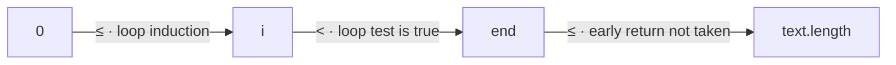

# What a PicoCalc text bounds check needs the compiler to prove

The PicoCalc typed compiler emits an explicit check when an application reads or writes a UTF-16 code unit. The compiler can omit that check when the program has already established that the index is in range. The question for a compiler running on the handheld is how much inference it takes to establish that fact and how often the extra inference helps. At the November 19 source snapshot, a host experiment removed three of 419 explicit checks with direct proofs. Allowing longer chains removed zero additional checks from the same 161 Files, Agenda, and Editor functions. A controlled edit to one Editor helper, adding a missing span validation at its entry, changed the result for that helper from zero to four removals.

> [!summary]
> - A signed branch can justify removing an unsigned check once the compiler proves that the same unmodified index is nonnegative and strictly below the receiver's current length.
> - The linked corpus retained 6 of 8 checks in Files, 34 of 35 in Agenda, and 376 of 376 in Editor with either proof mode.
> - A guarded Markdown marker scanner removed 45 executed checks across five selected host invocations. The whole-program result and this contract experiment answer different questions.

## One access has two bounds

A typed string points to an object in Wasm linear memory. Its first four bytes hold the UTF-16 code-unit count. A buffer has the same shape and uses that word for capacity. Both accessors compute the code unit's address by adding twice the index to the receiver pointer and using an offset of four bytes. Wasm's memory instructions still enforce the linear memory boundary. If an index crosses the end of its string but lands in another part of that same linear memory, the Wasm memory instruction can succeed. The explicit check enforces the object boundary before the payload access. In `picocalc-os/compiler/typed-wasm.js`, `codeUnitAddress` emits the following operations before the address calculation. [WebAssembly core specification](https://www.w3.org/TR/wasm-core-2/)

```wat
local.get $position
local.get $receiver
i32.load
i32.ge_u
if
  unreachable
end
```

PicoCalc's current typed `i32` branch operators interpret the same bit patterns as signed values. The source guard `i < text.length` therefore accepts `i = -1` when the length is three, while the generated unsigned check treats the index as `4294967295` and traps. To remove the check for an ordinary signed local, prove both `0 <= i` and `i < text.length` from facts that hold on every path reaching the access. The two signed propositions also imply a positive signed length, so signed and unsigned ordering agree for these operand values. This argument uses the header value that the check would reload at that point. [WebAssembly core specification](https://www.w3.org/TR/wasm-core-2/)

The earlier PicoCalc Native Next proposal, Task E8, makes the lower bound available through a new `index` type and looks for a direct guard. This experiment keeps the existing language and derives the lower bound from signed conditions, assignments, or a restricted induction rule. It makes the two proof modes comparable on the same input while exposing how many existing helpers leave their lower bound implicit.

## From two guards to one omitted check

Consider the following typed function. An early return means the remainder of the function executes only when `end <= text.length`. The true edge of the loop test adds `i < end`. Both facts remain valid at the read because the index and end have not changed on that path and no memory store or call has run since the length was tested.

```typescript
function sumTo(text: string, end: i32): i32 {
    if (end > text.length) return -1;
    let i = 0;
    let sum = 0;
    while (i < end) {
        sum = sum + text.charCodeAt(i);
        i = i + 1;
    }
    return sum;
}
```

The loop changes `i` on every iteration, so its initial value alone cannot prove the lower bound. This loop has a single unconditional update, `i = i + 1`, and body entry requires the signed `i < end`. Since every signed `i32` end is at most `INT32_MAX`, a true test implies `i <= INT32_MAX - 1`. Given a nonnegative initial index, the update stays nonnegative without signed overflow. The rule applies to a single top-level increment of one and a recognized strict signed comparison that is a required conjunct. A larger step or a different assignment makes the analysis forget the incoming fact about that counter at the loop head.

The analyzer records each relation as an edge between the zero constant, a scalar local, or the length loaded through a particular receiver local. Edges carry either `<=` or `<`. A path of such edges proves a strict bound if at least one edge is strict. For example, with `end = 3` and `text = "ABC"`, the loop reaches `i = 0, 1, 2`. For each of those three values the path contains the strict `i < end` step and the non-strict `end <= length` step. At `i = 3` the loop body is skipped. A path containing only non-strict edges cannot justify removal because equality with the length is out of bounds.



Direct mode requires a single edge for each bound. Chained mode allows up to six edges for each bound and consumes a shared budget of edge inspections. A breadth-first search keeps the current term and whether the path already contains a strict edge. Those two search states matter because finding a non-strict path to a term must not prevent later discovery of a strict one. The current implementation scans the active edge list for each queued state and charges every inspection, including edges whose source does not match. It retains the check when either path is missing or the budget runs out.

```text
facts_at(access):
    visit the index expression in evaluation order
    take the facts that are true on all incoming paths

decide(access, facts, budget):
    if the position is not a plain i32 local: retain the check
    lower = bounded_path(0, position, needs_strict = false, budget)
    if lower is missing: retain the check
    upper = bounded_path(position, length_of(receiver),
                         needs_strict = true, remaining_budget)
    if upper is missing: retain the check
    omit the explicit check byte range
```

Bodík, Gupta, and Sarkar's ABCD motivates the demand-driven query. It searches an inequality graph for the relation a check requires. ABCD builds that graph on extended SSA and uses a richer treatment of control flow. This prototype records relations from the existing structured emitter and uses conservative loop summaries and joins. It also occupies a smaller corner of the range of models described by Miné, whose difference-bound matrices represent relations of the form `x - y <= c` and support closure and richer transfer functions. The missing information in Editor also illustrates the use for an interface contract of the kind studied by Xi and Pfenning: a checked signature can communicate a relationship among arguments that an intraprocedural pass cannot infer from a function body. [ABCD, PLDI 2000](https://www.classes.cs.uchicago.edu/archive/2004/fall/32630-1/papers/p321-bodik.pdf), [A New Numerical Abstract Domain Based on Difference-Bound Matrices](https://arxiv.org/abs/cs/0703073), [Eliminating Array Bound Checking Through Dependent Types, PLDI 1998](https://www.cs.cmu.edu/~fp/papers/pldi98dml.pdf)

## When a fact stops describing the access

A local assignment invalidates the edges naming the old local value. Rebinding a receiver invalidates its old header facts. Calls and potentially aliasing stores erase the entire set, including facts obtained from a string header. The experiment also forgets facts that a loop body or its condition could invalidate on any backedge, then adds facts from the next evaluation of the condition. At a control-flow join a relation must survive on both continuing paths, with the weaker relation if they differ in strictness. The right operand of `&&` receives the left operand's true facts and the right operand of `||` receives its false facts. An early return contributes no continuing path.

These rules keep the generated check whenever an intervening effect can invalidate its proof. For example, a record store can clear a length word through an aliased pointer. An element store through another buffer can do the same when its payload overlaps the first receiver's header. Both cases run in the differential suite with shared addresses and prove that the required trap still occurs after the header changes. The compiler's bounds check for `output.setCharCodeAt(i, expression)` executes before it evaluates `expression`. The adapter visits that check before the right-hand side and preserves the original evaluation order, including a fixture where the right-hand side itself clears the receiver's length. Applying the proof at the time of the final store would describe a different program.

Arithmetic introduces a separate obligation. The suite sets an index to `INT32_MAX`, adds one, and then enters a signed `at < end` branch. Wasm addition wraps to `INT32_MIN`. The store or load address arithmetic could still land in linear memory because left shifting that bit pattern by one produces zero. The retained object check traps on the wrapped index. The analysis supports comparisons of plain locals and lengths, copies, zero and nonnegative literal initialization, and an upper bound for `Math.min` over recognized terms. Other arithmetic terms supply no relation. It discards the analysis for a function if it exceeds 50,000 analysis events or encounters JS recursion limits. Up to 64 relations can be live in each fact set. These bounds limit the host experiment's graph queries and analysis work. The host's temporary metadata and graph storage still need a measured device design. [WebAssembly core specification](https://www.w3.org/TR/wasm-core-2/)

## What happened in the unchanged applications

The adapter takes metadata from the repository's actual `FunctionEmitter` and tags the original byte ranges of its checks. Its tracked source stays intact. In the no-elision mode the resulting uninstrumented modules match the unmodified compiler byte for byte. The experiment links each whole app against its existing Wasm reactor in the host build and validates all nine module variants with Node's Wasm engine. The byte counts below include the reactor. Only checks produced by the typed sources appear in the check counts.

| App | Typed functions | While loops | Loops with a direct guard | Loops with a local upper guard | Baseline checks | Direct retained | Chained retained | Linked Wasm bytes, baseline → optimized |
|---|---:|---:|---:|---:|---:|---:|---:|---:|
| Files | 7 | 4 | 1 | 3 | 8 | 6 | 6 | 49,089 → 49,065 |
| Agenda | 34 | 16 | 6 | 5 | 35 | 34 | 34 | 67,429 → 67,417 |
| Editor | 120 | 46 | 3 | 22 | 376 | 376 | 376 | 88,255 → 88,255 |

The loop columns count syntactically recognized strict comparisons in required conjuncts, so a loop can appear in both guard columns. The local-upper column gives the potential first edge of a chain. It supplies neither the other edges nor a proof about any particular access. In Files, `filesCompare` has the same nonnegative induction variable under direct guards for both receivers. It eliminates two sites from one loop. Agenda's elimination is the `entryPut` write at `picocalc-os/worlds/agenda/entry.typed:179`, where an early return establishes both bounds. It is outside the six direct-guard loops.

Editor has 78 plain-local accesses queried by this lab. Seventy-two fail at the lower-bound query and six reach the upper-bound query without a matching proof. Another 88 checks have constant or computed indices and 210 bound the endpoints of string-literal writes. Three examples show where the missing information arises. `editorColumn` tests `at < line.length` and then calls `editorNext`, whose signed parameter carries an informal range contract. `editorMdSpace` checks `at < end` but the body supplies no relation between its `end` parameter and the receiver's length. In `filesName`, `end = value.length` does create a relation, but the trailing and leading whitespace loops call a classifier and the experiment invalidates such relations at call-capable backedges. A larger search budget supplies none of those missing facts.

## Dynamic results and query cost

For the dynamic run, the adapter emits one counter increment immediately before each retained check. The counter is a separate Wasm global and does not alias application memory. The replay compares both instrumented and clean variants with original code. Each case asserts the expected return or trap message and compares a SHA-256 of the complete 64 KiB linear memory. It also checks selected words directly after representative writes and faults. The real app samples run as standalone Wasm calls into original typed functions. End-to-end reactor replays would measure a different workload. The following counts include checks that executed and then trapped.

| Host replay | Cases | Traps | Baseline executed checks | Direct | Chained |
|---|---:|---:|---:|---:|---:|
| Synthetic fixtures, including 1,024 seeded inputs | 1,071 | 19 | 2,710 | 2,570 | 27 |
| Files name policy and comparison | 5 | 0 | 225 | 29 | 29 |
| Agenda helpers and a normalization | 5 | 1 | 43 | 34 | 34 |
| Editor wrap and whitespace helpers | 5 | 3 | 22 | 22 | 22 |
| Editor marker scanner with an added span contract | 5 | 0 | 45 | 45 | 0 |

The synthetic direct scan executes the same removed check 140 times across the selected lengths. The chained scan proofs account for 2,342 omitted check executions in their own fixture. Neither count establishes app-wide frequency. On unchanged source, the 196 removed executions in the Files sample come from two string loads in a few comparisons with a deliberately long equal prefix. It demonstrates how static counts and dynamic counts can diverge even when the module only loses 24 bytes.

The unmodified corpus issued 105 plain-local queries. Direct mode inspected 103 edges in total, with 10 of those inspections in its three successful queries. Chained mode inspected 151 edges for the same three removals. The synthetic one-guard scan required three edge inspections. Its two-edge counterpart required six. A six-edge chain with a workload budget of 32 inspections retained the check and executed it once. Raising the budget to 64 let the query finish after 43 inspections and the same input executed zero checks.

| Inspections allowed per query | Synthetic sites removed / 27 | Total inspections | Most expensive accepted query | Long-chain executed checks |
|---|---:|---:|---:|---:|
| 0 | 0 | 0 | — | 1 |
| 4 | 1 | 60 | 3 | 1 |
| 16 | 6 | 101 | 9 | 1 |
| 32 | 6 | 117 | 9 | 1 |
| 64 | 7 | 128 | 43 | 0 |
| 128 | 7 | 128 | 43 | 0 |

The separate Editor marker experiment inserts `if (start < 0 || end > text.length) return 0;` at the entry to the existing `editorMdMarker` helper. The original and guarded functions agreed for all five valid spans in that replay. The extra guard gives the first access, the two digit tests inside the loop, and the final punctuation access an upper path via `end`. Four accepted queries inspected 39 edges in total, with 11 the largest. A production design would have to establish the contract at the correct boundary, count the guard's own runtime cost, and qualify invalid-input behavior before changing the program. The measurement here isolates the optimizer's response to the newly visible facts.

## A narrower experiment to run next

The corpus does not justify allocating a larger graph solely to search for more chains. Its cheapest successful direct proofs already serve a Files comparison and an Agenda writer, while Editor's data exposes a lower-bound and effect-precision problem. A follow-up can first find which Editor checks dominate a representative event trace, then ask which call boundary or mutation hides the required fact at each hot access. Any effect summary would have to establish exactly which headers can be written by the callee and survive aliasing through reactor-provided views. Preserving a span relation at only the hot access gives a concrete target for measuring the additional compiler storage against the runtime checks it removes.

The evidence is from Node v24.18.0 on the host. It establishes byte differences, differential behavior on the cases above, and explicit check counts. Device compile time, peak memory, RV32 instruction count, and end-to-end latency remain unmeasured. The active compiler source and reactor SHA-256 values are stored beside the receipt. From the repository root, a clean run uses the existing build artifacts when available.

```bash
ticket=(ttmp/2026/11/19/PICOCALC-COMPILER-THESIS*)
node "$ticket/scripts/bounds/run.mjs"
node "$ticket/scripts/bounds/run.mjs" --linked
```

Run the first command for the self-contained host comparison. Its Editor survey uses assigned placeholder SDK function indices. The second links the whole corpus using `picocalc-os/build/{files-reactor,agenda-reactor,typed-world-reactor}.wasm`. The linked reference receipt is `various/bounds/results.json` in the ticket directory.
