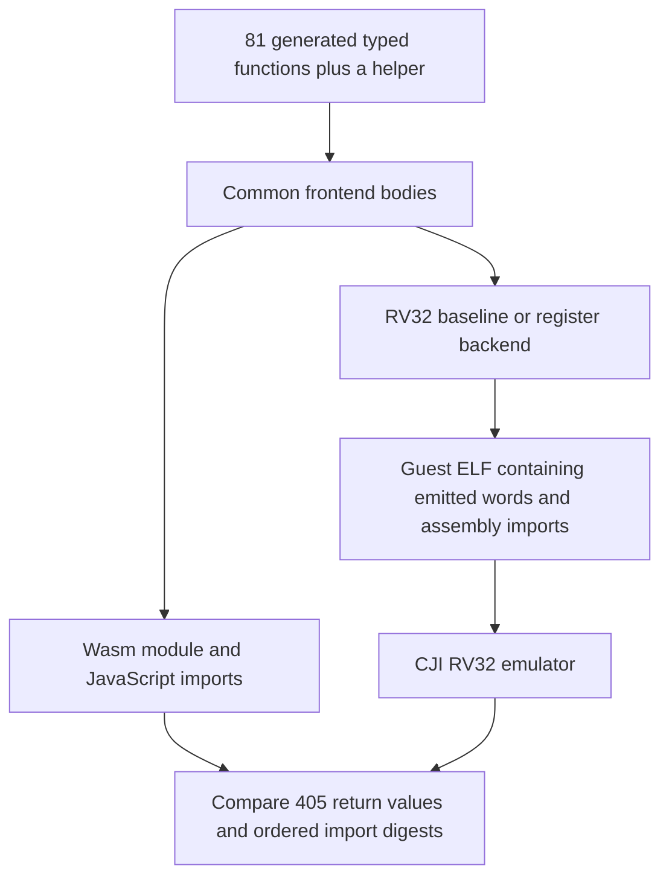

# What survives a call in the PicoCalc compiler?

A typed PicoCalc program can run as WebAssembly or as native 32-bit RISC-V machine code. Consider evaluating `left - readValue()`. By the time the program calls `readValue`, it has already evaluated `left`. Native code must recover that exact integer after the call. Now consider evaluating `text.charCodeAt(i)` after the same call. Even if a previous branch established that the index was below the text length, the callee might have changed the memory word holding that length. A compiler can save and restore an integer. Reusing a proposition about mutable memory requires an argument that the proposition still holds.

These two lifetimes determine whether two recent PicoCalc compiler changes preserve behavior. The production RV32 backend now keeps shallow expression operands in registers. A research-only Wasm emitter attempts to remove bounds checks justified by earlier comparisons. Independent experiments reached different engineering decisions for the two changes.

> [!summary]
> The RV32 backend preserved numeric results and ordered import digests for every combination of zero through eight live operands and zero through eight call arguments in the independent matrix. The bounds prototype matched the original compiler on 760 additional inputs, including 16 traps. A narrower invalidation rule proved an additional synthetic site but still removed only three of the 419 checks in Files, Agenda, and Editor.

## Two counts at an ordinary function call

The typed frontend emits a sequence of instructions with an implicit *operand stack*. Each instruction consumes or produces values. For example, if the stack already contains `left`, evaluating two arguments for `f(a,b)` leaves the three values `[left, a, b]`. The call consumes two arguments and produces a single result. The next subtraction operates on `[left, result]`. Call arity here is two and live depth across the call is one. These counts can vary independently.

The new backend assigns a physical home to each depth. Starting at depth zero, the first five homes are temporary registers `t0` through `t4`. Deeper values occupy four-byte words in the current function's frame, memory reserved until the function returns. Registers `a0` through `a7` carry arguments. The calling convention permits the callee to change those registers and the temporary registers. The compiler can therefore keep shallow operands in registers between ordinary operations provided that it saves the surviving ones before a call. [RISC-V integer calling convention](https://riscv-non-isa.github.io/riscv-elf-psabi-doc/#_integer_register_convention)

For six live values and a two-argument call, the backend emits this sequence in effect. An argument may previously have occupied either a register or a frame word.

```text
load or move argument 1 into a1
load or move argument 0 into a0
store the surviving values from t0 through t4 into their frame slots
call the function
reload t0 through t4 from those slots
place the a0 result at depth 6
```

Depth five already holds the sixth surviving value in the frame. The result at depth six occupies another frame word. If only three operands had survived, the call would save and reload three registers, and the result would go into `t3`. This assignment also serves branches that produce a value. Both arms of the compiler's value-producing conditional leave the result at the same depth and therefore in the same physical home. The typed frontend emits conditional expressions this way for `Math.max`, `Math.min`, and short-circuit operations. Its loop branches target blocks with no result. A future frontend that emits branches carrying values while discarding intervening operands would need explicit treatment of that transfer.

## A guest callee that overwrites the registers

Two implementations can agree because they share an error. The lowering authors tested their compiler against WebAssembly using a small JavaScript RV32 instruction interpreter and complete app replays. For this examination, the same frontend produced the Wasm bodies and native input, but a separately implemented C emulator executed the actual RISC-V instructions in two cross-linked guest executables. The original backend came from `dd69a81`, the register backend from `f0846ba`. The frontend files from those revisions matched.



Each generated function uses a selected number of arguments and a selected live depth. The live prefix contains different arithmetic expressions, and the generator uses subtraction so that value order matters. Computing the last argument can itself call a helper that takes an early return on one input and falls through on another. A second expression uses `Math.max` under the same live depth. Five pairs of signed inputs include equal values, both argument orderings and both signed 32-bit limits.

The guest import reads its ordered arguments into an arithmetic digest. It incorporates the previous digest and the current arity, writes the updated digest to a private word, fills all seven temporary and all eight argument registers with distinct constants, then places the return value in `a0`. The independent JavaScript import computes the same recurrence. The enclosing function returns its arithmetic result, and the driver writes both that result and the final import digest for comparison. Each guest import also checks 16-byte stack alignment. The driver checks the restored stack pointer on return.

For one concrete call, take the generated function with six surviving operands, two arguments, and inputs `x = 3`, `y = -5`. Immediately before evaluating the arguments the six pending left operands are `[-27,-22,-17,-12,-7,-2]`. The first explicit argument evaluates to 14. The second invokes the helper, whose call receives `[-5,3]`. Seven operand values now survive the helper call, the six left operands plus the pending 14. Subsequent imports consume the result and perform the maximum calculation. The final typed return is `-1900357695`, and the final digest is `-1244347106`. Keeping the two words lets the comparison catch a changed import sequence even on an input where downstream arithmetic cancels the difference. The digest compresses a sequence to 32 bits, so equality of the digest is a test observation and can admit collisions.

| Measurement | Old RV32 | Register RV32 | Wasm reference |
|---|---:|---:|---:|
| Input calls | 405 | 405 | 405 |
| Generated machine image bytes | 80,056 | 60,024 | — |
| Matched result and digest words | 810 | 810 | 810 |

All 3,240 output bytes agreed. The Wasm reference invoked 1,170 imports. The fixture synthesizes the import calls directly at the unresolved relocation words, so the test isolates lowering under the integer calling convention. The authors' production-linker replays supply the separate integration evidence. The proportions also constrain interpretation of the size result. This call-heavy corpus shrank by 25.0%, compared with 50.2% for the authors' unchanged Editor image. Static percentages depend on the proportion of operands that can stay in registers and the number live across calls.

## When a comparison expires

A PicoCalc string or buffer starts at an address in Wasm linear memory. The first four bytes hold its length or capacity in UTF-16 code units. Before reading element `i`, the ordinary compiler reloads that word and compares the index and length as unsigned integers. If the index is outside the object, the code executes `unreachable`, producing a trap. For a signed source index, the prototype can justify removal by proving that, at the access, `0 <= i` and `i < currentLength` under signed comparisons. Together these imply the desired unsigned relation. A negative index would otherwise become a large unsigned integer.

Consider two control conditions with the same ingredients. Here `change(c)` sets a word to zero and returns one. The caller can supply the same storage both as the text receiver and as the record to modify. Both controls execute the text access only on their true paths.

```typescript
// Check first, then possibly change memory.
i >= 0 && i < s.length && (skip || change(c) > 0)

// Possibly change memory, then check.
(skip || change(c) > 0) && i >= 0 && i < s.length
```

Start at `i = 0`, length one, `skip = false`, with the two arguments naming the same word. The first condition evaluates the positive length, clears it, and still enters the body. The access must check the length again and trap. The second condition clears the length before testing it. Its comparison is false, so the function returns its fallback value. On executions that reach the second body, both bounds hold for the header just read. Direct and chained analysis retained the first check and removed the second.

The order also matters inside seemingly unproductive operations. Writing an empty literal writes zero characters, but evaluating its position argument can still call a function. An earlier length test followed by `b.writeLiteral(change(c), "")` must lose the old header fact. Likewise, `Math.min(s.length, change(c))` takes a minimum of two captured values. The first operand may differ from the receiver's length after evaluating the second. The prototype retained the checks at both subsequent accesses. Each execution compared all 65,536 memory bytes after a return or a trap. That comparison distinguishes a correctly ordered mutation from one inadvertently skipped.

A signed loop reveals a different obligation. Start `i` at 2,147,483,647, guard the loop with `i <= stop` and choose the same maximum value for `stop`. The first test succeeds and the increment wraps to −2,147,483,648. On the second trip a signed comparison with an ordinary positive length succeeds for that negative value. The normal object check traps. A sound induction rule can preserve nonnegativity through a unit increment when loop entry requires `i < stop`. The strict inequality excludes the maximum value before the increment. This experiment's inclusive loop retained its check and reproduced the original trap. Separate cases used header words 0x80000000 and 0xffffffff to test how a negative signed length affects branch reachability.

| Additional Wasm inputs | Cases | Original traps | Selected static decision |
|---|---:|---:|---|
| High-bit and ordinary headers, mirrored inequalities, and strict loops | 270 | 0 | Direct checks removed for the direct header and strict loop. A mirrored chain required chained mode. |
| Minimum and empty literal with a mutating argument | 120 | 5 | Both sites retained |
| Optional mutation before or after the length test | 240 | 3 | Retain when the length test precedes mutation. Remove when it follows mutation. |
| Mutation in a nested loop | 120 | 3 | Retain |
| Inclusive loop and signed wrap | 10 | 5 | Retain |

Both proof modes agreed with original Wasm on all 760 inputs. This evidence concerns the existing prototype and these inputs. A general soundness argument would additionally have to cover every source construct the metadata adapter describes and show that its abstract effects follow the order of actual emission.

## How much precision did the application need?

The prototype represents a known inequality as an edge whose endpoints name zero, a scalar local or a particular receiver's current length. An edge can be strict or non-strict. Direct mode seeks one edge per bound. Chained mode searches paths and requires at least one strict step in the upper path. A call or potential memory write currently clears the entire set. It is possible to retain more information cheaply in an individual case. A numerical Wasm local belongs to an invocation, and writing a word in linear memory leaves its value intact. [WebAssembly variable instruction semantics](https://webassembly.github.io/spec/core/exec/instructions.html#variable-instructions)

I tested a narrower rule as an examiner-local treatment. After a memory effect, discard each edge with a receiver-length endpoint and keep the relations among scalars and zero. When summarizing a loop, also discard every edge mentioning a local assigned anywhere in that loop. The second part prevents a relation from a previous iteration from surviving a local reassignment. The treatment changes invalidation only. Both search modes retain the same 128-inspection budget per query.

A control function first rejects a negative index, calls a function that mutates a word, then tests the index against the receiver's freshly loaded length. The treatment can combine the surviving nonnegative fact with the fresh upper bound. Its control partners put the upper bound before the call or overwrite the scalar during a loop. Exactly the first of the three checks disappeared. Both policies agreed with original Wasm across 24 cases, including eight traps. This establishes that the more precise rule changed an observable compiler decision.

| Unchanged source | Removals, original → revised | Direct edge inspections | Chained edge inspections |
|---|---:|---:|---:|
| Files | 2 → 2 | 11 → 18 | 13 → 23 |
| Agenda | 1 → 1 | 16 → 16 | 18 → 18 |
| Editor | 0 → 0 | 76 → 93 | 120 → 150 |
| **Total** | **3 → 3** | **103 → 127** | **151 → 191** |

The controls succeeded, yet the source positions of all three corpus removals were identical under both rules. The breadth-first search scans more candidate edges when it retains extra facts. Increased precision therefore raised this measure of analysis work without changing the resulting site set. Edge inspections are an algorithm count. The device time required for filtering, allocation, and graph traversal remains unmeasured.

A separate test asked what happens to a proof already accepted when the analyzer exhausts its function-wide event limit. A short function contained one removable access near its entry. Adding a long tail of ordinary arithmetic assignments left the preconditions at that access intact. With 58,954 bytes of source, the analyzer reached event 50,001, revoked its earlier removal decision and emitted a module byte-identical to the ordinary compiler. The observed fallback concerns the proof walk. The adapter builds its metadata tree before starting that walk, so a bound on visited events leaves peak metadata allocation an open measurement.

## Engineering judgment

I found no release-blocking correctness defect in the register change for the structured operations produced by the current typed frontend. Its five-home mapping makes ordinary joins reviewable by inspection. Independent machine execution exercised both sides of the fifth-operand boundary and all supported call arities. Combined with the authors' linked application replays, that is sufficient evidence to keep the production change. A paired PicoCalc board run is still needed to quantify hardware compile time, heap high-water mark, and interactive latency.

The bounds research supports a different next investment. The three applications provide 419 static checks, of which these analyses remove three. Keeping scalar facts across memory effects raises search work while preserving precisely that site set. The next informative measurement would select a frequently executed retained Editor access and identify which comparison the compiler lacks at that program point. A caller-validated span, a missing nonnegative local bound, and a mutable header across a call demand different changes. Measuring the relevant site would allow the next compiler design to buy evidence for one of them.

The three independent experiment drivers and their JSON receipts are in the source repository under ticket `PICOCALC-COMPILER-THESIS`, directories `scripts/examiner/` and `various/examiner/`. The original lowering and proof experiments are pinned by `f0846ba` and `c1e3777`. All independent runs reported here used a host Wasm engine or the CJI RV32 emulator.
