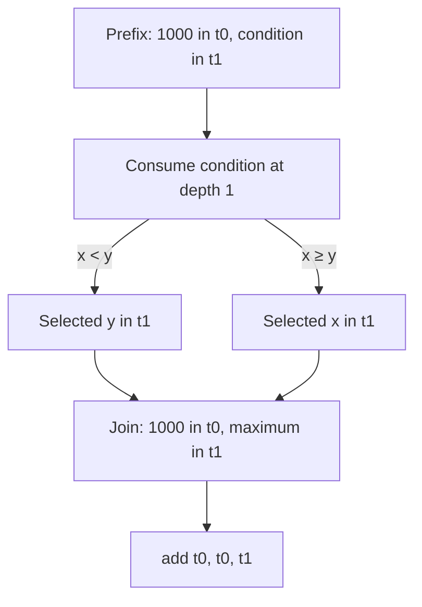

# Keeping the PicoCalc operand stack in RV32 registers

PicoCalc's typed compiler lowers one structured WebAssembly function body at a time into 32-bit RISC-V instructions. A temporary such as the result of adding two integers used to occupy a word in the machine stack frame even when the very next instruction consumed it. The change studied here gives the first five positions of the WebAssembly operand stack fixed register locations. Tracking the stack height is enough to choose those locations, generate arithmetic directly into them, and keep the two paths of a conditional in agreement.

> [!summary]
> - Fixed homes for the first five operands cut emitted instruction counts by 47.4% for Files, 47.4% for Agenda, and 50.2% for Editor.
> - A call spills the register operands that survive it. Values beyond the register capacity already reside in the frame.
> - WebAssembly and two RV32 implementations agreed on 78 differential cases. The old and new RV32 compilers each passed all 24 host application replays.

This is a subset of Scope A in PICOCALC-NATIVE-NEXT. It implements depth-indexed operands and host qualification for the existing consumers, with eager evaluation. Its three application images share the same frontend as the control. The broader design includes location descriptors for deferring constant and local evaluations, branch fusion, register allocation for locals, and resizing the reserved native code area. The exact assignment and authored user request are recorded in the [supervisor's investigation diary](../../reference/01-supervisor-investigation-diary.md#step-1-commission-three-controlled-compiler-experiments).

## Three different places to put an integer

A typed function starts with source such as this.

```js
function bump(b: i32, c: i32): i32 {
    let a = b + c;
    if (a > 0) { a = a + 1; }
    return a;
}
```

The frontend encodes the first assignment as `local.get b`, `local.get c`, `i32.add`, and `local.set a`. A *local* is a numbered variable location that persists while this function runs. The *operand stack* is the ordered sequence of anonymous intermediate values consumed by the instructions. Each `local.get` copies an integer from a local onto that sequence. The addition consumes the two copies and leaves their sum, which `local.set` then removes and stores in the destination local. This interpretation follows the WebAssembly execution rules even though the machine representation can change. [WebAssembly Core Specification, execution semantics](https://www.w3.org/TR/2024/CR-wasm-core-2-20241217/#exec).

RISC-V instructions name their input and output registers explicitly. The RV32 backend therefore chooses a machine location for each value in the abstract WebAssembly stack. Historically it chose a stack-frame offset for every operand. A *frame* is the space a function reserves below its caller's stack pointer, addressed relative to the function's current `sp`. For `bump`, the historical layout put `b`, `c`, and `a` at offsets 0, 4, and 8. Its first two operand slots were 12 and 16.

| Wasm operation | Frame-only lowering | Depth-indexed lowering |
| --- | --- | --- |
| `local.get b` | `lw t0,0(sp)`; `sw t0,12(sp)` | `lw t0,0(sp)` |
| `local.get c` | `lw t0,4(sp)`; `sw t0,16(sp)` | `lw t1,4(sp)` |
| `i32.add` | `lw t1,16(sp)`; `lw t0,12(sp)`; `add t0,t0,t1`; `sw t0,12(sp)` | `add t0,t0,t1` |
| `local.set a` | `lw t0,12(sp)`; `sw t0,8(sp)` | `sw t0,8(sp)` |

There are ten old instructions in those four rows, six of which access operand slots. The full old function emits 41 words. The variant emits 22, and the frame falls from 32 to 16 bytes. In the replacement, the sum reuses `t0` because it occupies the position vacated by the left input. The branch still computes a boolean via `slt` and keeps the existing branch-over-jump form. The new `mv a0,t0` at return is an integer register copy that replaces the final operand reload. The instruction counts in this example are **static**. The two inputs in the differential test execute 40 and 31 old instructions, or 21 and 18 new instructions, because only executed branch paths contribute to a dynamic count.

## Deriving the location from depth

Let `d = 0` denote the bottom position of the operand stack and let `L` be the number of locals including parameters. The compiler maintains an integer stack height while walking the opcode stream. The location function is common to every translated path through the function.

```text
home(d):
    if d < 5:
        return [t0, t1, t2, t3, t4][d]
    return memory at sp + 4 * (L + d)
```

For shallow values, emitting a pop consists of lowering the recorded height by one and returning the name of the home register to the instruction builder. A deep pop also emits one load into the scratch register chosen by the consumer. A producer can compute directly in the result's home register, or compute in scratch and store if the depth is beyond the first five. `t5` and `t6` supply separate scratch operands when a binary operation reads two frame slots. Stack height and the maximum spilled depth are compiler state. The compiled function receives no runtime register-location table.

The frame size covers the last spill slot the compiler writes, the locals, and the saved return address. If a function keeps every operand in registers and has no values that survive a call, its frame reserves space only for its locals and return address, rounded up to a 16-byte boundary. A deep spill can leave unused words between the locals and the highest spill slot. Those offsets are usable by call spills as well, so the same depth number determines the same offset in both cases.

The fixed mapping narrows the design space explored in M. Anton Ertl's *Stack Caching for Interpreters*. Ertl's static method tracks cache state in the compiler and discusses a canonical state at control-flow boundaries. Here the mapping follows directly from the structured stack height, so the canonical state arises after every opcode. It gives up some choices available to a more general allocator, such as keeping only the most recently used deep operands in registers. Each ordinary producer and consumer nevertheless has a predetermined location, and this requires no separate control-flow-graph or liveness pass. [Ertl, PLDI 1995, §§3 and 5](https://lampwww.epfl.ch/teaching/archive/advanced_compiler/2007/resources/papers/stack-caching.pdf).

## Joins with values below the condition

A *join* is an instruction reachable from multiple control-flow paths. Consider `1000 + Math.max(x, y)`. The frontend has already pushed 1000 before beginning the computation of the maximum. It evaluates the inputs to framed locals, compares them, and emits a result-producing `if` whose two arms each load the selected input. At the start of both arms, the live operand prefix consists of the value 1000 at depth 0. The conditional consumes the boolean, so both arms start at depth 1. Each arm puts exactly one result in `t1`. The following addition takes its left input from `t0` and its right input from `t1`, independently of the chosen path.



The compiler records the height after popping the condition as the block's entry height. At `else`, it jumps over the alternate arm for the previously emitted path, then resets the compiler's height to the entry height before emitting the alternate. At `end`, it sets the height to the entry height plus the result arity. A prefix of six live values puts the selected maximum at depth 6 in the frame. The test for `deepJoin` exercises both selections and an equal-input case at that depth. The current frontend emits `br_if` to leave a void block and `br` to repeat a void loop. Result joins in this experiment use `if` and `else`.

The ordinary instruction invariant is that values live at depths below the current height hold their WebAssembly values at the corresponding homes. The left half of this argument is local. An instruction that consumes its highest operands can write only in their reclaimed locations or above them. The right half is structural. Both sides of a result-producing `if` begin above the same prefix, finish at the same height, and write the result at that height's last position. The invariant is evaluated on reachable paths over the structured bodies produced by the typed frontend.

## Preserving live values across calls

The RISC-V integer calling convention carries up to eight arguments in `a0`–`a7` and uses `a0` for this compiler's single integer result. All seven temporary registers may change during a call. The first five operands can therefore remain in registers through arbitrary straight-line code and branches, while a call must preserve any of them still needed on return. [RISC-V psABI, register and integer calling conventions](https://riscv-non-isa.github.io/riscv-elf-psabi-doc/#_integer_calling_convention).

Consider the shape of `100 + clobber(3, -5, inner(x), 11, -13, 17, 19, 23)`. The first argument values and 100 are live at the inner call. Its call sequence moves its own argument to `a0`, spills the three live register operands, and performs the call. The reloads restore those operands before the result in `a0` is copied into the next free stack home. At the outer call, the compiler has eight arguments above the operand 100. Some arguments have register homes, others have stack slots. It pops argument eight first and then works down to argument one. Each pop writes to a distinct argument register, which cannot alias an operand's home.

```text
lower_call(argument_count, target):
    for i from argument_count - 1 down to 0:
        source = pop(scratch = a[i])
        copy a[i], source if locations differ

    live_register_count = min(current_height, 5)
    for d in 0 .. live_register_count - 1:
        store home(d), spill_slot(d)

    jal ra, target

    for d in 0 .. live_register_count - 1:
        load home(d), spill_slot(d)
    push a0
```

A deep argument can use its destination register directly as the reload target. After argument staging, the only live register operands are a prefix starting at depth 0. A deep prefix can also contain values already resident beyond depth 4. Spilling the shallow prefix preserves both kinds without touching the argument slots. Reloads write only temporary registers, which leaves the return value intact. This sequence works for imported functions because `linkSlot` patches their `jal` targets to SDK trampolines, whose ABI is the same. The linker and reactor interfaces are available through the normal `typedRv32.compile` and `typedRv32.linkSlot` entry points.

The same disjointness makes `a0` available as a scratch value during the signed division overflow check. No operand has an argument-register home at that point, and no call has begun staging its arguments. When both divide operands are spilled, `t5` and `t6` hold them and `a0` holds the bound used in the comparison. WebAssembly signed division traps for a zero divisor and for the unrepresentable quotient `INT_MIN / -1`. Signed remainder traps for zero and returns zero for `INT_MIN % -1`. The fixtures put those inputs both inside and beyond the register capacity.

## Counting what the change removes

The comparison compiles real source through `typedRv32.compile` at baseline `dd69a81` and candidate `f0846ba`. Both use the same typed frontend, source list, and Editor import signatures. Every emitted instruction and every import relocation placeholder occupies a four-byte word. The instruction scan recognizes a frame operand access by its `sp` base and its offset between the locals and the saved return address.

| Application | Functions | Instruction words | Operand loads + stores | Code bytes | Max function frame |
| --- | ---: | ---: | ---: | ---: | ---: |
| Files | 7 | 1,529 → 804 | 764 → 0 | 6,116 → 3,216 | 80 → 64 B |
| Agenda | 34 | 7,710 → 4,058 | 4,045 → 10 | 30,840 → 16,232 | 96 → 80 B |
| Editor | 120 | 43,965 → 21,886 | 24,330 → 415 | 175,860 → 87,544 | 192 → 192 B |

The accounting explains the instruction deltas exactly. Files loses 764 operand accesses and adds 39 register moves. Agenda loses 4,035 operand accesses and adds 383 moves. Editor loses 23,915 operand accesses and adds 1,836 moves. The residual operand accesses in Editor include both deep expressions and live values saved around calls. Files has neither kind in this input. A smaller image indicates less emitted work and less occupied space in the reactor's native code slot. The reservation still has its fixed capacity. In the paired replays, the complete linked ELF files remain 24,424 bytes for Files and 240,452 bytes for Editor.

The compiler source itself grows from 14,137 to 15,639 bytes. A warm Node v24.18.0 timing of the full source-to-RV32 compile path used ten unmeasured runs per implementation, then 31 measured pairs per application, alternating which implementation ran first. Median times in that session were 0.409 → 0.336 ms for Files, 2.043 → 1.682 ms for Agenda, and 8.287 → 6.112 ms for Editor. The paired medians characterize a reused host runtime. Loading a larger compiler in fresh QuickJS, linker work over a padded ELF, board memory, and visible startup each require their own measurement. [Instruction counts and individual paired measurements](../lowering/instruction-counts.json).

## Behavioral checks at two scales

The focused experiment executes the same structured body as WebAssembly, historic RV32, and candidate RV32. A small RV32 interpreter runs the unlinked images. At an import relocation it reads the arguments, calls the shared oracle handler, overwrites all caller-saved argument and temporary registers, and supplies the result in `a0`. An incorrect spill can thus fail even when a real import happens to preserve a temporary. Tests compare results, traps, the argument list and ordering for every import, and observable memory writes. The interpreter verifies stack alignment at calls, preservation of the stack pointer and saved registers, and the return address at each normal internal return.

All 78 cases passed, including 12 traps and 15 import invocations in the oracle. Summing instructions across exactly these fixture executions gives 4,594 → 3,138 words. The interpreter counts each import relocation as one instruction and excludes the host implementation's work. These vectors deliberately concentrate deep cases and trapping paths, so their aggregate is a property of this fixture set. The eight-argument deeply nested call executes 110 → 100 words in the example, although the shallow call executes 80 → 65. The smaller gain in the deep case follows from the stack locations and the call spill rules. [Differential receipt](../lowering/differential.json).

The second check runs 24 established replays per implementation. Files includes directory sorting, mode-dependent rounding, and directory creation. Agenda includes calendar calculations, parsing, and entry prompts. Editor includes navigation, editing, search, and Markdown previews with full-capacity documents. The replays run application code against the host simulator and RV32 emulator, including linked import trampolines for Editor. Their coverage complements the interpreter's explicit caller-clobber tests. [Baseline replay receipt](../lowering/baseline-replays.txt), [candidate replay receipt](../lowering/variant-replays.txt).

## Cold compilation and application execution

The supervisor ran the production Editor compile entry point with QuickJS 2026-06-04 on x86-64 Linux. Each invocation began in a fresh process and initialized its own JavaScript runtime. The twenty alternating pairs used one Editor source bundle and one reactor. Median time was 82.678 → 74.701 ms, every pair favored the candidate, and median within-pair savings were 7.660 ms. The allocator-reported peak was 3,910,760 → 3,402,944 bytes. That allocation counter uses Linux allocator sizes. It measures the host build of the production entry point and gives a hardware-independent test of whether the larger backend source erased the improvement. [Linux cold compile receipt](../supervisor/cold-editor.json), [supervisor's investigation diary](../../reference/01-supervisor-investigation-diary.md).

Four paired runs of the actual whole Editor driver used the emulator's guest instruction counter. In each pair, the executable driver and module path stayed the same. Full output hashes matched, while the two ELF contents differed inside the code slot. The count includes setup, reactor and app work. It measures executed guest instructions and can be compared with the static count, which weights each instruction once regardless of how often the program takes its path.

| Editor workflow | Input bytes | Baseline guest instructions | Candidate guest instructions |
| --- | ---: | ---: | ---: |
| Edit | 123 | 4,047,796 | 2,543,239 |
| Open large document | 65,536 | 12,359,858 | 7,621,786 |
| Dense inline preview | 65,536 | 35,693,419 | 22,853,317 |
| Late navigation | 65,536 | 73,408,388 | 42,316,056 |

The candidate reduces guest work by 36.0% to 42.4% across these four workloads. Differences in control-flow frequency and the work contributed by the shared driver and reactor explain why this interval can differ from the change in static image size. Device compile time, peak device heap, and execution latency await a paired board run. [Whole-driver instruction receipt](../supervisor/editor-steps.json).

## Reproducing the result

From the repo root, select the compiler-thesis ticket directory and extract the baseline compiler from Git. The counting script returns per-function counts and individual timing samples. The differential script additionally emits the worked-vector counts.

```bash
ticket=$(ls -d ttmp/2026/11/19/PICOCALC-COMPILER-THESIS--*)
baseline=$(mktemp)
git show dd69a81:picocalc-os/compiler/typed-rv32.js > "$baseline"
node "$ticket/scripts/lowering/count.mjs" "$baseline" 31
node "$ticket/scripts/lowering/differential.mjs" "$baseline"
bash "$ticket/scripts/lowering/replay.sh" "$P4_GCC" "$RV32EMU" "$baseline"
bash "$ticket/scripts/lowering/replay.sh" "$P4_GCC" "$RV32EMU"
rm -f "$baseline"
```

`P4_GCC` is the local ESP RISC-V toolchain's GCC binary. `RV32EMU` is the CJI emulator built with the support objects used by its host loaders. The [research notes](../../reference/lowering-notes.md) identify tool versions and the [chronological diary](../../reference/lowering-diary.md) records the changes to the harness and the observed failures.

## What the result establishes

One compile-time integer is sufficient to remove most memory traffic for the typed frontend's temporaries because structured control fixes stack height at joins and the application bodies have shallow stacks at most use sites. A local still involves a frame access. A comparison still materializes its boolean. A call still copies its return into the stack's canonical location. Those three observations identify distinct remaining costs. Any follow-on heuristic that gives an operand a different location at an ordinary instruction must establish when the value is captured and how calls and joins restore a location every path agrees on. The five-register design supplies a measured point of comparison for that work.

## Independent qualification

The alternating 20-pair trial above linked the QuickJS objects already available in the workstation build directory. A provenance check found a different `quickjs.o` in a fresh build from the checked-in Makefile. In the fresh-engine four-treatment experiment, changing only the backend lowered the median full Editor compile from 54.891 to 50.112 ms. Both experiments produced identical ELF hashes and the same memory peaks. Four complete driver replays of the freshly generated modules reproduced the previously recorded guest instruction counts and traces. The independent call examiner also replayed 405 adversarial invocations per backend and checked argument order, caller-saved operands and stack alignment. [Fresh compiler receipt](../supervisor/fresh-factorial-editor.json)
