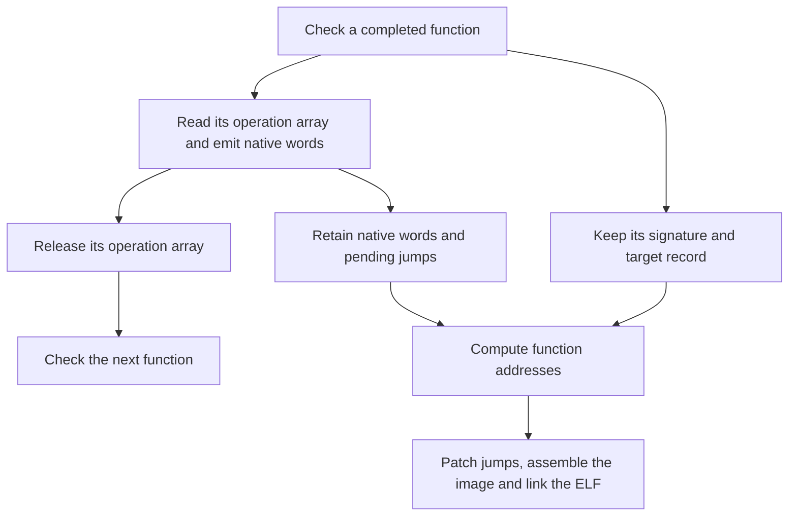

# Where PicoCalc compiler memory goes when functions are lowered one at a time

A user rebuilding the PicoCalc text editor needs a complete executable before the editor can start. The firmware loads JavaScript that implements a compiler, checks the editor source, generates RISC-V instructions, and inserts them into a prebuilt executable containing the runtime. The compiler temporarily holds several forms of the same function in memory. We can change their representation and lifetime while holding the final executable fixed.

In a fresh Linux build of the firmware compiler, five ways of compiling Editor produced the same 240,452-byte executable in all 50 runs. Passing integer operands directly accounted for the largest reduction in cold compile time. Discarding each function's operations after translating it to native code accounted for a further 697,496-byte reduction in peak compiler allocation. The order in which functions are compiled also matters. In a separate experiment, moving a large function to the end raised the streaming peak by 27.5%, with identical operation counts and final machine-code length.

## Follow an integer through both compilers

Consider `function f(x: i32): i32 { return x + 130; }`. The source frontend reads tokens, checks that the addition's operands are integers, and constructs the operations that read `x`, push 130, add and finish. It can encode each operation as WebAssembly bytes. The constant instruction occupies the three bytes `41 82 01` in hexadecimal. The first identifies the operation. The remaining two encode 130 in groups of seven bits. A second array combines the function's operations with the local declarations and a length prefix for writing a Wasm module.

The RV32 backend reads the first array and immediately decodes the integer again. On a native-only compile, the compiler can instead pass two JavaScript array entries, the opcode 65 and the integer 130. One entry in this experiment is a JavaScript Number held in an ordinary array. The word *packed* in the experiment names this use of one entry per operand. The encoded and decoded forms produce the same RV32 constant when given to their corresponding readers.

A second decision determines when the backend can release those entries. Once the parser completes a function, its final local count and signature are known. In this source language a function can call an import or a previously declared function. The compiler can therefore emit native words immediately, keep a target record for each unresolved address, and fill in the address after the eventual code offsets are known. In the experimental stream the compiler retains the function descriptor and sets its operation-array property to null. A saved reference from the native emitter to that descriptor can then persist without keeping the operations alive.



## Time the compile that the user actually invokes

The firmware starts its clock before reading the Editor source and prebuilt runtime. Inside the interval, it creates QuickJS, evaluates the compiler and linker scripts, copies inputs into JavaScript objects, calls the compiler, links the executable, copies the result back to C and destroys QuickJS. The host shim supplies a monotonic clock, a Linux allocator and ordinary file reads. The timing ends before the host writes the returned executable to disk. Every timed sample starts its own process. Linux may serve input pages from its file cache. Physical storage latency on a handheld needs its own measurement.

The original representation experiment also measured a resident compiler. Its full-call timer starts after the source, compiler and imports are loaded and ends when the raw native program is returned. Its lower-only timer starts with previously prepared operations and includes final assembly of the raw native image. These measurements answer questions about phase costs. The meaning of a millisecond changes when the interval expands to include evaluation, linking, copying and destruction.

The supervisor crossed two frontend choices, original and streamed, with two backends. One backend places intermediate operands in frame slots. The other uses registers for shallow operand positions. In the rebuilt series the median cold Editor compile moved from 54.891 ms for original frontend plus frame slots to 41.849 ms for streaming plus registers. Comparing within each of the 16 blocks gives a median saving of 12.982 ms, with a range of 10.800–16.117 ms. The linked executable matched across frontend choices within each backend. The two backends deliberately emit different instruction sequences.

A factorial design also lets us test whether effects depend on each other. In each block, subtract the register saving under streaming from the register saving under the original frontend. This difference was positive in 12 blocks and negative in four, with a median of 0.330 ms and a range of −2.177 to +9.830 ms. These timings establish an advantage for the combined treatment across all sampled blocks. Its division into a register contribution and an independent frontend contribution is less precise.

## Separate five changes at one fixed backend

The supervisor's streamed configuration also removes the Wasm module writer, omits duplicate framed bodies and replaces encoded immediates with numeric operands. Comparing that configuration to the original cannot identify which part made it faster. I froze the register backend at `f0846ba` and generated five compilers for a second experiment, changing one implementation decision at each step.

| Compiler configuration | Cold median | Peak Linux bytes accounted by the firmware | Median paired time saved from previous row |
| --- | ---: | ---: | ---: |
| Production sources and buffered Wasm bytes | 50.277 ms | 3,402,944 | — |
| Prune the Wasm module writer, preserve framing and byte operands | 49.932 ms | 3,368,208 | 0.467 ms |
| Omit the duplicate framed body | 48.315 ms | 2,616,552 | 1.528 ms |
| Pass numeric operands, buffer all functions | 41.007 ms | 2,588,664 | 7.220 ms |
| Pass numeric operands, lower each completed function | 41.823 ms | 1,891,168 | −0.985 ms |

The first comparison reduced the frontend script from 25,347 to 17,262 bytes while preserving function framing and the native reader. The peak fell by 34,736 bytes. Removing the framed body in the next comparison reduced the peak by a further 751,656 bytes. Numeric operands then reduced the peak by only 27,888 bytes but reduced elapsed time in all ten matched blocks. Integer encoding and decoding can take appreciable time even when they barely change the highest observed allocation total.

Streaming released enough input storage to cut another 697,496 peak bytes. It was slower than buffered numeric operands in seven of ten blocks. The paired median cost was 0.985 ms, and the paired outcomes ranged from a 2.767 ms saving to a 1.600 ms cost. The strongest latency observation in this series is the numeric-operands comparison. Choosing the streamed implementation requires deciding how much peak memory matters.

A block here consists of one sample of each configuration in five fresh processes pinned to one host CPU. Across ten blocks, each configuration occupied each position twice, and each ordered pair of different configurations appeared twice consecutively within a block. The block sequence used a fixed shuffle seed. Every timing, including slower samples, is retained. A difference calculated within a block keeps the observed conditions closer together. Its median can differ from subtracting the two medians in the table.

## Put the large function last

Let a compiler generate instructions for exactly 2,048 instances of `x=x+1;`. Allocate them to functions with one argument, one mutable local and a return. The functions do not call each other. This lets us vary the distribution of work while keeping the arithmetic and the chosen operand encoding fixed.

The following figures use the original frame-slot backend at `dd69a81`. Each is the median of four fresh QuickJS-runtime measurements above the live heap immediately before the resident compile call. The four measurements rotate process allocation order. They exclude compiler loading, ELF linking and file access.

| Distribution of the increments | Largest packed function, cells | RV32 image, bytes | Buffered peak above start, bytes | Streamed peak above start, bytes |
| --- | ---: | ---: | ---: | ---: |
| One function of 2,048 | 14,343 | 81,972 | 843,008 | 750,640 |
| Eight functions of 256 | 1,799 | 82,336 | 889,616 | 574,864 |
| Sixty-four functions of 32 | 231 | 85,248 | 1,024,000 | 687,096 |
| First function of 1,796, then 63 of four | 12,579 | 85,248 | 899,640 | 601,344 |
| First 63 functions of four, last of 1,796 | 12,579 | 85,248 | 899,640 | 766,624 |

In the last two rows, even the total packed cell count, 14,784, stays fixed. Both have the same 64 names in the same definition order. The functions acquiring the long body differ between programs. Within each program, every representation produced byte-identical native code and identical metadata. Looking across programs, the experiment holds emitted length and operation counts fixed. All four streamed readings with the large function first fell between 561,112 and 602,496 bytes. All four with that body last fell between 766,608 and 775,552 bytes.

A compiler's peak is the highest simultaneous total over time. While it lowers the last function, it can hold the last input array, its growing native output, *and* the native code for earlier functions. At final image construction it also holds the word arrays and an output byte array. The order experiment is consistent with these overlapping lifetimes. Locating the single allocation that set the high-water mark would require recording peaks inside individual stages. Even with only one function, streaming saved 92,368 bytes at the median. Releasing that function's input before the final image is assembled is possible without any preceding function to discard.

These results place a limit on what the representation can guarantee. The input operation storage of the stream is governed by the current function and its growth history. Overall peak also depends on already emitted code, fixups, signatures, the final image and allocator behavior. Reducing the largest function did not monotonically reduce the measured peak across these programs.

## Qualify what survives outside the benchmark

A successful compile exposes the code bytes and the data needed to link them, including function entry offsets, record layouts and import relocations. The original experiment compares those fields on real inputs and on a fixture with wide immediates and indices. The five-configuration cold experiment compares the complete linked ELF across every run. The two checks cover different boundaries. The complete ELF verifies the artifact the loader receives. Comparing metadata also catches differences in compiler results which the linker might ignore for this Editor build.

Failure exposes another part of the interface. Suppose an early function has nine arguments, which the native backend rejects, and a later function returns a Boolean where the source signature requires an integer. In buffered compilation all source checking finishes before lowering begins, so the later source error wins. Streaming observes the native error first. The prototype saves it, continues source checking and throws the saved error only if the remaining source checks succeed. The existing mixed-error fixture compares exact exception class and message. The firmware can also print an internal JS stack trace. Script pruning and the changed call sequence can change that trace. Both compilers run with a heap cap and a deadline on the device. Under resource exhaustion even the point at which a diagnostic can be produced depends on implementation cost.

Memory accounting needs the same care. The cold C firmware counts Linux allocator usable bytes allocated through its QuickJS callbacks and records their absolute maximum. C-owned source, runtime and copied executable buffers live outside that counter. The resident experiment measures an incremental peak, uses the QuickJS-style per-allocation overhead, and updates QuickJS's own allocation state. In the frozen firmware the custom callbacks update a private live-byte count, while QuickJS's automatic cycle-collection threshold reads the engine's allocation state. These configurations need separate calibration. Neither series yields the board's total PSRAM requirement.

A production build must also select the appropriate public compiler interface. The current firmware loads `typed/wasm.js` for each engine, and individual applications can select Wasm or native code in the same firmware build. The experimental pruned script exports only `compileFunctions`, while the Wasm world linker calls `typedWasm.linkWorld`. An integration could select a native-only compiler bundle when the engine is native or preserve both consumers in a common frontend. That decision changes the amount of JavaScript evaluated at startup and deserves another cold timing. A measurement of the largest acceptable real source on the physical handheld, accompanied by a mixed-engine smoke test and deterministic diagnostics, would establish how much of this host result the shipped compiler can use.

## Reproduce the experiments

The source repository is `/home/manuel/code/wesen/2026-10-20--ds-js-os`. The Git objects for `dd69a81` and `f0846ba` supply the compiler and workloads. Python 3 with tarfile data-filter support, a Linux C compiler, the matching Espressif RV32 GCC and one CPU permitted by the host are sufficient for the two review experiments. The scripts build QuickJS from the recorded sources.

```sh
TICKET=ttmp/2026/11/19/PICOCALC-COMPILER-THESIS--cold-compilation-and-bounded-analyses-on-the-picocalc
python3 -B "$TICKET/scripts/methods/function-shape.py" /tmp/methods-shape.json
python3 -B "$TICKET/scripts/methods/cold-stages.py" "$RV32_GCC" /tmp/methods-cold.json --cpu 6
```

Set `RV32_GCC` to Espressif's `riscv32-esp-elf-gcc` 14.2.0 (toolchain `esp-14.2.0_20260121`). Use an allowed CPU in place of 6 where needed. Raw data live under the ticket's `various/methods/`. The supervisor's rebuilt comparison is in `various/supervisor/fresh-factorial-editor.json`. For the five-configuration experiment, the complete ELF SHA-256 is `caad5e2d704f3dd363cfd1833a43616d33574e3fee9bdb75514cddebd7939bf9`. The exact executable, within-block timings and allocator peaks each have their own reproduction check.
