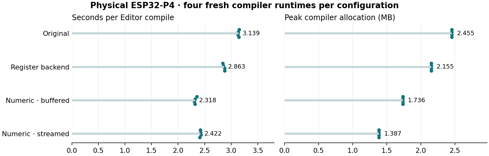
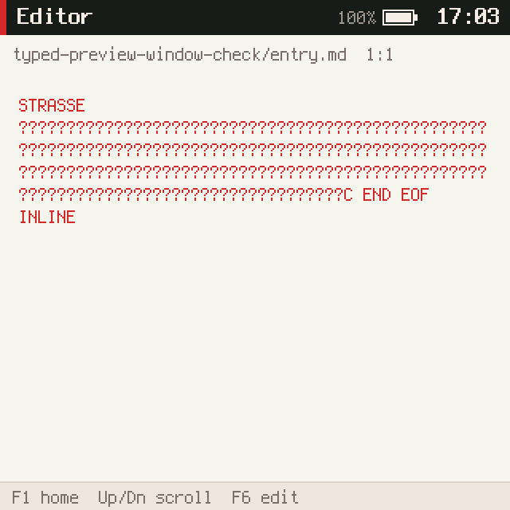

# What the physical PicoCalc pays to compile Editor

Compiling the complete typed Editor on the ESP32-P4 makes it possible to measure the effect of a compiler change in the environment where the change will run. Editor contains 120 typed functions. Its 70,859-byte source is stored in the firmware, alongside a prepared native executable called the reactor. Each build must check the source, emit RISC-V machine instructions, resolve calls and SDK imports, insert the result into the reactor, and return a usable executable to the loader.

The first physical comparison varied two decisions. The native backend can keep shallow expression results in processor registers, which changes the generated instructions. The frontend can pass integer operands directly as numbers and release completed functions earlier, which changes the work required to generate those instructions. The compiler uses QuickJS on the PicoCalc itself in all configurations.

## The four-way comparison

| Editor compiler on the physical P4 | Median cold compilation | Median peak compiler allocation |
| --- | ---: | ---: |
| Original byte frontend and stack-slot backend | 3.139 s | 2,454,968 B |
| Original byte frontend and register backend | 2.863 s | 2,154,834 B |
| Buffered numeric operands and register backend | 2.318 s | 1,735,524 B |
| Streamed numeric operands and register backend | 2.422 s | 1,387,004 B |

The register backend alone saved about 276 ms. Adding the buffered native frontend brought the median down a further 544 ms, or 19.0% relative to the integrated register backend. Compared to the original compiler, the combination reduced total compile time by 26.1% and peak compiler allocation by 29.3%. Each complete Editor module occupied 240,452 bytes, because the linker reserves the application's code region in advance.



The streamed frontend handed each function to the native backend when its body was ready. The buffered frontend retained all the operation arrays until native lowering began. The median difference was 103 ms in favor of buffering. Streaming saved a further 348,520 peak bytes. The current Editor profile allows 4 MiB of compiler allocations. Both choices passed that limit comfortably on this program. A larger app or a lower compiler budget could make the memory difference decisive.

## Isolating direct operands from function framing

A second firmware held the register backend fixed. It added a control frontend that skips Wasm module framing and uses the narrower native-only compiler bundle, but still writes and reads variable-length integer operands. Both this control and the buffered numeric treatment retain completed functions until lowering. Their comparison isolates the change in operand representation. This firmware ran its own four balanced blocks.

| Native frontend with the register backend | Median cold compilation | Median peak compiler allocation |
| --- | ---: | ---: |
| Regular frontend | 2.877 s | 2,154,662 B |
| Unframed functions with encoded operands | 2.725 s | 1,746,650 B |
| Unframed functions with numeric operands | 2.303 s | 1,735,888 B |
| Streamed functions with numeric operands | 2.403 s | 1,387,012 B |

**Passing integers directly saved 422 ms, or 15.5%, at the treatment medians.** The four within-block savings were 422, 409, 420 and 458 ms. All sixteen builds in this experiment produced the same complete ELF. The additional peak saving from direct operands was 10,762 bytes. Omitting framing and the unused Wasm-writing code together had already saved 408,012 bytes. The evidence assigns most of the time improvement to operand passing and most of this peak reduction to the earlier change in what the compiler constructs. Four observations per treatment and one Editor source constrain how widely the figures can be generalized.

## What a measurement includes

One instrumented firmware contained all four compiler bundles. Sixteen calls were organized into four blocks. Each compiler occupied every position once across the blocks. Each call created a fresh QuickJS runtime, loaded the compiler scripts, constructed the source and reactor arguments, checked the source, emitted RV32, linked the executable, copied it out, and destroyed the runtime. The timer began before reading the source and reactor from the firmware bundle. SHA-256 verification happened after the timer stopped. The trial ran within a boot on a single PicoCalc. Its elapsed times describe fresh compiler runtimes on that board. Its allocator peak excludes the C allocations used for file reads and final native-module ownership.

The program hash answers a different question from the timer. The original stack-slot backend emitted different machine code, so its complete ELF digest differed. The register backend with the ordinary frontend, the buffered numeric frontend and the streamed numeric frontend produced the same complete ELF bytes on the board. Each device digest agreed with an independent host compile that used the **actual firmware reactor**. The previous Linux benchmark had linked its reactor with a different toolchain distribution and input-file order. Even with the same typed app source and ELF length, using that older reactor's expected digest would compare different inputs.

## The native application after compilation

The device opened a 65,536-byte Markdown fixture and rendered the formatted heading through its final `END EOF INLINE` marker. Both captured frames passed their transport CRC. I compared their decoded pixels with the earlier physical qualification; the only differences were in the status-bar clock. The application stored its scratch file in an isolated directory and the qualifier verified its removal. After the replay, the test harness restored the backed-up factory application and verified its native Editor was running.



## How this informs the bounds decision

The numeric representation changes how an already checked integer crosses a compiler interface. For example, Wasm encodes an integer constant with a variable-length integer encoding. The old native path writes that encoding and immediately parses it. The numeric path passes the integer directly. The textual bounds experiment has a different obligation. It changes the application code by eliminating a check that can trap. To eliminate it, the compiler must know that the same index is nonnegative and below the current length of the same object on every path reaching the access.

Direct bounds proofs removed three of the 419 static check sites in the measured Files, Agenda and Editor sources. None were in Editor. The affected sites still matter in selected helpers. On the frozen helper inputs, Files went from 225 executed checks to 29 and Agenda from 43 to 34. Expanding the proof search removed no additional application sites. A separate application-runtime experiment on those hot helpers can test whether removing their checks pays for the compiler work. The physical Editor compile times in this study measure operand representations. The bounds pass was disabled throughout.

## Implementing the native path

The existing parser and type checker can serve both native and Wasm output. At the point an operation is emitted, its integer operand is known. A native consumer can store the number directly and a Wasm consumer can write the appropriate LEB encoding. Native compilation can also skip the Wasm function length prefix and local-declaration framing. This keeps Wasm module construction available for `typedWasm.linkWorld`, which the existing firmware calls for Wasm worlds. The timed experimental native bundle narrows its exports, so installing it verbatim over the firmware's shared frontend would break that entry point.

For the first production change, use buffered native operations. Preserve the complete output checks and invalid-source diagnostics while introducing the native consumer. Retain the streaming implementation as a measured candidate for a lower heap budget or a larger app. Keep bounds analysis independent so its proof rules, compile cost and generated-program performance can be reviewed on their own.

## Reproducing the device experiment

The experiment lives under `ttmp/2026/11/19/PICOCALC-COMPILER-THESIS--cold-compilation-and-bounded-analyses-on-the-picocalc`. The board was identified by bridge serial 5B61091051. On this Linux workstation its CDC ACM driver provides `/dev/ttyACM0`. The research scripts use the persistent by-id path. The original 8 MiB factory partition was saved locally. Its firmware image prefix matched the earlier qualification image. The test and restoration write only the factory application partition.

```sh
# Set LAB to the ticket path above and WORK to a new private temporary directory.
S="$LAB/scripts/supervisor"
PORT=/dev/serial/by-id/usb-1a86_USB_Single_Serial_5B61091051-if00
bash "$S/p4-backup.sh" "$PORT" "$WORK/original" "$ESPTOOL"
bash "$S/p4-trial-build.sh" "$WORK" "$IDF_EXPORT"
python3 -B "$S/p4-trial-run.py" "$WORK" "$PORT" "$ESPTOOL"
python3 -B "$S/p4-verify-preview.py" "$WORK/preview"
```

Run from the source repository root with `IDF_EXPORT` pointing at ESP-IDF 5.4.2's export script and `ESPTOOL` pointing at its installed executable. For the direct operand comparison use a second working directory, supply its `original` subdirectory from the same verified backup and pass `--ablation` to both the build and run scripts. The runner checks the partition table, compiles each expected image on the host, verifies all on-board digests, runs the physical 64 KiB Editor workflow, restores the saved firmware and queries its Editor world. Both physical trials restored the verified original factory application. Temporary firmware binaries and private storage stay outside the ticket.

The [report on negative results and deferred optimizations](negative-results.md) records why streaming and bounds analysis retain research value and what evidence would change their production status.
