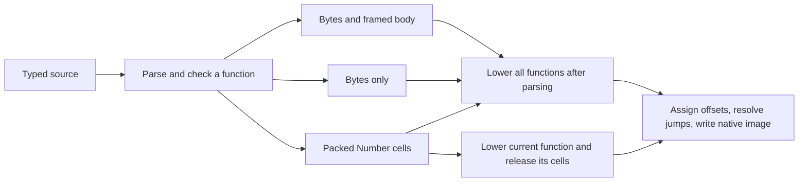

# What the PicoCalc compiler gains from a different intermediate representation

The PicoCalc typed compiler generates RV32 by translating operations that the frontend first encodes as WebAssembly instructions. Those instructions already contain enough information for a small native backend. The choice of representation still determines how much JavaScript work and temporary heap it takes to compile a source file. An experiment with the frozen compiler measured how much of that cost comes from unused Wasm function framing, how much comes from writing and reading variable-length operands, and how much depends on keeping all functions resident until native lowering starts.

> [!summary]
> On host QuickJS, packed operands reduced matched native compilation time by 12.8–17.3% across Files, Agenda's reminder and entry source, and Editor. Editor's incremental QuickJS heap peak fell from 3.20 MB to 2.43 MB. Consuming one function at a time reduced that figure to 1.72 MB and added 3.4% to the buffered packed variant's median latency. Every variant emitted identical RV32 images and metadata. Both representations erased a checked local's `bool` versus `i32` distinction.

## What crosses the compiler boundary

The frontend in `picocalc-os/compiler/typed-wasm.js` combines parsing, type checking and operation emission. A function record returns its name, source parameter and result types, a count of additional locals and two arrays. The first contains the Wasm instruction bytes. The second contains a duplicate of those instructions, prefixed by a vector of local declarations and the function body length. The Wasm writer uses the framed array. The native backend in `picocalc-os/compiler/typed-rv32.js` uses the instruction array, signatures and local counts.

These arrays hold JavaScript Numbers. A Wasm byte is a value between 0 and 255 in an array cell in this implementation. For an integer operand, LEB128 packs chunks of seven bits into bytes and uses the top bit to indicate whether another byte follows. The native decoder combines the chunks and sign-extends signed immediates. Inside QuickJS, encoding therefore creates and appends sequences of Number cells and decoding interprets them. That work buys a compact Wasm wire format when the compiler writes a Wasm module. The native compiler uses the values only to immediately reconstruct the operands. [WebAssembly binary values](https://webassembly.github.io/spec/core/binary/values.html), [WebAssembly binary modules](https://webassembly.github.io/spec/core/binary/modules.html#code-section)

Consider one accepted source function.

```typescript
function example(a: i32): i32 { return a + 130; }
```

| Representation | Contents |
| --- | --- |
| Wasm instruction bytes, hex | `20 00 41 82 01 6a 0b` |
| Wasm framed body, hex | `08 00 20 00 41 82 01 6a 0b` |
| Packed operation cells, decimal | `[32, 0, 65, 130, 106, 11]` |

Opcode `20` hex reads local index 0. Opcode `41` hex pushes an immediate. The signed LEB128 decoder reads bytes `82 01` to construct the integer 130. Opcode `6a` adds the two operands and `0b` ends the function. In the packed variant, the native compiler reads the Number 130 from the cell after opcode 65. Its instruction selector still materializes that number in an RV32 register, stores it in the same operand slot, then emits the same addition and return. The example's framed body starts with length 8 and an empty local declaration vector. Its parameter is already described by the signature.

The prototype keeps the existing type-checking rules and all instruction opcodes, even the Wasm memory alignment field the RV32 backend ignores. This makes the two representations easy to compare. The experiment changes neither the code selection logic nor the data structures used during native image construction.

## Measure the three interventions independently

Each variant starts from Git revision `dd69a81cbf91ebf00e1f527bcbbf785697b1c9a4`. The runner generates scratch scripts and builds the vendored QuickJS at that same revision. This keeps the comparison reproducible while the register-placement investigation edits the production backend in the working tree.

| Lane | Operations | Lifetime of frontend operations |
| --- | --- | --- |
| Bytes | Wasm instruction bytes and a duplicate framed body | All functions |
| Unframed | Wasm instruction bytes | All functions |
| Packed | Original opcodes and decoded Number operands | All functions |
| Stream | The same packed operations | One function at a time |



The stream variant lowers when the body has finished parsing. That is the first point at which the parser knows the total local count. In the frozen backend an operand slot's address depends on that count and on the current operand depth. Waiting for the function to finish lets the experiment preserve every offset calculation and all prologue and epilogue code.

The language's declaration order makes immediate consumption possible. A call can refer to an SDK import or an earlier function. The parser adds a function declaration after scanning its body, so a reference to a later function fails even if the callee appears elsewhere in the same source. Lowering can therefore use the current list of signatures and one mutable target record per function. The native image writer later fills in final addresses and resolves local call sites. The backend keeps emitted words and fixups in every lane. Wasm itself supports a different route to streaming compilation by placing function types in a separate section before the bodies. A future PicoCalc dialect with forward calls could collect signatures before parsing bodies and preserve per-function consumption. [WebAssembly binary modules](https://webassembly.github.io/spec/core/binary/modules.html)

```text
for each function in source order:
    parse and type-check the body, determine nlocals
    register the new callable signature and native target record
    if no native error has been saved:
        lower current operations to native words and fixups
        save the first native error, if any
    release the frontend operation array

if a native error was saved:
    report it
assign function offsets, patch calls, assemble the image
```

The implementation catches errors from lowering while allowing source parsing to continue. This matters if a nine-argument function appears before a later type error. The original backend reaches the type error first because it parses the entire file before lowering. The stream experiment reproduced that priority and separately reproduced the native arity error when the later type error was absent. The native writer's image and metadata also match exactly in all four lanes, including Editor's 145 relocations to SDK imports. A generated positive fixture exercises local indices, call indices and offsets above 127, minimum i32, loop branches, literal stores, division and a relocated import call.

## The time and heap results answer different questions

The frozen Files source contains 7 functions. Agenda's `reminder.typed` followed by `entry.typed` contains 34. Editor's 11 source files contain 120 and use the standard 28 SDK signatures. The largest native image, Editor, compiled to 175,860 bytes in all four lanes. This count measures the app image before placing it in a runtime ELF slot.

| Corpus | Bytes full | Unframed full | Packed full | Stream full | Bytes → packed paired saving |
| --- | ---: | ---: | ---: | ---: | ---: |
| Files | 2.910 ms | 2.829 ms | 2.542 ms | 2.625 ms | 12.8% |
| Agenda reminder + entry | 12.758 ms | 12.293 ms | 10.969 ms | 11.513 ms | 13.7% |
| Editor | 60.033 ms | 58.234 ms | 49.443 ms | 51.103 ms | 17.3% |

The full timings cover source checking, operation emission, native lowering and image assembly. The four lane median columns summarize 64 calls per lane. Each process creates a fresh realm per lane, calls each once, warms up with two more calls, then runs 16 serial rounds. A round rotates lane order. Four processes start with different rotations and pin to host CPU 6. The last column takes one minus the median of within-round time ratios. The host used an Intel i7-1165G7 and the frozen QuickJS 2026-06-04 tree built with `cc -O2`. Source text, SDK signatures and compiler scripts are resident before the timed region. Editor's first calls give medians of 65.450 ms for bytes, 52.898 ms for packed, and 54.919 ms for stream over the four new realms. These numbers describe a first invocation of a resident compiler. Device startup, ELF linking, OS installation and elapsed time on the PicoCalc are outside the interval.

Removing the unused frame alone saved about 3–4% in the paired full timing. Prepared-input replay shows why this differs from the packed result. Replay parses once before timing, then runs the same native instruction selection, fixup resolution, metadata construction and image writing on both saved representations. On Editor, the median replay falls from 24.830 ms to 22.229 ms. Its paired saving is 10.2%. The unframed byte lane's paired replay ratio to the baseline is 0.996. The separate frontend median drops from 35.488 ms to 33.596 ms by discarding framing and to 27.344 ms by discarding immediate encoding as well. The replay and frontend measurements have different object lifetimes from a normal full call, so their times cannot be summed to estimate a new full total.

| Corpus | Bytes extra peak | Unframed | Packed | Stream |
| --- | ---: | ---: | ---: | ---: |
| Files | 126,768 B | 114,944 B | 109,200 B | 86,784 B |
| Agenda reminder + entry | 586,944 B | 486,560 B | 483,392 B | 379,840 B |
| Editor | 3,198,824 B | 2,457,840 B | 2,427,040 B | 1,719,456 B |

The heap measurements use one first full compile in a fresh realm after a collection, in a separate process from timing. A QuickJS allocator hook records the maximum accounted live bytes after allocation callbacks, less the live total immediately before compiling. It uses Linux usable allocation sizes plus QuickJS's per-allocation accounting overhead. This measures compiler heap above the preloaded compiler and source. It excludes native C stack use, allocator process RSS, transient internals of a moving `realloc` and the board allocator. Differences in garbage collection and native word array lifetimes can affect the observed peak.

The Editor byte frontend retains 36,917 code cells and 37,418 framed-body cells. Unframed removes the latter arrays. Packed reduces the remaining number of cells to 35,133. With streaming, the largest completed input function has 2,479 packed cells. The reduced live input helps explain the peak drop after streaming. Streaming still pays for all native output and fixup data, so the entire job does not shrink in proportion to the input instruction cells. It saved another 708 kB of incremental peak over packed buffering on Editor. The stream lane incurred a latency cost in every application, ranging from 3.3% to 5.0% using the median call times. This experiment does not isolate the callback from incremental maintenance of signatures, target arrays and object lifetimes, so the individual contributors to that cost remain unmeasured.

## Decide which source facts the representation must carry

A compiler can avoid encoding overhead and still lose a distinction relevant to optimization. The experiment checked this with two source programs that differ in a checked local declaration.

```typescript
function f(): i32 { const x: bool = true; return 0; }
// In a second source, the same function declares x as i32.
function f(): i32 { const x: i32 = 1; return 0; }
```

The parser enforces each declared type. Both accepted sources give the same signature and identical packed operations `[65, 1, 33, 0, 65, 0, 11]`. Those operations set local 0 to the machine value 1, push 0 and finish. The byte and framed forms are identical as well. A later pass cannot recover the local's original type from that function record alone. Record layouts and function signatures still carry source types, and opcode shape carries load/store width and control structure. Any pass that needs source-local type, mutability or the source location for an operation needs another field or an annotation captured before emission erases it.

Binaryen's IR illustrates why representation decisions are tied to the pass using them. Its tree structure supports transformations on expressions and it supplies a stack representation for cases that need one. The MLIR authors describe an architecture with operations at multiple abstraction levels and typed values, with a separate serialized form. Those designs preserve particular information because their passes consume it. The PicoCalc experiment keeps one flat operation array and changes when and how operands are materialized. Extending that array for a concrete pass would be a separate compiler experiment. For a checked buffer access, one candidate would preserve the receiver, index, access width and source location as a single operation until the pass has used them. It would need a correctness argument for any intervening write or call that can invalidate the receiver's length and a measurement of the annotation's lifetime cost. [Binaryen IR design](https://github.com/WebAssembly/binaryen#binaryen-ir), [Lattner et al., MLIR](https://arxiv.org/abs/2002.11054), [MLIR language reference](https://mlir.llvm.org/docs/LangRef/)

The measured choices have different uses. Packed buffering is the fastest option in this host experiment. Function-at-a-time consumption is the lowest-peak option and fits the frozen compiler's declaration order. The exact output check isolates a compile-time change, so any improvement to RV32 instruction count requires a separate optimization. The most direct target follow-up is the same comparison under the board memory allocator, with source load and compiler evaluation measured independently from the compile call.

## Reproduce the comparison

From `/home/manuel/code/wesen/2026-10-20--ds-js-os`, use Python 3 and a C compiler on Linux. Use a permitted CPU ID or omit `--cpu` on another host.

```sh
ticket=ttmp/2026/11/19/PICOCALC-COMPILER-THESIS--cold-compilation-and-bounded-analyses-on-the-picocalc
python3 -B "$ticket/scripts/representation/run.py" \
  --cpu 6 --rounds 16 --rotations 4 --receipt /tmp/representation.json
```

The ticket's `various/representation/quickjs-results.json` includes per-call measurements, first-call samples, compiler and source hashes, allocator endpoints and the digests of native images and metadata. The first step in checking the equivalence claims is to run the same command with `--verify-only`. The source is reconstructed from immutable Git objects, so uncommitted changes to the production backend do not affect the result.

## Independent qualification

A second researcher varied function order while holding constant the operation count, number of functions, maximum function size and total emitted image length. Placing the large function last increased the median incremental streaming peak from 601,344 to 766,624 bytes. The buffered packed peak was 899,640 bytes in both orders. The compiler retains the native bytes of previously compiled functions. Their lifetime can overlap with a large input body, so maximum function size alone cannot predict the streaming peak.

The reviewer also repeated a full native Editor compile through the firmware entry with five freshly built configurations. At a fixed register backend, the packed-buffered and packed-streamed compilers produced the same ELF. Buffered took a median of 41.007 ms and 2,588,664 peak allocator bytes. Streamed took 41.823 ms and 1,891,168 bytes. Those peaks cover the cold Linux firmware-allocator interval. The phase measurements in the preceding sections use the resident harness with its own allocation accounting. A production integration also needs to retain the shared Wasm loader's `typedWasm.linkWorld` entry point.
