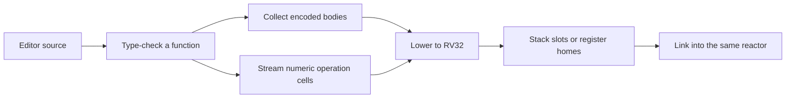
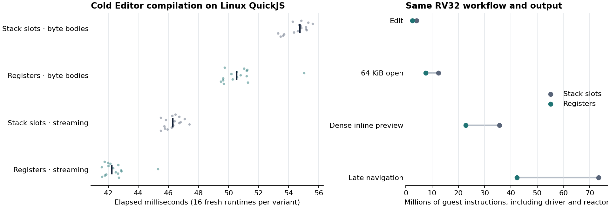

# What a cold compiler can afford on the PicoCalc

Editor is a typed JavaScript application that the PicoCalc firmware can compile to native RISC-V at boot. At the start of this investigation, its 120 typed functions produced 43,965 RV32 instructions. The compiler ran on the ESP32-P4 in roughly 3.14 seconds and occupied about 2.45 million bytes at its allocation peak in the earlier board qualification. A person editing a program on the handheld pays that compilation cost whenever they need a fresh build. They also pay for every unnecessary instruction in the resulting app each time it runs.

Three researchers examined where the compiler spends those resources. One changed where temporary values live in the emitted program. One changed the representation handed from the frontend to the native backend. The third asked whether the compiler could use known relationships between integer values to remove a text-access check. Each experiment has a different observable result. The first changes the machine instructions, the second can change the compile cost while preserving the machine instructions, and the third needs a proof that the removed check would always succeed.

> [!summary]
> The register change is integrated in the project compiler. It roughly halved the emitted code of three workloads. Four matched Editor replays used 36–42% fewer total guest instructions.
>
> Combining the register backend with an experimental streamed native frontend reduced a full Editor compile on Linux QuickJS from 54.74 to 42.23 ms in the same experiment. Its peak went from 3.91 to 1.89 million Linux allocator bytes. These figures are host measurements.
>
> Bounded relational search succeeded on constructed chains. In the unmodified corpus, three sites qualified for direct proofs and longer chains contributed zero additional removals.

## How a value reaches a machine register

For an expression such as `(a + b) * c`, the source compiler first constructs a sequence of typed stack operations. The add consumes two inputs and leaves a sum for the multiply. A stack position describes an order of computation. A compiler is free to implement that position with a processor register, a location in the function's memory area, or a constant that it will materialize later.

The original backend assigned every operand position a word in the function's stack frame. An add could load two temporary words, add them and store the result. The next operation would load that same result again. Commit `f0846ba` assigns the shallowest five positions to temporary RV32 registers. An operation writes directly to the register appropriate to its output depth. Deeper positions have locations in memory. When a called function may overwrite the temporary registers, the caller saves the live prefix of its stack and restores it after the call. Two control-flow paths that reach the same depth agree on these homes.

This first change deliberately uses eager reads. It establishes the cost and correctness of register placement independently of delayed constants, comparison fusion or register allocation for local variables. The technique belongs to a line of work on static stack caching and fast baseline compilation. The PicoCalc-specific evidence is the combination of an actual working backend, a hardware-constrained compiler design and a workload with an existing behavioral reference. [Liftoff](https://v8.dev/blog/liftoff) · [Titzer on baseline compilation](https://arxiv.org/abs/2305.13241)

| Typed workload | Baseline instructions | Register backend |
| --- | ---: | ---: |
| Files | 1,529 | 804 |
| Agenda entry and reminder functions | 7,710 | 4,058 |
| Editor | 43,965 | 21,886 |

For Editor that is 87,544 occupied code bytes, down from 175,860. The prepared reactor still reserves a fixed executable region. Both completed ELF files occupy 240,452 bytes. A change to the reservation would be required to reclaim this difference in the loaded application. Agenda's numbers refer to its typed logic. Its C reactor contains additional application behavior outside the count.

## The frontend and backend can be varied independently

The regular frontend encodes Wasm-like operations and their integer operands as bytes, then constructs the length-prefixed bodies required by the Wasm binary format. The native compiler consumes the operations and decodes the integers again before emitting RV32. Its input is already checked. That observation suggests two distinct experiments: change how an operand is represented, and release a completed function's temporary representation earlier.

The representation researcher generated four experimental compilers from the same frozen sources. One used the original byte bodies, one omitted Wasm module framing, one passed numeric operation cells and one also lowered functions as they became available. Here a cell is a JavaScript array entry holding an opcode or operand. Its representation in the interpreter may cost more than one byte. Its benefit follows from eliminating encoding, decoding and copies, as well as shortening the lifetime of the array. A per-function stream retains the signatures and addresses needed by later calls and output linking.



I crossed two representations with the two backends. For each of 16 blocks, four new OS processes loaded fresh QuickJS runtimes and compiled the same source and reactor. A balanced four-order schedule put every treatment in each position equally often. The harness compiled the firmware's real `p4_editor_compile` and `p4_typed_compile` in a Linux executable. Host services supplied the clock, bundle reads, memory and stack limit. The reported interval includes reading the inputs, loading the compiler, checking and lowering source, linking the ELF, copying the result and destroying QuickJS. The host's file cache can retain input pages between processes.

| Compiler used for a cold Editor build | Median elapsed | Peak QuickJS allocator bytes on Linux |
| --- | ---: | ---: |
| Original frontend and stack slots | 54.742 ms | 3,910,760 |
| Original frontend and register homes | 50.552 ms | 3,402,944 |
| Experimental streaming and stack slots | 46.285 ms | 2,396,120 |
| Experimental streaming and register homes | 42.233 ms | 1,891,168 |

For a given backend, both representations produced byte-identical linked ELF files. Across backends, the expected difference is the compiled code inside the slot. Every repeat of a given treatment produced the same output hash. The combined experiment measures the entire native-only frontend treatment, including changes to how much compiler JavaScript it loads. The researcher's separate four-way prepared-input experiment provides finer attribution. A representation which uses numeric cells can still discard source types. The prototype's local Boolean-versus-integer example demonstrates exactly that.



## Counting work in a running application

A change to static code size alone permits many possible runtime outcomes. In a text editor, some loops execute once per character while others handle an occasional menu selection. To compare generated execution, I used each compiled ELF with the same relocated RV32 driver and recorded the emulator's full guest instruction count from startup to exit. The driver, reactor, routines that publish frames and the typed app all contribute. The controls kept the driver binary, app pathname and input sequence identical for each pair. Both executions produced matching complete textual traces, and the ordinary Editor harness also compared published frames against the JavaScript reference.

| Workflow | Original guest instructions | Register backend | Reduction |
| --- | ---: | ---: | ---: |
| Edit | 4,047,796 | 2,543,239 | 37.2% |
| Open the 64 KiB fixture | 12,359,858 | 7,621,786 | 38.3% |
| Preview dense inline Markdown | 35,693,419 | 22,853,317 | 36.0% |
| Navigate near the end of the file | 73,408,388 | 42,316,056 | 42.4% |

A guest instruction has no fixed duration on the physical processor. Cache state, branches and the behavior of the memory system affect timing. The distinction also matters for the host compiler. A separate alternating 20-pair trial produced higher absolute median compile times, 82.68 ms and 74.70 ms for the original frontend with the two backends. All twenty pairs favored the register backend. Relative comparisons in this report use variants timed within the same series. The P4 figure in the opening paragraph comes from an earlier physical run of the original compiler. The previously qualified serial port was absent during this experiment and a read-only console probe on the available bridge returned no bytes.

## Which text accesses can a bounded proof remove?

A text buffer supplies a length in code units. A bounds check requires the index to be nonnegative and strictly smaller than that length. A proof at a particular access can use facts from conditions that executed on every path to that point. For example, `0 <= i`, `i < end`, and `end <= text.length` establish both bounds, provided the names still describe the same values and buffer. A write through an alias can invalidate a length fact. A signed induction variable can lose its lower bound on arithmetic wrap.

The bounds researcher used a budgeted search over strict and non-strict inequality edges. If the compiler exhausts its budget, the original check remains in place. This is an application of demand-driven bounds reasoning. The experiment distinguishes a syntactic opportunity, a valid proof, an eliminated machine-level check and a dynamically avoided check. The corpus contains loops with a suggestive guard for which a local proof lacks a necessary lower bound or a relation to the length of the same buffer. [Bodík, Gupta and Sarkar, *ABCD*](https://doi.org/10.1145/349299.349342)

The three workloads contained 419 check sites in the experimental census. Two sites in Files and one in Agenda qualified for direct elimination. The longer search succeeded on constructed examples but added zero corpus sites in this experiment. The direct Files sites accounted for a large fraction of executed checks in the selected helper replay. Wider search alone is therefore a poor next use of compile time on the evidence here. A more informative experiment would collect frequently executed surviving checks and identify the missing fact for each one.

## Reproduction and next experiment

The source repository is `/home/manuel/code/wesen/2026-10-20--ds-js-os`. The canonical lab is `ttmp/2026/11/19/PICOCALC-COMPILER-THESIS--cold-compilation-and-bounded-analyses-on-the-picocalc`. The baseline is `dd69a81` and the integrated backend is `f0846ba`. The three researcher reports explain their individual generators and oracles. The supervisor's scripts reproduce the cross-experiment measurements.

```sh
python3 -B "$TICKET/scripts/supervisor/cold-compiler.py" "$RV32_GCC" \
    --candidate f0846ba --pairs 16 --factorial --modules-out "$OUT"
python3 "$TICKET/scripts/supervisor/editor-steps.py" "$RV32_GCC" "$RV32_EMU" "$OUT"
```

Set `TICKET` to the lab path above, `OUT` to a scratch directory, and the two executable paths to the Espressif RV32 GCC and project RV32 emulator. Run the commands from the repository root with the project's host QuickJS objects and typed reactor build dependencies available. Detailed receipts include checksums and per-trial values.

The experiment supports testing a native frontend that avoids constructing unused Wasm bodies and progressively releases per-function data. Its next qualification is a matched fresh build on the physical P4, followed by semantic comparison of the resulting modules and measurements of peak compiler memory. The budgeted proof should stay experimental until a measurement of frequently executed checks shows which additional relationships justify their inference cost.
