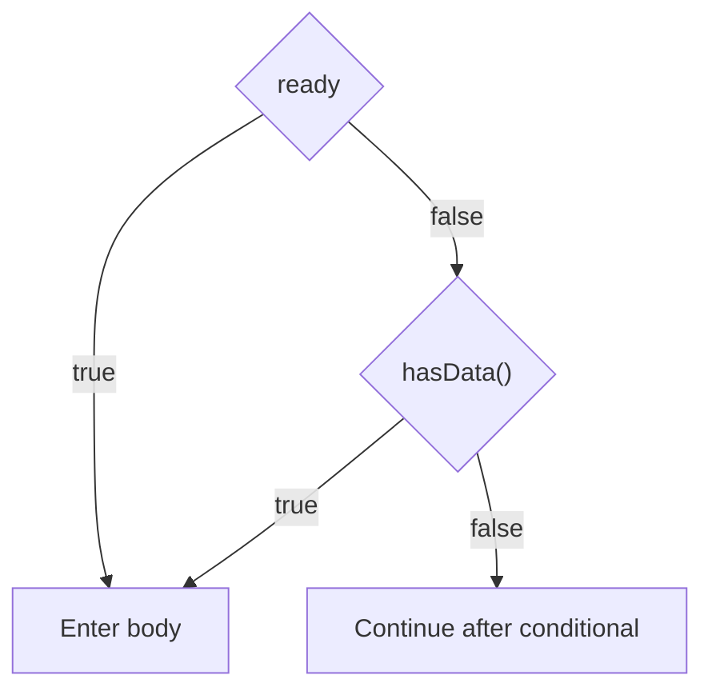

# When a Boolean becomes a branch on the PicoCalc

Files uses `start < end && filesSpace(value.charCodeAt(start))` to skip leading spaces in a file name. When `start == end`, evaluating the character access would trap. The source language requires the first test to prevent the second from executing. For a loop condition, either test can branch to the loop exit. In `let flag = ready && hasData();`, the compiler must produce a value because later code may read or pass `flag`.

Teaching the shared PicoCalc compiler that difference reduced native code by **77 instructions in Files, 297 in Agenda and 587 in Editor**. All three went under their proposed ceilings. Editor's linked Wasm module fell from 88,255 to 88,025 bytes. The same Wasm and RV32 results passed 24 application checks, and the focused oracle verified the order of calls and traps across 802 inputs.

## Translate the use of the result

In the staged A5 frontend, compiling `a && b` emitted a Wasm `if` that produced a value. The true arm evaluated `b`. The false arm produced zero. When this was the condition of a loop, a separate branch examined that value to decide whether to exit. The alternative makes the first false test take the loop exit directly and evaluates the second only when the first succeeds. Each leaf still emits its own typed operations, including bounds and division checks.

For an OR used as an exit-on-false condition, a true left operand needs to get past the right operand and reach the body. Wasm labels denote enclosing structured control regions. A new void block wraps the tests. A true left result branches to the end of that inner block, and a false right result branches out of the outer block.



The shared parser emits a small plan for the logical part of a condition. A raw fragment records the ordinary encoded operations of a leaf. Each tree edge represents the left or right operand, in evaluation order. The plan is discarded as soon as the statement's condition has been emitted. A work array handles long left-associated expressions without adding another recursive JavaScript path. Both Wasm encodings use the same branch emitter.

```text
branch(A || B, whenFalse, exit):
    block thenBody
        branch(A, whenTrue, thenBody)
        branch(B, whenFalse, exit)
    end
```

An equality still needs its operands' values, even when the equality is itself a condition. For `if ((a && b) === c) return 1;`, the nested AND still produces its value with an `if` result. The same rule applies to a logical expression in a call argument. An ordinary Boolean assignment retains its original encoding byte for byte in the focused fixture. Negation changes the direction of a condition branch, making it possible to use the existing staged backend's fused compare-and-branch.

## Test the parts a returned value cannot show

The fixture's `note` function appends one digit to a record when an operand runs. The bounds-checked function appends 4 before reading the string. The division function appends 5 before dividing. The record is still visible when execution traps. These observations distinguish treating short-circuiting as an arithmetic summary from executing only the operands the source requires.

| Expression in either `if` or `let flag` | Inputs | Call order digits | Outcome |
| --- | --- | ---: | --- |
| `A && bounds(...)` | A false, index −1 | 1 | False |
| `A && bounds(...)` | A true, index −1 | 14 | Trap |
| `A && bounds(...)` | A true, index 0 | 14 | True |
| `A || divides(...)` | A true, divisor 0 | 1 | True |
| `A || divides(...)` | A false, divisor 0 | 15 | Trap |
| `A || bounds(...) && divides(...)` | A false, index −1, divisor 0 | 14 | Trap during bounds |

An independent JavaScript oracle computed the value, trace and trap outcome. WebAssembly executed with Node's engine. RV32 executed with the repository's interpreter. Each of the 802 cases ran on each target with the staged compiler and the candidate. This gave 3,208 result and memory comparisons, including the 112 input cases expected to trap. The condition containing 2,048 logical operators passed on both targets. Eight malformed cases produced identical diagnostics. The application suite then exercised the normal host wrapper entry points, including 13 Editor scenarios. [Condition oracle and per-function accounts](../various/host-account.json) · [Application replay receipt](../various/host-replays.json)

## Code-size evidence

| Workload | Staged RV32 | Direct conditions RV32 | A6 ceiling | Result-producing Wasm ifs |
| --- | ---: | ---: | ---: | ---: |
| Files | 593 | 516 | 547 | 42 → 19 |
| Agenda | 2,793 | 2,496 | 2,611 | 115 → 26 |
| Editor | 16,541 | 15,954 | 16,210 | 228 → 61 |

The native counts exclude the surrounding reactor. The historical Stage 3 model rerun on A6 predicts 516, 2,497 and 15,969 instructions. The largest discrepancy is 15 instructions in Editor, below its five-percent tolerance. Native image output was identical in streamed and buffered compilation. Both lanes used the standard executable reservation. The smaller native code therefore occupied less of that reservation, while the allocated module size stayed fixed. [Frozen compiler identities](../various/compiler-inputs.json) · [Linked host ELF oracle](../various/board-oracle.json)

<!-- physical_results -->

## Reproduce the comparison

From the project repository, stage with the ticket's `scripts/01-stage.py`. Run `scripts/03-verify.mjs` over that directory and the built Editor Wasm reactor. The two frontend scripts differ by the ticket's `02-condition-destinations.patch`. Compare the application suite with `scripts/05-host-replays.py`. The board fixture stages the same pair with `scripts/04-stage-board.py` and builds the resulting port with `scripts/06-build-board.sh`. [Preimplementation design](../design-doc/01-how-a-boolean-expression-becomes-a-branch.md) · [Investigation diary](../reference/01-condition-destinations-investigation-diary.md)
