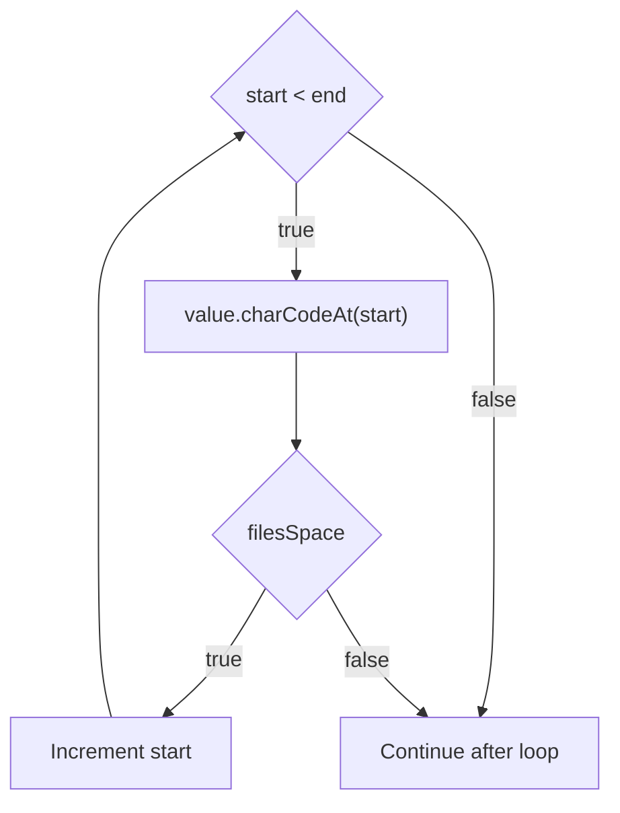

# How a Boolean expression becomes a branch

The Files world skips leading spaces with `while (start < end && filesSpace(value.charCodeAt(start)))`. The index guard needs to run first. At the end of the string the compiler must skip the access, which would otherwise trap. Inside the loop the only use of the Boolean result is deciding whether to enter the body. This study compares code that produces the Boolean before the loop with code that takes the exit directly from either test. Assigning the same expression to `let flag` still needs a Boolean stored for later use.

## Where the comparison starts

At project revision `dbe26be`, the production compiler is in `picocalc-os/compiler`. The experiment uses the frozen staged lane built by the earlier `PICOCALC-STAGED-RV32/scripts/01-stage.py`. The staged Wasm frontend is the frozen `typed-wasm.js` at `40bcf850`. The staged native lowerer layers deferred operands, compare-and-branch fusion, short branches and leaf frames onto that revision's native backend. The supervisor verifies this pinned pair through the professor's 24 replay cases before candidate measurements begin.

The shared frontend emits structured Wasm operations in two encodings. `FunctionEmitter` writes bytecode with variable-length integers for the Wasm target. `NumericFunctionEmitter` inherits the parser and writes each immediate as one number for the native backend. `compileFunctions(source, functionBase, imports, limit, numericOperands, onFunction)` selects the emitter. In streamed RV32 it invokes the backend callback as it completes each function. A condition change here affects both outputs without changing the callback or the operation vocabulary.

In `FunctionEmitter.statement` a simple `if` compiles an expression followed by an `if void` body. A `while` opens a break block and a loop, evaluates the expression, and exits via `eqz; br_if 1` when the result is zero. Currently `FunctionEmitter.expr` compiles every logical operator as a result-producing structured Wasm `if`. The left value chooses the arm. The right value is produced on one arm, and the other has a constant. The outer statement consumes that merged value.

## Parse once and choose how the result is used

The proposed `expr(minPrecedence, conditionMode)` continues to use the existing precedence parser and type checks. In condition mode, a logical operator creates a short-lived plan with the operator and its two operands. A parenthesis passes through the inner plan and a logical negation reverses a branch's sense. An operand that is already a scalar value becomes a fragment of the normal emitted operation array. The proposed representation retains plans only through the current condition. It dies before streaming the function to the backend.

The same grammar can consume a logical expression inside an equality. In `if ((a && b) === c) return 1;` the equality needs the value of `a && b`. Before emitting the equality, emit that operand in value mode with the original result-producing `if`. Call arguments, indices, local assignments and returns start their expressions in value mode. The position of an expression within the statement determines which contract applies. The type checker still parses both operands even when one can never execute.

```text
expr(minPrecedence, conditionMode):
    start = output length
    left = prefix(conditionMode)
    while next infix operator binds at minPrecedence:
        check left type at the existing diagnostic position
        if logical op and conditionMode:
            left = plan(op, capture(left, start), parse right in condition mode)
        else if logical op:
            emit the original result-producing Wasm if
        else:
            emit left as a value if it was deferred
            parse and emit right as a value
            emit scalar opcode
    return type or deferred logical plan
```

Starting by parsing a separate conditional grammar would repeat precedence and diagnostics. A full source AST or a second token walk would put more of a large app in flight. This proposal adds condition-aware lowering to the existing parser and uses already emitted, self-contained fragments for operations outside the logical cases. A long chain can produce a left-deep plan without consuming parser nesting depth. Lower it with an explicit work array so JavaScript function recursion does not introduce a new source limit. Copy fragments by iteration to avoid a maximum argument-count assumption for a single large expression.

## Choose a branch direction and preserve fall-through

Wasm branches name an enclosing structure by relative depth. A depth of zero names the innermost structure. An exit from an `if` body names the enclosing `block`. A loop's break block is one level outside its `loop`, so that break starts at depth one. Each additional condition block increases the distance to the original destination by one.

A one-sided condition branch takes the destination for one outcome and lets the other outcome continue with the next instruction. To exit on false from `p && q`, emit both operands with that same exit. To exit on false from `p || q`, create a short block around both operands. Its end is immediately ahead of the statement body. Branch there when `p` is true to skip `q`. A false `q` targets the original exit one level farther away. Switch the roles of `&&` and `||` when compiling a true destination. Negation flips which outcome takes the branch. The existing numeric backend can fuse the leaf comparison into a native conditional branch.



```text
branch(plan, takenWhen, depth):
    atom -> emit scalar operations, eqz if takenWhen is false, br_if depth
    not -> branch(child, opposite(takenWhen), depth)
    && for false, || for true -> branch(left, takenWhen, depth)
                                 branch(right, takenWhen, depth)
    otherwise -> block
                 branch(left, opposite(takenWhen), 0)
                 branch(right, takenWhen, depth + 1)
                 end
```

Preserve the direct `if void` template when parsing did not produce a logical plan. For a planned `if (C) return e;`, the block contains the statement's existing early return, with the false branch targeting after it. A planned `while` uses its original loop and break block. A trap inside a selected leaf may have internal structured instructions, but the fragment closes them before the condition emitter adds a branch. This keeps relative depths independent of the operation encoding.

## Implement and measure in an isolated tree

1. Stage the frozen control with `python3 -B ../PICOCALC-STAGED-RV32--*/scripts/01-stage.py <fresh-directory>`. Put the candidate patch to `typed/wasm.js` under this ticket's `scripts/`. Stage a second compiler lane named `conditions` with an unchanged `rv32.js` and `world.js`. Write input hashes and pin the A6 lane used by A7. A change to numeric operation metadata by the separate typed-operations study can be applied around the shared encoder hooks.
2. Compare the staged and candidate Wasm and RV32 on call traces and trap prefixes. Generate combinations for nested `&&`, `||`, `!`, mixed precedence and repeated loop tests. Include record mutations, an out-of-bounds code-unit read, and a division trap. Test the same logical forms as conditions, values, equality operands and arguments. A plain Boolean return and an ordered mutation trace make a useful independent oracle for each test. Compare errors on malformed conditions, including type errors in skipped operands.
3. Count linked native instruction words from the candidate image and the range between function entry offsets. Count Wasm result-producing `if` blocks with a binary-aware operation scanner, and record linked Wasm size where the matching reactor is available. Pull the three source inputs from the frozen staged experiment. Keep a separate model prediction so an implementation result never gets mistaken for an estimate.
4. Run the full Files, Agenda and Editor replay set for both targets on the host. For the physical experiment use matched staged and A6 bundles with the same reactor, streamed setting and hardware. Use separate cold QuickJS runtimes for compiler trials and alternate lane order within a boot. Capture compile time, allocated QuickJS peak, code and ELF identities, and physical app outcome. The supervisor schedules the UART and restores the prior app partition.

| Workload | Frozen A5 words | A6 ceiling | Result-producing Wasm if ceiling |
| --- | ---: | ---: | ---: |
| Files | 593 | 547 | 19 |
| Agenda | 2,793 | 2,611 | 26 |
| Editor | 16,541 | 16,210 | 61 |

The ceilings come from the A6 task and may differ from results based on later app inputs. Recover the measured control counts from the frozen input instead of assuming these historical counts still match. The roadmap also specifies a linked Editor Wasm size of at most 88,255 bytes and instruction totals within five percent of the rerun model. Track each gate independently. With identical app behavior, a higher compiler peak or elapsed time is a measured cost to report. Record the profiler's peak convention and the firmware configuration so A7's control can be reproduced.

[Professor's A6 design](../../PICOCALC-NATIVE-NEXT--a-smaller-rv32-backend-a-module-cache-safety-checks-and-await-for-typed-picocalc-worlds/design-doc/02-scope-a-an-rv32-backend-with-a-compile-time-operand-stack.md#task-a6--and--in-conditions-compiled-to-branches) · [Staged lowerer study](../../PICOCALC-STAGED-RV32--a-staged-operand-stack-for-picocalc-rv32-compilation/analysis/02-how-a-staged-operand-stack-made-room-for-picocalc-editor.md)
