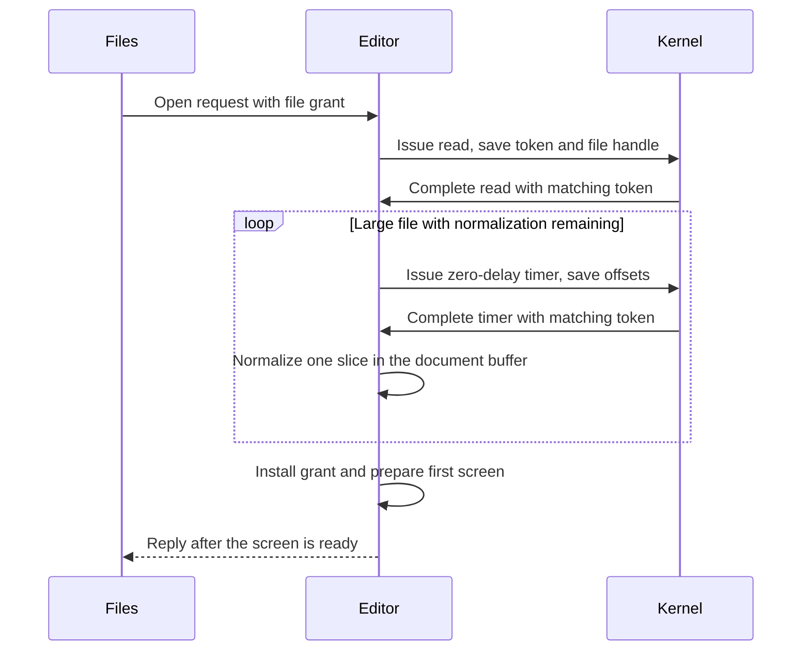
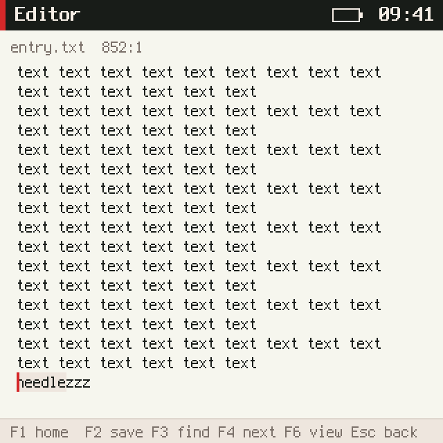

# What PicoCalc Editor keeps across a file read and a search pause

A file can take more than one execution segment to open on the PicoCalc. Editor asks the filesystem to read the file and returns control to the kernel. When the result arrives, Editor may have 65,536 units of text to prepare before publishing its first screen. Find has the same scheduling requirement without an I/O operation. It scans part of the text, requests a zero-delay timer and resumes on the timer's completion.

The production typed Editor now expresses both operations with `await`. The compiler generates the code that restarts them on the correct event. In host qualification, the combined state uses 70 scalar fields, one fewer than the hand-written app. The generated world passes 13 ordinary Editor workflows and five direct event tests on both Wasm and RV32. All 24 cross-application replays also pass at the combined checkpoint. The size of each generated frame follows from what the application still needs after each wait.

## A completion starts a new invocation

The kernel calls Editor with a `WorldEvent`, a persistent `WorldState` record and two buffers for screen and key hints. An operation such as `typedSdkFileRead(handle)` returns a positive integer token when the request starts. A later event of kind 4 carries that token, a success bit and a JSON result. Editor's native call stack is gone by that time. A value the code needs after the read has to come from state that survived the call or from the new event.

Before this change, the Open policy stored a file handle, a name length, a token and a mode bit in the state record. The event handler compared the incoming token against those fields and chose a continuation by hand. The typed task supplies the compiler with the actual point of suspension, so the labels and dispatch checks come from the source's control flow.

```typescript
const ok = await typedSdkFileRead(handle);
if (!ok) {
    // An immediate request failure still has the original message event.
    // A failed completion carries the filesystem's error in its result.
}
```

The compiler uses liveness to choose what to save. A value is live across a wait if some path after the wait can read it before its next assignment. At this first wait the file handle is live because Editor will either install that grant or release it. The result flag `ok` comes from the new event. The pending title is in a reactor-owned slot. The continuation receives the current event, output and hint parameters from the event handler and obtains a fresh reference to the title buffer when it needs it.



## Open keeps the read and the normalizer in one task

Open validates the transferred handle and title before starting the task. Slot 2 holds up to 95 UTF-16 units of pending title in positions 0 through 94. Its next position holds the title length. The app marks itself as `opening` while it owns that slot, because the usual renderer also writes status text there. The opening guard prevents both rendering and editing from touching the shared buffers during the read or conversion. When the read succeeds, Editor remembers the old cursor position before replacing the document buffer.

Normalization converts CRLF and bare CR to LF in place. The read and write positions start at zero. The read position advances by one input unit or by two for CRLF. The write position advances by one for every output unit. That difference lets each slice write into the original document buffer without overwriting unread input. A large document issues one timer before the first slice and another before each remaining slice. If a CR is input unit 4,095, the first slice can consume the LF at 4,096. The next slice starts at 4,097. In the fixture there are 54 CRLF pairs before that point, so the next wait saves a read position of 4,097 and a write position of 4,043.

The read wait saves one value, the handle. The yield wait saves four values: the handle, input length, read position and write position. The generated program counter selects the next statement. That counter and the waiting token add two words to the Open frame. Retaining the title count with the title removes one scalar from the compiler's frame while using the same buffer as the previous Open. Editor installs the prepared grant after the last normalization slice. A large first screen can require a separate timer for cursor restoration and layout. The success reply follows the successful path's call to publish the screen.

A failed start releases the offered grant immediately. A later permission error uses the filesystem's message in the reply. A missing-file result creates an empty document and installs the new grant. These are distinct outcomes from the same read operation and remain explicit in the typed source. [Open implementation](../../../../../../picocalc-os/worlds/editor/editor.typed)

## Find keeps physical and folded positions

Find searches the rest of the cursor line, the following lines, the earlier lines after wrapping, and finally the cursor line prefix. `FindPhase` names each range and the two terminal results. An exhaustive `match` must account for all six enum members. The enum detects an unhandled phase during compilation and retains the four-byte integer representation used by the reactor.

The search tracks two positions in the document because case folding changes some lengths. The unit U+0130, LATIN CAPITAL LETTER I WITH DOT ABOVE, consumes one UTF-16 unit in the input and two units in its folded form. For a line starting at physical offset 40, with one U+0130 before a candidate at offset 46, that candidate's folded absolute position is 47. The trace uses the folded position to preserve the existing cursor placement rule. If that position reaches the physical end of the line, Editor clamps it there. A second check keeps the cursor out of the middle of a surrogate pair.

Find saves the physical scan position `at`, the folded position `foldedAt`, the current physical line end, the phase and the anchor. The anchor is the cursor position, advanced one point within the same line for Find Next. The anchor defines the lower bound for matches in the starting suffix and the upper bound for starts of matches in the wrapping prefix. A match starting in that prefix can extend past the anchor. Saving absolute offsets lets Find locate the cursor line during wrap by comparing the physical line end with the anchor. It also lets the task retain the line end across a pause instead of searching for that newline again.

Each slice spends one work unit per loop iteration and adds the query length when it tests an eligible candidate. The compiled task obtains its document and query buffers at the start of the slice. A paused search leaves the active query available to the view, while the compiler's `pending()` prevents intermediate rendering. Once a match changes the cursor, the view may still need several 64-row passes to locate and draw its viewport. A Find timer resumes the search. A frame timer resumes the renderer. [Find implementation](../../../../../../picocalc-os/worlds/editor/find.typed)



The figure is the Wasm host framebuffer for a 65,536-byte file containing one occurrence of `needle` near its end. It matches the original JavaScript Editor's capture byte for byte. The RV32 replay compares the published frame tree with the same reference.

## Coordinate types and state size at each checkpoint

A persisted code-point column and a UTF-16 index can differ. In `A🙂B`, the `B` is at zero-based code-point column 2 and code-unit offset 3. Editor now gives a stored column the type `Point` and gives UTF-16 line bounds the type `Unit`. The corresponding SDK calls convert to or from raw `i32` explicitly. Both resulting binaries had the same hashes as the source with plain integer annotations.

| App checkpoint | Fields | Wasm bytes | Raw RV32 instructions | Editor entry source lines |
| --- | ---: | ---: | ---: | ---: |
| Hand-written baseline | 71 | 88,255 | 21,886 | 204 |
| Unit and Point | 71 | 88,255 | 21,886 | 204 |
| FindPhase | 71 | 88,302 | 21,922 | 204 |
| Async Open | 71 | 88,852 | 22,186 | 177 |
| Async Open and Find | 70 | 88,969 | 22,292 | 174 |

The Open migration adds 264 instructions to the enum-based app. The combined state has 57 declared fields, six generated Open fields and seven generated Find fields. The 70 fields describe used state slots in the reactor's fixed 80-word array. The RV32 instruction counts describe the generated program. The harness's complete ELF remains 240,452 bytes because it contains a fixed-size code slot along with the reactor. [Compiler receipts](../various/06-checkpoint-layouts.jsonl)

## Test the event that should have no effect

The normal kernel delivers a matching settlement while Editor has an asynchronous turn open. A second mailbox message waits behind that turn. The ordinary host workflows therefore establish parity through the kernel, while the direct native-event fixtures establish app behavior when a message is delivered mid-operation. They drive the emitted Wasm reactor in Node and the emitted RV32 reactor in the RISC-V interpreter. The fixture compares the targets' traces of frame calls, replies, grants, timers and return statuses.

The delayed Open fixture delivers a key before the read completes and again before its first normalization slice. Neither event changes the frame or the pending operation. A duplicated read completion also has no effect. After the 16 slices and first-frame timer, the fixture saves the file and checks every one of its 64,685 normalized bytes. A separate fixture covers failing startup, permission denial, opening an absent file and failure to request the first normalization timer.

The replacement fixture starts a dense miss and receives a positive search timer. The replacement Open clears that search frame. Delivering its former timer before the new read completes and again after the new screen has been published produces no app effects. The new frame, hints, grant release and success reply equal the control that opens the same replacement without a preceding search. A fifth fixture starts a new query in the existing document and verifies that the first search's timer cannot change its new match.

These tests distinguish a canceled task from cancellation of the underlying timer. The timer may still arrive from the kernel. Clearing the frame removes the correspondence between that token and any reachable continuation. [Direct-event receipts](../various/04-combined-event-fixtures.jsonl) · [Original Editor replay receipts](../various/05-combined-host-replays.txt) · [Cross-application replay receipt](../../PICOCALC-EG-QUAL--implement-and-qualify-the-typed-language-and-asynchronous-editor-on-the-picocalc/various/host-find.json)

## Cold compilation and workflow CPU on the PicoCalc

The device comparison used the same board, SDK, workflow and application reservation. The control included the language migrations through `1357545`. The candidate used the generated Open and Find with the continuation compiler at `2e4fee1`. Three trials per engine booted the compiler from the source bundle and replayed a real edit, search, preview and save. Each compile number below is the median of the last boot receipt in each trial.

| Engine | Cold compile before and after | Peak QuickJS heap before and after | Editor CPU during the workflow before and after |
| --- | ---: | ---: | ---: |
| RV32 | 2.646 s → 3.817 s (+44.3%) | 1,493,644 B → 2,256,776 B | 35.03 ms → 34.80 ms (−0.7%) |
| Wasm | 2.028 s → 3.121 s (+53.9%) | 1,545,892 B → 2,263,468 B | 144.35 ms → 144.30 ms (−0.03%) |

The workflow passed in every trial. Each engine reproduced the control's Find and preview screenshots byte for byte on all three candidate trials. The native workflow CPU met its 10% ceiling. The 44.3% increase for a cold native build exceeded its 10% target.

The two measurements cover different code. The boot receipt covers loading the compiler, analyzing and rewriting the task source, compiling generated functions and linking the module. The workflow counter starts after boot and accumulates only the Editor's turns during the measured interaction. The frame count and code-size comparison describe the resulting program. Those measurements establish that the run fits the state limit and preserves the demonstrated workflow, and the compile measurements show a cost that the instruction count alone cannot predict. [Device comparison](../../PICOCALC-EG-QUAL--implement-and-qualify-the-typed-language-and-asynchronous-editor-on-the-picocalc/various/workflow-comparison.json) · [Candidate trials](../../PICOCALC-EG-QUAL--implement-and-qualify-the-typed-language-and-asynchronous-editor-on-the-picocalc/various/physical-final.json)

## Reproduce the comparison

Build the host reactor with `make -C picocalc-os typed-world-reactor`. From the repository root, run the ticket scripts with Node. The first command compiles the five source checkpoints against the current compiler. The second executes the direct event fixtures with the P4 GCC and the CJI `rv32emu` paths.

```sh
ticket=ttmp/2026/11/19/PICOCALC-EDITOR-ASYNC--suspend-and-resume-editor-open-and-find-in-typed-source
node "$ticket/scripts/01-measure-editor-checkpoints.mjs" 289281c ed86ba9 1357545 eb4ef81 7b321a9
node "$ticket/scripts/03-check-editor-event-interleaving.mjs" "$P4_GCC" "$RV32EMU"
```

The [design](../design-doc/01-opening-and-searching-a-document-across-typed-editor-turns.md) records the state and ownership expectations. The [implementation diary](../reference/01-editor-open-and-find-investigation-diary.md) records the original 72-field Open attempt, the eventual 71-field result, and the compiler and fixture failures encountered while testing both operations together.
