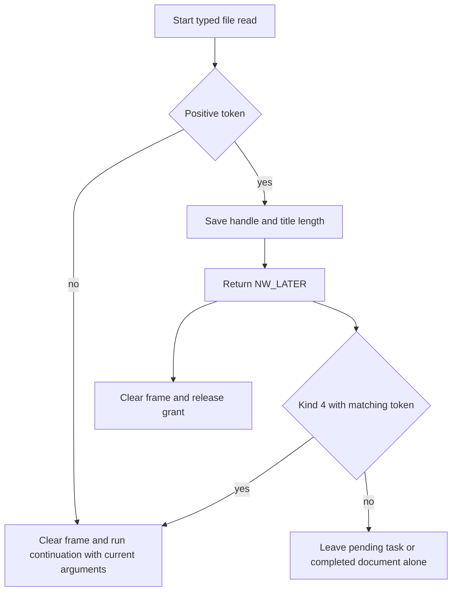

# How PicoCalc Editor resumes a compiled file read

Opening a file leaves Editor waiting while the PicoCalc's filesystem service reads it. The asynchronous operation returns a token. The event that carries the file's contents comes back later with the same token. By then the original native stack frame is gone. The compiler must know which values are still needed and arrange to recover them from persistent Editor state.

This study added one real `await` at the file read. The compiler saved the offered handle and pending title length, with one more word for the kernel token. The 12-byte frame raised the Editor state from 71 to 74 scalar fields. Both variants passed the existing Editor host workflows. The generated variant emits 181 additional RV32 instructions with the same 240,452-byte reactor allocation.

## The original Editor already has a continuation

When Files offers a file, Editor's native handler checks the request, copies the title to a reactor-owned buffer, and starts `typedSdkFileRead(handle)`. The read returns a positive token if the kernel accepted it. Editor's existing code stores the handle, title length and token in `WorldState`. The handler returns `NW_LATER`, allowing the kernel to run the file service. An event of kind 4 carries the token, a success flag and the read data or error. The existing handler checks the token and calls the appropriate continuation.

The typed version makes that boundary visible to the compiler. The file-read task calls the original success and error helpers after the point where it can suspend. Long documents still go through the existing 4,096-unit line-ending normalization and its timer-driven continuation. That policy also retains its existing state fields.

```typescript
async function editorReadTask(event: WorldEvent, state: WorldState,
    output: buffer, hints: buffer, handle: i32): i32 {
    // The real source copies the offered title and computes size here.
    const ok = await typedSdkFileRead(handle);
    if (!ok && !(event.kind === 4)) return editorReadNotStarted(handle, output);
    state.offered = handle;
    state.offeredNameLength = size;
    if (ok) return editorReadSuccess(state, output, hints);
    return editorReadFailure(state, output, hints);
}
```

If startup returns no positive token, the start calls this same remainder with the message event and `ok=false`. A failed read has a kind-4 event with an error payload. The difference matters because the message that asked to open a file has no read error payload to parse. [Actual async typed source](../sources/editor-read-task.typed)

## Work out what must cross the boundary

A local is live across the wait when a later statement can read the value it had before the wait. The rewriter walks backward from the continuation. A reference adds its value to the live set. A definite assignment removes the earlier value and adds references from the right-hand side. Branches contribute both paths, and loops contribute all their repeated uses. The existing typed compiler checks the generated statements after the rewrite.

| Item | After the file wait |
| --- | --- |
| `handle`, `size` | Reload from frame fields |
| File-read token | Compare before consuming the frame |
| Await result `ok` | Take from the settlement event |
| `event`, `state`, `output`, `hints` | Use the arguments supplied for this turn |
| Pre-wait `scratch` and `pending` aliases | End their lifetimes before the wait |

A reference to the original event's scratch buffer would persist across turns if it were saved like an integer. The rewriter rejects borrowed strings and buffers that are live across the wait. The pending title's text lives in a dedicated reactor-owned slot. The source can reacquire that slot and use the saved length, which is a scalar. A focused fixture passed distinct event, output, and hints addresses to the start and resume functions. The initial output kept the value 7 while the resumed output received 111 and the resumed hints received token 101.



The generated frame uses the positive token itself as the occupied flag. The first matching result clears the token before calling the continuation. Cancel also clears it and returns the owned handle to the app for release. The started filesystem operation may still deliver a result. The kernel assigns increasing tokens in a run and rejects settlements for an old world epoch. Tests exercise distinct positive tokens, including an old completion while a newly opened frame is pending.

## Host qualification

The focused Wasm and RV32 tests verified immediate failure, a failed read, success with rebound buffers, duplicate and wrong tokens, cancel followed by a late result, and a new request after cancel. A fixture with a definite write after the wait verifies that the dead old value does not occupy a frame field. A compile-time fixture that reads a borrowed buffer after the cut is rejected on the await line. The ordinary application suite covered Files, Agenda and Editor and includes 13 Editor workflows. The Wasm and RV32 native image fixture tests compare the same app's results to the hand-written behavior, including the 64 KiB preview and search paths. [Host layout and protocol witnesses](../various/host.json) · [Candidate application replay](../various/host-replays-await.json) · [Hand-written application replay](../various/host-replays-manual.json)

| Compiled artifact | Hand-written read | Typed await |
| --- | ---: | ---: |
| Editor state scalar fields | 71 | 74 |
| Read continuation scalar storage | 12 bytes using existing fields | 12 bytes in generated fields |
| RV32 instructions | 16,812 | 16,993 |
| Linked RV32 ELF bytes | 240,452 | 240,452 |
| Linked Wasm bytes | 88,884 | 89,275 |

The same await source also passed all 24 host replays when its world linker was paired with the program's combined scanner and native backend. This composition exercised the real Editor source on both targets. It produced 12,791 native instructions and 89,010 linked Wasm bytes, with the same 12-byte inferred frame. The separately flashed study uses the staged compiler so that the physical comparison isolates await. [Combined host replay](../various/host-replays-combined.json) · [Combined compiler input identities](../various/combined-inputs.json)

The manual comparison includes the same cancellation behavior as the candidate so both can be exercised with the same physical stimulus. The compiler rewriter and reactor are also identical between lanes. This isolates the incremental cost of the generated file-read path. The resulting 74 fields fit the runtime's 80-field capacity and exceed the full Scope G goal of at most 71. Removing the remaining hand-written normalization continuation is outside the measured pilot.

<!-- physical_results -->

## Reproduce one full suspension

Stage the frozen native compiler and the two real Editor source variants through `scripts/01-stage.py`. The raw source in the candidate's bundle contains the await. The world linker runs `scripts/02-typed-async.js` inside the normal P4 QuickJS compiler context, ahead of the standard typed emitter. The host oracle verifies the compiler sources and the unlowered editor source in each firmware. Both boots must return the independently linked ELF hash before the behavior evidence is accepted. [Implementation guide](../design-doc/01-compiling-a-typed-editor-open-into-a-start-and-a-native-continuation.md) · [Investigation diary](../reference/01-editor-await-investigation-diary.md)
