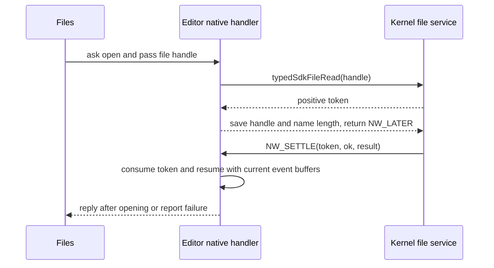

# Compiling a typed Editor Open into a start and a native continuation

A Files open request grants Editor a single file handle. Editor reads that file asynchronously so the native reactor can return to the kernel while the disk operation runs. A later event carries the request's token and either the file contents or an error. Today the typed Editor stores three scalar fields by hand and associates the later event with them in its dispatcher. This study asks whether the compiler can generate the continuation for that real file read while preserving observable Editor behavior.

## Trace the existing wait

The measured control is the staged A5 compiler over the pinned Editor source of the replay-qualified project checkout. Measurements compare the existing read and a narrow generated equivalent. The existing bounded lowering of line endings continues after the file read, including the 4,096-unit normalization slices and their separate timer events.

In `picocalc-os/worlds/editor/editor.typed`, `editorOpen` validates the ask, receives a handle from the event, and copies a title into the reactor-owned pending-name buffer. `typedSdkFileRead(handle)` starts the read. A nonpositive return means startup failed and no event will arrive. For a positive return, the function saves the handle, title length and token as `offered`, `offeredNameLength` and `readToken` in `WorldState`, and returns `NW_LATER`. `typedWorldEvent` later calls `editorReadDone` only for kind 4 and the matching token. The result selects normal document load, creation of a missing empty file, or cleanup and a failure reply. A long document can then reuse the original `readToken` for a normalization timer.

The reactor in `picocalc-os/sdk/typed/world.c` builds the current event record on each call and clears its internal `current` pointer on return. It passes the event and output buffers again at every event delivery. A local holding one of those pointers must not be saved across a wait. A scalar file handle is owned by the waiting operation. A persistent buffer slot holds the pending title text. Reacquiring that slot on a later turn is valid if the application gives only one read task ownership at a time and no competing operation writes that slot.



## Lower one top-level await to ordinary typed code

The experiment adds a compiler-side rewriter for one `async function` with one top-level `const ok = await typedSdkFileRead(handle);` statement. Async parameters supply the regular event, state, output and hints, plus any scalar parameters. Ordinary statements use the existing typed frontend for expression and type checking. Scoped statements may appear around the top-level suspension. The pilot rejects another await, await within a loop or branch, and awaiting other tasks or APIs. The broader Scope G design describes those extensions.

The edited app declares the actual suspended operation in typed source. It reads the title before awaiting and uses its original handling helpers after the await. The start calls the existing `typedSdkFileRead`. A matching settlement calls the generated continuation with the event's `ok` bit. On immediate failure, the start calls that same continuation with `false` and the original message event, which distinguishes a request startup failure from a later negative settlement.

The rewriter scans backward over statements after the wait. Reading a local puts it in the live set. A definite write removes the previous value from that set while its right-hand side adds any locals it reads. A conditional includes both successors and a loop iterates until its live set stabilizes. A local declared before the wait is saved only if its value can be used after the wait. The four ambient parameters `event`, `state`, `output` and `hints` are re-supplied by the current handler. Other live values must be scalar. The experiment expects to save `handle` and `size`, plus the positive token. The vectors that held the offered name and message scratch are used before the wait. A negative fixture deliberately reads one of those local aliases after the wait.

```text
lower(async, worldState):
    parse the declaration and one top-level await
    live = backward live-in of statements after the await
    live.remove(awaitResult)
    save = stable source-order intersection of live and scalar bindings
    reject any saved string, buffer or record
    append token and the saved bindings to WorldState
    emit continuation, start, resume, pending and cancel as ordinary functions

start(ambient, args):
    reject re-entry when token is occupied
    execute prefix and issue read
    if token <= 0: run continuation with ok=false and current message event
    save scalars and publish token
    return NW_LATER

resume(current ambient):
    if event is kind 4 and token matches the pending positive token:
        load and clear frame
        call continuation with live values and current event.ok

cancel(state):
    clear frame, return handle to application cleanup
```

The single wait uses its positive token as the occupied-frame state. There is no separate program counter. Generated resume and cancel clear the token before running continuation or cleanup, so duplicate or stale completions fail the guard. The application releases the narrowed file grant on cancellation. Clearing the frame does not stop in-flight I/O. The already prepared file job owns its path and sends its normal settlement, which must leave the document and outputs alone. One token issuer uses incrementing `K.next_promise` within a kernel run. Filesystem completions also carry a world epoch in the kernel, which discards results for an old world instance. This pilot assumes positive tokens do not repeat within that live epoch. It does not establish behavior at integer exhaustion or under forced same-token reuse in the same epoch.

## Preserve the build path and measure on the board

The ordinary shared world linker receives the async source. A candidate staging patch adds a single `typed/async.js` bundle entry and calls it ahead of the normal compiler in `typed-world.js`. The build does not preprocess the device's source on the host. The P4 QuickJS compiler desugars the input, compiles it with the pinned staged lowerer and produces the ELF that the normal native loader runs. Compare both the raw typed instruction payload and complete ELF hash against an independent host link.

The current kernel only delivers completion events to a world with an async turn open. A second mailbox message normally waits behind that turn. The physical cancellation fixture therefore calls the loaded native handler with a synthetic cancel event while the real Open suspension is pending, before applying the deferred file job. The reference and candidate use the same trigger and cancellation policy. The normal P4 file service still supplies the accepted and late read results. Outside the fixture, a concurrent UI cancel delivery is beyond this pilot. Test the cancel-with-late-real-settlement independently from ordinary success and error through the normal kernel. A probe-created temporary file and invalid UTF-8 fixture give deterministic physical success and failure without touching user data.

| Evidence | Prospective check |
| --- | --- |
| Host layout | Three 32-bit frame words for two saved scalars and the token. Report total state fields and the exact layout. |
| Negative lifetime test | A buffer held and used after the cut fails compilation. New output and hint addresses at resumption receive effects. |
| Pending and stale | Wrong token, duplicate token, canceled token and cancel followed by reopen do not resume the old read. |
| Ordinary application | Every original host Editor replay passes through both targets, including 64 KiB normalization. |
| Physical behavior | Match handles, replies and frame effects between the hand-written reference and generated ELF on success, failure and cancellation. Record which stimuli are probe-injected. |
| Compile resources | Record per-boot time and QuickJS peak bytes with the same source corpus and reactor. Record raw instruction count, module bytes and total state fields. |

The independent Opus review proposed a generation-tagged pool for multiple waits. This study has one Editor frame, reuses the production kernel's token and epoch contract, and measures actual stale and duplicate handling under those assumptions. It reserves no pool and retains no borrowed references. The reference's three scalar fields are reused for downstream normalization. The generated frame occupies new fields in this pilot, so the total state count can exceed the full Scope G target of 71 by those fields while remaining inside the runtime's 80-field cap. Record the count as observed, including a missed broader target.

[Scope G design for broader await support](../../PICOCALC-NATIVE-NEXT--a-smaller-rv32-backend-a-module-cache-safety-checks-and-await-for-typed-picocalc-worlds/design-doc/07-scope-g-await-compiled-to-start-and-resume-state-machines.md)
