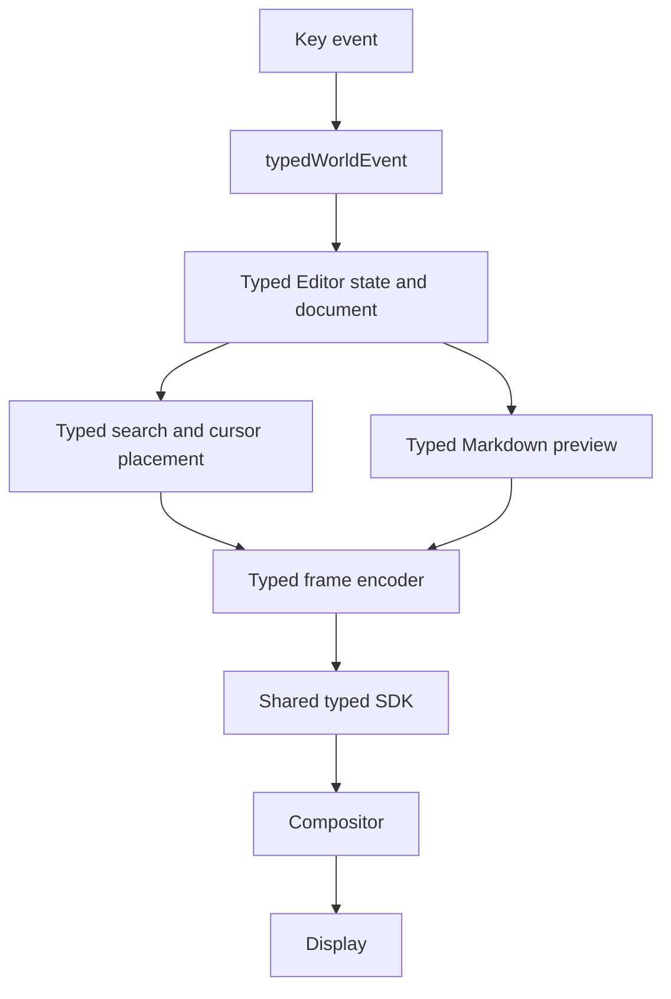
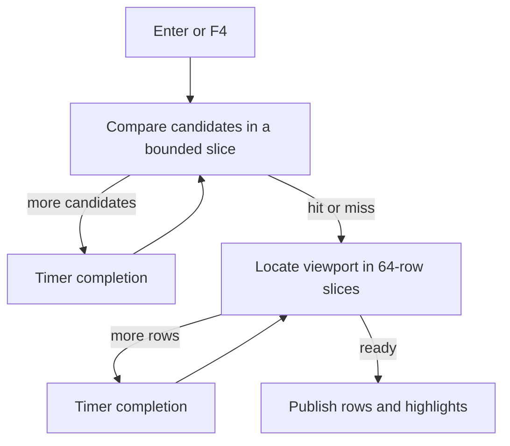
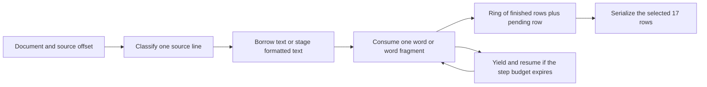
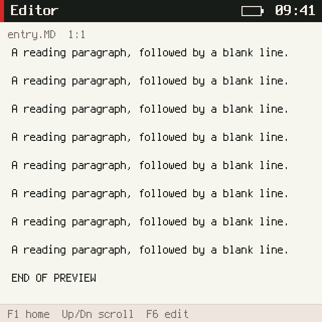

# Bounded search and preview for large PicoCalc documents

## Scope and observed failures

Editor is a typed JavaScript world. The files in `picocalc-os/worlds/editor/source.list` compile together into either a Wasm or an RV32 program. They own the document model, key bindings, file lifecycle, search, Markdown and views. The shared typed SDK connects compiled programs to the operating system. The old `picocalc-os/js/apps/editor.js` supplies reference behavior for parity tests.

The host stress check at commit `208076a` opened a 65,536-byte file on both implementations. The full-size save completed and the saved bytes matched the reference. A search for `zzz` exceeded 200 virtual milliseconds in Wasm. A 21,614-byte preview displayed the beginning but discarded the end at serialization time. The evidence is in `various/editor-large-host-after.json` under the PICOCALC-TYPED-WORLDS ticket. A virtual millisecond is a host test budget unit. Board timings and CPU use require a separate measurement.

## Execution path



The OS delivers keys and operation completions to `typedWorldEvent` in `editor.typed`. State contains scalar fields that survive across events. `typedSdkBuffer(0)` acquires the world’s document allocation. `typedSdkView(buffer, length)` sets its active UTF-16 length and returns a readable string view of that allocation. Code should reacquire the view in each incoming event. Typed Editor uses logical UTF-16 offsets in the document and code-point columns on the display.

`editorShow` in `document-view.typed` publishes a JSON tree with `typedSdkScreen`. The SDK converts UTF-16 into UTF-8 before calling `nw_screen`. The frame buffer holds 16,384 UTF-16 units, and the transport also limits bytes. Six bytes per input unit is a conservative upper bound for JSON escaping a control character, so sizing only by unescaped text length is unsafe.

## Search

F3 accepts printable ASCII, Enter finds the next match at or after the cursor, and F4 starts after the cursor. Search visits the current physical line suffix, subsequent lines, earlier lines, then the current line prefix. Matches never cross newlines. Highlighting checks visible display rows and retains overlapping matches. Preserve both traversal orders and the distinction between physical lines and wrapped rows.

The implementation compares against the reference’s lowercased strings without allocating them. U+212A (Kelvin sign) folds to lowercase k. U+0130 (dotted I) folds to lowercase i followed by combining dot. The latter adds one UTF-16 unit to the folded coordinate, even when the search candidate does not begin with i. The reference converts the folded position to a cursor in original text. `editorSetFound` applies this conversion and preserves surrogate boundaries.

Three generic SDK operations scan counted UTF-16 strings. `typedSdkSeek(text, start, end, a, b, c, d)` finds the first matching unit. `typedSdkLastIndex(text, start, end, unit)` finds the last, and `typedSdkCountUnit(text, start, end, unit)` counts occurrences. Search operations return `end` on a miss. The SDK validates each half-open interval against both the live string length and the allocation. Typed code decides which units and intervals to use.

`editorFindNext` finds the start of the cursor's logical line by seeking backward for a newline. `editorFindStep` tracks the search phase, physical offsets, and folded coordinate across settle events. Candidate seeking checks the first query unit and its equivalent forms. It also returns every dotted I because an unmatched dotted I still changes later folded offsets. `editorFindMatch` verifies a candidate using the original query buffer. The current phase controls whether a match's folded start precedes or follows the original cursor.

```text
start on the cursor line at its folded search boundary
for each candidate and line transition within this slice:
    seek the next candidate or dotted I
    if the candidate is in this phase and the whole query matches:
        set the cursor and start preparing its viewport
        stop searching
    if the line is exhausted:
        advance to the next line or search phase
    otherwise advance the source offset and folded offset
if all four phases are exhausted:
    show the miss
otherwise:
    wait for the timer receipt and resume the same search
```

A slice has 1,024 units of work. Visiting a candidate or advancing a line costs one unit. An eligible comparison contributes the full query length to conservatively bound even a long partial match. Returning `NW_LATER` keeps the active key turn open, so later keys wait while other worlds continue. Only the matching timer token advances the job. A file-write receipt can complete without closing the search turn.

### Find and render a late viewport

Rendering used to walk from the beginning separately to find the cursor, collect the viewport, and add find highlights. A hit near EOF therefore charged several whole-file walks to one segment. The typed view now locates the cursor in batches of 64 wrapped rows. It stores the last 18 entries in a ring and defers the next batch with `typedSdkYield`. Each entry holds the row offset, physical line offset and number, and the incoming Markdown fence state. Two 16-bit units hold each coordinate, including the 65,536 endpoint. The small buffer at SDK slot 9 survives interruption by an unrelated file receipt. Once the cursor is located, both drawing and highlighting recover the selected viewport from the ring.



Closing the document or opening another one records a logical line and column. `editorRemember` counts the preceding newlines and locates the last one with the shared UTF-16 primitives. That path does not need display wrapping. A later open uses the recorded position to reconstruct its viewport.

The replay checks a dense absent query and a hit on line 852 at 65,536 input bytes. It verifies another F4 search and opens a fresh file after the late hit. It also compares the original, Wasm, and RV32 frame traces on the long and short find fixtures. Ordinary cursor movement near EOF still deserves a dedicated fixture because it uses a separate synchronous lookup in `editorPlainKey`.

## Preview

The original typed renderer serialized one item list until it approached the frame limit. The compositor wrapped only the items it received, so scrolling could never recover the omitted content. The current implementation owns Markdown recognition and wrapping in typed Editor. The generic `lines` node accepts `wrapped: true` and draws the provided strings as rows.



`editorPreviewSource` classifies a source line, handles fences, and configures the next input span. Plain paragraphs without inline markers, literal quotations, and fenced code borrow a view directly from the document. Other lines use the existing typed inline formatting, and headings call the shared Unicode uppercase primitive. The 12,288-unit scratch buffer at slot 7 holds up to three output units for each staged input unit. The 4,096-unit formatter input is at slot 5. Slot 5 can be reused by position persistence after formatting completes. Only slot 7 persists a staged span across turns. Opening another file and leaving preview discard the continuation.

The display draws a 304-pixel-wide body and keeps 8 pixels for horizontal insets. At 6 pixels per small-font cell this fits 49 code points. An indented row holds 47. The body is 270 pixels tall. The status row uses 12 pixels, the column gap uses 4, and `lines` holds 4 for vertical padding. The remaining 250 pixels fit 17 rows at 14 pixels per row. The existing editor viewport has separate measurements.

`editorPreviewWord` consumes either one space-delimited word or a full-width piece of a long word. It counts code points, copies UTF-16 units, and never splits a surrogate pair. Separating ordinary physical lines at a space and keeping the pending row produces the same layout as wrapping a joined paragraph. A blank or special block finishes the paragraph before emitting its own rows.

```text
on preview request:
    if requested row precedes the cache, restart at source offset zero
    while the viewport is missing rows and the current slice has work left:
        stage one source line, advance one word, or finish one row
        stop at document end or when the viewport is ready
    if more work remains, schedule a timer and resume on its matching token
    otherwise clamp to the last full viewport and publish only those rows
```

A ring of 36 entries retains the last 35 complete rows and reserves enough room for the pending row. Each entry uses two UTF-16 header units plus up to 98 text units. Backward movement within the ring reads only cached rows. A longer jump restarts parsing in bounded slices. EOF clamps the display to the last visible window, while the requested scroll offset retains the reference app's behavior. At most 17 rows cross the SDK on each update. Even a conservative six bytes of JSON output per UTF-16 unit, plus row metadata, fits inside the screen budget.

A slice advances up to 96 units of scheduling work. Ordinary steps cost one unit, and staging adds a cost based on source length. This limits how often the app returns to the event loop. Inline stripping still runs as one step per formatted source line with the existing 4,096-unit input cap. A large imported line with inline markup can therefore need further work, even though a long plain line can stream directly without that cap.



## Implementation and verification

1. Replay search and position persistence with `scripts/04-check-search-traversal.sh`. The import order in `compiler/typed-world.js` matches the RV32 trampolines in `sdk/typed/rv32-slot.S`.
2. Replay the viewport tests with `scripts/02-check-preview-capacity.sh`. The 21,614-byte document reaches its end and navigates backward while matching the JavaScript reference. A separate fixture streams an 18,047-byte line with supplementary Unicode characters at the 200 virtual ms profile.
3. Follow up with long-line and late-document edit fixtures. The ordinary movement path uses a different lookup from the bounded frame builder. Record backend, hardware image, budget, and input in the diary when qualifying each workflow.

## Code and evidence

| File | Entry point or responsibility |
| --- | --- |
| `picocalc-os/worlds/editor/editor.typed` | `typedWorldEvent`, file normalization and deferred operations |
| `picocalc-os/worlds/editor/find.typed` | `editorFindNext`, `editorFindStep`, `editorFindMarks` |
| `picocalc-os/worlds/editor/view.typed` | `editorLineEnd`, `editorFrameLocate` and JSON quoting |
| `picocalc-os/worlds/editor/preview.typed` | `editorPreviewSource`, `editorPreviewWord`, `editorPreviewFrame`, navigation |
| `picocalc-os/js/system/compositor.js` | `wrapText`, `drawLines`, renderer layout constants |
| `picocalc-os/sdk/typed/world.c` | Counted strings, screen transport and event marshaling |
| `PICOCALC-TYPED-WORLDS/scripts/02-check-editor-world.mjs` | Matched JS, Wasm and RV32 regression fixtures |
| `PICOCALC-TYPED-WORLDS/scripts/05-measure-large-editor.mjs` | Full-size save and search plus preview capacity reproducer |
