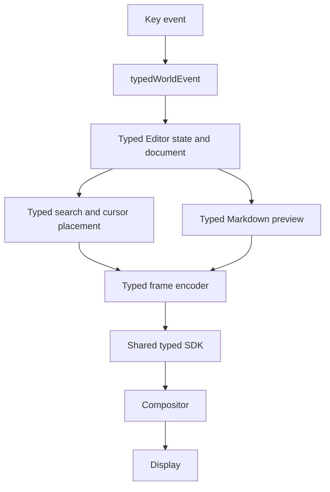

# Bounded search and preview for large PicoCalc documents

## Scope and observed failures

Editor is a typed JavaScript world. The files in `picocalc-os/worlds/editor/source.list` compile together into either a Wasm or an RV32 program. They own the document model, key bindings, file lifecycle, search, Markdown and views. The shared typed SDK connects compiled programs to the operating system. The old `picocalc-os/js/apps/editor.js` supplies reference behavior for parity tests.

The host stress check at commit `208076a` opened a 65,536-byte file on both implementations. The full-size save completed and the saved bytes matched the reference. A search for `zzz` exceeded 200 virtual milliseconds in Wasm. A 21,614-byte preview displayed the beginning but discarded the end at serialization time. The evidence is in `various/editor-large-host-after.json` under the PICOCALC-TYPED-WORLDS ticket. A virtual millisecond is a host test budget unit. Board timings and CPU use require a separate measurement.

## Execution path



The OS delivers keys and operation completions to `typedWorldEvent` in `editor.typed`. State contains scalar fields that survive across events. `typedSdkBuffer(0)` acquires the world’s document allocation. `typedSdkView(buffer, length)` sets its active UTF-16 length and returns a readable string view of that allocation. Code should reacquire the view in each incoming event. Typed Editor uses logical UTF-16 offsets in the document and code-point columns on the display.

`editorShow` in `document-view.typed` publishes a JSON tree with `typedSdkScreen`. The SDK converts UTF-16 into UTF-8 before calling `nw_screen`. The frame buffer holds 16,384 UTF-16 units, and the transport also limits bytes. Six bytes per input unit is a conservative upper bound for JSON escaping a control character, so sizing only by unescaped text length is unsafe.

## Search

F3 accepts printable ASCII, Enter finds the next match at or after the cursor, and F4 starts after the cursor. Search visits the current physical line suffix, subsequent lines, earlier lines, then the current line prefix. Matches never cross newlines. Highlighting checks visible display rows and retains overlapping matches. Preserve both traversal orders and the distinction between physical lines and wrapped rows.

The implementation compares against the reference’s lowercased strings without allocating them. U+212A (Kelvin sign) folds to lowercase k. U+0130 (dotted I) folds to lowercase i followed by combining dot. The latter adds one UTF-16 unit to the folded coordinate, even when the search candidate does not begin with i. The reference converts the folded position to a cursor in original text. `editorSetFound` applies this conversion and preserves surrogate boundaries.

A generic SDK operation `typedSdkSeek(text, start, end, a, b, c, d)` returns the first position in a half-open range that equals one of the four exact UTF-16 units, or `end` on a miss. Repeated unit arguments are allowed. The SDK validates the span against the live view and the allocation. The search policy remains in `find.typed`. Pass the lowercase first query unit, its uppercase equivalent, the Kelvin sign only when the first unit is k, and U+0130. Use a repeated unit when there is no alternate. Newline scanning passes four copies of U+000A. Using one bulk operation per span removes per-unit typed function calls on the common path.

```text
while at < lineEnd:
    candidate = seek(text, at, lineEnd, lowercase, uppercase, alternate, dottedI)
    folded += candidate - at
    if candidate == lineEnd:
        break
    if folded >= minimum and typedMatch(candidate, query):
        return folded
    folded += 1 + (text[candidate] == dottedI)
    at = candidate + 1
return -1
```

This pattern bounds work for stretches with few candidates. A dense candidate set or a long repeated prefix can still consume a full turn. If measured, move the matching loop to a resumable typed job. Each job step consumes a bounded number of candidate comparisons, stores its physical and folded offsets and remaining line ranges, and schedules `typedSdkYield`. With prefix-function matching, retain the matched prefix length and reconsider a unit after following a failure edge. Keep the dotted-I expansion visible to that matcher. Rendering after a match near EOF has a separate cost because `editorLocate`, the viewport, and marks can each walk wrapped rows from the beginning.

## Preview

`preview.typed` translates physical lines into paragraphs, headings, lists, quotations, and fenced code. It currently builds one growing `lines` node. The loop in `editorPreviewFrame` stops admitting lines when the next one could exceed the frame allocation. The compositor then wraps only the items present in the frame, so increasing the scroll offset cannot recover the missing text. Translating more than the visible viewport on every key also makes runtime depend on document length.

The bounded design emits a window of **visual rows**. Keep block recognition and plain text extraction in typed Editor. Wrap according to the compositor’s `wrapText` rules, using visual code-point columns and applying each block’s indent before wrapping. A stream of source lines is insufficient to preserve layout because an ordinary paragraph joins lines with spaces. A stream of words also needs an item-end marker so empty code lines and blank rows can be represented. The compositor draws the supplied rows and handles the app’s existing padding and colors. The world keeps the requested top row and a scan continuation in state.

```text
start preview from document offset zero
while this turn has work budget:
    advance one bounded parsing or wrapping step
    if it completes a visual row:
        advance the visual row number
        retain rows intersecting the requested viewport
        retain a small final viewport for end clamping
    if the desired viewport is complete or the document ends:
        publish only the final window
        stop
yield and continue on the matching completion token
```

Use an initial scan from zero to establish correctness for arbitrary scroll offsets. Retain a forward continuation if measurement shows repeated parsing dominates Page Down. Going backward can restart from zero while keeping other worlds responsive. The first implementation should test spaces, tabs, astral characters, headings with Unicode uppercasing, paragraph continuation, long words, blank lines and fence transitions. Existing `lines` frames can use the same row renderer through a generic compositor option for already wrapped rows. Establish the actual font metrics and visible row count from the 320×320 compositor layout before wiring that option.

## Implementation and verification

1. Add the generic seek API to `sdk/typed/world.c`, `compiler/typed-world.js`, and `sdk/typed/rv32-slot.S` in a single change. The import order must match the RV32 trampolines. Update `find.typed` and `view.typed`, and compare exact frames and captures against the reference across both backends. Verify a full-size absent search in the host harness.
2. Design the viewport output around the generic compositor contract. Keep any parsing and wrapping changes in the typed sources. Use the long preview fixture to verify that downwards scrolling reaches the last paragraph. Assert that moving above and below the bounds displays the same rows as the JavaScript reference.
3. Verify cursor placement late in the document, dense overlapping candidates, and a long repetitive absent query. Measure initial display, each search or preview key event, and longest scheduler slice using a reproducible corpus. Test both backends on the board when connected. Keep scripts in this ticket and record exact artifacts, build flags, and measured times in the diary.

## Code and evidence

| File | Entry point or responsibility |
| --- | --- |
| `picocalc-os/worlds/editor/editor.typed` | `typedWorldEvent`, file normalization and deferred operations |
| `picocalc-os/worlds/editor/find.typed` | `editorFindNext`, `editorFindSpan`, `editorFindMarks` |
| `picocalc-os/worlds/editor/view.typed` | `editorLineEnd`, `editorLocate` and JSON quoting |
| `picocalc-os/worlds/editor/preview.typed` | `editorPreviewLine`, `editorPreviewFrame`, navigation |
| `picocalc-os/js/system/compositor.js` | `wrapText`, `drawLines`, renderer layout constants |
| `picocalc-os/sdk/typed/world.c` | Counted strings, screen transport and event marshaling |
| `PICOCALC-TYPED-WORLDS/scripts/02-check-editor-world.mjs` | Matched JS, Wasm and RV32 regression fixtures |
| `PICOCALC-TYPED-WORLDS/scripts/05-measure-large-editor.mjs` | Full-size save and search plus preview capacity reproducer |
