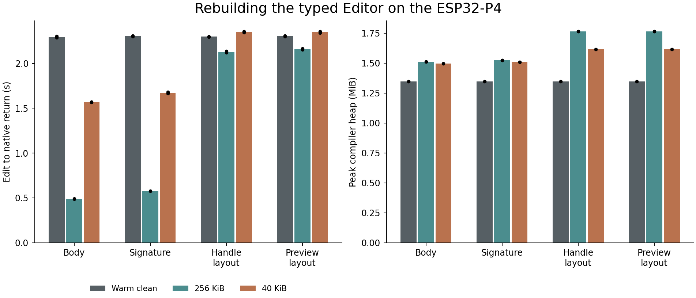

# What it costs to rebuild the typed Editor after a real edit

An Editor build starts with a program of 120 typed functions. Change one integer in the function that computes screen-row offsets and the program will write its preview header in a different place. The programmer wants to submit the new source and see the new behavior. If the old compiler stays alive between edits, the compiler can retain a function's generated machine code. The question is how much work can be reused, and how much time remains in parsing declarations, assembling the module and entering the new program.

## Establish an observable edit

The shipped Editor keeps up to 36 preview rows in a ring. The following two lines summarize a real function and its caller in `picocalc-os/worlds/editor/preview.typed`.

```js
const slot = editorPreviewSlot(state.previewRows);
rows.setCharCodeAt(slot, state.previewUnits);
```

The original helper returns `(row % 36) * 100`. The first edit uses stride 99. We call the existing `editorPreviewFinish(rows, state, kind)` with row 2, five used code units, a column count of seven and kind 4. Before the edit the generated code writes the pair 5 and 4 at indices 200 and 201. After the edit the pair appears at 198 and 199. In either case it advances the row to three and clears the unit and column counters. A function returning the expected integer zero could still have written the wrong cells. This fixture observes the return, the two buffer writes and three state fields.

The next edit adds an integer stride parameter and updates the three callers to pass 99. The repaired revision has the same observable result as its parent. We separately compile the temporarily broken source in which the callers still pass the old arguments. An incremental compiler must report the clean compiler's diagnostic and leave its last valid revision available. The third edit exchanges the first two fields of the real `WorldState` record, `file` and `offered`. These fields are unrelated to the preview helper. To observe the consequences of a stale field layout directly, a fourth edit swaps `previewRows` and `previewUnits`. The complete ELF comparison covers all functions in each case.

## A fragment and its dependencies

The ordinary native compiler checks one function, lowers arithmetic and control flow into 32-bit RISC-V words, and records pending calls. A fragment stores those words with a slice of source text, the signatures the function actually consulted and fingerprints of the records it used. The compiler can reuse it if all of these inputs agree with their current values. It also records whether a name existed where the parser distinguished a record name from another form. A change to the set of names can change how a declaration is interpreted.

The compiler still reads headers in source order to rebuild the namespace. It can jump from a matched function header to the known closing brace when the spelling and dependencies match. The linker computes the final position of every accepted function. A local call that originally targeted a function at offset 200 may now have to reach offset 208. Symbolic calls retain the target name and relocation position until all offsets are known, including calls from reused functions.

```text
previous fragment
  source and type fingerprints ── match ──→ reuse code words ─┐
                            └ mismatch ─→ parse + lower ──────┤
                                                             ↓
                                               assign every function offset
                                               patch calls and public entries
                                               return complete reactor ELF
```

In the experiment a fragment is admitted in declaration order when the remaining native-word budget and the fragment-count ceiling permit it. An omitted fragment has to be rebuilt when it is needed again. The source predicate is intentionally conservative. Exchanging unused fields invalidates all functions which consulted that record's full fingerprint. Refining dependency tracking to individual offsets could reduce work, at the cost of tracking more facts. A previous host audit of the same original policy found that 70 of the 77 functions rebuilt for the file-handle layout change still had identical linked instructions. [Original examination](../../PICOCALC-LAB-REVIEW--independent-examination-of-the-picocalc-compiler-lab/scripts/05-rebuild.mjs)

## Prove that the budget binds

| Edited revision | Rebuilt / reused at 256 KiB | Rebuilt / reused at 40 KiB |
| --- | ---: | ---: |
| Stride in one helper | 1 / 119 | 49 / 71 |
| Helper signature and three callers | 4 / 116 | 52 / 68 |
| File-handle record layout | 77 / 43 | 90 / 30 |
| Preview row record layout | 77 / 43 | 90 / 30 |

The generous limit fits all submitted fragments. Its retained code after the first edit is 87,544 bytes, about 85.5 KiB. At 40 KiB, 72 fragments totaling 40,892 bytes fit. The session briefly needs the code for the other functions to assemble the current ELF. A separate zero-capacity check rebuilt all 120 functions after every edit. An independent examiner inserted 8,192 source spaces and reproduced the same output and retained native bytes while retained function spellings increased from 34,431 to 42,623 UTF-16 units. This directly distinguishes the native payload bound from total JavaScript memory. The allocator measures the latter on the board.

## Trace the measured interval

Both lanes load the compiler in advance and build the parent source once. In the clean lane this warms the compiler but keeps no native fragments. In the incremental lane it seeds the bounded fragment store. Each measurement starts immediately before calling the compiler with the edited source. Source concatenation, seeding and collection occur before that timestamp. The session returns a complete ELF. The harness passes the ELF to `esp_elf_relocate`, maps an instruction address from the executable segment, prepares the preview caller arguments, executes it and records the return timestamp. Hashing and serial output occur afterward. The interval therefore includes output wrapping, executable relocation and the call setup as well as the compile. It excludes front-panel interaction, preparing source text and painting a new frame.

```text
warm clean session    | compile all 120 | link | load ELF | call → return |
warm fragment session | validate and lower misses | link | load | call → return |
                      ^ same edited-source handoff                         ^ endpoint
```

The host builds each accepted revision in a separate clean compiler realm. It compares every byte and calculates clean field indices and the internal function offset. The default Editor runtime exposes only metadata and event delivery through public stubs, so test firmware enters the existing preview helper through its independently verified internal address. The experiment leaves the actual native function text unchanged. Five emulated RV32 executions checked the original and four edited native images. A separate negative control applied the final field offsets to its predecessor's code and observed a trap, demonstrating that the final fixture can tell those two revisions apart.

## What the physical board measured

Each cell gives the median for boot one and boot two. The reference is a warmed full compiler that receives the same edited source. There are three counterbalanced measurements per cell per boot. All 72 device executions returned the expected result and wrote the expected Editor state. Each produced the same complete 240,452-byte ELF as its clean host oracle.

| Edit | Warm clean (ms) | 256 KiB cap (ms) | Paired change (%) | 40 KiB cap (ms) | Paired change (%) |
| --- | ---: | ---: | ---: | ---: | ---: |
| Body | 2,302.7 / 2,288.3 | 487.3 / 489.9 | -78.8 / -78.6 | 1,567.6 / 1,571.2 | -32.0 / -31.9 |
| Signature and callers | 2,309.7 / 2,301.0 | 576.1 / 576.0 | -75.1 / -74.9 | 1,680.3 / 1,663.9 | -27.3 / -27.7 |
| File handle layout | 2,301.2 / 2,295.0 | 2,135.4 / 2,122.3 | -7.2 / -7.5 | 2,355.5 / 2,345.9 | 2.5 / 2.4 |
| Preview row layout | 2,306.6 / 2,299.5 | 2,166.2 / 2,151.6 | -5.8 / -6.3 | 2,356.1 / 2,339.1 | 2.3 / 1.7 |



The dots show the two boot medians. The labels 256 KiB and 40 KiB specify how much native instruction payload the session may keep between edits. The peak heap includes the other allocations needed while compiling.

| Edit | Warm clean peak (KiB) | 256 KiB peak (KiB) | 40 KiB peak (KiB) |
| --- | ---: | ---: | ---: |
| Body | 1,379.5 / 1,379.5 | 1,547.5 / 1,547.4 | 1,530.7 / 1,530.7 |
| Signature and callers | 1,380.4 / 1,380.4 | 1,560.0 / 1,560.0 | 1,544.3 / 1,544.3 |
| File handle layout | 1,380.4 / 1,380.5 | 1,806.3 / 1,806.3 | 1,653.6 / 1,653.6 |
| Preview row layout | 1,380.4 / 1,380.4 | 1,806.3 / 1,806.3 | 1,653.6 / 1,653.6 |

Before the body edit, live QuickJS memory was about 721 KiB for the warm clean session, 1,190 KiB at the generous cap and 1,006 KiB at the tighter cap. The generous cap bought roughly 1.8 seconds on a one-function change. Both field-order changes still forced it to compile 77 of the 120 functions. The tighter cap had already discarded additional valid fragments and needed 90 compilations in each layout case. Those two cases took longer than the warm full build on both boots.

The observed delay depends on how many valid fragments survive the edit and how many fit before the edit. Holding a full set can make a body or signature edit interactive while exposing the disproportionate cost of conservative record dependencies. The next focused comparison would replace the whole-record fingerprint with a fingerprint of the fields actually used by each function. For that experiment the same four edits, stale-layout witness, complete ELF equality and physical return clock provide a direct control.


## Reproduce the experiment

1. `scripts/01-stage.py WORK` creates the pinned compiler and editing session. `scripts/03-oracle.mjs WORK SOURCE REACTOR` builds the host reference and the C header recording each clean entry and field offset.
2. `scripts/01-stage.py WORK --board` prepares a fresh firmware tree. `bash scripts/05-build.sh WORK IDF_ROOT` compiles the ESP32-P4 image. Keep the matching 5.4.2 toolchain and SDK configuration from the ticket.
3. `scripts/08-replay-native.mjs WORK GCC EMULATOR` verifies the real store and state effects on the host. `scripts/06-physical.py WORK BACKUP --port PORT --esptool PATH` checks the final bundled inputs, takes the shared board lock and performs three rotated pairs of comparisons per edit per boot.
4. `scripts/07-summarize.py RECEIPT OUT --figure FIGURE` reconstructs paired changes from the raw physical rows. Each boot is a run on the same chip.

The [intern design](../design-doc/01-from-an-editor-source-edit-to-a-native-return-with-bounded-fragments.md) covers code paths and decision criteria. The [investigation diary](../reference/01-incremental-editor-experiment-diary.md) records failed fixtures, toolchain details and attribution.
